# 거울 던전 E.G.O 기프트

출처: 나무위키 · 총 145개 · `gifts.json`에서 자동 생성 (`python3 gifts/make_md.py`)

화상 18 · 출혈 20 · 진동 20 · 파열 18 · 침잠 20 · 호흡 18 · 충전 18 · 참격 11 · 관통 2

## 화상 (18)

### Ⅰ 융해된 파라핀

- 가격: 150 · 획득: 통상 · 강화: 가능
- 연관: 환상체: 살갗 예언자 · 첫 등장: 폭풍의 거울 (거울 던전 4)

**기본**

- 화상 위력, 화상 횟수, 특수 화상을 부여하는 스킬로 합 승리 시, (남은 코인 수/2)만큼 대상 적에게 화상 위력 부여

**+**

- 화상 위력, 화상 횟수, 특수 화상을 부여하는 스킬로 합 승리 시, (남은 코인 수/2+1)만큼 대상 적에게 화상 위력 부여

**++**

- 화상 위력, 화상 횟수, 특수 화상을 부여하는 스킬로 합 승리 시, (남은 코인 수+1)만큼 대상 적에게 화상 위력 부여

### Ⅰ 재에서 재로

- 가격: 148 · 획득: 통상 · 강화: 가능
- 연관: 환상체: 밀려오는 재 · 첫 등장: 시작의 거울 (거울 던전 1)

**기본**

- 전투 시작 시 모든 적(환상체일 경우, 모든 부위)이 화상에 걸린 경우, 적 전체(환상체일 경우, 모든 부위)에게 화상 위력 2 부여

**+**

- 전투 시작 시 화상에 걸린 적 전체(환상체일 경우, 모든 부위)에게 화상 위력 2 부여

**++**

- 전투 시작 시 적 전체(환상체일 경우, 모든 부위)에게 화상 위력 3 부여

### Ⅰ 타오르는 지성

- 가격: 141 · 획득: 통상 · 강화: 가능
- 연관: 불명 · 첫 등장: 호수의 거울 (거울 던전 3)

**기본**

- 화상 효과로 적을 처치하였다면 다음 턴 시작 시, 화상 위력을 부여하는 스킬을 보유한 아군 인격 둘이 피해량 증가 1 얻음

**+**

- 화상 효과로 적을 처치하였다면 다음 턴 시작 시, 화상 위력을 부여하는 스킬을 보유한 아군 인격 둘이 피해량 증가 2 얻음

**++**

- 화상 효과로 적을 처치하였다면 다음 턴 시작 시, 화상 위력을 부여하는 스킬을 보유한 아군 인격 셋이 피해량 증가 2 얻음.

### Ⅰ 편광

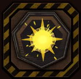

- 가격: 158 · 획득: 통상 · 강화: 가능
- 연관: 불명 · 첫 등장: 폭풍의 거울 (거울 던전 4)

**기본**

- 아군이 대상보다 정신력이 30 이상 높을 경우, 화상 위력 또는 화상 횟수 또는 특수 화상을 부여하는 스킬로 입히는 피해량 +7.5%

**+**

- 아군이 대상보다 정신력이 25 이상 높을 경우, 화상 위력 또는 화상 횟수 또는 특수 화상을 부여하는 스킬로 입히는 피해량 +12.5%

**++**

- 아군이 대상보다 정신력이 15 이상 높을 경우, 화상 위력 또는 화상 횟수 또는 특수 화상을 부여하는 스킬로 입히는 피해량 +20%

### Ⅱ 만년 동안 끓는 솥

- 가격: 208 · 획득: 통상 · 강화: 불가
- 연관: 환상체: 바질리스프크 · 첫 등장: 꿈결의 거울 (거울 던전 5)

**효과**

- 화상 위력, 화상 횟수 또는 특수 화상을 부여하는 스킬의 합 위력 +1

### Ⅱ 만년 화롯불

- 가격: 201 · 획득: 한정 · 하드 난이도 한정 · 강화: 불가
- 연관: 환상체: 바질리스프크 · 첫 등장: 꿈결의 거울 (거울 던전 5)

**효과**

- 턴 종료 시, 화상 횟수를 3 이상 보유한 적이 화상을 1회 더 발동함 (화상 횟수 1 감소)

### Ⅱ 울화통

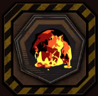

- 가격: 199 · 획득: 통상 · 강화: 가능
- 연관: 환상체: 놋쇠 황소 · 첫 등장: 폭풍의 거울 (거울 던전 4)

**기본**

- 화상 또는 특수 화상에 걸린 적에게 스킬 효과로 화상 위력이나 횟수 또는 특수 화상을 부여할 경우, 다음 턴에 신속 1 얻음. (스킬 당 1회, 턴당 최대 2회)
- 신속을 이미 보유한 경우, 효과가 강화되어 신속 1, 공격 레벨 증가 2 얻음

**+**

- 화상 또는 특수 화상에 걸린 적에게 스킬 효과로 화상 위력이나 횟수 또는 특수 화상을 부여할 경우, 다음 턴에 신속 1 얻음. (스킬 당 1회, 턴당 최대 3회)
- 신속을 이미 보유한 경우, 효과가 강화되어 신속 2, 공격 레벨 증가 2 얻음

**++**

- 화상 또는 특수 화상에 걸린 적에게 스킬 효과로 화상 위력이나 횟수 또는 특수 화상을 부여할 경우, 다음 턴에 신속 1 얻음. (스킬 당 1회, 턴당 최대 3회)
- 신속을 이미 보유한 경우, 효과가 강화되어 신속 2, 공격 레벨 증가 2, 피해량 증가 2 얻음

### Ⅱ 일점타격논리회로

- 가격: 204 · 획득: 통상 · 강화: 불가
- 연관: 환상체: kqe-1j-23 · 첫 등장: 시작의 거울 (거울 던전 1)

**효과**

- 화상 위력 또는 특수 화상을 부여하는 스킬 또는 질투 속성 스킬을 사용하여 적에게 적중 시, 대상에게 해당 스킬의 코인 수 절반만큼 추가로 화상 위력 부여. (소수는 올림하여 계산)
- - [중첩 발동 불가] 입주 신고 히스클리프 E.G.O 패시브 「회로 연결」 발동 시, 이 효과가 발동하지 않음.
- 적중시 대상의 화상 위력이 99면, 주민등록 마이크로칩 1 부여 (적당 1회, 턴당 3회)

### Ⅱ 작열우모

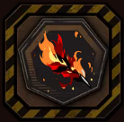

- 가격: 203 · 획득: 통상 · 강화: 가능
- 연관: 환상체: 살갗 예언자 · 첫 등장: 시작의 거울 (거울 던전 1)

**기본**

- 화상 위력 또는 특수 화상을 부여하는 스킬 또는 색욕 속성의 스킬을 사용하여 대상에게 적중 시, 대상에게 화상 위력 3 부여.
- 턴 시작 시 화상 20 이상을 보유한 적의 경우, 화상이 2배로 증가

**+**

- 화상 위력 또는 특수 화상을 부여하는 스킬 또는 색욕 속성의 스킬을 사용하여 대상에게 적중 시, 대상에게 화상 위력 4 부여.
- 턴 시작 시 화상 20 이상을 보유한 적의 경우, 화상이 2배로 증가

**++**

- 화상 위력 또는 특수 화상을 부여하는 스킬 또는 색욕 속성의 스킬을 사용하여 대상에게 적중 시, 대상에게 화상 위력 4 부여.
- 턴 시작 시 화상 20 이상을 보유한 적의 경우, 화상이 2.5배로 증가

### Ⅱ 지옥나비의 꿈

- 가격: 198 · 획득: 통상 · 강화: 가능
- 연관: 환상체: 홍염나방 · 첫 등장: 시작의 거울 (거울 던전 1)

**기본**

- 화상 또는 특수 화상에 걸린 적에게 스킬 효과로 화상 위력 또는 특수 화상을 부여할 경우, 모든 적에게 화상 위력 3 무작위로 나누어 부여.
- 분노 완전 공명을 발동하였다면 전투 시작 시, 모든 적에게 화상 위력 5 무작위로 나누어 부여

**+**

- 화상 또는 특수 화상에 걸린 적에게 스킬 효과로 화상 위력 또는 특수 화상을 부여할 경우, 모든 적에게 화상 위력 4 무작위로 나누어 부여.
- 분노 완전 공명을 발동하였다면 전투 시작 시, 모든 적에게 화상 위력 6 무작위로 나누어 부여

**++**

- 화상 또는 특수 화상에 걸린 적에게 스킬 효과로 화상 위력 또는 특수 화상을 부여할 경우, 모든 적에게 화상 위력 5 무작위로 나누어 부여.
- 분노 공명을 발동하였다면 전투 시작 시, 모든 적에게 화상 위력 8 무작위로 나누어 부여

### Ⅲ 그을린 원반

- 가격: 248 · 획득: 통상 · 강화: 불가
- 연관: 불명 · 첫 등장: 거울의 거울 (거울 던전 2)

**효과**

- 화상 상태인 적이 사망하였을 경우(환상체일 경우, 본체 사망 시), 남은 화상 위력 수치의 절반만큼을 다음 턴 시작 시 화상 위력 수치가 제일 적은 적 중 하나에게 부여.
- 턴 시작 시 화상 상태인 적에게 이번 턴 동안 공격 레벨 감소 4 부여

### Ⅲ 먼지에서 먼지로

- 가격: 231 · 획득: 통상 · 강화: 가능
- 연관: 불명 · 첫 등장: 거울의 거울 (거울 던전 2)

**기본**

- 웨이브 첫 턴 시작 시, 모든 적(환상체일 경우, 무작위 부위 하나)에게 화상 위력 5, 화상 횟수 3 부여.
- 나태 완전 공명을 발동하였다면 전투 시작 시, 모든 적(환상체일 경우, 무작위 부위 하나)에게 화상 위력 3, 화상 횟수 2 부여

**+**

- 웨이브 첫 턴 시작 시, 모든 적(환상체일 경우, 무작위 부위 하나)에게 화상 위력 6, 화상 횟수 3 부여.
- 나태 완전 공명을 발동하였다면 전투 시작 시, 모든 적(환상체일 경우, 무작위 부위 하나)에게 화상 위력 4, 화상 횟수 2 부여

**++**

- 웨이브 첫 턴 시작 시, 모든 적(환상체일 경우, 무작위 부위 하나)에게 화상 위력 8, 화상 횟수 3 부여.
- 나태 공명을 발동하였다면 전투 시작 시, 모든 적(환상체일 경우, 무작위 부위 하나)에게 화상 위력 4, 화상 횟수 3 부여

### Ⅲ 불빛꽃

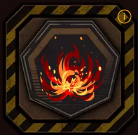

- 가격: 246 · 획득: 통상 · 강화: 불가
- 연관: 환상체: 홍염나방 · 첫 등장: 폭풍의 거울 (거울 던전 4)

**효과**

- 분노 공명이 3 이상이면 화상 위력, 횟수 또는 특수 화상을 부여하는 스킬의 합 위력 +1
- - 분노 완전 공명 3 이상이거나 분노 공명이 6 이상이면, 대신 합 위력 +2
- [편성 1번, 2번 인격 전용 효과]
- 아군이 적을 공격할 때 대상의 남은 체력이 최대 체력의 (보유한 화상 위력)% 이하일 경우 (환상체일 경우, 본체 체력으로 계산), 화상 위력 또는 화상 횟수 또는 특수 화상을 부여하는 공격 스킬로 입히는 피해량 +50%

### Ⅲ 요리 비법 전서

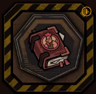

- 가격: 260 (구매불가) · 획득: 합성 · 강화: 불가
- 조합식: 만년 동안 끓는 솥 + 융해된 파라핀
- 연관: 캐릭터: 봉이 아빠 · 첫 등장: 꿈결의 거울 (거울 던전 5)

**효과**

- 턴 시작 시, 화상 위력, 화상 횟수 또는 특수 화상을 부여하는 공격 스킬을 보유한 인격이 5인 이상이면, 이번 전투 동안 발동 (E.G.O 스킬 제외. 대기 인원 제외)
- 화상 위력, 화상 횟수 또는 특수 화상을 부여하는 스킬의 최종 위력 +1
- 화상 위력, 화상 횟수 또는 특수 화상을 부여하는 스킬로 합 승리 시, (남은 코인 수/2+1)만큼 대상 적에게 화상 위력을 부여

### Ⅳ 불꽃의 편린

- 가격: 379 · 획득: 통상 · 강화: 가능
- 연관: 불명 · 첫 등장: 거울의 거울 (거울 던전 2)

**기본**

- 턴 종료 시, 화상 상태인 적에게 대상이 보유한 화상 횟수의 절반만큼을 소모하여 (화상 위력 × 소모한 화상 횟수)만큼 추가 분노 피해를 입힘. (화상 횟수 최대 5 소모)
- 불꽃의 편린 효과로 소모한 화상 횟수만큼, 다음 턴 동안 대상의 방어 레벨 감소 (최대 3)

**+**

- 턴 종료 시, 화상 상태인 적에게 대상이 보유한 화상 횟수의 절반만큼을 소모하여 (화상 위력 × 소모한 화상 횟수)만큼 추가 분노 피해를 입힘. (화상 횟수 최대 7 소모)
- 불꽃의 편린 효과로 소모한 화상 횟수만큼, 다음 턴 동안 대상의 방어 레벨 감소 (최대 5)

**++**

- 턴 종료 시, 화상 상태인 적에게 대상이 보유한 화상 횟수의 절반만큼을 소모하여 (화상 위력 × 소모한 화상 횟수)만큼 추가 분노 피해를 입힘. (화상 횟수 최대 10 소모)
- 불꽃의 편린 효과로 소모한 화상 횟수만큼, 다음 턴 동안 대상의 방어 레벨 감소 (최대 8)

### Ⅳ 업화 조각

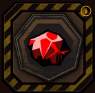

- 가격: 400 · 획득: 통상 · 강화: 불가
- 연관: 불명 · 첫 등장: 폭풍의 거울 (거울 던전 4)

**효과**

- 화상 위력, 화상 횟수 또는 특수 화상을 부여하는 E.G.O 스킬 사용시 발동.
- 소모하는 (분노 E.G.O 자원 +나머지 E.G.O 자원의 합/3)만큼 최종 위력이 증가, 피해량 +50%
- 분노 속성 E.G.O 스킬의 경우, 효과가 강화되어 공격 시작 전에 화상 횟수를 추가로 부여(ZAYIN의 경우 2, 등급이 오를수록 +1)하고 피해량 +(공격 가중치/공격 대상 수×20)%

### Ⅳ 진혼

- 가격: 421 (구매불가) · 획득: 합성 · 강화: 불가
- 조합식: 재에서 재로 + 먼지에서 먼지로 + 요리 비법 전서
- 연관: 불명 · 첫 등장: 호수의 거울 (거울 던전 3)

**효과**

- 턴 시작 시, 화상 위력, 화상 횟수 또는 특수 화상을 부여하는 공격 스킬을 보유한 인격이 5인 이상이면, 이번 전투 동안 발동 (E.G.O 스킬 제외. 대기 인원 제외)
- 턴 시작 시, 모든 적(환상체일 경우, 모든 부위)에게 화상 횟수 6을 부여하고 화상 위력 15를 무작위로 나누어 부여. (웨이브 당 최대 1회)
- 화상 위력, 화상 횟수 또는 특수 화상을 부여하는 더하기 코인 스킬의 최종 위력 +1, 코인 위력 +1, 화상 위력 부여 값 +1, 화상 횟수 부여 값 +1.
- - 빼기 코인 스킬일 경우, 코인 위력 대신 기본 위력 +(4/코인 수) (최소 1, 소수점 버림)
- 화상 위력, 화상 횟수 또는 특수 화상을 부여하는 스킬로 합 승리 시, (남은 코인 수 + 1)만큼 대상 적에게 화상 위력을 부여

### Ⅳ 훔쳐온 불꽃

- 가격: 404 (구매불가) · 획득: 합성 · 하드 난이도 한정 · 강화: 불가
- 조합식: 타오르는 지성 + 그을린 원반 + 만년 화롯불
- 연관: 불명 · 첫 등장: 꿈결의 거울 (거울 던전 5)

**효과**

- 턴 시작 시, 화상 위력, 화상 횟수 또는 특수 화상을 부여하는 공격 스킬을 보유한 인격이 5인 이상이면, 이번 전투 동안 발동 (E.G.O 스킬 제외. 대기 인원 제외)
- 스킬(E.G.O 스킬 포함) 적중 시 대상의 화상 횟수가 3 이상이면, 대상의 화상을 1회 발동함. (화상 횟수 1 감소, 스킬당 1회 발동)
- 턴 종료 시, 화상 횟수를 3 이상 보유한 적이 화상을 1회 더 발동함. (화상 횟수 1 감소)
- 화상 상태인 적이 사망하였을 경우(환상체일 경우, 본체 사망 시), 남은 화상 위력 수치만큼을 다음 턴 시작 시 화상 위력 수치가 제일 적은 적 중 하나에게 부여.
- 턴 시작 시 화상 상태인 적에게 이번 턴 동안 공격 레벨 감소 4 부여.
- 화상을 보유한 적이 사망하였을 경우, 다음 턴 시작 시, 화상 부여 스킬을 보유한 아군 (사망한 적의 화상 위력/15)명이 피해량 증가 2 얻음 (턴 당 1회 발동)

## 출혈 (20)

### Ⅰ 녹슨 입마개

- 가격: 164 · 획득: 통상 · 강화: 가능
- 연관: 불명 · 첫 등장: 호수의 거울 (거울 던전 3)

**기본**

- 스킬을 사용하여 적에게 적중 시 12 이상의 체력 피해를 입혔다면, 대상에게 출혈 위력 2 부여.
- 참격 스킬을 사용할 경우, 효과가 강화되어 출혈 4 부여.

**+**

- 스킬을 사용하여 적에게 적중 시 12 이상의 체력 피해를 입혔다면, 대상에게 출혈 위력 3 부여.
- 참격 스킬을 사용할 경우, 효과가 강화되어 출혈 위력 5 부여.

**++**

- 스킬을 사용하여 적에게 적중 시 1 이상의 체력 피해를 입혔다면, 대상에게 출혈 위력 3 부여.
- 참격 스킬을 사용할 경우, 효과가 강화되어 출혈 위력 5, 출혈 횟수 1 부여.

### Ⅰ 늘어붙은 쇠말뚝

- 가격: 147 · 획득: 통상 · 강화: 불가
- 연관: 환상체: 아파하는 테디 · 첫 등장: 시작의 거울 (거울 던전 1)

**효과**

- 단일 코인 스킬을 사용하여 적에게 적중 시, 대상에게 출혈 위력 1 부여하고 다음 턴까지 방어 레벨 감소 2 부여.
- 대상이 출혈 상태일 경우, 효과가 강화되어 출혈 위력 3 부여.

### Ⅰ 덧붙인 반창고

- 가격: 150 · 획득: 통상 · 강화: 가능
- 연관: 환상체: 아파하는 테디 · 첫 등장: 꿈결의 거울 (거울 던전 5)

**기본**

- 턴 종료 시, 출혈을 보유한 아군 중 가장 체력이 적은 인격이 자신의 최대 체력의 5%만큼 체력을 회복.

**+**

- 턴 종료 시, 출혈을 보유한 아군 중 가장 체력이 적은 인격 2명이 자신의 최대 체력의 5%만큼 체력을 회복.

### Ⅰ 억류된 찬송

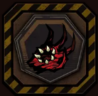

- 가격: 149 · 획득: 통상 · 강화: 가능
- 연관: 불명 · 첫 등장: 폭풍의 거울 (거울 던전 4)

**기본**

- 전투 시작 시 모든 적(환상체의 경우, 모든 부위)이 출혈에 걸린 경우, 다음 턴에 모든 아군이 신속 1 얻음.

**+**

- 전투 시작 시 모든 적(환상체의 경우, 모든 부위)이 출혈에 걸린 경우, 다음 턴에 모든 아군이 신속 1, 피해량 증가 1 얻음.

**++**

- 전투 시작 시 모든 적(환상체의 경우, 모든 부위)이 출혈에 걸린 경우, 다음 턴에 모든 아군이 신속 2, 피해량 증가 1, 공격 레벨 증가 2 얻음.

### Ⅰ 옭아맨 타래

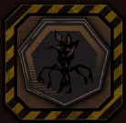

- 가격: 159 · 획득: 통상 · 강화: 가능
- 연관: 환상체: 머금은 목화 · 첫 등장: 폭풍의 거울 (거울 던전 4)

**기본**

- 속도가 제일 빠른 아군이 출혈 위력, 출혈 횟수 또는 특수 출혈 부여하는 스킬을 사용하여 적에게 피해를 입힐 경우, 피해량 +12.5%

**+**

- 속도가 제일 빠른 아군 둘이 출혈 위력, 출혈 횟수 또는 특수 출혈 부여하는 스킬을 사용하여 적에게 피해를 입힐 경우, 피해량 +15%

**++**

- 속도가 제일 빠른 아군 셋이 출혈 위력, 출혈 횟수 또는 특수 출혈 부여하는 스킬을 사용하여 적에게 피해를 입힐 경우, 피해량 +20%

### Ⅱ 경외심

- 가격: 207 · 획득: 통상 · 강화: 가능
- 연관: 환상체: 경멸의 나선 · 첫 등장: 폭풍의 거울 (거울 던전 4)

**기본**

- [편성 1번, 2번 인격 전용 효과]
- 출혈 위력, 출혈 횟수 또는 특수 출혈을 부여하는 스킬 사용 시, 메인 공격 대상의 출혈 횟수가 7 이상이면 피해량 +10%

**+**

- [편성 1번, 2번, 3번 인격 전용 효과]
- 출혈 위력, 출혈 횟수 또는 특수 출혈을 부여하는 스킬 사용 시, 메인 공격 대상의 출혈 횟수가 5 이상이면 피해량 +15%

**++**

- [편성 1번, 2번, 3번 인격 전용 효과]
- 출혈 위력, 출혈 횟수 또는 특수 출혈을 부여하는 스킬 사용 시, 메인 공격 대상의 출혈 횟수가 3 이상이면 피해량 +20%

### Ⅱ 밀라르카

- 가격: 204 · 획득: 통상 · 강화: 불가
- 연관: 환상체: 사백송이의 장미 · 첫 등장: 꿈결의 거울 (거울 던전 5)

**효과**

- 출혈 위력, 출혈 횟수 또는 특수 출혈을 부여하는 스킬의 합 위력 +1.

### Ⅱ 상처붙이

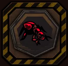

- 가격: 202 · 획득: 통상 · 강화: 가능
- 연관: 환상체: 귀곡관 · 첫 등장: 시작의 거울 (거울 던전 1)

**기본**

- 출혈 위력 또는 특수 출혈을 부여하는 스킬을 사용하여 적에게 적중 시, 대상에게 출혈 위력 4 부여.

**+**

- 출혈 위력 또는 특수 출혈을 부여하는 스킬 또는 분노 속성의 스킬을 사용하여 적에게 적중 시, 대상에게 출혈 위력 5 부여.

**++**

- 출혈 위력 또는 특수 출혈을 부여하는 스킬 또는 분노 속성의 스킬을 사용하여 적에게 적중 시, 대상에게 출혈 위력 5, 출혈 횟수 1 부여.

### Ⅱ 작고 나쁠 인형

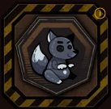

- 가격: 191 · 획득: 통상 · 강화: 불가
- 연관: 불명 · 첫 등장: 시작의 거울 (거울 던전 1)

**효과**

- 전투 시작 단계에서 출혈에 걸린 적에게 가하는 피해량 +10%
- 전투 시작 단계에서 출혈에 걸린 적에게 대상에게 받는 피해량 -20%
- 오만 속성 공격 스킬을 보유한 아군의 경우, 효과가 강화되어 출혈에 걸린 적에게 가하는 피해량 +20%
- 오만 속성 공격 스킬을 보유한 아군의 경우, 효과가 강화되어 출혈에 걸린 적에게 받는 피해량 -30%

### Ⅱ 흰 목화

- 가격: 201 · 획득: 통상 · 강화: 가능
- 연관: 환상체: 머금은 목화 · 첫 등장: 시작의 거울 (거울 던전 1)

**기본**

- 턴 시작 시 흐트러짐 상태인 적들이 있을 경우, 대상은 흐트러짐 상태에서 풀려나는 대신 (8 + 흐트러짐 단계 × 4)만큼 출혈 위력을 얻고 그 수치의 절반만큼 이번 턴과 다음 턴 동안 대상에게 공격 레벨 감소 부여 (동일한 적에게는 전투 당 1회 발동하며, 흐트러짐 상태에서 풀려나지 않는 특정 적에게는 발동하지 않음)

**+**

- 턴 시작 시 흐트러짐 상태인 적들이 있을 경우, 대상은 흐트러짐 상태에서 풀려나는 대신 (10 + 흐트러짐 단계 × 5)만큼 출혈 위력을 얻고 그 수치만큼 이번 턴과 다음 턴 동안 대상에게 공격 레벨 감소 부여 (동일한 적에게는 전투 당 1회 발동하며, 흐트러짐 상태에서 풀려나지 않는 특정 적에게는 발동하지 않음)

**++**

- 턴 시작 시 흐트러짐 상태인 적들이 있을 경우, 대상은 흐트러짐 상태에서 풀려나는 대신 (12 + 흐트러짐 단계 × 6)만큼 출혈 위력을 얻고 그 수치만큼 이번 턴과 다음 턴 동안 대상에게 공격 레벨 감소와 방어 레벨 감소 부여 (동일한 적에게는 전투 당 1회 발동하며, 흐트러짐 상태에서 풀려나지 않는 특정 적에게는 발동하지 않음).

### Ⅲ 녹슨 커터 나이프

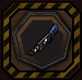

- 가격: 244 · 획득: 통상 · 강화: 가능
- 연관: 불명 · 첫 등장: 거울의 거울 (거울 던전 2)

**기본**

- 흐트러짐 상태가 아닌 적에게 스킬 효과로 출혈 위력 또는 특수 출혈을 부여할 때마다 대상에게 출혈 위력 1, 출혈 횟수 1 부여.
- 색욕 속성 스킬을 사용한 경우, 효과가 강화되어 출혈 위력 3, 출혈 횟수 1 부여.

**+**

- 스킬 효과로 출혈 위력 또는 특수 출혈을 부여할 때마다 대상에게 출혈 위력 2, 출혈 횟수 1 부여.
- 색욕 속성 스킬을 사용한 경우, 효과가 강화되어 출혈 위력 3, 출혈 횟수 1 부여.

**++**

- 스킬 효과로 출혈 위력 또는 특수 출혈을 부여할 때마다 대상에게 출혈 위력 3, 출혈 횟수 1 부여.
- 색욕 속성 스킬을 사용한 경우, 효과가 강화되어 출혈 위력 3, 출혈 횟수 2 부여.

### Ⅲ 안식처

- 가격: 255 · 획득: 통상 · 강화: 불가
- 연관: 환상체: 장미 표지판 · 첫 등장: 폭풍의 거울 (거울 던전 4)

**효과**

- 출혈 위력, 출혈 횟수 또는 특수 출혈을 부여하는 스킬을 사용하여 합 승리 시 발동 (남은 코인 수/2)만큼 대상에게 출혈 횟수를 부여하고 다음 턴에 그 수치만큼 공격 레벨 증가 얻음
- 코인 수가 2 이하인 스킬의 경우, 효과가 강화되어 그 수치가 (남은 코인 수+3)로 적용됨

### Ⅲ 연기와 철조망

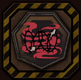

- 가격: 261 · 획득: 통상 · 강화: 가능
- 연관: 환상체: 연기 전쟁 제4 전선 · 첫 등장: 거울의 거울 (거울 던전 2)

**기본**

- 아군이 스킬 효과로 적에게 부여하는 출혈 위력 수치가 2배로 적용.
- 턴 종료 시 출혈 상태인 적들이 다음 턴에 속도가 2만큼 감소.

**+**

- 아군이 스킬 효과로 적에게 부여하는 출혈 위력 수치가 2배로 적용.
- 턴 종료 시 출혈 상태인 적들이 다음 턴에 속도가 3만큼 감소.

**++**

- 아군이 스킬 효과로 적에게 부여하는 출혈 위력 수치가 2.5배로 적용.
- 턴 종료 시 출혈 상태인 적들이 다음 턴에 속도가 3만큼 감소.

### Ⅲ 찢어진 피주머니

- 가격: 259 · 획득: 한정 · 하드 난이도 한정 · 강화: 불가
- 연관: 환상체: 단수어 · 첫 등장: 꿈결의 거울 (거울 던전 5)

**효과**

- 아군이 합 승리 시, 적의 출혈을 1회 발동시키고, 출혈 횟수 1 감소. (턴 당 3회 발동)

### Ⅲ 치성

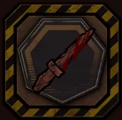

- 가격: 259 (구매불가) · 획득: 합성 · 강화: 불가
- 조합식: 억류된 찬송 + 밀라르카
- 연관: 환상체: 귀곡관 · 첫 등장: 꿈결의 거울 (거울 던전 5)

**효과**

- 턴 시작 시, 출혈 위력, 출혈 횟수 또는 특수 출혈을 부여하는 공격 스킬을 보유한 인격이 5인 이상이면, 이번 전투 동안 발동 (E.G.O 스킬 제외. 대기 인원 제외)
- 속도가 가장 빠른 아군 1명의 출혈 위력, 출혈 횟수 또는 특수 출혈을 부여하는 더하기 코인 스킬의 코인 위력 +1, 피해량 +50%
- - 빼기 코인 스킬일 경우, 코인 위력 대신 기본 위력 +(4/코인 수) (최소 1, 소수점 버림)
- 출혈 위력, 출혈 횟수 또는 특수 출혈을 부여하는 스킬의 최종 위력 +1

### Ⅲ 혈향도래

- 가격: 251 · 획득: 통상 · 강화: 불가
- 연관: 불명 · 첫 등장: 영생의 거울 (거울 던전 6)

**효과**

- 전투 시작 전 체력이 가장 낮은 아군이 출혈 또는 특수 출혈을 부여하는 공격 스킬 적중 시, 최대 체력 3%만큼 체력 회복 (턴당 2회)
- 출혈 또는 특수 출혈을 부여하는 스킬로 출혈 또는 특수 출혈을 보유한 적과 합을 진행할 때, 합 위력 +1
- - 출혈 또는 특수 출혈을 부여하는 공격 스킬을 보유한 인격이 5인 이상이면, 대신 합 위력 +1, 피해량 +10% (편성 인원 포함)
- - 10인 이상이면, 대신 합 위력 +2, 피해량 +15%

### Ⅳ 매혹 조각

- 가격: 400 · 획득: 통상 · 강화: 불가
- 연관: 불명 · 첫 등장: 폭풍의 거울 (거울 던전 4)

**효과**

- 출혈 위력, 출혈 횟수 또는 특수 출혈을 부여하는 E.G.O 스킬 사용 시 발동
- 소모하는 (색욕 E.G.O 자원 +나머지 E.G.O 자원의 합/3)만큼 최종 위력이 증가, 피해량 +50%
- 색욕 속성 E.G.O 스킬의 경우, 효과가 강화되어 공격 시작 전에 출혈 횟수를 추가로 부여(E.G.O 등급에 비례하며 ZAYIN의 경우 2, 등급이 오를수록 +1)하고 대상이 보유한 출혈 위력만큼 색욕 피해 추가로 입힘

### Ⅳ 붉게 물든 목화

- 가격: 382 · 획득: 통상 · 강화: 가능
- 연관: 불명 · 첫 등장: 거울의 거울 (거울 던전 2)

**기본**

- 스테이지 첫 턴 시작 시, 모든 적(환상체일 경우, 모든 부위)에게 출혈 위력 1, 출혈 횟수 15 부여.
- 턴 시작 시 출혈 상태인 적의 공격 레벨과 방어 레벨이 이번 턴 동안 (출혈 위력 / 3)만큼 감소. (출혈 위력 30 스택 시, 효과 최대)

**+**

- 웨이브 첫 턴 시작 시, 모든 적(환상체일 경우, 모든 부위)에게 출혈 위력 2, 출혈 횟수 15 부여.
- 턴 시작 시 출혈 상태인 적의 공격 레벨과 방어 레벨이 이번 턴 동안 (출혈 위력 / 3)만큼 감소. (출혈 위력 30 스택 시, 효과 최대)

**++**

- 웨이브 첫 턴 시작 시, 모든 적(환상체일 경우, 모든 부위)에게 출혈 위력 4, 출혈 횟수 20 부여.
- 턴 시작 시 출혈 상태인 적의 공격 레벨과 방어 레벨이 이번 턴 동안 (출혈 위력 / 2)만큼 감소. (출혈 위력 30 스택 시, 효과 최대)

### Ⅳ 출혈성 쇼크

- 가격: 405 (구매불가) · 획득: 합성 · 하드 난이도 한정 · 강화: 불가
- 조합식: 늘어붙은 쇠말뚝 + 녹슨 커터 나이프 + 찢어진 피주머니
- 연관: 불명 · 첫 등장: 꿈결의 거울 (거울 던전 5)

**효과**

- 턴 시작 시, 출혈 위력 또는 출혈 횟수 또는 특수 출혈을 부여하는 공격 스킬을 보유한 인격이 5인 이상이면, 이번 전투 동안 발동 (E.G.O 스킬 제외. 대기 인원 제외)
- 아군이 합 승리 시, 적의 출혈을 1회 발동시키고, 출혈 횟수 1 감소 (아군 1명당 턴 당 1회)
- 적이 출혈 피해로 흐트러질 수 있으며, 적이 합 진행 중 출혈 피해로 흐트러지면, 적의 남은 코인 수만큼 출혈을 발동시킴
- 모든 적이 출혈이 부여되어 있으면 방어 레벨 2 감소. 턴 종료 시 (출혈이 발동한 횟수 × 2)만큼 다음 턴에 방어 레벨 감소를 얻음 (최대 20)
- 스킬 효과로 출혈 위력 또는 특수 출혈을 부여할 때마다 대상에게 출혈 위력 3, 출혈 횟수 1 부여

### Ⅳ 피안개

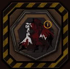

- 가격: 421 (구매불가) · 획득: 합성 · 강화: 불가
- 조합식: 연기와 철조망 + 녹슨 입마개 + 치성
- 연관: 캐릭터: 붉은안개 · 첫 등장: 호수의 거울 (거울 던전 3)

**효과**

- 턴 시작 시, 출혈 위력, 출혈 횟수 또는 특수 출혈을 부여하는 공격 스킬을 보유한 인격이 5인 이상이면, 이번 전투 동안 발동 (E.G.O 스킬 제외. 대기 인원 제외)
- 아군이 스킬 효과로 적에게 부여하는 출혈 위력과 출혈 횟수가 2배로 적용.
- 턴 시작 시 편성 순서가 제일 빠른 아군의 출혈 위력, 출혈 횟수 또는 특수 출혈을 부여하는 더하기 코인 스킬의 코인 위력 +2, 피해량 +100%.
- - 빼기 코인 스킬일 경우, 코인 위력 대신 기본 위력 +(8/코인 수) (최소 1, 소수점 버림)
- 해당 캐릭터가 공격하거나, 합을 진행한 적이 사망했으면, 사망한 적의 남은 출혈 위력을 모든 적에게 무작위로 나눠서 부여 (집중 전투인 경우, 부위로 판정)
- 출혈 위력, 횟수 또는 특수 출혈을 부여하는 더하기 코인 스킬의 코인 위력 +1, 피해량 +30%
- - 빼기 코인 스킬일 경우, 코인 위력 대신 기본 위력 +(4/코인 수) (최소 1, 소수점 버림)

## 진동 (20)

### Ⅰ 극독성 외피

- 가격: 147 · 획득: 통상 · 강화: 가능
- 연관: 환상체: 울음 두꺼비 · 첫 등장: 폭풍의 거울 (거울 던전 4)

**기본**

- 진동 위력 또는 진동 횟수를 부여하는 스킬(본인 또는 아군을 대상으로 하는 경우 포함)을 사용하여 합 승리 시, (남은 코인 수/2)만큼 대상 적에게 진동 위력 부여

**+**

- 진동 위력 또는 진동 횟수를 부여하는 스킬(본인 또는 아군을 대상으로 하는 경우 포함)을 사용하여 합 승리 시, 남은 코인 수만큼 대상 적에게 진동 위력 부여

**++**

- 진동 위력 또는 진동 횟수를 부여하는 스킬(본인 또는 아군을 대상으로 하는 경우 포함)을 사용하여 합 승리 시, 남은 코인 수만큼 대상 적에게 진동 위력과 (남은 코인 수/2)만큼 진동 횟수 부여

### Ⅰ 닉시 다이버전스

- 가격: 145 · 획득: 통상 · 강화: 가능
- 연관: 환상체: 증기 운반 기계 · 첫 등장: 시작의 거울 (거울 던전 1)

**기본**

- 스테이지 첫 턴 시작 시, 적 전체(환상체일 경우, 모든 부위)에게 진동 위력 4, 진동 횟수 4 부여.
- 질투 속성 스킬을 사용하여 적에게 적중 시, 대상에게 진동 위력 2 부여

**+**

- 웨이브 첫 턴 시작 시, 적 전체(환상체일 경우, 모든 부위)에게 진동 위력 4, 진동 횟수 4 부여.
- 질투 속성 스킬을 사용하여 적에게 적중 시, 대상에게 진동 위력 2 부여

**++**

- 웨이브 첫 턴 시작 시, 적 전체(환상체일 경우, 모든 부위)에게 진동 위력 5, 진동 횟수 5 부여.
- 질투 속성 스킬을 사용하여 적에게 적중 시, 대상에게 진동 위력 3 부여

### Ⅰ 보석 진동자

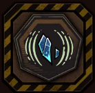

- 가격: 153 · 획득: 한정 · 하드 난이도 한정 · 강화: 불가
- 연관: 불명 · 첫 등장: 꿈결의 거울 (거울 던전 5)

**효과**

- 진동 횟수를 소모한 스킬로 합 승리시, 대상에게 진동이 없다면 대상의 진동 횟수 2 증가.
- 해당 공격 스킬을 포함하여 나태 공명 3 이상이면, 대신 대상의 진동 횟수 3 증가

### Ⅰ 초록빛 결실

- 가격: 146 · 획득: 통상 · 강화: 가능
- 연관: 환상체: 신사 요정 · 첫 등장: 시작의 거울 (거울 던전 1)

**기본**

- 흐트러짐 상태가 아닌 적에게 탐식 속성 스킬을 사용하여 적중하였거나 또는 스킬 효과로 진동 위력을 부여할 경우, 모든 적(환상체일 경우, 모든 부위)에게 진동 위력 4 무작위로 나누어 부여.

**+**

- 흐트러짐 상태가 아닌 적에게 탐식 속성 스킬을 사용하여 적중하였거나 또는 스킬 효과로 진동 위력을 부여할 경우, 모든 적(환상체일 경우, 모든 부위)에게 진동 위력 6 무작위로 나누어 부여.

**++**

- 흐트러짐 상태가 아닌 적에게 탐식 속성 스킬을 사용하여 적중하였거나 또는 스킬 효과로 진동 위력을 부여할 경우, 모든 적(환상체일 경우, 모든 부위)에게 진동 위력 8 무작위로 나누어 부여.

### Ⅱ 감합된 톱니바퀴

- 가격: 207 · 획득: 통상 · 강화: 불가
- 연관: 불명 · 첫 등장: 꿈결의 거울 (거울 던전 5)

**효과**

- 턴 시작 시, 진동 위력, 진동 횟수 또는 특수 진동을 부여하는 공격 스킬을 보유한 인격이 5인 이상이면, 이번 전투 동안 발동 (E.G.O 스킬 제외. 대기 인원 제외)
- 이번 턴에 대상에게 진동 폭발을 6회 부여하였을 경우, 대상의 현재 체력 기준 0%에 새로운 흐트러짐 구간 추가 (전투 당 1회 발동).
- 진폭 변환, 진폭 얽힘 시 취약 1 부여 (턴 당 최대 1회)

### Ⅱ 거울 촉각 공감각

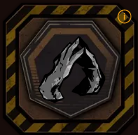

- 가격: 200 · 획득: 통상 · 강화: 불가
- 연관: 환상체: 길 잃은 마음 · 첫 등장: 폭풍의 거울 (거울 던전 4)

**효과**

- 아군이 진동 위력 또는 진동 횟수를 부여하는 스킬(본인 또는 아군을 대상으로 하는 경우 포함)로 적을 흐트러뜨릴 경우 (E.G.O 스킬 제외), 다음 턴에 대상이 보유한 진동 위력의 1/3만큼을 다른 무작위 적들(환상체일 경우, 무작위 부위)에게 진동 위력을 나누어 부여함

### Ⅱ 고혈

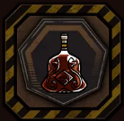

- 가격: 200 · 획득: 통상 · 강화: 가능
- 연관: 환상체: 주정뱅이 · 첫 등장: 시작의 거울 (거울 던전 1)

**기본**

- 흐트러짐 상태의 적에게 스킬을 사용하여 가하는 피해량 +10%.
- 진동 위력, 진동 횟수를 부여하거나, 진폭 변환, 진동 폭발, 진폭 얽힘 효과를 보유한 스킬 또는 나태 속성 스킬을 사용할 경우, 효과가 강화되어 피해량 +20%.

**+**

- 흐트러짐 상태의 적에게 스킬을 사용하여 가하는 피해량 +12.5%.
- 진동 위력, 진동 횟수를 부여하거나, 진폭 변환, 진동 폭발, 진폭 얽힘 효과를 보유한 스킬 또는 나태 속성 스킬을 사용할 경우, 효과가 강화되어 피해량 +25%.

**++**

- 흐트러짐 상태의 적에게 스킬을 사용하여 가하는 피해량 +15%.
- 진동 위력, 진동 횟수를 부여하거나, 진폭 변환, 진동 폭발, 진폭 얽힘 효과를 보유한 스킬 또는 나태 속성 스킬을 사용할 경우, 효과가 강화되어 피해량 +30%.

### Ⅱ 시큼한 주향

- 가격: 185 · 획득: 통상 · 강화: 가능
- 연관: 환상체: 신사 요정 · 첫 등장: 폭풍의 거울 (거울 던전 4)

**기본**

- [편성 1번, 2번 인격 전용 효과]
- 진동 위력 또는 진동 횟수를 부여하는 스킬(본인 또는 아군을 대상으로 하는 경우 포함)의 공격 레벨 +2
- 메인 공격 대상이 진동 상태이고 흐트러진 경우, 스킬로 가하는 피해량 +(흐트러짐 단계 × 7.5)%
- 진동 위력 또는 진동 횟수를 부여하는 스킬로 적을 공격할 경우, 효과가 강화되어 피해량 +(흐트러짐 단계 × 15)%

**+**

- [편성 1번, 2번, 3번 인격 전용 효과]
- 진동 위력 또는 진동 횟수를 부여하는 스킬(본인 또는 아군을 대상으로 하는 경우 포함)의 공격 레벨 +2
- 메인 공격 대상이 진동 상태이고 흐트러진 경우, 스킬로 가하는 피해량 +(흐트러짐 단계 × 10)%
- 진동 위력 또는 진동 횟수를 부여하는 스킬로 적을 공격할 경우, 효과가 강화되어 피해량 +(흐트러짐 단계 × 20)%

**++**

- [편성 1번, 2번, 3번 인격 전용 효과]
- 진동 위력 또는 진동 횟수를 부여하는 스킬(본인 또는 아군을 대상으로 하는 경우 포함)의 공격 레벨 +3
- 메인 공격 대상이 진동 상태이고 흐트러진 경우, 스킬로 가하는 피해량 +(흐트러짐 단계 × 12.5)%
- 진동 위력 또는 진동 횟수를 부여하는 스킬로 적을 공격할 경우, 효과가 강화되어 피해량 +(흐트러짐 단계 × 25)%

### Ⅱ 잔향

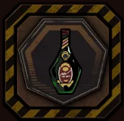

- 가격: 216 · 획득: 통상 · 강화: 가능
- 연관: 불명 · 첫 등장: 호수의 거울 (거울 던전 3)

**기본**

- 턴 종료 시, 진동 위력을 10 이상 보유한 적(환상체일 경우, 해당 부위)에게 다음 턴에 속박 2 부여.
- 대상이 진동 위력을 20 이상 보유한 경우, 효과가 강화되어 속박 2, 마비 1 부여.

**+**

- 턴 종료 시, 진동 위력을 8 이상 보유한 적(환상체일 경우, 해당 부위)에게 다음 턴에 속박 2, 방어 레벨 감소 2 부여.
- 대상이 진동 위력을 15 이상 보유한 경우, 효과가 강화되어 속박 2, 마비 1, 방어 레벨 감소 2 부여.

**++**

- 턴 종료 시, 진동 위력을 5 이상 보유한 적(환상체일 경우, 해당 부위)에게 다음 턴에 속박 2, 방어 레벨 감소 3 부여.
- 대상이 진동 위력을 10 이상 보유한 경우, 효과가 강화되어 속박 2, 마비 1, 방어 레벨 감소 4 부여.

### Ⅱ 진동형 팔찌

- 가격: 208 · 획득: 통상 · 강화: 가능
- 연관: 불명 · 첫 등장: 거울의 거울 (거울 던전 2)

**기본**

- 스킬을 사용하여 적에게 적중 시, 다음 턴에 대상에게 진동 위력 1 부여
- 분노 속성 스킬을 사용할 경우, 효과가 강화되어 진동 위력 2 부여.

**+**

- 스킬을 사용하여 적에게 적중 시, 다음 턴에 대상에게 진동 위력 1 부여.
- 분노 속성 스킬을 사용할 경우, 효과가 강화되어 진동 위력 3 부여.

**++**

- 스킬을 사용하여 적에게 적중 시, 다음 턴에 대상에게 진동 위력 2 부여.
- 분노 속성 스킬을 사용할 경우, 효과가 강화되어 진동 위력 4 부여.

### Ⅱ 흔들리는 술통

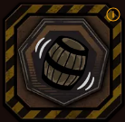

- 가격: 211 · 획득: 한정 · 하드 난이도 한정 · 강화: 불가
- 연관: 환상체: 주정뱅이 · 첫 등장: 꿈결의 거울 (거울 던전 5)

**효과**

- 턴 시작 시, 자신의 진동 횟수가 8 이상이면 합 위력 +1
- 자신의 진동 횟수를 소모하는 스킬로 적을 처치하거나 흐트러짐 상태로 만들었으면, (소모된 진동 횟수 / 4)만큼 자신의 진동 횟수 증가 (스킬당 1회)

### Ⅲ 녹아내린 눈알

- 가격: 248 · 획득: 통상 · 강화: 불가
- 연관: 환상체: 울음 두꺼비 · 첫 등장: 시작의 거울 (거울 던전 1)

**효과**

- 진동 폭발된 적에게 다음 턴에 공격 레벨 감소 5와 방어 레벨 감소 5 부여. (턴 당 최대 3회)

### Ⅲ 생체 맹독 바이알

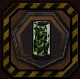

- 가격: 162 · 획득: 통상 · 강화: 가능
- 연관: 환상체: 걷는 진주 · 첫 등장: 폭풍의 거울 (거울 던전 4)

**기본**

- 진동 위력을 보유한 적이 사망할 경우, 대상이 보유한 (진동 위력과 진동 횟수의 합 × 0.5)만큼 다음 턴에 무작위 적 하나(환상체일 경우, 무작위 부위)에게 나태 피해를 입힘

**+**

- 진동 위력을 보유한 적이 사망할 경우, 대상이 보유한 (진동 위력과 진동 횟수의 합 × 0.75)만큼 다음 턴에 무작위 적 하나(환상체일 경우, 무작위 부위)에게 나태 피해를 입힘

**++**

- 진동 위력을 보유한 적이 사망할 경우, 대상이 보유한 (진동 위력과 진동 횟수의 합 × 1.25)만큼 다음 턴에 무작위 적 하나(환상체일 경우, 무작위 부위)에게 나태 피해를 입힘

### Ⅲ 진실의 종

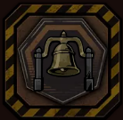

- 가격: 268 · 획득: 통상 · 강화: 가능
- 연관: 환상체: 태엽장치시간오뚝이 · 첫 등장: 호수의 거울 (거울 던전 3)

**기본**

- 진동 폭발이 적용된 적에게 이번 턴에 취약 1 부여 (공격 스킬을 사용하여 진동 폭발 부여 시, 스킬 당 최대 1회).

**+**

- 진동 폭발이 적용된 적에게 이번 턴과 다음 턴에 취약 1 부여 (공격 스킬을 사용하여 진동 폭발 부여 시, 스킬 당 최대 1회).

**++**

- 진동 폭발이 적용된 적에게 이번 턴과 다음 턴에 취약 2 부여 (공격 스킬을 사용하여 진동 폭발 부여 시, 스킬 당 최대 1회).

### Ⅲ 진원점

- 가격: 248 (구매불가) · 획득: 합성 · 하드 난이도 한정 · 강화: 불가
- 조합식: 보석 진동자 + 흔들리는 술통
- 연관: 불명 · 첫 등장: 꿈결의 거울 (거울 던전 5)

**효과**

- 턴 시작 시, 진동 위력 또는 진동 횟수를 부여하는 공격 스킬을 보유한 인격이 5인 이상이면, 이번 전투 동안 발동 (E.G.O 스킬 제외. 대기 인원 제외. 인격이 스스로 진동 횟수를 얻는 경우에는 발동 x)
- 자신의 진동 횟수를 소모한 스킬로 합 승리시, 대상에게 진동이 없다면 대상의 진동 횟수 3 증가
- 턴 시작 시 합 위력이 (자신의 진동 횟수/5)만큼 증가. (최대 3)
- 자신의 진동 횟수를 소모하는 스킬을 사용했을 때, 적 처치 혹은 흐트러짐 상태로 만들 경우 (소모한 진동 횟수 / 2)만큼 자신의 진동 횟수 증가 (스킬당 1회)

### Ⅲ 톱니바퀴 태엽

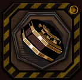

- 가격: 249 · 획득: 통상 · 강화: 불가
- 연관: 환상체: 증기 운반 기계 · 첫 등장: 폭풍의 거울 (거울 던전 4)

**효과**

- [편성 1번, 2번 인격 전용 효과]
- 진동 위력 또는 진동 횟수를 부여하는 스킬(본인 또는 아군을 대상으로 하는 경우 포함)의 합 위력 +1.
- 진동 상태인 적에게 진동 위력 또는 진동 횟수를 부여하는 공격 스킬로 피해를 입힐 경우, 피해량 +(적이 보유한 진동 위력 + 5)% (E.G.O 스킬 제외).
- 오만 속성 스킬일 경우, 효과가 강화되어 피해량 +(적이 보유한 진동 위력과 진동 횟수의 합 + 5)%

### Ⅳ 무진팔방종

- 가격: 405 (구매불가) · 획득: 합성 · 하드 난이도 한정 · 강화: 불가
- 조합식: 극독성 외피 + 톱니바퀴 태엽 + 진원점
- 연관: 불명 · 첫 등장: 꿈결의 거울 (거울 던전 5)

**효과**

- 턴 시작 시, 진동 위력 또는 진동 횟수를 부여하는 공격 스킬을 보유한 인격이 5인 이상이면, 이번 전투 동안 발동 (E.G.O 스킬 제외. 대기 인원 제외. 인격이 스스로 진동 횟수를 얻는 경우에는 발동 x)
- 진동 위력 또는 진동 횟수를 부여하거나 자신의 진동 횟수를 소모한 스킬로 합 승리시 남은 코인만큼 대상에게 진동 위력 부여, 자신의 진동 횟수 증가 (스킬 당 자신의 진동 횟수 최대 3 증가). 대상에게 진동이 없으면, 대상의 진동 횟수 3 증가
- 턴 시작 시 합 위력 증가를 1 + (자신의 진동 횟수/5)만큼 얻음 (최대 3)
- 자신의 진동 횟수를 소모하는 스킬을 사용했을 때, 적 처치 혹은 흐트러짐 상태로 만들 경우 (소모한 진동 횟수 / 2)만큼 자신의 진동 횟수 증가 (스킬당 1회)
- 스킬의 피해량 +(자신이 소모한 진동 횟수 + 적이 보유한 진동 위력 + 5)% (E.G.O 스킬 제외, 최대 50%).
- 대상에게 진동 - 중첩이 있을 때, 그 대상에게 중첩되지 않은 유형의 진동 유형으로 진폭 변환, 진폭 얽힘을 사용하면, 턴 종료 시 대상이 보유한 진동 - 중첩을 다음 턴까지 연장함

### Ⅳ 연성진동

- 가격: 419 (구매불가) · 획득: 합성 · 강화: 불가
- 조합식: 진실의 종 + 감합된 톱니바퀴 + 닉시 다이버전스
- 연관: 불명 · 첫 등장: 호수의 거울 (거울 던전 3)

**효과**

- 턴 시작 시, 진동 위력, 진동 횟수 또는 특수 진동을 부여하는 공격 스킬을 보유한 인격이 5인 이상이면, 이번 전투 동안 발동 (E.G.O 스킬 제외. 대기 인원 제외)
- 웨이브 첫 턴 시작 시, 적 전체(환상체일 경우, 모든 부위)에 진동 5, 진동 횟수 5 부여
- 진동 폭발이 적용된 적에게 이번 턴과 다음 턴에 진동 위력 5, 취약 2 부여 (공격 스킬을 사용하여 진동 폭발 부여 시, 스킬 당 최대 1회).
- 이번 턴에 대상에게 진동 폭발을 3회 부여하였을 경우, 다음 턴 시작 시 대상을 흐트러뜨리고 현재 체력 기준 66%, 33%에 흐트러짐 구간 추가. (전투 당 1회 발동).
- 진폭 변환, 진폭 얽힘 시 취약 1 부여 (턴 당 최대 3회)

### Ⅳ 타성 조각

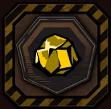

- 가격: 400 · 획득: 통상 · 강화: 불가
- 연관: 불명 · 첫 등장: 폭풍의 거울 (거울 던전 4)

**효과**

- 진동 위력 또는 진동 횟수 또는 특수 진동을 부여하는 E.G.O 스킬 사용 시 발동
- 소모하는 (나태 E.G.O 자원 +나머지 E.G.O 자원의 합/3)만큼 최종 위력이 증가, 피해량 +50%
- 나태 속성 E.G.O 스킬의 경우, 효과가 강화되어 공격 시작 전에 진동 횟수를 추가로 부여(ZAYIN의 경우 2, 등급이 오를수록 +1)하고 피해량 +(대상이 보유한 진동 위력 x1.5)%

### Ⅳ 폭우

- 가격: 381 · 획득: 통상 · 강화: 가능
- 연관: 불명 · 첫 등장: 거울의 거울 (거울 던전 2)

**기본**

- 턴 시작 시, 모든 적(환상체일 경우, 모든 부위)에게 진동 위력을 (현재 턴 × 2) 부여, 진동 횟수 2 부여.
- 턴 종료 시, 모든 적(환상체일 경우, 모든 부위)에게 진동 폭발 효과 부여.

**+**

- 턴 시작 시, 모든 적(환상체일 경우, 모든 부위)에게 진동 위력을 (3 + 현재 턴 × 2) 부여, 진동 횟수 3 부여.
- 턴 종료 시, 모든 적(환상체일 경우, 모든 부위)에게 진동 폭발 효과 부여.

**++**

- 턴 시작 시, 모든 적(환상체일 경우, 모든 부위)에게 진동 위력을 (5 + 현재 턴 × 2) 부여, 진동 횟수 3 부여.
- 턴 종료 시, 모든 적(환상체일 경우, 모든 부위)에게 진동 폭발 효과 2회 부여.

## 파열 (18)

### Ⅰ 부서진 리볼버

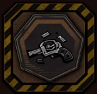

- 가격: 209 · 획득: 통상 · 강화: 불가
- 연관: 불명 · 첫 등장: 거울의 거울 (거울 던전 2)

**효과**

- 턴 시작 시, 파열 상태(환상체일 경우, 부위)인 적의 공격 레벨과 방어 레벨이 이번 턴 동안 2만큼 감소.

### Ⅰ 부적 묶음

- 가격: 143 · 획득: 통상 · 강화: 가능
- 연관: 환상체: 누구도 울지 않도록 · 첫 등장: 시작의 거울 (거울 던전 1)

**기본**

- 스킬을 사용하여 적에게 적중 시 12 이상의 체력 피해를 입혔다면, 대상에게 파열 위력 2 부여.
- 참격 스킬을 사용할 경우, 효과가 강화되어 파열 위력 4 부여.

**+**

- 스킬을 사용하여 적에게 적중 시 12 이상의 체력 피해를 입혔다면, 대상에게 파열 위력 3 부여.
- 참격 스킬을 사용할 경우, 효과가 강화되어 파열 위력 5 부여

**++**

- 스킬을 사용하여 적에게 적중 시 1 이상의 체력 피해를 입혔다면, 대상에게 파열 위력 3 부여.
- 참격 스킬을 사용할 경우, 효과가 강화되어 파열 위력 5 부여, 파열 횟수 1 증가.

### Ⅰ 뼈 말뚝

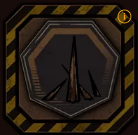

- 가격: 152 · 획득: 통상 · 강화: 불가
- 연관: 환상체: 이빨 딱딱이 · 첫 등장: 폭풍의 거울 (거울 던전 4)

**효과**

- 파열 효과가 적이 보유한 보호막에 입히는 피해량 +100%

### Ⅰ 장미 면류관

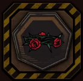

- 가격: 144 · 획득: 통상 · 강화: 가능
- 연관: 환상체: 장미 표지판 · 첫 등장: 시작의 거울 (거울 던전 1)

**기본**

- 턴 시작 시, 무작위 적 하나(환상체일 경우, 모든 부위)에게 파열 위력 4 부여.
- 탐식 완전 공명을 발동하였다면 전투 시작 시, 모든 적에게 파열 위력 2 부여.

**+**

- 턴 시작 시, 무작위 적 둘(환상체일 경우, 모든 부위)에게 파열 위력 4 부여.
- 탐식 완전 공명을 발동하였다면 전투 시작 시, 모든 적에게 파열 위력 3 부여.

**++**

- 턴 시작 시, 무작위 적 셋(환상체일 경우, 모든 부위)에게 파열 위력 4 부여.
- 탐식 완전 공명을 발동하였다면 전투 시작 시, 모든 적에게 파열 위력 4 부여.

### Ⅱ 가시 올가미

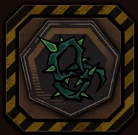

- 가격: 187 · 획득: 통상 · 강화: 가능
- 연관: 환상체: 장미 사냥꾼 · 첫 등장: 거울의 거울 (거울 던전 2)

**기본**

- 턴 종료 시, 모든 적에게 현재 속도만큼 파열 위력을 부여.
- 색욕 완전 공명을 발동하였다면 전투 시작 시, 무작위 적 하나에게 파열 위력 3, 파열 횟수 3 부여.

**+**

- 턴 종료 시, 모든 적에게 (현재 속도 + 1)만큼 파열 위력을 부여.
- 색욕 완전 공명을 발동하였다면 전투 시작 시, 무작위 적 하나에게 파열 위력 4, 파열 횟수 3 부여.

**++**

- 턴 종료 시, 모든 적에게 (현재 속도 + 2)만큼 파열 위력을 부여.
- 색욕 완전 공명을 발동하였다면 전투 시작 시, 무작위 적 하나에게 파열 위력 5, 파열 횟수 4 부여.

### Ⅱ 가시오랏줄

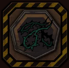

- 가격: 200 · 획득: 통상 · 강화: 불가
- 연관: 환상체: 장미 사냥꾼 · 첫 등장: 꿈결의 거울 (거울 던전 5)

**효과**

- 턴 시작 시, 파열 위력 또는 파열 횟수를 부여하는 공격 스킬을 보유한 인격이 5인 이상이면, 이번 전투 동안 발동 (E.G.O 스킬 제외. 대기 인원 제외)
- 전투 중 적의 파열 횟수가 1 아래로 떨어질 때, 파열 횟수 대신 파열 위력 20을 소모 (파열 위력이 20 미만이 될 경우, 효과 종료).
- 전투 중 적중 시 적의 파열 횟수가 1인 경우, 파열 횟수를 부여할 때 부여량 +1 (전투 당 2회)

### Ⅱ 유연 화약

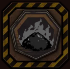

- 가격: 201 · 획득: 통상 · 강화: 가능
- 연관: 불명 · 첫 등장: 폭풍의 거울 (거울 던전 4)

**기본**

- [편성 1번, 2번 인격 전용 효과]
- 턴 종료 시 이번 턴에 파열 위력 또는 파열 횟수를 부여하는 공격 스킬을 한 번이라도 사용하였다면, 다음 턴에 신속 1 얻음.
- 자신의 속도가 6 이상이면, 파열 위력 또는 파열 횟수를 부여하는 공격 스킬의 피해량 +12.5%

**+**

- [편성 1번, 2번, 3번 인격 전용 효과]
- 턴 종료 시 이번 턴에 파열 위력 또는 파열 횟수를 부여하는 공격 스킬을 한 번이라도 사용하였다면, 다음 턴에 신속 1 얻음.
- 자신의 속도가 5 이상이면, 파열 위력 또는 파열 횟수를 부여하는 공격 스킬의 피해량 +15%

**++**

- [편성 1번, 2번, 3번 인격 전용 효과]
- 턴 종료 시 이번 턴에 파열 위력 또는 파열 횟수를 부여하는 공격 스킬을 한 번이라도 사용하였다면, 다음 턴에 신속 1 ~ 2 얻음.
- 자신의 속도가 4 이상이면, 파열 위력 또는 파열 횟수를 부여하는 공격 스킬의 피해량 +20%

### Ⅱ 종말의 파편

- 가격: 200 · 획득: 한정 · 하드 난이도 한정 · 강화: 불가
- 연관: 환상체: 종말 달력 · 첫 등장: 꿈결의 거울 (거울 던전 5)

**효과**

- 대상의 파열 위력이 15 미만이면, 파열 위력 부여 시 추가 1 부여

### Ⅱ 해진 우산

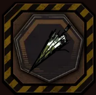

- 가격: 211 · 획득: 통상 · 강화: 가능
- 연관: 환상체: 떠돌이 여우 · 첫 등장: 폭풍의 거울 (거울 던전 4)

**기본**

- [편성 1번, 2번 인격 전용 효과]
- 파열 위력 또는 파열 횟수를 부여하는 공격 스킬을 사용하여 합 승리 시, 대상 적에게 파열 횟수 2 부여 (인격 별로 턴 당 1회).
- 대상이 파열 상태가 아닐 경우, 효과가 강화되어 파열 위력 3, 파열 횟수 2 부여

**+**

- [편성 1번, 2번, 3번 인격 전용 효과]
- 파열 위력 또는 파열 횟수를 부여하는 공격 스킬을 사용하여 합 승리 시, 대상 적에게 파열 위력 2, 파열 횟수 2 부여 (인격 별로 턴 당 1회).
- 대상이 파열 상태가 아닐 경우, 효과가 강화되어 파열 위력 4, 파열 횟수 2 부여

**++**

- [편성 1번, 2번, 3번 인격 전용 효과]
- 파열 위력 또는 파열 횟수를 부여하는 공격 스킬을 사용하여 합 승리 시, 대상 적에게 파열 위력 4, 파열 횟수 2 부여 (인격 별로 턴 당 1회).
- 대상이 파열 상태가 아닐 경우, 효과가 강화되어 파열 위력 6, 파열 횟수 3 부여

### Ⅱ 형광색 램프

- 가격: 219 · 획득: 통상 · 강화: 가능
- 연관: 환상체: 꿈먹는 탁류 · 첫 등장: 호수의 거울 (거울 던전 3)

**기본**

- 턴 종료 시 파열 상태인 적의 수(환상체일 경우, 모든 부위) + 1만큼, 다음 턴에 무작위 아군 하나에게 피해량 증가 1, 신속 1 효과 중 하나를 부여.

**+**

- 턴 종료 시 파열 상태인 적의 수(환상체일 경우, 모든 부위) + 3만큼, 다음 턴에 무작위 아군 하나에게 피해량 증가 1, 신속 1 효과 중 하나를 부여.

**++**

- 턴 종료 시 파열 상태인 적의 수(환상체일 경우, 모든 부위) + 3만큼, 다음 턴에 무작위 아군 하나에게 피해량 증가 1, 신속 1 효과를 부여.

### Ⅲ 근무용 통상 배터리

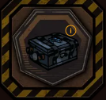

- 가격: 269 · 획득: 통상 · 강화: 불가
- 연관: 환상체: 충격 지네 · 첫 등장: 시작의 거울 (거울 던전 1)

**효과**

- 스킬을 사용하여 적에게 적중 시, 대상에게 파열 위력 3 부여
- 질투 속성 스킬을 사용할 경우, 효과가 강화되어 대상에게 파열 위력 5 부여

### Ⅲ 기괴한 석상

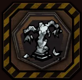

- 가격: 249 (구매불가) · 획득: 합성 · 하드 난이도 한정 · 강화: 불가
- 조합식: 뼈 말뚝 + 종말의 파편
- 연관: 불명 · 첫 등장: 꿈결의 거울 (거울 던전 3)

**효과**

- 턴 시작 시, 파열 위력 또는 파열 횟수를 부여하는 공격 스킬을 보유한 인격이 5인 이상이면, 이번 전투 동안 발동 (E.G.O 스킬 제외. 대기 인원 제외)
- 파열 효과가 적이 보유한 보호막에 입히는 피해량 +100%
- 대상의 파열 위력이 15 미만이면, 파열 위력 부여 시 추가 2 부여
- 스킬 효과로 인해 파열을 부여하지 못하는 경우 더하기 코인 위력 +1
- - 빼기 코인 스킬일 경우, 더하기 코인 위력 대신 기본 위력 +(4/코인 수) (최소 1, 소수점 버림)

### Ⅲ 벼락가지

- 가격: 252 · 획득: 통상 · 강화: 가능
- 연관: 환상체: 원귀목 · 첫 등장: 시작의 거울 (거울 던전 1)

**기본**

- 스킬 효과로 파열 위력을 부여할 때마다 대상에게 파열 위력 1, 파열 횟수 1 부여

**+**

- 스킬 효과로 파열 위력을 부여할 때마다 대상에게 파열 위력 2, 파열 횟수 1 부여

**++**

- 스킬 효과로 파열 위력을 부여할 때마다 대상에게 파열 위력 3, 파열 횟수 1 부여
- 우울 속성 스킬을 사용할 경우, 효과가 강화되어 파열 위력 3, 파열 횟수 2 부여

### Ⅲ 죽음바라기

- 가격: 271 · 획득: 통상 · 강화: 불가
- 연관: 불명 · 첫 등장: 폭풍의 거울 (거울 던전 4)

**효과**

- [편성 1번, 2번 인격 전용 효과]
- 파열 위력 또는 파열 횟수를 부여하는 공격 스킬의 합 위력 +1, 공격 레벨 +2, 피해량 +15% (E.G.O 스킬 제외)
- 단일 코인 스킬일 경우, 효과가 강화되어 합 위력 +2, 공격 레벨 +2, 피해량 +40%

### Ⅳ 욕망 조각

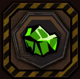

- 가격: 400 · 획득: 통상 · 강화: 불가
- 연관: 불명 · 첫 등장: 폭풍의 거울 (거울 던전 4)

**효과**

- 파열 위력 또는 파열 횟수를 부여하는 E.G.O 스킬 사용시 발동
- 소모하는 (탐식 E.G.O 자원 +나머지 E.G.O 자원의 합/3)만큼 최종 위력이 증가, 피해량 +50%
- 탐식 속성 E.G.O 스킬을 사용할 경우, E.G.O 등급에 비례하여 파열 횟수를 추가로 부여(ZAYIN의 경우 2, 등급이 오를수록 +1)하고 피해량 +(사용한 E.G.O 자원 종류의 수x15)%

### Ⅳ 쾌감

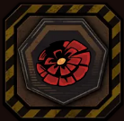

- 가격: 384 · 획득: 통상 · 강화: 가능
- 연관: 불명 · 첫 등장: 거울의 거울 (거울 던전 2)

**기본**

- 턴 시작 시, 적 전체(환상체일 경우, 모든 부위)에게 파열 위력 3, 파열 횟수 3 부여
- 턴 종료 시, 모든 적(환상체일 경우, 부위마다 별도로 판정)이 (파열 위력 × 파열 횟수) 만큼의 탐식 피해를 입음. (파열 횟수 최대 5까지 적용)

**+**

- 턴 시작 시, 적 전체(환상체일 경우, 모든 부위)에게 파열 위력 4, 파열 횟수 3 부여
- 턴 종료 시, 모든 적(환상체일 경우, 부위마다 별도로 판정)이 (파열 위력 × 파열 횟수) 만큼의 탐식 피해를 입음. (파열 횟수 최대 7까지 적용)

**++**

- 턴 시작 시, 적 전체(환상체일 경우, 모든 부위)에게 파열 위력 6, 파열 횟수 3 부여
- 턴 종료 시, 모든 적(환상체일 경우, 부위마다 별도로 판정)이 (파열 위력 × 파열 횟수) 만큼의 탐식 피해를 입음. (파열 횟수 최대 10까지 적용)

### Ⅳ 파탄

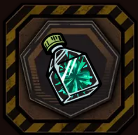

- 가격: 406 (구매불가) · 획득: 합성 · 하드 난이도 한정 · 강화: 불가
- 조합식: 부서진 리볼버 + 벼락가지 + 기괴한 석상
- 연관: 불명 · 첫 등장: 꿈결의 거울 (거울 던전 5)

**효과**

- 턴 시작 시, 파열 위력 또는 파열 횟수를 부여하는 공격 스킬을 보유한 인격이 5인 이상이면, 이번 전투 동안 발동 (E.G.O 스킬 제외. 대기 인원 제외)
- 파열 효과가 적이 보유한 보호막에 입히는 피해량 +150%
- 턴 시작 시, 파열 상태인 적 또는 부위의 공격 레벨과 방어 레벨이 (3 + 파열 위력/2) 만큼 감소. (최대 6)
- 스킬 효과로 파열 위력 또는 횟수를 부여할 때마다 대상에게 파열 위력 2, 파열 횟수 1 부여. 대상의 파열 위력이 15 미만이면, 파열 위력 부여 시 추가 2 부여.
- 파열 위력, 횟수 또는 특수 파열을 부여하는 더하기 코인 스킬의 코인 위력 +1
- 파열 위력, 횟수 또는 특수 파열을 부여하는 빼기 코인 스킬의 기본 위력 +(4/코인 수) (최소 1. 소수점 버림)

### Ⅳ 황홀경

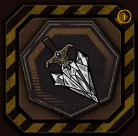

- 가격: 416 (구매불가) · 획득: 합성 · 강화: 불가
- 조합식: 근무용 통상 배터리 + 가시오랏줄 + 부적 묶음
- 연관: 불명 · 첫 등장: 호수의 거울 (거울 던전 3)

**효과**

- 턴 시작 시, 파열 위력 또는 파열 횟수를 부여하는 공격 스킬을 보유한 인격이 5인 이상이면, 이번 전투 동안 발동 (E.G.O 스킬 제외. 대기 인원 제외)
- 스킬을 사용하여 적에게 적중 시, 대상에게 파열 위력 5 부여.
- - 파열 위력 또는 파열 횟수를 부여하는 공격 스킬이면, 추가로 파열 위력 3 부여, 파열 횟수 1 증가 (스킬당 1번)
- 전투 중 적의 파열 횟수가 1 아래로 떨어질 때, 파열 횟수 대신 파열 위력 10을 소모 (파열 위력이 10 미만이 될 경우, 효과 종료).
- 대상의 파열 횟수가 3 미만이면, 파열 횟수를 부여할 때 부여량 +1 (전투 당 3회)

## 침잠 (20)

### Ⅰ 가시밭길

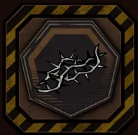

- 가격: 160 · 획득: 통상 · 강화: 가능
- 연관: 환상체: 하늘 지시관의 보좌 · 첫 등장: 거울의 거울 (거울 던전 2)

**기본**

- 침잠 위력 또는 특수 침잠을 부여하는 스킬로 적에게 체력 피해를 입힌 경우, 턴 종료 시 대상에게 침잠 위력 3, 침잠 횟수 2 부여. (동일한 적에게는 턴당 1회 발동)
- 우울 또는 색욕 완전 공명을 발동하였다면 전투 시작 시, 모든 적(환상체일 경우, 무작위 부위 하나)에게 침잠 위력 2, 침잠 횟수 3 부여.

**+**

- 침잠 위력 또는 특수 침잠을 부여하는 스킬로 적에게 체력 피해를 입힌 경우, 턴 종료 시 대상에게 침잠 위력 3, 침잠 횟수 2 부여. (동일한 적에게는 턴당 1회 발동)
- 우울 또는 색욕 공명을 발동하였다면 전투 시작 시, 모든 적(환상체일 경우, 무작위 부위 하나)에게 침잠 위력 2, 침잠 횟수 3 부여.

**++**

- 침잠 위력 또는 특수 침잠을 부여하는 스킬로 적에게 체력 피해를 입힌 경우, 턴 종료 시 대상에게 침잠 위력 4, 침잠 횟수 3 부여. (동일한 적에게는 턴당 1회 발동)
- 우울 또는 색욕 공명을 발동하였다면 전투 시작 시, 모든 적(환상체일 경우, 무작위 부위 하나)에게 침잠 위력 3, 침잠 횟수 3 부여.

### Ⅰ 고목 함정

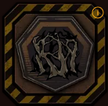

- 가격: 145 · 획득: 통상 · 강화: 가능
- 연관: 환상체: 요정초롱 · 첫 등장: 폭풍의 거울 (거울 던전 4)

**기본**

- 침잠 위력, 침잠 횟수 또는 특수 침잠을 부여하는 공격 스킬의 피해량 +5% (E.G.O 스킬 제외).
- 코인 수가 2개 이하인 경우, 효과가 강화되어 합 위력 +1, 피해량 +10%.

**+**

- 침잠 위력, 침잠 횟수 또는 특수 침잠을 부여하는 공격 스킬의 피해량 +7.5% (E.G.O 스킬 제외).
- 코인 수가 2개 이하인 경우, 효과가 강화되어 합 위력 +1, 피해량 +12.5%.

**++**

- 침잠 위력, 침잠 횟수 또는 특수 침잠을 부여하는 공격 스킬의 피해량 +10% (E.G.O 스킬 제외).
- 코인 수가 2개 이하인 경우, 효과가 강화되어 합 위력 +1, 피해량 +15%.

### Ⅰ 넝마

- 가격: 155 · 획득: 통상 · 강화: 가능
- 연관: 불명 · 첫 등장: 폭풍의 거울 (거울 던전 4)

**기본**

- 침잠 위력, 침잠 횟수 또는 특수 침잠을 부여하는 공격 스킬을 보유한 인격이 합 승리시 정신력 5를 추가로 회복(턴 당 1회)하고, 정신력이 최대일 경우에는 피해량 +7.5%.
- 해당 인격이 빼기 코인 스킬(E.G.O 스킬 제외)을 사용할 경우, 효과가 변경되어 스킬 사용시 정신력이 -15 이상일 경우에는 정신력이 -15로 감소하고 피해량 +(정신력 감소한 수치)%, 정신력이 -15 미만일 경우에는 피해량 +15%.

**+**

- 침잠 위력, 침잠 횟수 또는 특수 침잠을 부여하는 공격 스킬을 보유한 인격이 합 승리시 정신력 6을 추가로 회복(턴 당 1회)하고, 정신력이 최대일 경우에는 피해량 +10%.
- 해당 인격이 빼기 코인 스킬(E.G.O 스킬 제외)을 사용할 경우, 효과가 변경되어 스킬 사용시 정신력이 -15 이상일 경우에는 정신력이 -15로 감소하고 피해량 +(정신력 감소한 수치+5)%, 정신력이 -15 미만일 경우에는 피해량 +20%.

**++**

- 침잠 위력, 침잠 횟수 또는 특수 침잠을 부여하는 공격 스킬을 보유한 인격이 합 승리시 정신력 7을 추가로 회복(턴 당 1회)하고, 정신력이 최대일 경우에는 피해량 +12.5%.
- 해당 인격이 빼기 코인 스킬(E.G.O 스킬 제외)을 사용할 경우, 효과가 변경되어 스킬 사용시 정신력이 -15 이상일 경우에는 정신력이 -15로 감소하고 피해량 +(정신력 감소한 수치+10)%, 정신력이 -15 미만일 경우에는 피해량 +25%.

### Ⅰ 머리 없는 초상화

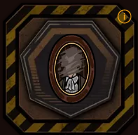

- 가격: 151 · 획득: 통상 · 강화: 가능
- 연관: 환상체: 어느 날의 초상 · 첫 등장: 거울의 거울 (거울 던전 2)

**기본**

- 전투 시작 시, 정신력이 0 미만인 모든 적(환상체일 경우, 무작위 부위 하나)에게 침잠 위력 2 부여.
- 질투 속성 스킬을 사용할 때마다 다음 턴에 모든 적(환상체일 경우, 무작위 부위 하나)에게 침잠 위력 1 나누어 부여.

**+**

- 전투 시작 시, 정신력이 0 미만인 모든 적(환상체일 경우, 무작위 부위 하나)에게 침잠 위력 3 부여.
- 질투 속성 스킬을 사용할 때마다 다음 턴에 모든 적(환상체일 경우, 무작위 부위 하나)에게 침잠 위력 2 나누어 부여.

**++**

- 전투 시작 시, 정신력이 0 미만인 모든 적(환상체일 경우, 무작위 부위 하나)에게 침잠 위력 4, 침잠 횟수 1 부여.
- 질투 속성 스킬을 사용할 때마다 다음 턴에 모든 적(환상체일 경우, 무작위 부위 하나)에게 침잠 위력 3 나누어 부여.

### Ⅰ 칸타빌레

- 가격: 156 · 획득: 한정 · 하드 난이도 한정 · 강화: 불가
- 연관: 환상체: 죽을 나비의 장례 · 첫 등장: 꿈결의 거울 (거울 던전 5)

**효과**

- 기본 공격 스킬 사용시, 적의 침잠 위력이 5 이상이면, 대상의 (침잠 위력 / 10)만큼 자신의 정신력 회복 (최대 3)

### Ⅱ 녹아내린 시계태엽

- 가격: 206 · 획득: 통상 · 강화: 불가
- 연관: 환상체: 시간오리 · 첫 등장: 거울의 거울 (거울 던전 2)

**효과**

- 턴 시작 시 침잠 상태인 적의 공격 레벨과 방어 레벨이 이번 턴 동안 3만큼 감소

### Ⅱ 뒤엉킨 뼛조각

- 가격: 207 · 획득: 통상 · 강화: 불가
- 연관: 환상체: 뼈무덤 · 첫 등장: 꿈결의 거울 (거울 던전 5)

**효과**

- 턴 시작시 침잠 위력, 침잠 횟수, 혹은 특수 침잠을 부여하는 공격 스킬을 보유한 인원이 5인 이상이면, 이번 전투 동안 발동 (E.G.O 스킬 제외. 대기 인원 제외)
- 턴 시작시 침잠을 보유한 적 (환상체일 경우 모든 부위)들이 (직전 턴에 피격을 받아 소모한 침잠 횟수/3)만큼 침잠 횟수를 다시 얻음
- 기본 스킬 적중 대상의 정신력이 0 미만일 경우(정신력이 없을 경우 우울 내성이 1.5 이상일 때), (침잠 위력/10)만큼 우울 속성 피해를 입힘 (최소 대미지 1, 해당 효과는 턴 당 10회 발동 가능)

### Ⅱ 빛바랜 외투

- 가격: 209 · 획득: 한정 · 하드 난이도 한정 · 강화: 불가
- 연관: 불명 · 첫 등장: 꿈결의 거울 (거울 던전 5)

**효과**

- 턴 종료 시 정신력이 -45인 적이 3명 이상이면, 다음 턴에 모든 아군이 공격 레벨 증가 2 얻음

### Ⅱ 유골 부스러기

- 가격: 205 · 획득: 통상 · 강화: 불가
- 연관: 환상체: 뼈무덤 · 첫 등장: 거울의 거울 (거울 던전 2)

**효과**

- 전투 시작 단계에서 침잠 상태인 적에게 가하는 피해량 +12.5%, 대상에게 받는 피해량 -12.5%.
- 우울 속성 스킬을 보유한 아군은 효과가 강화되어, 침잠 상태인 적에게 가하는 피해량 +20%, 대상에게 받는 피해량 -20%.

### Ⅱ 장엄

- 가격: 215 · 획득: 통상 · 강화: 가능
- 연관: 환상체: 나는 비워내느니 · 첫 등장: 폭풍의 거울 (거울 던전 4)

**기본**

- [편성 1번, 2번 인격 전용 효과]
- 침잠 위력과 침잠 횟수의 합이 10 이상인 적에게 침잠 위력, 침잠 횟수 또는 특수 침잠을 부여하는 공격 스킬로 피해를 입힐 경우, 공격 종료 시 침잠 위력 2, 침잠 횟수 2 부여 (인격별 턴 당 2회)
- 집중 전투 방식의 전투 스테이지에서는 효과가 변경되어 침잠 위력 4, 침잠 횟수 2 부여 (인격별 턴 당 1회)

**+**

- [편성 1번, 2번, 3번 인격 전용 효과]
- 침잠 위력과 침잠 횟수의 합이 8 이상인 적에게 침잠 위력, 침잠 횟수 또는 특수 침잠을 부여하는 공격 스킬로 피해를 입힐 경우, 공격 종료 시 침잠 위력 3, 침잠 횟수 2 부여 (인격별 턴 당 2회)
- 집중 전투 방식의 전투 스테이지에서는 효과가 변경되어 침잠 위력 5, 침잠 횟수 2 부여 (인격별 턴 당 1회)

**++**

- [편성 1번, 2번, 3번 인격 전용 효과]
- 침잠 위력과 침잠 횟수의 합이 5 이상인 적에게 침잠 위력, 침잠 횟수 또는 특수 침잠을 부여하는 공격 스킬로 피해를 입힐 경우, 공격 종료 시 침잠 위력 3, 침잠 횟수 3 부여 (인격별 턴 당 2회)
- 집중 전투 방식의 전투 스테이지에서는 효과가 변경되어 침잠 위력 5, 침잠 횟수 3 부여 (인격별 턴 당 1회)

### Ⅱ 적색 지령

- 가격: 188 · 획득: 통상 · 강화: 가능
- 연관: 환상체: 지네사도 · 첫 등장: 거울의 거울 (거울 던전 2)

**기본**

- 아군이 스킬 효과로 적에게 침잠 위력, 침잠 횟수 또는 특수 침잠을 부여할 때마다 해당 인격이 다음 턴에 공격 레벨이 1 증가 (최대 3).
- 우울 또는 분노 속성 공격 스킬을 보유한 아군의 경우, 효과가 강화되어 침잠 위력 또는 침잠 횟수를 부여할 때마다 다음 턴에 공격 레벨이 2 증가 (최대 4).

**+**

- 아군이 스킬 효과로 적에게 침잠 위력, 침잠 횟수 또는 특수 침잠을 부여할 때마다 해당 인격이 다음 턴에 공격 레벨이 1 증가 (최대 4).
- 우울 또는 분노 속성 공격 스킬을 보유한 아군의 경우, 효과가 강화되어 침잠 위력 또는 침잠 횟수를 부여할 때마다 다음 턴에 공격 레벨이 2 증가 (최대 5).

**++**

- 아군이 스킬 효과로 적에게 침잠 위력, 침잠 횟수 또는 특수 침잠을 부여할 때마다 해당 인격이 다음 턴에 공격 레벨이 2 증가 (최대 4).
- 우울 또는 분노 속성 공격 스킬을 보유한 아군의 경우, 효과가 강화되어 침잠 위력 또는 침잠 횟수를 부여할 때마다 다음 턴에 공격 레벨이 3 증가 (최대 6).

### Ⅲ 고장난 나침반

- 가격: 263 · 획득: 통상 · 강화: 가능
- 연관: 환상체: 길 잃은 탐험가 · 첫 등장: 호수의 거울 (거울 던전 3)

**기본**

- 웨이브 첫 턴 시작 시, 모든 적(환상체일 경우, 모든 부위)에게 침잠 횟수 (5 + 등장한 적의 수 × 3)만큼 무작위로 나누어 부여 (환상체일 경우, 적 숫자는 본체 하나로 계산).

**+**

- 웨이브 첫 턴 시작 시, 모든 적(환상체일 경우, 모든 부위)에게 침잠 횟수 (10 + 등장한 적의 수 × 3)만큼 무작위로 나누어 부여 (환상체일 경우, 적 숫자는 본체 하나로 계산).

**++**

- 웨이브 첫 턴 시작 시, 모든 적(환상체일 경우, 모든 부위)에게 침잠 횟수 (10 + 등장한 적의 수 × 4)만큼 무작위로 나누어 부여 (환상체일 경우, 적 숫자는 본체 하나로 계산).

### Ⅲ 머나먼 별

- 가격: 257 · 획득: 통상 · 강화: 불가
- 연관: 불명 · 첫 등장: 폭풍의 거울 (거울 던전 4)

**효과**

- 침잠 위력, 침잠 횟수 또는 특수 침잠을 부여하거나 획득하는 기본 공격 스킬을 사용하여 적에게 적중 시, 대상이 보유한 침잠 효과(특수 침잠을 포함)를 발동시킬 때마다 턴 종료 시 자신의 정신력 3 회복 (인격 별로 턴 당 2회).
- 턴 시작 시 정신력이 45일 경우 효과가 변경되어, 기본 공격 스킬을 사용하여 적에게 적중 시, 대상이 보유한 침잠 효과(특수 침잠을 포함)를 발동시킬 때마다 대상 적에게 침잠 횟수 2 부여 (인격 별로 턴 당 2회)

### Ⅲ 서지 글로브

- 가격: 251 (구매불가) · 획득: 합성 · 하드 난이도 한정 · 강화: 불가
- 조합식: 칸타빌레 + 빛바랜 외투
- 연관: 불명 · 첫 등장: 꿈결의 거울 (거울 던전 5)

**효과**

- 턴 시작 시, 침잠 위력, 침잠 횟수 또는 특수 침잠을 부여하는 공격 스킬을 보유한 인격이 5인 이상이면, 이번 전투 동안 발동 (E.G.O 스킬 제외. 대기 인원 제외)
- 기본 공격 스킬 사용 시, 적의 침잠 위력이 5 이상이면, 대상의 (침잠 위력 / 10)만큼 자신의 정신력 회복 (최대 5)
- 턴 종료 시 정신력이 -45인 적의 수만큼 다음 턴에 모든 아군이 공격 레벨 증가 얻음 (최대 3)

### Ⅲ 파란 별조각

- 가격: 246 · 획득: 통상 · 강화: 가능
- 연관: 불명 · 첫 등장: 영생의 거울 (거울 던전 6)

**기본**

- 사기저하 또는 패닉 상태인 적의 스킬 최종 위력 -1 (정신력이 없는 적은 침잠 위력이 25 이상일 때 발동)
- - 해당 적에게 침잠 위력, 침잠 횟수 또는 특수 침잠을 부여하는 스킬로 피해를 입힐 경우, 다음 턴에 방어 레벨 감소 2 부여 (턴당 최대 2회)

**+**

- 사기저하 또는 패닉 상태인 적의 스킬 최종 위력 -2 (정신력이 없는 적은 침잠 위력이 15 이상일 때 발동)
- - 해당 적에게 침잠 위력, 침잠 횟수 또는 특수 침잠을 부여하는 스킬로 피해를 입힐 경우, 다음 턴에 방어 레벨 감소 3 부여 (턴당 최대 2회)

**++**

- 사기저하 또는 패닉 상태인 적의 스킬 최종 위력 -3 (정신력이 없는 적은 침잠 위력이 10 이상일 때 발동)
- - 해당 적에게 침잠 위력, 침잠 횟수 또는 특수 침잠을 부여하는 스킬로 피해를 입힐 경우, 다음 턴에 방어 레벨 감소 3 부여 (턴당 최대 3회)

### Ⅲ 한겨울 밤의 악몽

- 가격: 259 · 획득: 통상 · 강화: 불가
- 연관: 환상체: 요정초롱 · 첫 등장: 거울의 거울 (거울 던전 2)

**효과**

- 스킬을 사용하여 적에게 적중 시 체력 피해를 입혔다면, 대상에게 침잠 위력 3 부여.
- 탐식 속성 스킬을 사용할 경우, 효과가 강화되어 대상에게 침잠 위력 5 부여.

### Ⅳ 검은 악보

- 가격: 427 (구매불가) · 획득: 합성 · 강화: 불가
- 조합식: 한겨울 밤의 악몽 + 뒤엉킨 뼛조각 + 머리 없는 초상화
- 연관: 캐릭터: 검은침묵 · 첫 등장: 호수의 거울 (거울 던전 3)

**효과**

- 턴 시작 시, 침잠 위력, 침잠 횟수 또는 특수 침잠을 부여하는 공격 스킬을 보유한 인격이 5인 이상이면, 이번 전투 동안 발동 (E.G.O 스킬 제외. 대기 인원 제외)
- 스킬을 사용하여 적에게 적중 시, 대상에게 침잠 위력 5 부여.
- 턴 시작 시, 모든 적 또는 부위가 각자 직전 턴에 피격을 받아 소모한 침잠 횟수의 절반만큼 침잠 횟수를 다시 얻음.
- 기본 공격 스킬 적중시, (대상의 침잠 위력/10)만큼 우울 속성 피해 (최소 대미지 1)
- 기본 공격 스킬 적중 시, 대상의 0 미만의 정신력 1 당 스킬 피해량 +1%.
- - 대상이 패닉 상태면, 대신 스킬 피해량 +50%
- - 정신력이 없는 대상이면, 대상이 보유한 침잠 위력 2 당 스킬 피해량 +1%. 침잠 위력이 90 이상이면, 대신 스킬 피해량 +50%

### Ⅳ 덮칠 파도

- 가격: 401 (구매불가) · 획득: 합성 · 하드 난이도 한정 · 강화: 불가
- 조합식: 가시밭길 + 머나먼 별 + 서지 글로브
- 연관: 불명 · 첫 등장: 꿈결의 거울 (거울 던전 5)

**효과**

- 턴 시작 시, 침잠 위력, 침잠 횟수 또는 특수 침잠을 부여하는 공격 스킬을 보유한 인격이 5인 이상이면, 이번 전투 동안 발동 (E.G.O 스킬 제외. 대기 인원 제외)
- 턴 시작시, 무작위 적 하나에게 역류 1 부여
- 역류를 보유한 적 사망 시, 대상의 역류 수치만큼 역류 수치가 최대치가 아닌 가장 높은 적에게 다음 턴 시작 시 역류 부여
- 침잠 위력, 침잠 횟수 또는 특수 침잠을 부여하는 스킬을 사용하여 적에게 적중 시 체력 피해를 입혔다면, 턴 종료 시 대상에게 침잠 위력 4, 침잠 횟수 3 부여 (적 1명 당 턴 당 1회 발동)
- 우울 또는 색욕 완전 공명을 발동하였다면, 전투 시작 시, 모든 적 (환상체일 경우, 무작위 부위 하나)에게 침잠 위력 3, 침잠 횟수 3 부여.
- 기본 공격 스킬 사용 시, 적의 침잠 위력이 10 이상이면, 대상의 (침잠 위력 / 10)만큼 자신의 정신력 회복, 대상에게 방어 레벨 감소 부여 (최대 5. 적 1명 당 턴 당 1회 발동)
- 턴 종료 시 정신력이 -45이거나 정신력이 없는 적의 수만큼 다음 턴에 모든 아군이 공격 레벨 증가 얻음 (최대 6)
- 침잠 위력, 횟수 또는 특수 침잠을 부여하는 더하기 코인 스킬의 코인 위력 +1
- 침잠 위력, 횟수 또는 특수 침잠을 부여하는 빼기 코인 스킬의 기본 위력 +(4/코인 수) (최소 1. 소수점 버림)
- 침잠 위력, 침잠 횟수 또는 특수 침잠을 부여하거나 획득하는 기본 공격 스킬을 사용하여 적에게 적중 시, 대상이 보유한 침잠 효과(특수 침잠을 포함)를 발동시킬 때마다 턴 종료 시 자신의 정신력 5 회복 (인격 별로 턴 당 2회).
- 턴 시작 시 정신력이 45일 경우 효과가 변경되어, 기본 공격 스킬을 사용하여 적에게 적중 시, 대상이 보유한 침잠 효과(특수 침잠을 포함)를 발동시킬 때마다 대상 적에게 침잠 횟수 3 부여 (인격 별로 턴 당 2회)

### Ⅳ 미적 감각

- 가격: 373 · 획득: 통상 · 강화: 가능
- 연관: 불명 · 첫 등장: 거울의 거울 (거울 던전 2)

**기본**

- 정신력 감소로 인하여 부정적 효과(사기 저하, 패닉)를 얻은 적에게 입히는 피해량 35% 증가.
- 침잠 위력을 부여하거나 횟수를 증가시키는 스킬일 경우, 추가로 피해량 10% 증가 (특수 침잠 포함)
- 정신력이 없는 적에게 침잠 효과가 적용될 경우, 우울 속성 피해를 입히는 대신 이를 포함한 죄악 속성 중 가장 효과적인 속성 피해로 변경.

**+**

- 정신력이 0 미만인 적에게 입히는 피해량 40% 증가.
- 침잠 위력을 부여하거나 횟수를 증가시키는 스킬일 경우, 추가로 피해량 10% 증가 (특수 침잠 포함)
- 정신력이 없는 적에게 침잠 효과가 적용될 경우, 우울 속성 피해를 입히는 대신 이를 포함한 죄악 속성 중 가장 효과적인 속성 피해로 변경.

**++**

- 정신력이 없거나 0 미만인 적에게 입히는 피해량 50% 증가.
- 침잠 위력을 부여하거나 횟수를 증가시키는 스킬일 경우, 추가로 피해량 10% 증가 (특수 침잠 포함)
- 정신력이 없는 적에게 침잠 효과가 적용될 경우, 우울 속성 피해를 입히는 대신 이를 포함한 죄악 속성 중 가장 효과적인 속성 피해로 변경.

### Ⅳ 잠식 조각

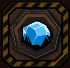

- 가격: 400 · 획득: 통상 · 강화: 불가
- 연관: 불명 · 첫 등장: 폭풍의 거울 (거울 던전 4)

**효과**

- 침잠 위력, 침잠 횟수 또는 특수 침잠을 부여하는 E.G.O 스킬 사용 시 발동
- 소모하는 (우울 E.G.O 자원 +나머지 E.G.O 자원의 합/3)만큼 최종 위력이 증가, 피해량 +50%
- 우울 속성 E.G.O 스킬의 경우, 효과가 강화되어 공격 시작 전에 침잠 횟수를 추가로 부여(ZAYIN의 경우 2, 등급이 오를수록 +1)하고 피해량 +(소모한 정신력x2.5)%.

## 호흡 (18)

### Ⅰ 녹빛 겉날개

- 가격: 160 · 획득: 통상 · 강화: 가능
- 연관: 환상체: 키다리 요정 · 첫 등장: 폭풍의 거울 (거울 던전 4)

**기본**

- 웨이브 첫 턴 시작 시, 속도가 제일 빠른 아군 하나가 호흡 위력 3, 호흡 횟수 2 얻음.
- 질투 속성 공격 스킬을 보유한 아군일 경우, 효과가 강화되어 호흡 위력 4, 호흡 횟수 3 얻음.

**+**

- 웨이브 첫 턴 시작 시, 속도가 제일 빠른 아군 하나가 호흡 위력 4, 호흡 횟수 4 얻음.
- 질투 속성 공격 스킬을 보유한 아군일 경우, 효과가 강화되어 호흡 위력 5, 호흡 횟수 5 얻음.

**++**

- 턴 시작시, 속도가 제일 빠른 아군 하나가 호흡 위력 4, 호흡 횟수 4 얻음.
- 질투 속성 공격 스킬을 보유한 아군일 경우, 효과가 강화되어 호흡 위력 5, 호흡 횟수 5 얻음.

### Ⅰ 데블스 셰어

- 가격: 144 · 획득: 통상 · 강화: 가능
- 연관: 불명 · 첫 등장: 폭풍의 거울 (거울 던전 4)

**기본**

- 턴 종료 시, 호흡 위력이 제일 높은 아군 하나와 호흡 횟수가 제일 높은 아군 하나에게 다음 턴에 신속 1 부여. (같은 인격일 경우 중복 가능)
- 색욕 속성 공격 스킬을 보유한 아군일 경우, 효과가 강화되어 신속 2 부여. (E.G.O 스킬 제외)

**+**

- 턴 종료 시, 호흡 위력이 제일 높은 아군 하나와 호흡 횟수가 제일 높은 아군 하나에게 다음 턴에 신속 1, 공격 레벨 증가 1 부여. (같은 인격일 경우 중복 가능)
- 색욕 속성 공격 스킬을 보유한 아군일 경우, 효과가 강화되어 신속 2, 공격 레벨 증가 2 부여. (E.G.O 스킬 제외)

**++**

- 턴 종료 시, 호흡 위력이 제일 높은 아군 하나와 호흡 횟수가 제일 높은 아군 하나에게 다음 턴에 신속 1, 공격 레벨 증가 1, 피해량 증가 1 부여. (같은 인격일 경우 중복 가능)
- 색욕 속성 공격 스킬을 보유한 아군일 경우, 효과가 강화되어 신속 2, 공격 레벨 증가 2, 피해량 증가 2 부여. (E.G.O 스킬 제외)

### Ⅰ 장식된 편자

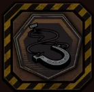

- 가격: 154 · 획득: 통상 · 강화: 가능
- 연관: 불명 · 첫 등장: 호수의 거울 (거울 던전 3)

**기본**

- 턴 시작 시, 호흡 상태가 아닌 무작위 아군 하나에게 호흡 위력 2 부여.
- 모든 아군이 호흡 상태일 경우, 효과가 변경되어 모든 아군에게 호흡 횟수 1 부여.

**+**

- 턴 시작 시, 호흡 상태가 아닌 무작위 아군 하나에게 호흡 위력 3 부여.
- 모든 아군이 호흡 상태일 경우, 효과가 변경되어 모든 아군에게 호흡 횟수 2 부여.

**++**

- 턴 시작 시, 호흡 상태가 아닌 무작위 아군 둘에게 호흡 위력 3 부여.
- 모든 아군이 호흡 상태일 경우, 효과가 변경되어 모든 아군에게 호흡 횟수 3 부여.

### Ⅰ 추억의 펜던트

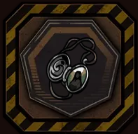

- 가격: 145 · 획득: 통상 · 강화: 가능
- 연관: 환상체: 흉탄의 사수 · 첫 등장: 거울의 거울 (거울 던전 2)

**기본**

- 전투 시작 시, 무작위 아군 하나가 호흡 위력 3 얻음 (공격 스킬을 사용하여 호흡 횟수를 획득하는 인격을 우선으로 지정).
- 우울 속성 공격 스킬을 보유한 아군에게 우선으로 적용되며, 이 경우에는 호흡 위력 3 얻고 호흡 횟수 2 증가.

**+**

- 전투 시작 시, 무작위 아군 하나가 호흡 위력 4 얻음 (공격 스킬을 사용하여 호흡 횟수를 획득하는 인격을 우선으로 지정).
- 우울 속성 공격 스킬을 보유한 아군에게 우선으로 적용되며, 이 경우에는 호흡 위력 4 얻고 호흡 횟수 3 증가.

**++**

- 전투 시작 시, 무작위 아군 둘이 호흡 위력 4 얻음 (공격 스킬을 사용하여 호흡 횟수를 획득하는 인격을 우선으로 지정).
- 우울 속성 공격 스킬을 보유한 아군에게 우선으로 적용되며, 이 경우에는 호흡 위력 4 얻고 호흡 횟수 3 증가.

### Ⅱ 낡은 목각 인형

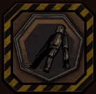

- 가격: 214 · 획득: 통상 · 강화: 가능
- 연관: 환상체: 누구도 울지 않도록 · 첫 등장: 폭풍의 거울 (거울 던전 4)

**기본**

- [편성 1번, 2번 인격 전용 효과]
- 적에게 치명타 피해를 입힐 때마다 다음 턴에 방어 레벨 감소 1 부여 (인격별로 턴 당 3회까지 부여 가능).
- [중첩 발동 불가] 홍적 돈키호테 E.G.O의 패시브가 발동시, 이 효과가 발동하지 않음.

**+**

- [편성 1번, 2번, 3번 인격 전용 효과]
- 적에게 치명타 피해를 입힐 때마다 다음 턴에 방어 레벨 감소 1 부여 (인격별로 턴 당 4회까지 부여 가능).
- [중첩 발동 불가] 홍적 돈키호테 E.G.O의 패시브가 발동시, 이 효과가 발동하지 않음.

**++**

- [편성 1번, 2번, 3번 인격 전용 효과]
- 적에게 치명타 피해를 입힐 때마다 다음 턴에 방어 레벨 감소 1 부여 (인격별로 턴 당 6회까지 부여 가능).
- [중첩 발동 불가] 홍적 돈키호테 E.G.O의 패시브가 발동시, 이 효과가 발동하지 않음.

### Ⅱ 네뷸라이저

- 가격: 218 · 획득: 통상 · 강화: 가능
- 연관: 환상체: 지난 날의 침낭 · 첫 등장: 거울의 거울 (거울 던전 2)

**기본**

- 스테이지 첫 턴 시작시 모든 아군이 호흡 위력 4 얻고 호흡 횟수 4 증가
- 오만 완전 공명을 발동하였다면 전투 시작 시, 모든 아군이 호흡 위력 2 얻고 호흡 횟수 2 증가.
- - [중첩 발동 불가] 흉통 료슈 E.G.O 패시브 「숨」발동시, 이 효과가 발동하지 않음.

**+**

- 웨이브 첫 턴 시작시 모든 아군이 호흡 위력 5 얻고 호흡 횟수 4 증가
- 오만 완전 공명을 발동하였다면 전투 시작 시, 모든 아군이 호흡 위력 3 얻고 호흡 횟수 2 증가
- - [중첩 발동 불가] 흉통 료슈 E.G.O 패시브 「숨」발동시, 이 효과가 발동하지 않음.

**++**

- 웨이브 첫 턴 시작시 모든 아군이 호흡 위력 5 얻고 호흡 횟수 5 증가
- 오만 공명을 발동하였다면 전투 시작 시, 모든 아군이 호흡 위력 3 얻고 호흡 횟수 3 증가
- - [중첩 발동 불가] 흉통 료슈 E.G.O 패시브 「숨」발동시, 이 효과가 발동하지 않음.

### Ⅱ 돌무덤

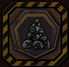

- 가격: 196 · 획득: 통상 · 강화: 가능
- 연관: 환상체: 탑돌이 · 첫 등장: 거울의 거울 (거울 던전 2)

**기본**

- 아군이 스킬 효과로 획득하는 호흡 위력 수치가 1.5배로 적용.
- 아군이 나태 속성 스킬을 사용하여 적을 처치하였다면, 다음 턴 시작 시 호흡 위력 2, 호흡 횟수 2 획득. (턴당 1회)

**+**

- 아군이 스킬 효과로 획득하는 호흡 위력 수치가 1.5배로 적용.
- 아군이 적을 처치하였다면, 다음 턴 시작 시 호흡 위력 3, 호흡 횟수 2 획득. (턴당 1회)

**++**

- 아군이 스킬 효과로 획득하는 호흡 위력 수치가 2배로 적용.
- 아군이 적을 처치하였다면, 다음 턴 시작 시 호흡 위력 4, 호흡 횟수 2 획득. (턴당 1회)

### Ⅱ 물부리

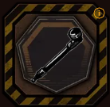

- 가격: 197 · 획득: 통상 · 강화: 불가
- 연관: 불명 · 첫 등장: 거울의 거울 (거울 던전 2)

**효과**

- 턴 시작 시, 호흡 상태인 아군이 위력 증가 1 얻음.
- 호흡 횟수를 5 이상 보유한 아군의 경우에는 효과가 강화되어, 위력 증가 2 얻음.

### Ⅱ 어느 날의 기억

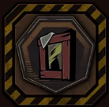

- 가격: 213 · 획득: 통상 · 강화: 불가
- 연관: 환상체: 어느 날의 초상 · 첫 등장: 꿈결의 거울 (거울 던전 5)

**효과**

- 스킬을 사용(E.G.O 스킬 제외)하여 호흡 위력 또는 호흡 횟수를 획득하는 인격이 사용하는 스킬 3의 최종 위력 +2

### Ⅱ 엔젤스 컷

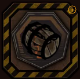

- 가격: 211 · 획득: 한정 · 하드 난이도 한정 · 강화: 불가
- 연관: 환상체: 주정뱅이 · 첫 등장: 꿈결의 거울 (거울 던전 5)

**효과**

- 턴 종료 시, 각 아군이 자신의 호흡 위력이 20을 초과했으면, 호흡 위력을 1 소모하여 호흡 횟수 1 증가

### Ⅲ 네잎클로버

- 가격: 260 · 획득: 통상 · 강화: 불가
- 연관: 환상체: 키다리 요정 · 첫 등장: 거울의 거울 (거울 던전 2)

**효과**

- 전투 시작 단계에서 호흡 상태인 아군이 스킬을 사용하여 적에게 치명타 피해를 입힐 경우, 다음 턴 시작 시 호흡 위력 5 얻고 호흡 횟수 2 증가. (턴당 1회 발동)
- 탐식 속성 스킬을 사용한 경우에는 효과가 강화되어, 다음 턴 시작 시 호흡 위력 7 얻고 호흡 횟수 3 증가.

### Ⅲ 미련

- 가격: 243 · 획득: 통상 · 강화: 불가
- 연관: 불명 · 첫 등장: 폭풍의 거울 (거울 던전 4)

**효과**

- [편성 1번, 2번 인격 전용 효과]
- 턴 시작 시, 호흡 위력과 호흡 횟수의 합이 10 이상인 아군이 합 위력 +1, 피해량 증가 1 얻음.
- 수치의 합이 20 이상인 경우, 효과가 강화되어 합 위력 +1, 피해량 증가 3 얻음.
- 수치의 합이 40 이상인 경우, 효과가 최대로 강화되어 합 위력 +2, 피해량 증가 3 얻음.

### Ⅲ 엔도르핀 키트

- 가격: 251 · 획득: 통상 · 강화: 가능
- 연관: 환상체: 꿈먹는 탁류 · 첫 등장: 거울의 거울 (거울 던전 2)

**기본**

- 스킬 효과로 호흡 위력을 획득할 때마다 대상이 호흡 위력 1, 호흡 횟수 1 얻음.
- 질투 속성의 스킬을 사용할 경우, 효과가 강화되어 호흡 위력 2, 호흡 횟수 2 얻음

**+**

- 스킬 효과로 호흡 위력을 획득할 때마다 대상이 호흡 위력 2, 호흡 횟수 2 얻음.
- 질투 속성의 스킬을 사용할 경우, 효과가 강화되어 호흡 위력 3, 호흡 횟수 3 얻음

**++**

- 스킬 효과로 호흡 위력을 획득할 때마다 대상이 호흡 위력 3, 호흡 횟수 3 얻음.
- 질투 속성의 스킬을 사용할 경우, 효과가 강화되어 호흡 위력 4, 호흡 횟수 4 얻음

### Ⅲ 추억

- 가격: 261 (구매불가) · 획득: 합성 · 강화: 불가
- 조합식: 어느 날의 기억 + 추억의 펜던트
- 연관: 불명 · 첫 등장: 꿈결의 거울 (거울 던전 5)

**효과**

- 턴 시작 시, 호흡 위력 또는 호흡 횟수를 부여 또는 획득하는 공격 스킬을 보유한 인격이 5인 이상이면, 이번 전투 동안 발동 (E.G.O 스킬 제외. 대기 인원 제외)
- 스킬을 사용(E.G.O 스킬 제외)하여 호흡 위력 또는 호흡 횟수를 획득하는 인격이 사용하는 스킬 3의 더하기 코인 위력 +1
- - 빼기 코인 스킬일 경우, 더하기 코인 위력 대신 기본 위력 +(4/코인 수) (최소 1, 소수점 버림)
- 전투 시작 시, 무작위 아군 하나가 호흡 위력 3 얻음 (공격 스킬을 사용하여 호흡 횟수를 획득하는 인격을 우선으로 지정). 우울 속성 공격 스킬을 보유한 아군에게 우선으로 적용되며, 이 경우에는 호흡 위력 3 얻고 호흡 횟수 2 증가.

### Ⅳ 교만 조각

- 가격: 400 · 획득: 통상 · 강화: 불가
- 연관: 불명 · 첫 등장: 폭풍의 거울 (거울 던전 4)

**효과**

- 호흡 위력 또는 호흡 횟수를 부여 또는 획득하는 E.G.O 스킬 사용 시 발동
- 소모하는 (오만 E.G.O 자원 + 나머지 E.G.O 자원의 합/3)만큼 최종 위력이 증가, 피해량 +50%
- 오만 속성 E.G.O 스킬의 경우, 효과가 강화되어 공격 시작 전에 호흡 횟수를 추가로 획득(ZAYIN의 경우 2, 등급이 오를수록 +1)하고 피해량 +(소모한 E.G.O 자원의 합x8)%

### Ⅳ 명경지수

- 가격: 390 · 획득: 통상 · 강화: 가능
- 연관: 불명 · 첫 등장: 거울의 거울 (거울 던전 2)

**기본**

- 아군이 치명타로 가하는 피해량이 1.2배에서 1.7배로 증가.
- 치명타가 발생하여 호흡 횟수를 소모하였을 경우, 다음 턴에 해당 인격이 공격 레벨 증가 10 얻음 (인격별로 턴 당 1회 발동).

**+**

- 아군이 치명타로 가하는 피해량이 1.2배에서 2배로 증가.
- 치명타가 발생하여 호흡 횟수를 소모하였을 경우, 다음 턴에 해당 인격이 공격 레벨 증가 12 얻음 (인격별로 턴 당 1회 발동).

**++**

- 아군이 치명타로 가하는 피해량이 1.2배에서 2.5배로 증가.
- 치명타가 발생하여 호흡 횟수를 소모하였을 경우, 다음 턴에 해당 인격이 공격 레벨 증가 15 얻음 (인격별로 턴 당 1회 발동).

### Ⅳ 복주머니

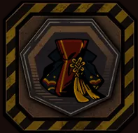

- 가격: 410 (구매불가) · 획득: 합성 · 강화: 불가
- 조합식: 네잎클로버 + 장식된 편자 + 추억
- 연관: 불명 · 첫 등장: 호수의 거울 (거울 던전 3)

**효과**

- 턴 시작 시, 호흡 위력 또는 호흡 횟수를 부여 또는 획득하는 공격 스킬을 보유한 인격이 5인 이상이면, 이번 전투 동안 발동 (E.G.O 스킬 제외. 대기 인원 제외)
- 전투 시작 단계에서 호흡 상태인 무작위 아군이 스킬을 사용하여 적에게 치명타 피해를 입힐 경우, 다음 턴 시작 시 모든 아군이 호흡 위력 7 얻고 호흡 횟수 7 증가 (턴 당 1회 발동).
- 호흡 위력 또는 호흡 횟수를 획득하는 인격이 사용하는 3스킬의 최종 위력 +3, 더하기 코인 위력 +(12/코인 수), 피해량 +(50/코인 수)%.
- - 빼기 코인 스킬일 경우, 더하기 코인 위력 대신 최종 위력 +(12/코인 수) (최소 1, 소수점 버림)
- 전투 시작 시, 무작위 아군 하나가 호흡 위력 3 얻음 (공격 스킬을 사용하여 호흡 횟수를 획득하는 인격을 우선으로 지정). 우울 속성 공격 스킬을 보유한 아군에게 우선으로 적용되며, 이 경우에는 호흡 위력 3 얻고 호흡 횟수 2 증가.

### Ⅳ 캐스크 스피리츠

- 가격: 402 (구매불가) · 획득: 합성 · 하드 난이도 한정 · 강화: 불가
- 조합식: 데블스 셰어 + 엔젤스 컷 + 엔도르핀 키트
- 연관: 불명 · 첫 등장: 꿈결의 거울 (거울 던전 5)

**효과**

- 턴 시작 시, 호흡 위력 또는 호흡 횟수를 부여 또는 획득하는 공격 스킬을 보유한 인격이 5인 이상이면, 이번 전투 동안 발동 (E.G.O 스킬 제외. 대기 인원 제외)
- 턴 종료 시, 각 아군이 자신의 호흡 위력이 20을 초과했으면, 호흡 위력을 1 소모하여 호흡 횟수 1 증가
- 턴 종료 시, 호흡 위력이 제일 높은 아군 하나와 호흡 횟수가 제일 높은 아군 하나에게 다음 턴에 신속 2, 공격 레벨 증가 1, 피해량 증가 1 부여 (같은 인격일 경우 중복 가능)
- 스킬 효과로 호흡 위력을 획득할 때마다 해당 캐릭터가 호흡 위력 2, 호흡 횟수 2 얻음. 보유한 호흡 위력과 호흡 횟수의 합이 20 미만이면, 대신 호흡 위력 3, 호흡 횟수 3 얻음.
- 턴 종료 시, 자신의 호흡 위력이 40을 초과하면, 호흡 위력을 15 소모하여 자신의 모든 스킬 슬롯에서 등급이 가장 낮은 스킬을 1개 버림 (캐릭터당, 턴 당 1회)

## 충전 (18)

### Ⅰ 무정전 전원장치

- 가격: 156 · 획득: 통상 · 강화: 가능
- 연관: 환상체: kqe-1j-23 · 첫 등장: 폭풍의 거울 (거울 던전 4)

**기본**

- 턴 종료 시 충전 횟수가 3 미만인 경우에는 다음 턴 시작 시 충전 횟수 3 증가. (특수 충전을 포함)
- 턴 종료 시 충전 횟수가 3 이상인 경우에는 다음 턴 시작 시 피해량 증가 1 얻음. (특수 충전을 포함)

**+**

- 턴 종료 시 충전 횟수가 4 미만인 경우에는 다음 턴 시작 시 충전 횟수 3 증가. (특수 충전을 포함)
- 턴 종료 시 충전 횟수가 4 이상인 경우에는 다음 턴 시작 시 피해량 증가 1 얻음. (특수 충전을 포함)

**++**

- 턴 종료 시 충전 횟수가 5 미만인 경우에는 다음 턴 시작 시 충전 횟수 4 증가. (특수 충전을 포함)
- 턴 종료 시 충전 횟수가 5 이상인 경우에는 다음 턴 시작 시 피해량 증가 2 얻음. (특수 충전을 포함)

### Ⅰ 손목 보호대

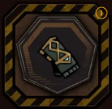

- 가격: 161 · 획득: 통상 · 강화: 가능
- 연관: 환상체: 악수의 악수 · 첫 등장: 거울의 거울 (거울 던전 2)

**기본**

- 턴 시작 시, 충전 횟수와 특수 충전을 합하여 5 이상 보유한 아군이 피해량 증가 1 얻음.
- 오만 속성 공격 스킬을 보유한 아군의 경우에는 효과가 강화되어, 피해량 증가 2 얻음.

**+**

- 턴 시작 시, 충전 횟수와 특수 충전을 합하여 3 이상 보유한 아군이 피해량 증가 1 얻음.
- 오만 속성 공격 스킬을 보유한 아군의 경우에는 효과가 강화되어, 피해량 증가 2 얻음.

**++**

- 턴 시작 시, 충전 횟수 또는 특수 충전을 보유한 아군이 피해량 증가 2 얻음.
- 오만 속성 공격 스킬을 보유한 아군의 경우에는 효과가 강화되어, 피해량 증가 3 얻음.

### Ⅰ 이력서

- 가격: 155 · 획득: 통상 · 강화: 가능
- 연관: 환상체: 죽을 나비의 장례 · 첫 등장: 거울의 거울 (거울 던전 2)

**기본**

- 턴 종료 시, 충전 횟수와 특수 충전을 합하여 7 이상 보유한 아군이 다음 턴에 신속 1 얻음.
- 우울 속성 공격 스킬을 보유한 아군의 경우, 효과가 강화되어 다음 턴에 신속 2, 공격 위력 증가 1 얻음.

**+**

- 턴 종료 시, 충전 횟수와 특수 충전을 합하여 7 이상 보유한 아군이 다음 턴에 신속 2 얻음.
- 우울 속성 공격 스킬을 보유한 아군의 경우, 효과가 강화되어 다음 턴에 신속 3, 공격 위력 증가 1 얻음.

**++**

- 턴 종료 시, 충전 횟수와 특수 충전을 합하여 7 이상 보유한 아군이 다음 턴에 신속 3 얻음.
- 우울 속성 공격 스킬을 보유한 아군의 경우, 효과가 강화되어 다음 턴에 신속 4, 공격 위력 증가 1 얻음.

### Ⅰ 제한 풀린 제세동기

- 가격: 147 · 획득: 통상 · 강화: 가능
- 연관: 환상체: 충격 지네 · 첫 등장: 폭풍의 거울 (거울 던전 4)

**기본**

- 턴 종료 시, 이번 턴에 공격 스킬을 사용하여 소모한 충전 횟수와 특수 충전의 합만큼 체력과 정신력을 회복.
- 남은 체력이 최대 체력의 절반 이하일 경우, 회복되는 수치가 1.5배로 적용.

**+**

- 턴 종료 시, 이번 턴에 공격 스킬을 사용하여 소모한 (충전 횟수와 특수 충전의 합+1)만큼 체력과 정신력을 회복.
- 남은 체력이 최대 체력의 절반 이하일 경우, 회복되는 수치가 2배로 적용.

**++**

- 턴 종료 시, 이번 턴에 공격 스킬을 사용하여 소모한 (충전 횟수와 특수 충전의 합+2)만큼 체력과 정신력을 회복.
- 남은 체력이 최대 체력의 75% 이하일 경우, 회복되는 수치가 2배로 적용.

### Ⅱ 1B 타입 팔각 볼트

- 가격: 198 · 획득: 통상 · 강화: 불가
- 연관: 환상체: 당신은 강해졌나요 · 첫 등장: 꿈결의 거울 (거울 던전 5)

**효과**

- 턴 시작 시, 충전 횟수 또는 특수 충전을 획득하는 공격 스킬을 보유한 인격이 5인 이상이면, 이번 전투 동안 발동 (E.G.O 스킬 제외. 대기 인원 제외)
- 턴 시작 시, (충전 횟수 / 10)만큼 피해량 증가를 얻음 (최대 2, 올림하여 처리. 특수 충전을 포함)
- 턴 종료 시 충전 역장이 없으면, 충전 역장 1 얻음.
- 각 인격마다 충전 횟수를 20 소모할 때 충전 위력 1 얻음. (전투당 인격별로 2회, 특수 충전은 적용되지 않음)

### Ⅱ 미니어처 전봇대

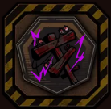

- 가격: 205 · 획득: 한정 · 하드 난이도 한정 · 강화: 불가
- 연관: 환상체: 골목파수견 · 첫 등장: 꿈결의 거울 (거울 던전 5)

**효과**

- 자신의 충전 횟수를 7 이상 소모한 공격 스킬 종료 시 대상이 사망한 경우, (해당 스킬로 소모한 충전 횟수/4)만큼 자신의 충전 횟수 증가 (특수 충전을 포함)

### Ⅱ 사원증

- 가격: 195 · 획득: 통상 · 강화: 가능
- 연관: 환상체: 버려진 직원 · 첫 등장: 거울의 거울 (거울 던전 2)

**기본**

- 분노 완전 공명을 발동하였거나 충전 횟수 또는 특수 충전을 획득하거나 부여하는 스킬을 사용할 경우, 다음 턴 시작 시 모든 아군이 충전 횟수 3 증가. (턴 당 1회 발동)

**+**

- 분노 공명을 발동하였거나 충전 횟수 또는 특수 충전을 획득하거나 부여하는 스킬을 사용할 경우, 다음 턴 시작 시 모든 아군이 충전 횟수 3 증가. (턴 당 1회 발동)

**++**

- 분노 공명을 발동하였거나 충전 횟수 또는 특수 충전을 획득하거나 부여하는 스킬을 사용할 경우, 다음 턴 시작 시 모든 아군이 충전 횟수 4 증가. (턴 당 1회 발동)

### Ⅱ 순찰용 손전등

- 가격: 210 · 획득: 통상 · 강화: 가능
- 연관: 환상체: 길 잃은 승객 · 첫 등장: 폭풍의 거울 (거울 던전 4)

**기본**

- [편성 1번, 2번 인격 전용 효과]
- 턴 시작 시 효과 대상 인격이 충전 역장 2 얻음.
- 효과 적용 대상이 충전 횟수 또는 특수 충전을 획득하거나 소모하는 스킬을 보유하였다면, 충전 역장 상태일 때 대상의 1스킬 합 위력 +1, 피해량 +10%.

**+**

- [편성 1번, 2번, 3번 인격 전용 효과]
- 턴 시작 시 효과 대상 인격이 충전 역장 3 얻음.
- 효과 적용 대상 인격이 충전 횟수 또는 특수 충전을 획득하거나 소모하는 스킬을 보유하였다면, 충전 역장 상태일 때 대상의 1스킬 합 위력 +1, 피해량 +15%.

**++**

- [편성 1번, 2번, 3번 인격 전용 효과]
- 턴 시작 시 효과 대상 인격이 충전 역장 4 얻음.
- 효과 적용 대상 인격이 충전 횟수 또는 특수 충전을 획득하거나 소모하는 스킬을 보유하였다면, 충전 역장 상태일 때 대상의 1스킬 합 위력 +1, 피해량 +25%.

### Ⅱ 야간투시경

- 가격: 184 · 획득: 통상 · 강화: 불가
- 연관: 환상체: 차원산화변이체 · 첫 등장: 거울의 거울 (거울 던전 2)

**효과**

- 턴 시작 시, 충전 횟수가 15 이상인 인격이 있을 경우 발동. (특수 충전을 포함)
- 전투 시작 시, 해당 인격이 충전 횟수를 3 소모하고 이번 턴 동안 공격 레벨 5 증가.

### Ⅱ 휴대용 전지 소켓

- 가격: 190 · 획득: 통상 · 강화: 가능
- 연관: 불명 · 첫 등장: 거울의 거울 (거울 던전 2)

**기본**

- 턴 시작 시, 무작위 아군 둘이 충전 횟수 2 증가 (스킬을 사용하여 충전 횟수 또는 특수 충전을 획득하는 인격을 우선으로 지정).
- 나태 완전 공명을 발동하였다면 전투 시작 시, 무작위 아군 하나가 충전 횟수 3 증가.

**+**

- 턴 시작 시, 무작위 아군 둘이 충전 횟수 3 증가 (스킬을 사용하여 충전 횟수 또는 특수 충전을 획득하는 인격을 우선으로 지정).
- 나태 공명을 발동하였다면 전투 시작 시, 무작위 아군 하나가 충전 횟수 3 증가.

**++**

- 턴 시작 시, 무작위 아군 셋이 충전 횟수 3 증가 (스킬을 사용하여 충전 횟수 또는 특수 충전을 획득하는 인격을 우선으로 지정).
- 나태 공명을 발동하였다면 전투 시작 시, 무작위 아군 하나가 충전 횟수 5 증가.

### Ⅲ 모조발전기

- 가격: 254 · 획득: 통상 · 강화: 불가
- 연관: 불명 · 첫 등장: 폭풍의 거울 (거울 던전 4)

**효과**

- [편성 1번, 2번 인격 전용 효과]
- 턴 시작 시 충전 횟수와 특수 충전의 합이 10 이상인 경우 발동.
- 충전 횟수 또는 특수 충전을 획득하거나 소모하는 스킬 3의 더하기 코인 위력 +1.
- - 빼기 코인 스킬일 경우, 더하기 코인 위력 대신 기본 위력 +(4/코인 수) (최소 1, 소수점 버림)
- 해당 스킬의 기본 위력이 5 미만일 경우 피해량 +25%, 기본 위력이 5 이상일 경우 더하기 코인 위력 추가로 +1.
- - 빼기 코인 스킬일 경우, 더하기 코인 위력 대신 기본 위력 +(4/코인 수) (최소 1, 소수점 버림)

### Ⅲ 물리 간섭 보호장

- 가격: 262 · 획득: 통상 · 강화: 가능
- 연관: 환상체: 메트로폴라리스의 주민 · 첫 등장: 호수의 거울 (거울 던전 3)

**기본**

- 웨이브 첫 턴 시작 시, 모든 아군이 충전 역장 3 얻음.

**+**

- 웨이브 첫 턴 시작 시, 모든 아군이 충전 역장 5 얻음.

**++**

- 웨이브 첫 턴 시작 시, 모든 아군이 충전 역장 7 얻음.

### Ⅲ 인슐레이터

- 가격: 254 (구매불가) · 획득: 합성 · 하드 난이도 한정 · 강화: 불가
- 조합식: 무정전 전원장치 + 미니어처 전봇대
- 연관: 불명 · 첫 등장: 꿈결의 거울 (거울 던전 5)

**효과**

- 턴 시작 시, 충전 횟수 또는 특수 충전을 획득하는 공격 스킬을 보유한 인격이 5인 이상이면, 이번 전투 동안 발동 (E.G.O 스킬 제외. 대기 인원 제외)
- 자신의 충전 횟수를 소모한 스킬 공격 종료 시 대상이 사망한 경우, (해당 스킬로 소모한 충전 횟수/3)만큼 자신의 충전 횟수 증가
- 턴 시작 시 충전 횟수가 3 미만인 경우, 충전 횟수 3 증가. 턴 시작 시 충전 횟수가 3 이상인 경우, 피해량 증가 1 얻음.)

### Ⅲ 피뢰침

- 가격: 247 · 획득: 통상 · 강화: 가능
- 연관: 불명 · 첫 등장: 거울의 거울 (거울 던전 2)

**기본**

- 스테이지 시작 시, 모든 아군의 충전 횟수 3 증가.
- 질투 속성 스킬을 보유하고 있는 아군이 전투에 둘 이상 참여한 경우 효과가 강화되어, 모든 아군의 충전 횟수 5 증가.

**+**

- 스테이지 시작 시, 모든 아군의 충전 횟수 4 증가.
- 질투 속성 스킬을 보유하고 있는 아군이 전투에 둘 이상 참여한 경우 효과가 강화되어, 모든 아군의 충전 횟수 6 증가.

**++**

- 스테이지 시작 시, 모든 아군의 충전 횟수 5 증가.
- 질투 속성 스킬을 보유하고 있는 아군이 전투에 둘 이상 참여한 경우 효과가 강화되어, 모든 아군의 충전 횟수 7 증가.

### Ⅳ 마찰 조각

- 가격: 400 · 획득: 통상 · 강화: 불가
- 연관: 불명 · 첫 등장: 폭풍의 거울 (거울 던전 4)

**효과**

- 충전 횟수 또는 특수 충전을 획득하거나 소모하는 E.G.O 스킬 사용시 발동
- 소모하는 (질투 E.G.O 자원 + 나머지 E.G.O 자원 / 3)만큼 최종 위력이 증가, 피해량 +50%
- 질투 속성 E.G.O 스킬의 경우, 효과가 강화되어 공격 시작 전에 충전 횟수를 추가로 획득(ZAYIN의 경우 2, 등급이 오를수록 +1)하고 피해량 +(보유한 충전 횟수와 특수 충전의 합×5)%

### Ⅳ 제 1종 영구기관

- 가격: 406 (구매불가) · 획득: 합성 · 강화: 불가
- 조합식: 물리 간섭 보호장 + 1B 타입 팔각 볼트 + 손목 보호대
- 연관: 불명 · 첫 등장: 호수의 거울 (거울 던전 3)

**효과**

- 턴 시작 시, 충전 횟수 또는 특수 충전을 획득하는 공격 스킬을 보유한 인격이 5인 이상이면, 이번 전투 동안 발동 (E.G.O 스킬 제외. 대기 인원 제외)
- 웨이브 첫 턴 시작 시, 모든 아군이 충전 역장 7 얻음.
- 턴 시작 시, 아군이 (충전 횟수 / 5 + 1)만큼 피해량 증가 얻음 (최대 9. 올림하여 처리. 특수 충전을 포함)
- 각 인격마다 (이번 전투 동안 공격 스킬을 사용하여 누적 소모한 충전 횟수/4)만큼 턴 시작 시, 공격 레벨 증가 얻음 (충전 횟수 40 소모 시, 효과 최대)
- 각 인격마다 충전 횟수를 10 소모할 때마다 충전 위력 1 얻음. (전투 당 인격별로 5회, 위력 고정인 특수 충전을 제외)
- 턴 시작시, 모든 아군이 자신의 충전 위력 2 당 공격 위력 증가 1 얻음 (최대 3)

### Ⅳ 제 5종 영구기관

- 가격: 410 (구매불가) · 획득: 합성 · 하드 난이도 한정 · 강화: 불가
- 조합식: 이력서 + 피뢰침 + 인슐레이터
- 연관: 불명 · 첫 등장: 꿈결의 거울 (거울 던전 5)

**효과**

- 턴 시작 시, 충전 횟수 또는 특수 충전을 획득하는 공격 스킬을 보유한 인격이 5인 이상이면, 이번 전투 동안 발동 (E.G.O 스킬 제외. 대기 인원 제외)
- 턴 시작 시 충전 횟수가 3 미만인 경우, 충전 횟수 5 증가. 턴 시작 시 충전 횟수가 5 이상인 경우, 속도 최솟값, 속도 최댓값 +2, 공격 위력 증가 1, 피해량 증가 2 얻음. (특수 충전을 포함)
- 모든 아군이 전투 참여 턴 시작 시 자가 공진 회로를 얻음.
- 자신의 충전 횟수를 소모하거나 얻는 스킬 3 공격 종료 시 대상이 사망하였거나 충전이 3 이상이면, 스킬 3 1개를 다음 턴에 사용할 스킬 목록에 추가함. (아군당 턴 당 1회 발동. 특수 충전을 포함)

### Ⅳ 충전식 장갑

- 가격: 394 · 획득: 통상 · 강화: 가능
- 연관: 불명 · 첫 등장: 거울의 거울 (거울 던전 2)

**기본**

- 충전 횟수 최대치 +10.
- 스테이지 시작 시, 모든 아군의 충전 횟수 5 증가.
- 턴 시작 시, 모든 아군의 충전 횟수 2 증가.
- [1번 편성 전용 효과] 스테이지 시작시, 초아광축전 1 얻음

**+**

- 충전 횟수 최대치 +10.
- 스테이지 시작 시, 모든 아군의 충전 횟수 6 증가.
- 턴 시작 시, 모든 아군의 충전 횟수 3 증가.
- [1번 편성 전용 효과] 스테이지 시작시, 초아광축전 10 얻음

**++**

- 충전 횟수 최대치 +10.
- 스테이지 시작 시, 모든 아군의 충전 횟수 8 증가.
- 턴 시작 시, 모든 아군의 충전 횟수 4 증가.
- [1번 편성 전용 효과] 스테이지 시작시, 초아광축전 20 얻음

## 참격 (11)

### Ⅰ 닳고 닳은 숫돌

- 가격: 148 · 획득: 통상 · 강화: 불가
- 연관: 불명 · 첫 등장: 꿈결의 거울 (거울 던전 5)

**효과**

- [편성 3번 인격 전용 효과]
- 참격 스킬 공격 레벨 +(보유한 참격 기본 공격 스킬 수) (동일한 스킬은 하나로 계산, 최대 3).
- 참격 내성이 약점(1.0 초과, 흐트러짐 제외)인 적 공격 시, 참격 피해량 +(5+(대상의 참격 내성)×10)% (최대 25%).

### Ⅰ 수술용 메스

- 가격: 155 · 획득: 통상 · 강화: 가능
- 연관: 불명 · 첫 등장: 폭풍의 거울 (거울 던전 4)

**기본**

- [편성 4번 인격 전용 효과]
- 턴 종료 시, 참격 공격 스킬을 보유한 인격이 보유한 참격 공격 스킬의 수만큼 (동일한 스킬은 하나로 계산되며, E.G.O 스킬과 반격은 제외) 다음 턴에 신속을 얻음.

**+**

- [편성 4번 인격 전용 효과]
- 턴 종료 시, 참격 공격 스킬을 보유한 인격이 (보유한 참격 공격 스킬의 수+1)만큼 (동일한 스킬은 하나로 계산되며, E.G.O 스킬과 반격은 제외) 다음 턴에 신속을 얻음.

**++**

- [편성 4번, 5번 인격 전용 효과]
- 턴 종료 시, 참격 공격 스킬을 보유한 인격이 (보유한 참격 공격 스킬의 수+1)만큼 (동일한 스킬은 하나로 계산되며, E.G.O 스킬과 반격은 제외) 다음 턴에 신속을 얻음.

### Ⅰ 위장된 화평

- 가격: 148 · 획득: 통상 · 강화: 가능
- 연관: 환상체: 꺾인 날개 · 첫 등장: 폭풍의 거울 (거울 던전 4)

**기본**

- [편성 5번 인격 전용 효과]
- 공격 대상인 적과의 속도 차이가 3 이상인 경우, 참격 스킬 피해량 +15%

**+**

- [편성 5번 인격 전용 효과]
- 공격 대상인 적과의 속도 차이가 3 이상인 경우, 참격 스킬 피해량 +20%

**++**

- [편성 5번, 6번 인격 전용 효과]
- 공격 대상인 적과의 속도 차이가 3 이상인 경우, 참격 스킬 피해량 +20%

### Ⅱ 결의

- 가격: 207 · 획득: 통상 · 강화: 가능
- 연관: 불명 · 첫 등장: 폭풍의 거울 (거울 던전 4)

**기본**

- 참격 스킬을 2개 이상 보유한 모든 아군이 이번 전투 동안 첫 턴에는 합 위력 +2, 두 번째 턴부터는 신속 1 얻고 합 위력 +2.
- 시 협회 소속 인격이 유지 또는 회복 가능한 최대 체력의 상한선이 75%로 고정되는 대신 받는 피해량과 자신이 받는 회복량이 50% 감소 (전투 진입 시 발동, E.G.O 기프트로 인한 회복 제외).
- 시 협회 소속 인격이라면 매 턴 시작시마다 참격 위력 증가 1, 참격 피해량 증가 1 얻음

**+**

- 참격 스킬을 2개 이상 보유한 모든 아군이 이번 전투 동안 첫 턴에는 합 위력 +2, 두 번째 턴부터는 신속 2 얻고 합 위력 +2.
- 시 협회 소속 인격이 유지 또는 회복 가능한 최대 체력의 상한선이 50%로 고정되는 대신 받는 피해량과 자신이 받는 회복량이 75% 감소 (전투 진입 시 발동, E.G.O 기프트로 인한 회복 제외).
- 시 협회 소속 인격이라면 매 턴 시작시마다 참격 위력 증가 1, 참격 피해량 증가 2 얻음

**++**

- 참격 스킬을 2개 이상 보유한 모든 아군이 이번 전투 동안 첫 턴에는 합 위력 +2, 두 번째 턴부터는 신속 2 얻고 최종 위력 +1.
- 해당 인격의 속도가 7 이상이면, 해당 인격의 참격 스킬의 피해량 +10%
- 시 협회 소속 인격이 유지 또는 회복 가능한 최대 체력의 상한선이 49%로 고정되는 대신 받는 피해량과 자신이 받는 회복량이 75% 감소 (전투 진입 시 발동, E.G.O 기프트로 인한 회복 제외).
- 시 협회 소속 인격이라면 매 턴 시작시마다 참격 위력 증가 1, 참격 피해량 증가 3 얻음

### Ⅱ 꿈을 꾸는 전기양

- 가격: 198 · 획득: 통상 · 강화: 불가
- 연관: 환상체: 꿈꾸는 전기양 · 첫 등장: 시작의 거울 (거울 던전 1)

**효과**

- 참격 스킬 또는 질투 속성 스킬 공격 종료 시 적이 사망했으면, 해당 아군이 이번 턴을 제외한 다음 턴부터 2턴 동안 참격 스킬 위력 +2.
- 질투 완전 공명을 발동하였다면, 전투 시작 시 모든 아군이 공격 레벨 증가 2, 방어 레벨 증가 2 얻음.

### Ⅱ 재단용 가위

- 가격: 199 · 획득: 통상 · 강화: 가능
- 연관: 불명 · 첫 등장: 폭풍의 거울 (거울 던전 4)

**기본**

- [편성 6번 인격 전용 효과]
- 코인 수가 2 이하인 참격 스킬(E.G.O 스킬 제외)의 합 위력 +1, 피해량 +10%.
- 단일 코인 스킬인 경우, 효과가 강화되어 합 위력 +1, 피해량 +20%.

**+**

- [편성 4번, 6번 인격 전용 효과]
- 코인 수가 2 이하인 참격 스킬(E.G.O 스킬 제외)의 합 위력 +1, 피해량 +15%.
- 단일 코인 스킬인 경우, 효과가 강화되어 합 위력 +1, 피해량 +25%.

**++**

- [편성 4번, 6번 인격 전용 효과]
- 코인 수가 2 이하인 참격 스킬(E.G.O 스킬 제외)의 합 위력 +1, 피해량 +20%.
- 단일 코인 스킬인 경우, 효과가 강화되어 합 위력 +1, 피해량 +30%.

### Ⅱ 짧은 케인 소드

- 가격: 207 · 획득: 통상 · 강화: 가능
- 연관: 집단: 세븐 협회 · 첫 등장: 꿈결의 거울 (거울 던전 5)

**기본**

- 참격 기본 공격 스킬로 합 승리 시, 대상 적에게 다음 턴에 방어 레벨 감소 2 부여(인격 별로 턴 당 1회, 동일한 적에게 중첩 불가).
- - 세븐 협회 소속 인격은 관통, 타격 기본 공격 스킬에도 효과 적용
- 스테이지 시작 시, 세븐 협회 소속 인격이 (자신을 제외한 다른 세븐 협회 소속 인격 수/2)만큼 합 위력 증가 얻음 (버림하여 처리, 최대 2).

**+**

- 참격 기본 공격 스킬로 합 승리 시, 대상 적에게 다음 턴에 방어 레벨 감소 2 부여(인격 별로 턴 당 1회, 동일한 적에게 중첩 불가).
- - 세븐 협회 소속 인격은 관통, 타격 기본 공격 스킬에도 효과가 적용되고 약점 분석 추가로 부여
- 홀수 번째 턴 시작 시, 세븐 협회 소속 인격이 (자신을 제외한 다른 세븐 협회 소속 인격 수/2)만큼 합 위력 증가 얻음 (버림하여 처리, 최대 2).

**++**

- 참격 기본 공격 스킬로 합 승리 시, 대상 적에게 다음 턴에 방어 레벨 감소 2 부여(인격 별로 턴 당 1회, 동일한 적에게 중첩 불가).
- - 세븐 협회 소속 인격은 관통, 타격 기본 공격 스킬에도 효과가 적용되고 약점 분석, 합 위력 감소 1 추가로 부여
- 턴 시작 시, 세븐 협회 소속 인격이 (자신을 제외한 다른 세븐 협회 소속 인격 수/2)만큼 합 위력 증가 얻음 (버림하여 처리, 최대 2). 합 승리 시 해당 스킬의 피해량 +20%.

### Ⅲ 구름무늬 호리병

- 가격: 264 · 획득: 통상 · 강화: 가능
- 연관: 집단: 흑운회 · 첫 등장: 꿈결의 거울 (거울 던전 5)

**기본**

- 참격 유형인 스킬 1의 합 위력 +1. 적중 시 공격 레벨 감소 2 부여
- - 흑운회 소속 인격은 효과가 변경되어, 참격 유형인 모든 기본 공격 스킬에 효과 적용
- 흑운회 소속 인격이 턴 시작 시 위력 증가 1을 얻음. 기본 공격 스킬을 사용하여 적중 시 출혈 위력, 출혈 횟수를 부여할 때마다 호흡 위력 1 얻음 (인격 별로 턴당 최대 4)

**+**

- 참격 유형인 스킬 1의 합 위력 +1. 적중 시 공격 레벨 감소 2 부여
- - 흑운회 소속 인격은 효과가 변경되어, 참격 유형 또는 색욕 속성인 모든 기본 공격 스킬(중첩되지 않음)에 효과 적용
- 흑운회 소속 인격이 턴 시작 시 위력 증가 1을 얻음. 기본 공격 스킬을 사용하여 적중 시 출혈 위력, 출혈 횟수를 부여할 때마다 호흡 위력 1 얻음 (인격 별로 턴당 최대 6)

**++**

- 참격 유형인 스킬 1의 합 위력 +1. 적중 시 공격 레벨 감소 2 부여
- - 흑운회 소속 인격은 효과가 변경되어, 모든 기본 공격 스킬(중첩되지 않음)에 효과 적용
- 흑운회 소속 인격이 턴 시작 시 위력 증가 1을 얻음. 기본 공격 스킬을 사용하여 적중 시 출혈 위력, 출혈 횟수를 부여할 때마다 호흡 위력 1~2 얻음 (인격 별로 턴당 최대 8)

### Ⅲ 선고의 순간

- 가격: 256 · 획득: 통상 · 강화: 가능
- 연관: 불명 · 첫 등장: 폭풍의 거울 (거울 던전 4)

**기본**

- [편성 3번, 4번 인격 전용 효과]
- 일방 공격 시, 참격 스킬의 피해량 +10%
- 합 승리 시, 참격 스킬의 피해량 +(40/남은 코인 수)%

**+**

- [편성 3번, 4번, 5번 인격 전용 효과]
- 일방 공격 시, 참격 스킬의 피해량 +10%
- 합 승리 시, 참격 스킬의 피해량 +(40/남은 코인 수)%

**++**

- [편성 3번, 4번, 5번, 6번 인격 전용 효과]
- 일방 공격 시, 참격 스킬의 피해량 +12.5%
- 합 승리 시, 참격 스킬의 피해량 +(50/남은 코인 수)%

### Ⅳ 깨어진 대검

- 가격: 420 · 획득: 통상 · 강화: 불가
- 연관: 집단: 츠바이 협회 · 첫 등장: 꿈결의 거울 (거울 던전 5)

**효과**

- 참격 기본 공격 스킬의 합 위력 +2. 전투 시작 시, 자신을 제외하고 이번 턴에 참격 기본 공격 스킬을 사용하는 인격 수만큼 공격 레벨 증가 얻음 (최대 3).
- 보유한 모든 기본 공격 스킬이 참격 유형인 아군이 턴 시작 시 참격 피해량 증가 2 얻음 (강화되거나 특수 발동하는 경우 제외)
- 가드 스킬 사용 시 (강화 방어 제외), 보호 1, 방어 레벨 증가 3 얻음 (인격 별로 턴 당 1회). 아군 인격이 이번 턴 동안 적에게 단일 대상 공격 스킬로 적중당하여 체력 또는 보호막 피해를 2회 받을 때마다 다음 턴에 방어 레벨 증가 1 얻음 (최대 3)
- 츠바이 협회 소속 인격이 턴 시작 시 공격 위력 증가 2, 참격 위력 증가 1 얻고 자신을 제외한 다른 츠바이 협회 소속 인격 수만큼 방어 레벨 증가 2 얻음 (최대 8)

### Ⅳ 잘려나간 기억

- 가격: 400 · 획득: 통상 · 강화: 불가
- 연관: 불명 · 첫 등장: 폭풍의 거울 (거울 던전 4)

**효과**

- [편성 1번, 2번 인격 전용 효과]
- 참격 공격 스킬의 기본 위력 +2, 더하기 코인 위력 +1, 빼기 코인 위력 -1 (E.G.O 스킬 포함).
- 참격 공격 스킬을 사용하여 합 승리 시 피해량 +30%. 해당 스킬로 적중 시 자신의 잃은 체력 5%당 피해량 +5% (최대 20%) (E.G.O 스킬 제외)

## 관통 (2)

### Ⅳ 구멍난 기억

- 가격: 400 · 획득: 통상 · 강화: 불가
- 연관: 불명 · 첫 등장: 폭풍의 거울 (거울 던전 4)

**효과**

- [편성 1번, 2번 인격 전용 효과]
- 관통 공격 스킬의 기본 위력 +2, 더하기 코인 위력 +1, 빼기 코인 위력 -1 (E.G.O 스킬 포함).
- 관통 공격 스킬을 사용하여 합 승리 시 피해량 +15%. 해당 스킬로 적중 시 메인 공격 대상보다 속도가 빠르다면 피해량 +(메인 공격 대상과의 속도 차이 × 2.5, 최대 35)% (E.G.O 스킬 제외).

### Ⅳ 듀엘교본 3권

- 가격: 407 · 획득: 통상 · 강화: 불가
- 연관: 집단: 섕크 협회 · 첫 등장: 꿈결의 거울 (거울 던전 5)

**효과**

- 관통 기본 공격 스킬의 합 위력 +2. 전투 시작 시, 자신을 제외하고 이번 턴에 관통 기본 공격 스킬을 사용하는 인격 수만큼 공격 레벨 증가 얻음 (최대 3).
- 보유한 모든 기본 공격 스킬이 관통 유형인 아군이 턴 시작 시 관통 피해량 증가 2 얻음 (강화되거나 특수 발동하는 경우 제외)
- 회피 스킬 위력 +2. 아군 인격이 이번 턴 동안 회피를 2회 성공할 때마다 다음 턴에 피해량 증가 1 얻음 (최대 3).
- 섕크 협회 소속 인격이 턴 시작 시 관통 위력 증가 1, 관통 피해량 증가 2 얻음. 섕크 협회 소속 인격이 본인이 부여한 결투 선포 또는 집중 공격을 보유한 적에게 기본 스킬로 공격 적중 시 피해를 입혔다면, 다음 턴에 관통 피해량 증가 2, 신속 1 얻음 (인격 별로 턴 당 1회)
