# 거울 던전 E.G.O 기프트

출처: 나무위키 · 총 303개 · `gifts.json`에서 자동 생성 (`python3 gifts/make_md.py`)

화상 21 · 출혈 37 · 진동 29 · 파열 24 · 침잠 28 · 호흡 28 · 충전 24 · 참격 13 · 관통 11 · 타격 14 · 키워드 없음 74

## 화상 (21)

### Ⅰ 융해된 파라핀

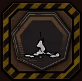

- 가격: 150 · 획득: 통상 · 강화: 가능
- 연관: 환상체: 살갗 예언자 · 첫 등장: 폭풍의 거울 (거울 던전 4)

**기본**

- 화상 위력, 화상 횟수, 특수 화상을 부여하는 스킬로 합 승리 시, (남은 코인 수/2)만큼 대상 적에게 화상 위력 부여

**+**

- 화상 위력, 화상 횟수, 특수 화상을 부여하는 스킬로 합 승리 시, (남은 코인 수/2+1)만큼 대상 적에게 화상 위력 부여

**++**

- 화상 위력, 화상 횟수, 특수 화상을 부여하는 스킬로 합 승리 시, (남은 코인 수+1)만큼 대상 적에게 화상 위력 부여

### Ⅰ 재에서 재로

- 가격: 148 · 획득: 통상 · 강화: 가능
- 연관: 환상체: 밀려오는 재 · 첫 등장: 시작의 거울 (거울 던전 1)

**기본**

- 전투 시작 시 모든 적(환상체일 경우, 모든 부위)이 화상에 걸린 경우, 적 전체(환상체일 경우, 모든 부위)에게 화상 위력 2 부여

**+**

- 전투 시작 시 화상에 걸린 적 전체(환상체일 경우, 모든 부위)에게 화상 위력 2 부여

**++**

- 전투 시작 시 적 전체(환상체일 경우, 모든 부위)에게 화상 위력 3 부여

### Ⅰ 타오르는 지성

- 가격: 141 · 획득: 통상 · 강화: 가능
- 연관: 불명 · 첫 등장: 호수의 거울 (거울 던전 3)

**기본**

- 화상 효과로 적을 처치하였다면 다음 턴 시작 시, 화상 위력을 부여하는 스킬을 보유한 아군 인격 둘이 피해량 증가 1 얻음

**+**

- 화상 효과로 적을 처치하였다면 다음 턴 시작 시, 화상 위력을 부여하는 스킬을 보유한 아군 인격 둘이 피해량 증가 2 얻음

**++**

- 화상 효과로 적을 처치하였다면 다음 턴 시작 시, 화상 위력을 부여하는 스킬을 보유한 아군 인격 셋이 피해량 증가 2 얻음.

### Ⅰ 편광

- 가격: 158 · 획득: 통상 · 강화: 가능
- 연관: 불명 · 첫 등장: 폭풍의 거울 (거울 던전 4)

**기본**

- 아군이 대상보다 정신력이 30 이상 높을 경우, 화상 위력 또는 화상 횟수 또는 특수 화상을 부여하는 스킬로 입히는 피해량 +7.5%

**+**

- 아군이 대상보다 정신력이 25 이상 높을 경우, 화상 위력 또는 화상 횟수 또는 특수 화상을 부여하는 스킬로 입히는 피해량 +12.5%

**++**

- 아군이 대상보다 정신력이 15 이상 높을 경우, 화상 위력 또는 화상 횟수 또는 특수 화상을 부여하는 스킬로 입히는 피해량 +20%

### Ⅱ 만년 동안 끓는 솥

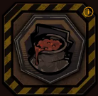

- 가격: 208 · 획득: 통상 · 강화: 불가
- 연관: 환상체: 바질리스프크 · 첫 등장: 꿈결의 거울 (거울 던전 5)

**효과**

- 화상 위력, 화상 횟수 또는 특수 화상을 부여하는 스킬의 합 위력 +1

### Ⅱ 만년 화롯불

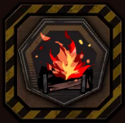

- 가격: 201 · 획득: 한정 · 하드 난이도 한정 · 강화: 불가
- 연관: 환상체: 바질리스프크 · 첫 등장: 꿈결의 거울 (거울 던전 5)

**효과**

- 턴 종료 시, 화상 횟수를 3 이상 보유한 적이 화상을 1회 더 발동함 (화상 횟수 1 감소)

### Ⅱ 울화통

- 가격: 199 · 획득: 통상 · 강화: 가능
- 연관: 환상체: 놋쇠 황소 · 첫 등장: 폭풍의 거울 (거울 던전 4)

**기본**

- 화상 또는 특수 화상에 걸린 적에게 스킬 효과로 화상 위력이나 횟수 또는 특수 화상을 부여할 경우, 다음 턴에 신속 1 얻음. (스킬 당 1회, 턴당 최대 2회)
- 신속을 이미 보유한 경우, 효과가 강화되어 신속 1, 공격 레벨 증가 2 얻음

**+**

- 화상 또는 특수 화상에 걸린 적에게 스킬 효과로 화상 위력이나 횟수 또는 특수 화상을 부여할 경우, 다음 턴에 신속 1 얻음. (스킬 당 1회, 턴당 최대 3회)
- 신속을 이미 보유한 경우, 효과가 강화되어 신속 2, 공격 레벨 증가 2 얻음

**++**

- 화상 또는 특수 화상에 걸린 적에게 스킬 효과로 화상 위력이나 횟수 또는 특수 화상을 부여할 경우, 다음 턴에 신속 1 얻음. (스킬 당 1회, 턴당 최대 3회)
- 신속을 이미 보유한 경우, 효과가 강화되어 신속 2, 공격 레벨 증가 2, 피해량 증가 2 얻음

### Ⅱ 일점타격논리회로

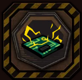

- 가격: 204 · 획득: 통상 · 강화: 불가
- 연관: 환상체: kqe-1j-23 · 첫 등장: 시작의 거울 (거울 던전 1)

**효과**

- 화상 위력 또는 특수 화상을 부여하는 스킬 또는 질투 속성 스킬을 사용하여 적에게 적중 시, 대상에게 해당 스킬의 코인 수 절반만큼 추가로 화상 위력 부여. (소수는 올림하여 계산)
- - [중첩 발동 불가] 입주 신고 히스클리프 E.G.O 패시브 「회로 연결」 발동 시, 이 효과가 발동하지 않음.
- 적중시 대상의 화상 위력이 99면, 주민등록 마이크로칩 1 부여 (적당 1회, 턴당 3회)

### Ⅱ 작열우모

- 가격: 203 · 획득: 통상 · 강화: 가능
- 연관: 환상체: 살갗 예언자 · 첫 등장: 시작의 거울 (거울 던전 1)

**기본**

- 화상 위력 또는 특수 화상을 부여하는 스킬 또는 색욕 속성의 스킬을 사용하여 대상에게 적중 시, 대상에게 화상 위력 3 부여.
- 턴 시작 시 화상 20 이상을 보유한 적의 경우, 화상이 2배로 증가

**+**

- 화상 위력 또는 특수 화상을 부여하는 스킬 또는 색욕 속성의 스킬을 사용하여 대상에게 적중 시, 대상에게 화상 위력 4 부여.
- 턴 시작 시 화상 20 이상을 보유한 적의 경우, 화상이 2배로 증가

**++**

- 화상 위력 또는 특수 화상을 부여하는 스킬 또는 색욕 속성의 스킬을 사용하여 대상에게 적중 시, 대상에게 화상 위력 4 부여.
- 턴 시작 시 화상 20 이상을 보유한 적의 경우, 화상이 2.5배로 증가

### Ⅱ 지옥나비의 꿈

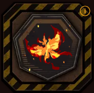

- 가격: 198 · 획득: 통상 · 강화: 가능
- 연관: 환상체: 홍염나방 · 첫 등장: 시작의 거울 (거울 던전 1)

**기본**

- 화상 또는 특수 화상에 걸린 적에게 스킬 효과로 화상 위력 또는 특수 화상을 부여할 경우, 모든 적에게 화상 위력 3 무작위로 나누어 부여.
- 분노 완전 공명을 발동하였다면 전투 시작 시, 모든 적에게 화상 위력 5 무작위로 나누어 부여

**+**

- 화상 또는 특수 화상에 걸린 적에게 스킬 효과로 화상 위력 또는 특수 화상을 부여할 경우, 모든 적에게 화상 위력 4 무작위로 나누어 부여.
- 분노 완전 공명을 발동하였다면 전투 시작 시, 모든 적에게 화상 위력 6 무작위로 나누어 부여

**++**

- 화상 또는 특수 화상에 걸린 적에게 스킬 효과로 화상 위력 또는 특수 화상을 부여할 경우, 모든 적에게 화상 위력 5 무작위로 나누어 부여.
- 분노 공명을 발동하였다면 전투 시작 시, 모든 적에게 화상 위력 8 무작위로 나누어 부여

### Ⅲ 그을린 원반

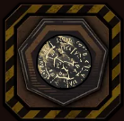

- 가격: 248 · 획득: 통상 · 강화: 불가
- 연관: 불명 · 첫 등장: 거울의 거울 (거울 던전 2)

**효과**

- 화상 상태인 적이 사망하였을 경우(환상체일 경우, 본체 사망 시), 남은 화상 위력 수치의 절반만큼을 다음 턴 시작 시 화상 위력 수치가 제일 적은 적 중 하나에게 부여.
- 턴 시작 시 화상 상태인 적에게 이번 턴 동안 공격 레벨 감소 4 부여

### Ⅲ 뜨거운 육즙 다리살

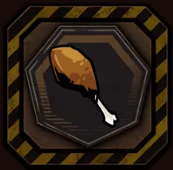

- 가격: 259 · 획득: 한정 · 강화: 불가
- 전용 팩: 헬스 치킨
- 연관: 집단: K사 · 첫 등장: 폭풍의 거울 (거울 던전 4)

**효과**

- 스킬로 적에게 화상 부여 시 화상 횟수 3 증가. (턴 당 최대 3회)

### Ⅲ 먼지에서 먼지로

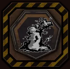

- 가격: 231 · 획득: 통상 · 강화: 가능
- 연관: 불명 · 첫 등장: 거울의 거울 (거울 던전 2)

**기본**

- 웨이브 첫 턴 시작 시, 모든 적(환상체일 경우, 무작위 부위 하나)에게 화상 위력 5, 화상 횟수 3 부여.
- 나태 완전 공명을 발동하였다면 전투 시작 시, 모든 적(환상체일 경우, 무작위 부위 하나)에게 화상 위력 3, 화상 횟수 2 부여

**+**

- 웨이브 첫 턴 시작 시, 모든 적(환상체일 경우, 무작위 부위 하나)에게 화상 위력 6, 화상 횟수 3 부여.
- 나태 완전 공명을 발동하였다면 전투 시작 시, 모든 적(환상체일 경우, 무작위 부위 하나)에게 화상 위력 4, 화상 횟수 2 부여

**++**

- 웨이브 첫 턴 시작 시, 모든 적(환상체일 경우, 무작위 부위 하나)에게 화상 위력 8, 화상 횟수 3 부여.
- 나태 공명을 발동하였다면 전투 시작 시, 모든 적(환상체일 경우, 무작위 부위 하나)에게 화상 위력 4, 화상 횟수 3 부여

### Ⅲ 불빛꽃

- 가격: 246 · 획득: 통상 · 강화: 불가
- 연관: 환상체: 홍염나방 · 첫 등장: 폭풍의 거울 (거울 던전 4)

**효과**

- 분노 공명이 3 이상이면 화상 위력, 횟수 또는 특수 화상을 부여하는 스킬의 합 위력 +1
- - 분노 완전 공명 3 이상이거나 분노 공명이 6 이상이면, 대신 합 위력 +2
- [편성 1번, 2번 인격 전용 효과]
- 아군이 적을 공격할 때 대상의 남은 체력이 최대 체력의 (보유한 화상 위력)% 이하일 경우 (환상체일 경우, 본체 체력으로 계산), 화상 위력 또는 화상 횟수 또는 특수 화상을 부여하는 공격 스킬로 입히는 피해량 +50%

### Ⅲ 붉은색 넥타이

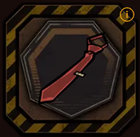

- 가격: 250 · 획득: 한정 · 하드 난이도 한정 · 강화: 불가
- 전용 팩: 교본
- 연관: 집단: 리우 협회 · 첫 등장: 이름과 거미의 거울 (거울 던전 7)

**효과**

- 화상 위력 또는 화상 횟수 또는 특수 화상을 부여하는 스킬 3의 합 위력 +2, 피해량 +30%

### Ⅲ 요리 비법 전서

- 가격: 260 (구매불가) · 획득: 합성 · 강화: 불가
- 조합식: 만년 동안 끓는 솥 + 융해된 파라핀
- 연관: 캐릭터: 봉이 아빠 · 첫 등장: 꿈결의 거울 (거울 던전 5)

**효과**

- 턴 시작 시, 화상 위력, 화상 횟수 또는 특수 화상을 부여하는 공격 스킬을 보유한 인격이 5인 이상이면, 이번 전투 동안 발동 (E.G.O 스킬 제외. 대기 인원 제외)
- 화상 위력, 화상 횟수 또는 특수 화상을 부여하는 스킬의 최종 위력 +1
- 화상 위력, 화상 횟수 또는 특수 화상을 부여하는 스킬로 합 승리 시, (남은 코인 수/2+1)만큼 대상 적에게 화상 위력을 부여

### Ⅳ 불꽃의 편린

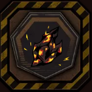

- 가격: 379 · 획득: 통상 · 강화: 가능
- 연관: 불명 · 첫 등장: 거울의 거울 (거울 던전 2)

**기본**

- 턴 종료 시, 화상 상태인 적에게 대상이 보유한 화상 횟수의 절반만큼을 소모하여 (화상 위력 × 소모한 화상 횟수)만큼 추가 분노 피해를 입힘. (화상 횟수 최대 5 소모)
- 불꽃의 편린 효과로 소모한 화상 횟수만큼, 다음 턴 동안 대상의 방어 레벨 감소 (최대 3)

**+**

- 턴 종료 시, 화상 상태인 적에게 대상이 보유한 화상 횟수의 절반만큼을 소모하여 (화상 위력 × 소모한 화상 횟수)만큼 추가 분노 피해를 입힘. (화상 횟수 최대 7 소모)
- 불꽃의 편린 효과로 소모한 화상 횟수만큼, 다음 턴 동안 대상의 방어 레벨 감소 (최대 5)

**++**

- 턴 종료 시, 화상 상태인 적에게 대상이 보유한 화상 횟수의 절반만큼을 소모하여 (화상 위력 × 소모한 화상 횟수)만큼 추가 분노 피해를 입힘. (화상 횟수 최대 10 소모)
- 불꽃의 편린 효과로 소모한 화상 횟수만큼, 다음 턴 동안 대상의 방어 레벨 감소 (최대 8)

### Ⅳ 업화 조각

- 가격: 400 · 획득: 통상 · 강화: 불가
- 연관: 불명 · 첫 등장: 폭풍의 거울 (거울 던전 4)

**효과**

- 화상 위력, 화상 횟수 또는 특수 화상을 부여하는 E.G.O 스킬 사용시 발동.
- 소모하는 (분노 E.G.O 자원 +나머지 E.G.O 자원의 합/3)만큼 최종 위력이 증가, 피해량 +50%
- 분노 속성 E.G.O 스킬의 경우, 효과가 강화되어 공격 시작 전에 화상 횟수를 추가로 부여(ZAYIN의 경우 2, 등급이 오를수록 +1)하고 피해량 +(공격 가중치/공격 대상 수×20)%

### Ⅳ 제식 복장 - 리우 협회

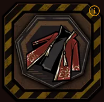

- 가격: 398 (구매불가) · 획득: 합성 · 하드 난이도 한정 · 강화: 불가
- 전용 팩: 교본
- 조합식: 편광 + 가장 낮은 별 + 붉은색 넥타이
- 연관: 집단: 리우 협회 · 첫 등장: 이름과 거미의 거울 (거울 던전 7)

**효과**

- 턴 시작 시, 화상 위력 또는 화상 횟수 또는 특수 화상을 부여하는 공격 스킬을 보유한 인격이 5인 이상이면, 이번 전투 동안 발동 (E.G.O 스킬 제외, 대기 인원 제외)
- 리우 협회 소속 인격의 기본 공격 스킬의 더하기 코인 위력 +2 (빼기 코인 스킬일 경우, 기본 위력 +(8/코인 수) (최소 1, 소수점 버림))
- 화상 위력 또는 화상 횟수 또는 특수 화상을 부여하는 스킬 3이 아닌 스킬의 피해량 +20% (E.G.O 스킬 포함)
- 화상 위력 또는 화상 횟수 또는 특수 화상을 부여하는 스킬 3의 더하기 코인 위력 +1 (빼기 코인 스킬일 경우, 기본 위력 +(4/코인 수) (최소 1, 소수점 버림)), 피해량 +30%
- - 동일한 소속 인격을 편성한 수당 해당 소속 인격의 해당 스킬 피해량 5% 증가 (최대 20%, 대기 인원 포함)
- 턴 종료 시 정신력이 가장 낮은 아군 2명의 정신력 8 회복
- - 대상의 정신력이 0 이하면, 추가로 5 회복

### Ⅳ 진혼

- 가격: 421 (구매불가) · 획득: 합성 · 강화: 불가
- 조합식: 재에서 재로 + 먼지에서 먼지로 + 요리 비법 전서
- 연관: 불명 · 첫 등장: 호수의 거울 (거울 던전 3)

**효과**

- 턴 시작 시, 화상 위력, 화상 횟수 또는 특수 화상을 부여하는 공격 스킬을 보유한 인격이 5인 이상이면, 이번 전투 동안 발동 (E.G.O 스킬 제외. 대기 인원 제외)
- 턴 시작 시, 모든 적(환상체일 경우, 모든 부위)에게 화상 횟수 6을 부여하고 화상 위력 15를 무작위로 나누어 부여. (웨이브 당 최대 1회)
- 화상 위력, 화상 횟수 또는 특수 화상을 부여하는 더하기 코인 스킬의 최종 위력 +1, 코인 위력 +1, 화상 위력 부여 값 +1, 화상 횟수 부여 값 +1.
- - 빼기 코인 스킬일 경우, 코인 위력 대신 기본 위력 +(4/코인 수) (최소 1, 소수점 버림)
- 화상 위력, 화상 횟수 또는 특수 화상을 부여하는 스킬로 합 승리 시, (남은 코인 수 + 1)만큼 대상 적에게 화상 위력을 부여

### Ⅳ 훔쳐온 불꽃

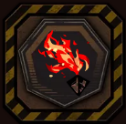

- 가격: 404 (구매불가) · 획득: 합성 · 하드 난이도 한정 · 강화: 불가
- 조합식: 타오르는 지성 + 그을린 원반 + 만년 화롯불
- 연관: 불명 · 첫 등장: 꿈결의 거울 (거울 던전 5)

**효과**

- 턴 시작 시, 화상 위력, 화상 횟수 또는 특수 화상을 부여하는 공격 스킬을 보유한 인격이 5인 이상이면, 이번 전투 동안 발동 (E.G.O 스킬 제외. 대기 인원 제외)
- 스킬(E.G.O 스킬 포함) 적중 시 대상의 화상 횟수가 3 이상이면, 대상의 화상을 1회 발동함. (화상 횟수 1 감소, 스킬당 1회 발동)
- 턴 종료 시, 화상 횟수를 3 이상 보유한 적이 화상을 1회 더 발동함. (화상 횟수 1 감소)
- 화상 상태인 적이 사망하였을 경우(환상체일 경우, 본체 사망 시), 남은 화상 위력 수치만큼을 다음 턴 시작 시 화상 위력 수치가 제일 적은 적 중 하나에게 부여.
- 턴 시작 시 화상 상태인 적에게 이번 턴 동안 공격 레벨 감소 4 부여.
- 화상을 보유한 적이 사망하였을 경우, 다음 턴 시작 시, 화상 부여 스킬을 보유한 아군 (사망한 적의 화상 위력/15)명이 피해량 증가 2 얻음 (턴 당 1회 발동)

## 출혈 (37)

### Ⅰ 녹슨 입마개

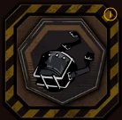

- 가격: 164 · 획득: 통상 · 강화: 가능
- 연관: 불명 · 첫 등장: 호수의 거울 (거울 던전 3)

**기본**

- 스킬을 사용하여 적에게 적중 시 12 이상의 체력 피해를 입혔다면, 대상에게 출혈 위력 2 부여.
- 참격 스킬을 사용할 경우, 효과가 강화되어 출혈 4 부여.

**+**

- 스킬을 사용하여 적에게 적중 시 12 이상의 체력 피해를 입혔다면, 대상에게 출혈 위력 3 부여.
- 참격 스킬을 사용할 경우, 효과가 강화되어 출혈 위력 5 부여.

**++**

- 스킬을 사용하여 적에게 적중 시 1 이상의 체력 피해를 입혔다면, 대상에게 출혈 위력 3 부여.
- 참격 스킬을 사용할 경우, 효과가 강화되어 출혈 위력 5, 출혈 횟수 1 부여.

### Ⅰ 늘어붙은 쇠말뚝

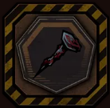

- 가격: 147 · 획득: 통상 · 강화: 불가
- 연관: 환상체: 아파하는 테디 · 첫 등장: 시작의 거울 (거울 던전 1)

**효과**

- 단일 코인 스킬을 사용하여 적에게 적중 시, 대상에게 출혈 위력 1 부여하고 다음 턴까지 방어 레벨 감소 2 부여.
- 대상이 출혈 상태일 경우, 효과가 강화되어 출혈 위력 3 부여.

### Ⅰ 덧붙인 반창고

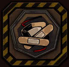

- 가격: 150 · 획득: 통상 · 강화: 가능
- 연관: 환상체: 아파하는 테디 · 첫 등장: 꿈결의 거울 (거울 던전 5)

**기본**

- 턴 종료 시, 출혈을 보유한 아군 중 가장 체력이 적은 인격이 자신의 최대 체력의 5%만큼 체력을 회복.

**+**

- 턴 종료 시, 출혈을 보유한 아군 중 가장 체력이 적은 인격 2명이 자신의 최대 체력의 5%만큼 체력을 회복.

### Ⅰ 억류된 찬송

- 가격: 149 · 획득: 통상 · 강화: 가능
- 연관: 불명 · 첫 등장: 폭풍의 거울 (거울 던전 4)

**기본**

- 전투 시작 시 모든 적(환상체의 경우, 모든 부위)이 출혈에 걸린 경우, 다음 턴에 모든 아군이 신속 1 얻음.

**+**

- 전투 시작 시 모든 적(환상체의 경우, 모든 부위)이 출혈에 걸린 경우, 다음 턴에 모든 아군이 신속 1, 피해량 증가 1 얻음.

**++**

- 전투 시작 시 모든 적(환상체의 경우, 모든 부위)이 출혈에 걸린 경우, 다음 턴에 모든 아군이 신속 2, 피해량 증가 1, 공격 레벨 증가 2 얻음.

### Ⅰ 옭아맨 타래

- 가격: 159 · 획득: 통상 · 강화: 가능
- 연관: 환상체: 머금은 목화 · 첫 등장: 폭풍의 거울 (거울 던전 4)

**기본**

- 속도가 제일 빠른 아군이 출혈 위력, 출혈 횟수 또는 특수 출혈 부여하는 스킬을 사용하여 적에게 피해를 입힐 경우, 피해량 +12.5%

**+**

- 속도가 제일 빠른 아군 둘이 출혈 위력, 출혈 횟수 또는 특수 출혈 부여하는 스킬을 사용하여 적에게 피해를 입힐 경우, 피해량 +15%

**++**

- 속도가 제일 빠른 아군 셋이 출혈 위력, 출혈 횟수 또는 특수 출혈 부여하는 스킬을 사용하여 적에게 피해를 입힐 경우, 피해량 +20%

### Ⅱ 경외심

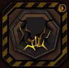

- 가격: 207 · 획득: 통상 · 강화: 가능
- 연관: 환상체: 경멸의 나선 · 첫 등장: 폭풍의 거울 (거울 던전 4)

**기본**

- [편성 1번, 2번 인격 전용 효과]
- 출혈 위력, 출혈 횟수 또는 특수 출혈을 부여하는 스킬 사용 시, 메인 공격 대상의 출혈 횟수가 7 이상이면 피해량 +10%

**+**

- [편성 1번, 2번, 3번 인격 전용 효과]
- 출혈 위력, 출혈 횟수 또는 특수 출혈을 부여하는 스킬 사용 시, 메인 공격 대상의 출혈 횟수가 5 이상이면 피해량 +15%

**++**

- [편성 1번, 2번, 3번 인격 전용 효과]
- 출혈 위력, 출혈 횟수 또는 특수 출혈을 부여하는 스킬 사용 시, 메인 공격 대상의 출혈 횟수가 3 이상이면 피해량 +20%

### Ⅱ 못과 망치의 책

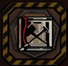

- 가격: 214 · 획득: 한정 · 강화: 불가
- 전용 팩: 신앙과 침식
- 연관: 집단: N사 광신도 · 첫 등장: 폭풍의 거울 (거울 던전 4)

**효과**

- 아군이 출혈 위력, 출혈 횟수 또는 특수 출혈을 부여하는 스킬로 적과 합하여 승리 시, 못 1 ~ 2 부여.
- N사 광신도 소속일 경우, 턴 시작 시 광신 1 얻음.

### Ⅱ 밀라르카

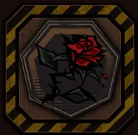

- 가격: 204 · 획득: 통상 · 강화: 불가
- 연관: 환상체: 사백송이의 장미 · 첫 등장: 꿈결의 거울 (거울 던전 5)

**효과**

- 출혈 위력, 출혈 횟수 또는 특수 출혈을 부여하는 스킬의 합 위력 +1.

### Ⅱ 범작

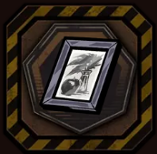

- 가격: 200 · 획득: 한정 · 하드 난이도 한정 · 강화: 불가
- 전용 팩: 검과 작품
- 연관: 집단: 약지 · 첫 등장: 이름과 거미의 거울 (거울 던전 7)

**효과**

- 약지 소속 인격이 영감을 얻음
- 영감을 보유한 약지 소속 인격의 색욕 속성 또는 참격 속성 스킬이 적중한 대상에게 다음 턴에 탐구 대상 부여
- - 적이 탐구 대상을 이미 보유했을 시, 탐구 대상이 그림 재료로 교체됨
- 그림 재료가 있는 대상을 영감이 있는 약지 소속 인원이 처치했으면, 다음 턴에 더하기 코인 강화 1 얻음 (턴당 1회)

### Ⅱ 불결함

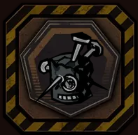

- 가격: 217 · 획득: 한정 · 강화: 불가
- 전용 팩: 마주하지 않는
- 연관: 집단: N사 광신도 · 첫 등장: 폭풍의 거울 (거울 던전 4)

**효과**

- 아군이 출혈 위력, 출혈 횟수 또는 특수 출혈을 부여하는 스킬로 출혈 상태인 적을 공격할 경우, 대상에게 입히는 피해량 +15%.
- 적의 체력이 최대 체력의 33% 이하인 경우, 효과가 강화되어 입히는 피해량 +25%.

### Ⅱ 상처붙이

- 가격: 202 · 획득: 통상 · 강화: 가능
- 연관: 환상체: 귀곡관 · 첫 등장: 시작의 거울 (거울 던전 1)

**기본**

- 출혈 위력 또는 특수 출혈을 부여하는 스킬을 사용하여 적에게 적중 시, 대상에게 출혈 위력 4 부여.

**+**

- 출혈 위력 또는 특수 출혈을 부여하는 스킬 또는 분노 속성의 스킬을 사용하여 적에게 적중 시, 대상에게 출혈 위력 5 부여.

**++**

- 출혈 위력 또는 특수 출혈을 부여하는 스킬 또는 분노 속성의 스킬을 사용하여 적에게 적중 시, 대상에게 출혈 위력 5, 출혈 횟수 1 부여.

### Ⅱ 새하얀 캔버스

- 가격: 200 · 획득: 한정 · 하드 난이도 한정 · 강화: 불가
- 전용 팩: 검과 작품
- 연관: 집단: 약지 · 첫 등장: 이름과 거미의 거울 (거울 던전 7)

**효과**

- 출혈이 15 이상 있는 적에게 더하기 코인 공격 스킬 적중 시 정신력 3 회복 (인격별로 턴당 1회)
- - 자신 혹은 대상이 부정적인 효과가 3개 이상이면, 대신 정신력 6 회복

### Ⅱ 오염된 실과 바늘

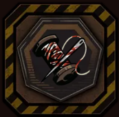

- 가격: 208 · 획득: 한정 · 강화: 불가
- 전용 팩: 헬스 치킨
- 연관: 캐릭터: 닭도리 · 첫 등장: 폭풍의 거울 (거울 던전 4)

**효과**

- 매 턴마다 처음으로 적에게 피해를 입힌 스킬에 적용. (피해량 / 3)만큼 출혈 위력을 부여.

### Ⅱ 작고 나쁠 인형

- 가격: 191 · 획득: 통상 · 강화: 불가
- 연관: 불명 · 첫 등장: 시작의 거울 (거울 던전 1)

**효과**

- 전투 시작 단계에서 출혈에 걸린 적에게 가하는 피해량 +10%
- 전투 시작 단계에서 출혈에 걸린 적에게 대상에게 받는 피해량 -20%
- 오만 속성 공격 스킬을 보유한 아군의 경우, 효과가 강화되어 출혈에 걸린 적에게 가하는 피해량 +20%
- 오만 속성 공격 스킬을 보유한 아군의 경우, 효과가 강화되어 출혈에 걸린 적에게 받는 피해량 -30%

### Ⅱ 전혈 플라스크

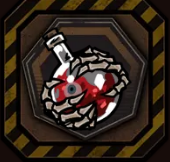

- 가격: 199 · 획득: 한정 · 강화: 불가
- 전용 팩: 다시 열린 라만차랜드, 끝나지 않는 행렬, 꿈이 끝나는, 혈귀가 되지 못한 자들, 축복의 카니발, 라만차랜드의 주인
- 연관: 캐릭터: 혈귀 · 첫 등장: 영생의 거울 (거울 던전 6)

**효과**

- 적 처치시, 해당 적의 (최대 체력/10)만큼 혈찬 생성 (최대 50)
- 턴 종료 시 이번 턴에 사망한 아군이 있으면, 다음 턴에 모든 아군이 공격 위력 증가 2 얻음

### Ⅱ 흰 목화

- 가격: 201 · 획득: 통상 · 강화: 가능
- 연관: 환상체: 머금은 목화 · 첫 등장: 시작의 거울 (거울 던전 1)

**기본**

- 턴 시작 시 흐트러짐 상태인 적들이 있을 경우, 대상은 흐트러짐 상태에서 풀려나는 대신 (8 + 흐트러짐 단계 × 4)만큼 출혈 위력을 얻고 그 수치의 절반만큼 이번 턴과 다음 턴 동안 대상에게 공격 레벨 감소 부여 (동일한 적에게는 전투 당 1회 발동하며, 흐트러짐 상태에서 풀려나지 않는 특정 적에게는 발동하지 않음)

**+**

- 턴 시작 시 흐트러짐 상태인 적들이 있을 경우, 대상은 흐트러짐 상태에서 풀려나는 대신 (10 + 흐트러짐 단계 × 5)만큼 출혈 위력을 얻고 그 수치만큼 이번 턴과 다음 턴 동안 대상에게 공격 레벨 감소 부여 (동일한 적에게는 전투 당 1회 발동하며, 흐트러짐 상태에서 풀려나지 않는 특정 적에게는 발동하지 않음)

**++**

- 턴 시작 시 흐트러짐 상태인 적들이 있을 경우, 대상은 흐트러짐 상태에서 풀려나는 대신 (12 + 흐트러짐 단계 × 6)만큼 출혈 위력을 얻고 그 수치만큼 이번 턴과 다음 턴 동안 대상에게 공격 레벨 감소와 방어 레벨 감소 부여 (동일한 적에게는 전투 당 1회 발동하며, 흐트러짐 상태에서 풀려나지 않는 특정 적에게는 발동하지 않음).

### Ⅲ 갇힌 구더기

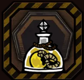

- 가격: 246 · 획득: 한정 · 강화: 불가
- 전용 팩: 속하지 못하는
- 연관: 환상체: 황금빛의 사과 · 첫 등장: 폭풍의 거울 (거울 던전 4)

**효과**

- 적에게 색욕, 탐식 속성 공격 스킬 적중 시, 대상에게 구더기 2 부여 (E.G.O 스킬 제외).
- 출혈 위력, 출혈 횟수 또는 특수 출혈을 부여하는 스킬일 경우에는 효과가 강화되어 구더기 3 부여.

### Ⅲ 녹슨 커터 나이프

- 가격: 244 · 획득: 통상 · 강화: 가능
- 연관: 불명 · 첫 등장: 거울의 거울 (거울 던전 2)

**기본**

- 흐트러짐 상태가 아닌 적에게 스킬 효과로 출혈 위력 또는 특수 출혈을 부여할 때마다 대상에게 출혈 위력 1, 출혈 횟수 1 부여.
- 색욕 속성 스킬을 사용한 경우, 효과가 강화되어 출혈 위력 3, 출혈 횟수 1 부여.

**+**

- 스킬 효과로 출혈 위력 또는 특수 출혈을 부여할 때마다 대상에게 출혈 위력 2, 출혈 횟수 1 부여.
- 색욕 속성 스킬을 사용한 경우, 효과가 강화되어 출혈 위력 3, 출혈 횟수 1 부여.

**++**

- 스킬 효과로 출혈 위력 또는 특수 출혈을 부여할 때마다 대상에게 출혈 위력 3, 출혈 횟수 1 부여.
- 색욕 속성 스킬을 사용한 경우, 효과가 강화되어 출혈 위력 3, 출혈 횟수 2 부여.

### Ⅲ 라만차랜드 자유이용권

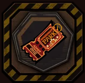

- 가격: 239 · 획득: 한정 · 하드 난이도 한정 · 강화: 불가
- 전용 팩: 다시 열린 라만차랜드, 끝나지 않는 행렬, 꿈이 끝나는
- 연관: 집단: 라만차랜드 · 첫 등장: 꿈결의 거울 (거울 던전 5)

**효과**

- 출혈, 특수 출혈과 파열의 합이 10 이상 부여된 적에게 공격 적중 시 호흡 위력 1을 얻음, 자신의 호흡 횟수 1 증가 (스킬당 최대 2회 발동)

### Ⅲ 승리의 증표

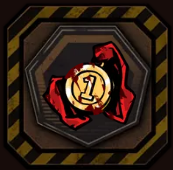

- 가격: 248 · 획득: 한정 · 하드 난이도 한정 · 강화: 불가
- 전용 팩: 다시 열린 라만차랜드, 끝나지 않는 행렬, 꿈이 끝나는
- 연관: 집단: 라만차랜드 · 첫 등장: 꿈결의 거울 (거울 던전 5)

**효과**

- 적 처치 시 현재 정신력이 가장 낮은 아군 1명의 정신력 3 회복.
- 공격 종료 시 출혈, 특수 출혈과 파열의 합이 10 이상 부여된 적이 사망한 경우, 다음 턴에 아군 중 1명이 공격 레벨 증가 2 얻음 (대상을 처치한 아군에게 우선으로 부여)

### Ⅲ 안식처

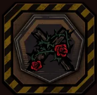

- 가격: 255 · 획득: 통상 · 강화: 불가
- 연관: 환상체: 장미 표지판 · 첫 등장: 폭풍의 거울 (거울 던전 4)

**효과**

- 출혈 위력, 출혈 횟수 또는 특수 출혈을 부여하는 스킬을 사용하여 합 승리 시 발동 (남은 코인 수/2)만큼 대상에게 출혈 횟수를 부여하고 다음 턴에 그 수치만큼 공격 레벨 증가 얻음
- 코인 수가 2 이하인 스킬의 경우, 효과가 강화되어 그 수치가 (남은 코인 수+3)로 적용됨

### Ⅲ 연기와 철조망

- 가격: 261 · 획득: 통상 · 강화: 가능
- 연관: 환상체: 연기 전쟁 제4 전선 · 첫 등장: 거울의 거울 (거울 던전 2)

**기본**

- 아군이 스킬 효과로 적에게 부여하는 출혈 위력 수치가 2배로 적용.
- 턴 종료 시 출혈 상태인 적들이 다음 턴에 속도가 2만큼 감소.

**+**

- 아군이 스킬 효과로 적에게 부여하는 출혈 위력 수치가 2배로 적용.
- 턴 종료 시 출혈 상태인 적들이 다음 턴에 속도가 3만큼 감소.

**++**

- 아군이 스킬 효과로 적에게 부여하는 출혈 위력 수치가 2.5배로 적용.
- 턴 종료 시 출혈 상태인 적들이 다음 턴에 속도가 3만큼 감소.

### Ⅲ 열선 무기

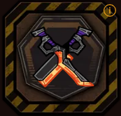

- 가격: 249 · 획득: 한정 · 강화: 불가
- 전용 팩: 현혹, 방황, 불신
- 연관: 캐릭터: 키라 · 첫 등장: 이름과 거미의 거울 (거울 던전 7)

**효과**

- 질투 속성 스킬 또는 반격 스킬 적중 시 출혈 횟수 또는 화상 횟수 1 증가 (턴당 3회)
- 전투 중 적의 출혈 횟수가 1 아래로 떨어질 때, 해당 적이 보유한 화상 횟수가 2 이상이면, 출혈 횟수 대신 화상 횟수 감소 (턴당 3회)

### Ⅲ 조각난 칼날

- 가격: 244 · 획득: 한정 · 강화: 불가
- 전용 팩: 육참골단, 육참골단 BokGak
- 연관: 집단: 흑운회 · 첫 등장: 호수의 거울 (거울 던전 3)

**효과**

- 이번 전투 동안 공격 스킬 효과로 적에게 출혈 위력 또는 특수 출혈을 처음으로 부여할 경우, 출혈 횟수 2 추가로 부여 (전투 당 1회).
- 흑운회 소속일 경우 효과가 강화되어 적에게 처음으로 피해를 주었을 경우 출혈 위력 4, 출혈 횟수 4 추가로 부여.

### Ⅲ 찢어진 피주머니

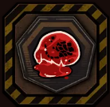

- 가격: 259 · 획득: 한정 · 하드 난이도 한정 · 강화: 불가
- 연관: 환상체: 단수어 · 첫 등장: 꿈결의 거울 (거울 던전 5)

**효과**

- 아군이 합 승리 시, 적의 출혈을 1회 발동시키고, 출혈 횟수 1 감소. (턴 당 3회 발동)

### Ⅲ 치성

- 가격: 259 (구매불가) · 획득: 합성 · 강화: 불가
- 조합식: 억류된 찬송 + 밀라르카
- 연관: 환상체: 귀곡관 · 첫 등장: 꿈결의 거울 (거울 던전 5)

**효과**

- 턴 시작 시, 출혈 위력, 출혈 횟수 또는 특수 출혈을 부여하는 공격 스킬을 보유한 인격이 5인 이상이면, 이번 전투 동안 발동 (E.G.O 스킬 제외. 대기 인원 제외)
- 속도가 가장 빠른 아군 1명의 출혈 위력, 출혈 횟수 또는 특수 출혈을 부여하는 더하기 코인 스킬의 코인 위력 +1, 피해량 +50%
- - 빼기 코인 스킬일 경우, 코인 위력 대신 기본 위력 +(4/코인 수) (최소 1, 소수점 버림)
- 출혈 위력, 출혈 횟수 또는 특수 출혈을 부여하는 스킬의 최종 위력 +1

### Ⅲ 혈향도래

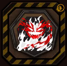

- 가격: 251 · 획득: 통상 · 강화: 불가
- 연관: 불명 · 첫 등장: 영생의 거울 (거울 던전 6)

**효과**

- 전투 시작 전 체력이 가장 낮은 아군이 출혈 또는 특수 출혈을 부여하는 공격 스킬 적중 시, 최대 체력 3%만큼 체력 회복 (턴당 2회)
- 출혈 또는 특수 출혈을 부여하는 스킬로 출혈 또는 특수 출혈을 보유한 적과 합을 진행할 때, 합 위력 +1
- - 출혈 또는 특수 출혈을 부여하는 공격 스킬을 보유한 인격이 5인 이상이면, 대신 합 위력 +1, 피해량 +10% (편성 인원 포함)
- - 10인 이상이면, 대신 합 위력 +2, 피해량 +15%

### Ⅳ 떨어진 한 방울

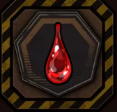

- 가격: 398 · 획득: 한정 · 하드 난이도 한정 · 강화: 불가
- 전용 팩: 다시 열린 라만차랜드, 끝나지 않는 행렬, 꿈이 끝나는
- 연관: 캐릭터: 혈귀 · 첫 등장: 영생의 거울 (거울 던전 6)

**효과**

- 혈찬을 소모하는 스킬을 보유한 인격이 3인 이상이면, 이번 전투 동안 발동 (E.G.O 스킬 제외, 대기 인원 제외)
- 전투 시작 시 혈찬을 소모하는 인격이 공격하는 대상의 출혈 위력이 30 이상일 때, 대상의 출혈 위력을 15로 감소시키고, 감소한 출혈 위력만큼 혈찬을 생성함. (턴 당 적 전체에서 1회 발동, 광역 스킬의 경우 메인 타겟에게만 적용됨)
- 해당 효과로 생성한 혈찬 10 당, 혈찬을 소모하는 스킬을 보유한 인격에게 다음 턴에 위력 증가 1, 피해량 증가 1 부여 (최대 4)

### Ⅳ 매혹 조각

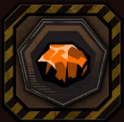

- 가격: 400 · 획득: 통상 · 강화: 불가
- 연관: 불명 · 첫 등장: 폭풍의 거울 (거울 던전 4)

**효과**

- 출혈 위력, 출혈 횟수 또는 특수 출혈을 부여하는 E.G.O 스킬 사용 시 발동
- 소모하는 (색욕 E.G.O 자원 +나머지 E.G.O 자원의 합/3)만큼 최종 위력이 증가, 피해량 +50%
- 색욕 속성 E.G.O 스킬의 경우, 효과가 강화되어 공격 시작 전에 출혈 횟수를 추가로 부여(E.G.O 등급에 비례하며 ZAYIN의 경우 2, 등급이 오를수록 +1)하고 대상이 보유한 출혈 위력만큼 색욕 피해 추가로 입힘

### Ⅳ 미니어처 대관람차

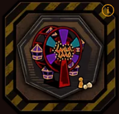

- 가격: 402 (구매불가) · 획득: 합성 · 하드 난이도 한정 · 강화: 불가
- 전용 팩: 다시 열린 라만차랜드, 끝나지 않는 행렬, 꿈이 끝나는
- 조합식: 덧붙인 반창고 + 전혈 플라스크 + 퍼레이드의 가면
- 연관: 집단: 라만차랜드 · 첫 등장: 이름과 거미의 거울 (거울 던전 7)

**효과**

- 혈귀인 모든 아군의 기본 스킬 코인 위력 +1, 자신의 (누적 소모 혈찬 / 10)%만큼 스킬 피해량 증가
- 턴 종료 시, 출혈을 보유한 아군 중 가장 체력이 적은 인격 2명이 자신의 최대 체력의 5%만큼 체력을 회복하고 다음 턴 시작시 일렁임【혈귀】 10 얻음
- 적 처치시, 해당 적의 (본체 최대 체력/10)만큼 혈찬 생성 (최대 50)
- 턴 종료시 이번 턴에 사망한 아군이 있으면, 다음 턴에 모든 아군이 공격 위력 증가 2 얻음
- 적이 증원되는 전투에서 새로운 적이 등장하면, 전투 시작 시 해당 적에게 출혈 5, 출혈 횟수 3 부여.
- 아군에 <혈귀>가 있다면, 적이 증원될 때 모든 적의 출혈을 2회 발동시키고, 모든 적의 출혈 횟수 2 감소

### Ⅳ 붉게 물든 목화

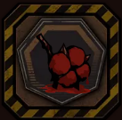

- 가격: 382 · 획득: 통상 · 강화: 가능
- 연관: 불명 · 첫 등장: 거울의 거울 (거울 던전 2)

**기본**

- 스테이지 첫 턴 시작 시, 모든 적(환상체일 경우, 모든 부위)에게 출혈 위력 1, 출혈 횟수 15 부여.
- 턴 시작 시 출혈 상태인 적의 공격 레벨과 방어 레벨이 이번 턴 동안 (출혈 위력 / 3)만큼 감소. (출혈 위력 30 스택 시, 효과 최대)

**+**

- 웨이브 첫 턴 시작 시, 모든 적(환상체일 경우, 모든 부위)에게 출혈 위력 2, 출혈 횟수 15 부여.
- 턴 시작 시 출혈 상태인 적의 공격 레벨과 방어 레벨이 이번 턴 동안 (출혈 위력 / 3)만큼 감소. (출혈 위력 30 스택 시, 효과 최대)

**++**

- 웨이브 첫 턴 시작 시, 모든 적(환상체일 경우, 모든 부위)에게 출혈 위력 4, 출혈 횟수 20 부여.
- 턴 시작 시 출혈 상태인 적의 공격 레벨과 방어 레벨이 이번 턴 동안 (출혈 위력 / 2)만큼 감소. (출혈 위력 30 스택 시, 효과 최대)

### Ⅳ 수작

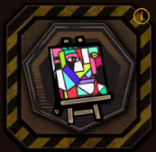

- 가격: 404 (구매불가) · 획득: 합성 · 하드 난이도 한정 · 강화: 불가
- 전용 팩: 검과 작품
- 조합식: 귀로 + 새하얀 캔버스 + 범작
- 연관: 집단: 약지 · 첫 등장: 이름과 거미의 거울 (거울 던전 7)

**효과**

- 출혈이 15 이상 있는 적에게 더하기 코인 공격 스킬 적중 시 정신력 3 회복 (인격별로 턴당 1회)
- - 자신 혹은 대상이 부정적인 효과가 3개 이상이면, 대신 정신력 6 회복
- 약지 소속 인격이 영감을 얻음
- 영감을 보유한 약지 소속 인격의 공격 스킬이 적중한 대상에게 탐구 대상 부여
- - 적이 탐구 대상을 이미 보유했을 시, 탐구 대상이 그림 재료로 교체됨
- 그림 재료가 있는 대상을 영감이 있는 약지 소속 인원이 처치했으면, 해당 약지 소속 인원이 영감을 잃고 훌륭한 미감을 얻음

### Ⅳ 완전함

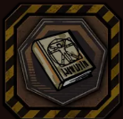

- 가격: 404 (구매불가) · 획득: 합성 · 강화: 불가
- 전용 팩: 신앙과 침식, 마주하지 않는
- 조합식: 못과 망치의 책 + 불결함
- 연관: 집단: N사 광신도 · 첫 등장: 폭풍의 거울 (거울 던전 4)

**효과**

- 아군이 출혈 위력, 출혈 횟수 또는 특수 출혈을 부여하는 스킬로 적과 합하여 승리 시, 못 2 ~ 3 부여.
- N사 광신도 소속 인격이 적을 공격할 때 피해량 +25%, 턴 시작 시 광신 1 얻음. 해당 소속 인격의 정신력이 최대이거나 이전 턴에 색욕 공명을 3 이상 했으면, 해당 인격이 피해량 증가 3을 추가로 얻음.
- N사 광신도 소속 인격의 최종 위력 +2, 더하기 코인 위력 +1, 빼기 코인 위력 -1, 공격 스킬의 못 부여량 +1.
- N사 광신도 소속 인격이 <기계 융화 생명체>인 적에게 가하는 기본 스킬 피해량 +50%

### Ⅳ 작품이 된 마에스트로 링

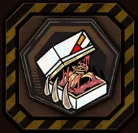

- 가격: 400 (히든보스) · 획득: 한정 · 익스트림 난이도 한정 · 강화: 불가
- 히든 보스 기프트 (익스트림 난이도 히든 보스에서만 획득)
- 연관: 캐릭터: 칼리스토 · 첫 등장: 이름과 거미의 거울 (거울 던전 7)

**효과**

- 아군이 사용하는 스킬의 코인 위력 +(8/ 코인 수) (더하기 코인 적용), 최종 위력 +(8 / 코인 수) (빼기 코인 적용) (최소 증가 값 1, 소수점 버림, E.G.O 스킬 포함)
- 약지 소속 인격이 기본 공격 스킬 사용 시, 대상에게 부여된 부정적인 효과의 개수에 따라 해당 스킬에 아래 효과 적용
- - 2 ~ : 합 위력 +2
- - 4 ~ : 피해량 +15%
- - 6 ~ : 코인 효과로 부여하는 부정적인 효과의 위력, 횟수 부여값 +1
- - 7 ~ : 기본 위력 +2
- - 8 ~ : 피해량 +35%

**시즌 지난 뒤 (약화)**

- 약지 소속 인격이 기본 공격 스킬 사용 시, 대상에게 부여된 부정적인 효과의 개수에 따라 해당 스킬에 아래 효과 적용
- - 2 ~ : 합 위력 +2
- - 4 ~ : 피해량 +15%
- - 6 ~ : 코인 효과로 부여하는 부정적인 효과의 위력, 횟수 부여값 +1
- - 7 ~ : 기본 위력 +2
- - 8 ~ : 피해량 +35%

### Ⅳ 출혈성 쇼크

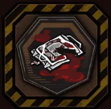

- 가격: 405 (구매불가) · 획득: 합성 · 하드 난이도 한정 · 강화: 불가
- 조합식: 늘어붙은 쇠말뚝 + 녹슨 커터 나이프 + 찢어진 피주머니
- 연관: 불명 · 첫 등장: 꿈결의 거울 (거울 던전 5)

**효과**

- 턴 시작 시, 출혈 위력 또는 출혈 횟수 또는 특수 출혈을 부여하는 공격 스킬을 보유한 인격이 5인 이상이면, 이번 전투 동안 발동 (E.G.O 스킬 제외. 대기 인원 제외)
- 아군이 합 승리 시, 적의 출혈을 1회 발동시키고, 출혈 횟수 1 감소 (아군 1명당 턴 당 1회)
- 적이 출혈 피해로 흐트러질 수 있으며, 적이 합 진행 중 출혈 피해로 흐트러지면, 적의 남은 코인 수만큼 출혈을 발동시킴
- 모든 적이 출혈이 부여되어 있으면 방어 레벨 2 감소. 턴 종료 시 (출혈이 발동한 횟수 × 2)만큼 다음 턴에 방어 레벨 감소를 얻음 (최대 20)
- 스킬 효과로 출혈 위력 또는 특수 출혈을 부여할 때마다 대상에게 출혈 위력 3, 출혈 횟수 1 부여

### Ⅳ 퍼레이드의 가면

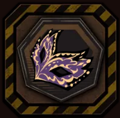

- 가격: 394 · 획득: 한정 · 하드 난이도 한정 · 강화: 가능
- 전용 팩: 다시 열린 라만차랜드, 끝나지 않는 행렬, 꿈이 끝나는
- 연관: 집단: 라만차랜드 · 첫 등장: 꿈결의 거울 (거울 던전 5)

**기본**

- 혈귀인 모든 아군의 기본 스킬 코인 위력 +1
- 적이 증원되는 전투에서 새로운 적이 등장하면, 전투 시작 시 해당 적에게 출혈 3, 출혈 횟수 3 부여.
- 아군에 <혈귀>가 있다면, 적이 증원될 때 모든 적의 출혈을 1회 발동시키고, 모든 적의 출혈 횟수 1 감소

**+**

- 혈귀인 모든 아군의 기본 스킬 코인 위력 +1
- 적이 증원되는 전투에서 새로운 적이 등장하면, 전투 시작 시 해당 적에게 출혈 5, 출혈 횟수 3 부여.
- 아군에 <혈귀>가 있다면, 적이 증원될 때 모든 적의 출혈을 1회 발동시키고, 모든 적의 출혈 횟수 1 감소

### Ⅳ 피안개

- 가격: 421 (구매불가) · 획득: 합성 · 강화: 불가
- 조합식: 연기와 철조망 + 녹슨 입마개 + 치성
- 연관: 캐릭터: 붉은안개 · 첫 등장: 호수의 거울 (거울 던전 3)

**효과**

- 턴 시작 시, 출혈 위력, 출혈 횟수 또는 특수 출혈을 부여하는 공격 스킬을 보유한 인격이 5인 이상이면, 이번 전투 동안 발동 (E.G.O 스킬 제외. 대기 인원 제외)
- 아군이 스킬 효과로 적에게 부여하는 출혈 위력과 출혈 횟수가 2배로 적용.
- 턴 시작 시 편성 순서가 제일 빠른 아군의 출혈 위력, 출혈 횟수 또는 특수 출혈을 부여하는 더하기 코인 스킬의 코인 위력 +2, 피해량 +100%.
- - 빼기 코인 스킬일 경우, 코인 위력 대신 기본 위력 +(8/코인 수) (최소 1, 소수점 버림)
- 해당 캐릭터가 공격하거나, 합을 진행한 적이 사망했으면, 사망한 적의 남은 출혈 위력을 모든 적에게 무작위로 나눠서 부여 (집중 전투인 경우, 부위로 판정)
- 출혈 위력, 횟수 또는 특수 출혈을 부여하는 더하기 코인 스킬의 코인 위력 +1, 피해량 +30%
- - 빼기 코인 스킬일 경우, 코인 위력 대신 기본 위력 +(4/코인 수) (최소 1, 소수점 버림)

## 진동 (29)

### Ⅰ 극독성 외피

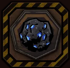

- 가격: 147 · 획득: 통상 · 강화: 가능
- 연관: 환상체: 울음 두꺼비 · 첫 등장: 폭풍의 거울 (거울 던전 4)

**기본**

- 진동 위력 또는 진동 횟수를 부여하는 스킬(본인 또는 아군을 대상으로 하는 경우 포함)을 사용하여 합 승리 시, (남은 코인 수/2)만큼 대상 적에게 진동 위력 부여

**+**

- 진동 위력 또는 진동 횟수를 부여하는 스킬(본인 또는 아군을 대상으로 하는 경우 포함)을 사용하여 합 승리 시, 남은 코인 수만큼 대상 적에게 진동 위력 부여

**++**

- 진동 위력 또는 진동 횟수를 부여하는 스킬(본인 또는 아군을 대상으로 하는 경우 포함)을 사용하여 합 승리 시, 남은 코인 수만큼 대상 적에게 진동 위력과 (남은 코인 수/2)만큼 진동 횟수 부여

### Ⅰ 기름때 찌든 스패너

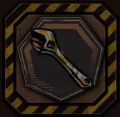

- 가격: 148 · 획득: 한정 · 강화: 불가
- 전용 팩: 우.미.다
- 연관: 집단: 어금니 보트 센터 · 첫 등장: 폭풍의 거울 (거울 던전 4)

**효과**

- 타격 스킬의 피해량 +10%
- 타격 스킬 마지막 코인 적중 시, 적에게 진동 위력 2 부여. (턴당 1회)

### Ⅰ 닉시 다이버전스

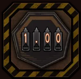

- 가격: 145 · 획득: 통상 · 강화: 가능
- 연관: 환상체: 증기 운반 기계 · 첫 등장: 시작의 거울 (거울 던전 1)

**기본**

- 스테이지 첫 턴 시작 시, 적 전체(환상체일 경우, 모든 부위)에게 진동 위력 4, 진동 횟수 4 부여.
- 질투 속성 스킬을 사용하여 적에게 적중 시, 대상에게 진동 위력 2 부여

**+**

- 웨이브 첫 턴 시작 시, 적 전체(환상체일 경우, 모든 부위)에게 진동 위력 4, 진동 횟수 4 부여.
- 질투 속성 스킬을 사용하여 적에게 적중 시, 대상에게 진동 위력 2 부여

**++**

- 웨이브 첫 턴 시작 시, 적 전체(환상체일 경우, 모든 부위)에게 진동 위력 5, 진동 횟수 5 부여.
- 질투 속성 스킬을 사용하여 적에게 적중 시, 대상에게 진동 위력 3 부여

### Ⅰ 보석 진동자

- 가격: 153 · 획득: 한정 · 하드 난이도 한정 · 강화: 불가
- 연관: 불명 · 첫 등장: 꿈결의 거울 (거울 던전 5)

**효과**

- 진동 횟수를 소모한 스킬로 합 승리시, 대상에게 진동이 없다면 대상의 진동 횟수 2 증가.
- 해당 공격 스킬을 포함하여 나태 공명 3 이상이면, 대신 대상의 진동 횟수 3 증가

### Ⅰ 불 꺼진 랜턴

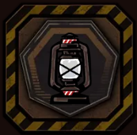

- 가격: 152 · 획득: 한정 · 하드 난이도 한정 · 강화: 불가
- 전용 팩: 20번구의 기적 BokGak
- 연관: 환상체: 아늑한 침대 · 첫 등장: 꿈결의 거울 (거울 던전 5)

**효과**

- [편성 7번 인격 전용 효과]
- 스킬, 코인 효과로 얻는 진동 횟수의 값 +1
- - 공격 대상이 흐트러짐, 사기저하, 패닉 상태면 대신 +2

### Ⅰ 초록빛 결실

- 가격: 146 · 획득: 통상 · 강화: 가능
- 연관: 환상체: 신사 요정 · 첫 등장: 시작의 거울 (거울 던전 1)

**기본**

- 흐트러짐 상태가 아닌 적에게 탐식 속성 스킬을 사용하여 적중하였거나 또는 스킬 효과로 진동 위력을 부여할 경우, 모든 적(환상체일 경우, 모든 부위)에게 진동 위력 4 무작위로 나누어 부여.

**+**

- 흐트러짐 상태가 아닌 적에게 탐식 속성 스킬을 사용하여 적중하였거나 또는 스킬 효과로 진동 위력을 부여할 경우, 모든 적(환상체일 경우, 모든 부위)에게 진동 위력 6 무작위로 나누어 부여.

**++**

- 흐트러짐 상태가 아닌 적에게 탐식 속성 스킬을 사용하여 적중하였거나 또는 스킬 효과로 진동 위력을 부여할 경우, 모든 적(환상체일 경우, 모든 부위)에게 진동 위력 8 무작위로 나누어 부여.

### Ⅱ 감합된 톱니바퀴

- 가격: 207 · 획득: 통상 · 강화: 불가
- 연관: 불명 · 첫 등장: 꿈결의 거울 (거울 던전 5)

**효과**

- 턴 시작 시, 진동 위력, 진동 횟수 또는 특수 진동을 부여하는 공격 스킬을 보유한 인격이 5인 이상이면, 이번 전투 동안 발동 (E.G.O 스킬 제외. 대기 인원 제외)
- 이번 턴에 대상에게 진동 폭발을 6회 부여하였을 경우, 대상의 현재 체력 기준 0%에 새로운 흐트러짐 구간 추가 (전투 당 1회 발동).
- 진폭 변환, 진폭 얽힘 시 취약 1 부여 (턴 당 최대 1회)

### Ⅱ 거울 촉각 공감각

- 가격: 200 · 획득: 통상 · 강화: 불가
- 연관: 환상체: 길 잃은 마음 · 첫 등장: 폭풍의 거울 (거울 던전 4)

**효과**

- 아군이 진동 위력 또는 진동 횟수를 부여하는 스킬(본인 또는 아군을 대상으로 하는 경우 포함)로 적을 흐트러뜨릴 경우 (E.G.O 스킬 제외), 다음 턴에 대상이 보유한 진동 위력의 1/3만큼을 다른 무작위 적들(환상체일 경우, 무작위 부위)에게 진동 위력을 나누어 부여함

### Ⅱ 고혈

- 가격: 200 · 획득: 통상 · 강화: 가능
- 연관: 환상체: 주정뱅이 · 첫 등장: 시작의 거울 (거울 던전 1)

**기본**

- 흐트러짐 상태의 적에게 스킬을 사용하여 가하는 피해량 +10%.
- 진동 위력, 진동 횟수를 부여하거나, 진폭 변환, 진동 폭발, 진폭 얽힘 효과를 보유한 스킬 또는 나태 속성 스킬을 사용할 경우, 효과가 강화되어 피해량 +20%.

**+**

- 흐트러짐 상태의 적에게 스킬을 사용하여 가하는 피해량 +12.5%.
- 진동 위력, 진동 횟수를 부여하거나, 진폭 변환, 진동 폭발, 진폭 얽힘 효과를 보유한 스킬 또는 나태 속성 스킬을 사용할 경우, 효과가 강화되어 피해량 +25%.

**++**

- 흐트러짐 상태의 적에게 스킬을 사용하여 가하는 피해량 +15%.
- 진동 위력, 진동 횟수를 부여하거나, 진폭 변환, 진동 폭발, 진폭 얽힘 효과를 보유한 스킬 또는 나태 속성 스킬을 사용할 경우, 효과가 강화되어 피해량 +30%.

### Ⅱ 시큼한 주향

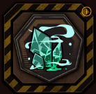

- 가격: 185 · 획득: 통상 · 강화: 가능
- 연관: 환상체: 신사 요정 · 첫 등장: 폭풍의 거울 (거울 던전 4)

**기본**

- [편성 1번, 2번 인격 전용 효과]
- 진동 위력 또는 진동 횟수를 부여하는 스킬(본인 또는 아군을 대상으로 하는 경우 포함)의 공격 레벨 +2
- 메인 공격 대상이 진동 상태이고 흐트러진 경우, 스킬로 가하는 피해량 +(흐트러짐 단계 × 7.5)%
- 진동 위력 또는 진동 횟수를 부여하는 스킬로 적을 공격할 경우, 효과가 강화되어 피해량 +(흐트러짐 단계 × 15)%

**+**

- [편성 1번, 2번, 3번 인격 전용 효과]
- 진동 위력 또는 진동 횟수를 부여하는 스킬(본인 또는 아군을 대상으로 하는 경우 포함)의 공격 레벨 +2
- 메인 공격 대상이 진동 상태이고 흐트러진 경우, 스킬로 가하는 피해량 +(흐트러짐 단계 × 10)%
- 진동 위력 또는 진동 횟수를 부여하는 스킬로 적을 공격할 경우, 효과가 강화되어 피해량 +(흐트러짐 단계 × 20)%

**++**

- [편성 1번, 2번, 3번 인격 전용 효과]
- 진동 위력 또는 진동 횟수를 부여하는 스킬(본인 또는 아군을 대상으로 하는 경우 포함)의 공격 레벨 +3
- 메인 공격 대상이 진동 상태이고 흐트러진 경우, 스킬로 가하는 피해량 +(흐트러짐 단계 × 12.5)%
- 진동 위력 또는 진동 횟수를 부여하는 스킬로 적을 공격할 경우, 효과가 강화되어 피해량 +(흐트러짐 단계 × 25)%

### Ⅱ 오더메이드

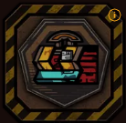

- 가격: 190 · 획득: 한정 · 강화: 불가
- 전용 팩: 공장 자동화
- 연관: 환상체: 당신은 강해졌나요, 너 맞아볼래? 매우? · 첫 등장: 폭풍의 거울 (거울 던전 4)

**효과**

- [편성 3번 인격 전용 효과]
- 스테이지 시작 시, 진동 횟수 3을 획득.
- 턴 시작 시, 보호 1, 피해량 증가 1, 위력 증가 1 얻음.

### Ⅱ 잔향

- 가격: 216 · 획득: 통상 · 강화: 가능
- 연관: 불명 · 첫 등장: 호수의 거울 (거울 던전 3)

**기본**

- 턴 종료 시, 진동 위력을 10 이상 보유한 적(환상체일 경우, 해당 부위)에게 다음 턴에 속박 2 부여.
- 대상이 진동 위력을 20 이상 보유한 경우, 효과가 강화되어 속박 2, 마비 1 부여.

**+**

- 턴 종료 시, 진동 위력을 8 이상 보유한 적(환상체일 경우, 해당 부위)에게 다음 턴에 속박 2, 방어 레벨 감소 2 부여.
- 대상이 진동 위력을 15 이상 보유한 경우, 효과가 강화되어 속박 2, 마비 1, 방어 레벨 감소 2 부여.

**++**

- 턴 종료 시, 진동 위력을 5 이상 보유한 적(환상체일 경우, 해당 부위)에게 다음 턴에 속박 2, 방어 레벨 감소 3 부여.
- 대상이 진동 위력을 10 이상 보유한 경우, 효과가 강화되어 속박 2, 마비 1, 방어 레벨 감소 4 부여.

### Ⅱ 진동형 팔찌

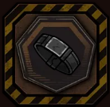

- 가격: 208 · 획득: 통상 · 강화: 가능
- 연관: 불명 · 첫 등장: 거울의 거울 (거울 던전 2)

**기본**

- 스킬을 사용하여 적에게 적중 시, 다음 턴에 대상에게 진동 위력 1 부여
- 분노 속성 스킬을 사용할 경우, 효과가 강화되어 진동 위력 2 부여.

**+**

- 스킬을 사용하여 적에게 적중 시, 다음 턴에 대상에게 진동 위력 1 부여.
- 분노 속성 스킬을 사용할 경우, 효과가 강화되어 진동 위력 3 부여.

**++**

- 스킬을 사용하여 적에게 적중 시, 다음 턴에 대상에게 진동 위력 2 부여.
- 분노 속성 스킬을 사용할 경우, 효과가 강화되어 진동 위력 4 부여.

### Ⅱ 흔들리는 술통

- 가격: 211 · 획득: 한정 · 하드 난이도 한정 · 강화: 불가
- 연관: 환상체: 주정뱅이 · 첫 등장: 꿈결의 거울 (거울 던전 5)

**효과**

- 턴 시작 시, 자신의 진동 횟수가 8 이상이면 합 위력 +1
- 자신의 진동 횟수를 소모하는 스킬로 적을 처치하거나 흐트러짐 상태로 만들었으면, (소모된 진동 횟수 / 4)만큼 자신의 진동 횟수 증가 (스킬당 1회)

### Ⅲ 그림자 괴물

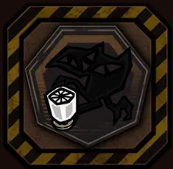

- 가격: 251 (구매불가) · 획득: 합성 · 하드 난이도 한정 · 강화: 불가
- 전용 팩: 20번구의 기적 BokGak
- 조합식: 불 꺼진 랜턴 + 불 꺼진 촛대
- 연관: 환상체: 아늑한 침대 · 첫 등장: 꿈결의 거울 (거울 던전 5)

**효과**

- [편성 1, 2, 7, 8번 인격 전용 효과]
- 스킬, 코인 효과로 얻는 진동 횟수의 값 +1
- - 공격 대상이 흐트러짐, 사기저하, 패닉 상태면 대신 +2
- 턴 시작 시 흐트러짐, 사기저하, 패닉 상태인 적이 있으면, 모든 적에게 공격 레벨 감소 1 또는 방어 레벨 감소 1 부여 (턴 당 최대 3회)
- 흐트러짐, 사기저하, 패닉 상태인 적에게 공격 적중 시, 공격 레벨 감소 1 또는 방어 레벨 감소 1 부여 (턴 당 최대 3회, 다른 인격과 횟수 공유)

### Ⅲ 녹아내린 눈알

- 가격: 248 · 획득: 통상 · 강화: 불가
- 연관: 환상체: 울음 두꺼비 · 첫 등장: 시작의 거울 (거울 던전 1)

**효과**

- 진동 폭발된 적에게 다음 턴에 공격 레벨 감소 5와 방어 레벨 감소 5 부여. (턴 당 최대 3회)

### Ⅲ 달궈진 망치

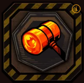

- 가격: 248 · 획득: 한정 · 하드 난이도 한정 · 강화: 불가
- 전용 팩: 교본
- 연관: 불명 · 첫 등장: 이름과 거미의 거울 (거울 던전 7)

**효과**

- 적에게 진동 - 작열이 있을 경우 다음 효과 적용
- - 기본 스킬 적중 시 화상 위력 1 부여 (스킬당 최대 3회)
- - 기본 스킬 적중 시 진동 - 작열이 15 이상이면, 화상 횟수 1 증가 (스킬당 최대 2회)
- - 화상 3당, 진동 폭발로 인한 흐트러짐 손상 +1% (최대 15%)

### Ⅲ 르누아르 메종 슬랙스

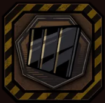

- 가격: 258 · 획득: 한정 · 하드 난이도 한정 · 강화: 불가
- 전용 팩: 보존의 신념
- 연관: 집단: 르누아르 · 첫 등장: 시지프의 거울 (거울 던전 8)

**효과**

- 충전 위력이 2 이상인 아군이 진동 폭발 시 아래 효과 적용
- - (자신의 충전 위력 x 횟수)만큼 질투 피해를 줌 (스킬당 2회, 1회당 최대 100)
- - 위 효과로 질투 피해를 2번 주었으면, 다음 턴에 대상에게 속박 3 부여
- 아군이 스킬로 진동 폭발 시 진동 폭발마다 (자신의 충전 위력 / 3)만큼 다음 턴에 공격 레벨 증가 얻음 (턴당 최대 5, 소수점 버림)

### Ⅲ 생체 맹독 바이알

- 가격: 162 · 획득: 통상 · 강화: 가능
- 연관: 환상체: 걷는 진주 · 첫 등장: 폭풍의 거울 (거울 던전 4)

**기본**

- 진동 위력을 보유한 적이 사망할 경우, 대상이 보유한 (진동 위력과 진동 횟수의 합 × 0.5)만큼 다음 턴에 무작위 적 하나(환상체일 경우, 무작위 부위)에게 나태 피해를 입힘

**+**

- 진동 위력을 보유한 적이 사망할 경우, 대상이 보유한 (진동 위력과 진동 횟수의 합 × 0.75)만큼 다음 턴에 무작위 적 하나(환상체일 경우, 무작위 부위)에게 나태 피해를 입힘

**++**

- 진동 위력을 보유한 적이 사망할 경우, 대상이 보유한 (진동 위력과 진동 횟수의 합 × 1.25)만큼 다음 턴에 무작위 적 하나(환상체일 경우, 무작위 부위)에게 나태 피해를 입힘

### Ⅲ 손거울

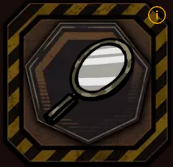

- 가격: 404 (구매불가) · 획득: 합성 · 강화: 불가
- 전용 팩: 어느 세계
- 조합식: 거울 촉각 공감각 + 치프 버틀러의 비급서
- 연관: 캐릭터: 캐서린 · 첫 등장: 폭풍의 거울 (거울 던전 4)

**효과**

- 웨이브 첫 턴 시작 시, 속도가 제일 낮은 적 둘(환상체일 경우 무작위 부위 둘, 적이 단일 대상일 경우 효과가 중첩되지 않음)를 선택하여 다음 턴부터 턴 시작 시 속박 5, 방어 레벨 감소 3을 부여.
- 적이 흐트러짐에서 풀려날 때, 보유한 흐트러짐 구간이 없다면 대상의 현재 체력 기준 66%에 새로운 흐트러짐 구간 추가 (전투 당 3회).
- 아군이 진동 위력 또는 진동 횟수를 부여하는 공격 스킬(본인 또는 아군을 대상으로 하는 경우 포함)로 적을 흐트러뜨릴 경우 (E.G.O 스킬 제외), 다음 턴에 대상이 보유한 진동 위력의 절반만큼 다른 무작위 적들(환상체일 경우, 부위)에게 진동 위력을 나누어 부여하고 흐트러진 대상은 보유한 진동 위력이 2배로 증가.

### Ⅲ 진실의 종

- 가격: 268 · 획득: 통상 · 강화: 가능
- 연관: 환상체: 태엽장치시간오뚝이 · 첫 등장: 호수의 거울 (거울 던전 3)

**기본**

- 진동 폭발이 적용된 적에게 이번 턴에 취약 1 부여 (공격 스킬을 사용하여 진동 폭발 부여 시, 스킬 당 최대 1회).

**+**

- 진동 폭발이 적용된 적에게 이번 턴과 다음 턴에 취약 1 부여 (공격 스킬을 사용하여 진동 폭발 부여 시, 스킬 당 최대 1회).

**++**

- 진동 폭발이 적용된 적에게 이번 턴과 다음 턴에 취약 2 부여 (공격 스킬을 사용하여 진동 폭발 부여 시, 스킬 당 최대 1회).

### Ⅲ 진원점

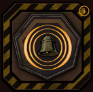

- 가격: 248 (구매불가) · 획득: 합성 · 하드 난이도 한정 · 강화: 불가
- 조합식: 보석 진동자 + 흔들리는 술통
- 연관: 불명 · 첫 등장: 꿈결의 거울 (거울 던전 5)

**효과**

- 턴 시작 시, 진동 위력 또는 진동 횟수를 부여하는 공격 스킬을 보유한 인격이 5인 이상이면, 이번 전투 동안 발동 (E.G.O 스킬 제외. 대기 인원 제외. 인격이 스스로 진동 횟수를 얻는 경우에는 발동 x)
- 자신의 진동 횟수를 소모한 스킬로 합 승리시, 대상에게 진동이 없다면 대상의 진동 횟수 3 증가
- 턴 시작 시 합 위력이 (자신의 진동 횟수/5)만큼 증가. (최대 3)
- 자신의 진동 횟수를 소모하는 스킬을 사용했을 때, 적 처치 혹은 흐트러짐 상태로 만들 경우 (소모한 진동 횟수 / 2)만큼 자신의 진동 횟수 증가 (스킬당 1회)

### Ⅲ 톱니바퀴 태엽

- 가격: 249 · 획득: 통상 · 강화: 불가
- 연관: 환상체: 증기 운반 기계 · 첫 등장: 폭풍의 거울 (거울 던전 4)

**효과**

- [편성 1번, 2번 인격 전용 효과]
- 진동 위력 또는 진동 횟수를 부여하는 스킬(본인 또는 아군을 대상으로 하는 경우 포함)의 합 위력 +1.
- 진동 상태인 적에게 진동 위력 또는 진동 횟수를 부여하는 공격 스킬로 피해를 입힐 경우, 피해량 +(적이 보유한 진동 위력 + 5)% (E.G.O 스킬 제외).
- 오만 속성 스킬일 경우, 효과가 강화되어 피해량 +(적이 보유한 진동 위력과 진동 횟수의 합 + 5)%

### Ⅳ 무진팔방종

- 가격: 405 (구매불가) · 획득: 합성 · 하드 난이도 한정 · 강화: 불가
- 조합식: 극독성 외피 + 톱니바퀴 태엽 + 진원점
- 연관: 불명 · 첫 등장: 꿈결의 거울 (거울 던전 5)

**효과**

- 턴 시작 시, 진동 위력 또는 진동 횟수를 부여하는 공격 스킬을 보유한 인격이 5인 이상이면, 이번 전투 동안 발동 (E.G.O 스킬 제외. 대기 인원 제외. 인격이 스스로 진동 횟수를 얻는 경우에는 발동 x)
- 진동 위력 또는 진동 횟수를 부여하거나 자신의 진동 횟수를 소모한 스킬로 합 승리시 남은 코인만큼 대상에게 진동 위력 부여, 자신의 진동 횟수 증가 (스킬 당 자신의 진동 횟수 최대 3 증가). 대상에게 진동이 없으면, 대상의 진동 횟수 3 증가
- 턴 시작 시 합 위력 증가를 1 + (자신의 진동 횟수/5)만큼 얻음 (최대 3)
- 자신의 진동 횟수를 소모하는 스킬을 사용했을 때, 적 처치 혹은 흐트러짐 상태로 만들 경우 (소모한 진동 횟수 / 2)만큼 자신의 진동 횟수 증가 (스킬당 1회)
- 스킬의 피해량 +(자신이 소모한 진동 횟수 + 적이 보유한 진동 위력 + 5)% (E.G.O 스킬 제외, 최대 50%).
- 대상에게 진동 - 중첩이 있을 때, 그 대상에게 중첩되지 않은 유형의 진동 유형으로 진폭 변환, 진폭 얽힘을 사용하면, 턴 종료 시 대상이 보유한 진동 - 중첩을 다음 턴까지 연장함

### Ⅳ 불완전한 예지안

- 가격: 400 (히든보스) · 획득: 한정 · 익스트림 난이도 한정 · 강화: 불가
- 히든 보스 기프트 (익스트림 난이도 히든 보스에서만 획득)
- 연관: 캐릭터: 발렌치나 · 첫 등장: 이름과 거미의 거울 (거울 던전 7)

**효과**

- 아군이 사용하는 스킬의 코인 위력 +(8/ 코인 수) (더하기 코인 적용), 최종 위력 +(8 / 코인 수) (빼기 코인 적용) (최소 증가 값 1, 소수점 버림, E.G.O 스킬 포함)
- [편성 1번 인격 전용 효과]
- - 합 진행 시 매 합마다 자신이 순간의 예지 1 얻음. 대상에게 진동과 화상 2 부여 (스킬당 최대 10회)
- - 합 승리 시 메인 타겟에게 진동 - 작열로 진폭 변환하고, 진동 폭발. 대상에게 진동 횟수 1 감소
- - 스킬 적중 시 대상이 흐트러짐 상태라면, 가하는 피해량 +30%
- - 크리티컬 적중 시 진동 폭발. 대상에게 진동 횟수 1 감소 (스킬당 2회)

**시즌 지난 뒤 (약화)**

- [편성 1번 인격 전용 효과]
- - 합 진행 시 매 합마다 자신이 순간의 예지 1 얻음. 대상에게 진동과 화상 2 부여 (스킬당 최대 10회)
- - 합 승리 시 메인 타겟에게 진동 - 작열로 진폭 변환하고, 진동 폭발. 대상에게 진동 횟수 1 감소
- - 스킬 적중 시 대상이 흐트러짐 상태라면, 가하는 피해량 +30%
- - 크리티컬 적중 시 진동 폭발. 대상에게 진동 횟수 1 감소 (스킬당 2회)

### Ⅳ 상납된 시가

- 가격: 390 · 획득: 한정 · 하드 난이도 한정 · 강화: 불가
- 전용 팩: 교본
- 연관: 집단: 엄지 · 첫 등장: 이름과 거미의 거울 (거울 던전 7)

**효과**

- 턴 시작 시, 엄지 소속 인격이 3인 이상일 때 발동 (출격 인원을 기준으로 함)
- 엄지 소속 인격이 턴 시작 시 더하기 코인 강화 1, 피해량 증가 2 얻음
- 엄지 소속 인격 1명당 엄지 소속 인격이 공격 레벨 증가 1 얻음 (최대 4)
- 대상이 보유한 진동 - 작열 1당 피해량 +1% (최대 20%)
- - 탄환을 소모하는 스킬이면, 추가로 +1% (최대 20%)
- - 엄지 소속이면, 추가로 +1% (최대 20%)
- 자신의 스킬 효과로 진동 폭발이 발동하였다면, 다음 턴에 공격 레벨 증가 2 얻음 (턴당 3회)
- 거미집 엄지 아비 로쟈의 스킬 3 공격 종료시 거미집 엄지 제자 히스클리프에게 완성되어가는 교본 1 부여

### Ⅳ 연성진동

- 가격: 419 (구매불가) · 획득: 합성 · 강화: 불가
- 조합식: 진실의 종 + 감합된 톱니바퀴 + 닉시 다이버전스
- 연관: 불명 · 첫 등장: 호수의 거울 (거울 던전 3)

**효과**

- 턴 시작 시, 진동 위력, 진동 횟수 또는 특수 진동을 부여하는 공격 스킬을 보유한 인격이 5인 이상이면, 이번 전투 동안 발동 (E.G.O 스킬 제외. 대기 인원 제외)
- 웨이브 첫 턴 시작 시, 적 전체(환상체일 경우, 모든 부위)에 진동 5, 진동 횟수 5 부여
- 진동 폭발이 적용된 적에게 이번 턴과 다음 턴에 진동 위력 5, 취약 2 부여 (공격 스킬을 사용하여 진동 폭발 부여 시, 스킬 당 최대 1회).
- 이번 턴에 대상에게 진동 폭발을 3회 부여하였을 경우, 다음 턴 시작 시 대상을 흐트러뜨리고 현재 체력 기준 66%, 33%에 흐트러짐 구간 추가. (전투 당 1회 발동).
- 진폭 변환, 진폭 얽힘 시 취약 1 부여 (턴 당 최대 3회)

### Ⅳ 타성 조각

- 가격: 400 · 획득: 통상 · 강화: 불가
- 연관: 불명 · 첫 등장: 폭풍의 거울 (거울 던전 4)

**효과**

- 진동 위력 또는 진동 횟수 또는 특수 진동을 부여하는 E.G.O 스킬 사용 시 발동
- 소모하는 (나태 E.G.O 자원 +나머지 E.G.O 자원의 합/3)만큼 최종 위력이 증가, 피해량 +50%
- 나태 속성 E.G.O 스킬의 경우, 효과가 강화되어 공격 시작 전에 진동 횟수를 추가로 부여(ZAYIN의 경우 2, 등급이 오를수록 +1)하고 피해량 +(대상이 보유한 진동 위력 x1.5)%

### Ⅳ 폭우

- 가격: 381 · 획득: 통상 · 강화: 가능
- 연관: 불명 · 첫 등장: 거울의 거울 (거울 던전 2)

**기본**

- 턴 시작 시, 모든 적(환상체일 경우, 모든 부위)에게 진동 위력을 (현재 턴 × 2) 부여, 진동 횟수 2 부여.
- 턴 종료 시, 모든 적(환상체일 경우, 모든 부위)에게 진동 폭발 효과 부여.

**+**

- 턴 시작 시, 모든 적(환상체일 경우, 모든 부위)에게 진동 위력을 (3 + 현재 턴 × 2) 부여, 진동 횟수 3 부여.
- 턴 종료 시, 모든 적(환상체일 경우, 모든 부위)에게 진동 폭발 효과 부여.

**++**

- 턴 시작 시, 모든 적(환상체일 경우, 모든 부위)에게 진동 위력을 (5 + 현재 턴 × 2) 부여, 진동 횟수 3 부여.
- 턴 종료 시, 모든 적(환상체일 경우, 모든 부위)에게 진동 폭발 효과 2회 부여.

## 파열 (24)

### Ⅰ 부서진 리볼버

- 가격: 209 · 획득: 통상 · 강화: 불가
- 연관: 불명 · 첫 등장: 거울의 거울 (거울 던전 2)

**효과**

- 턴 시작 시, 파열 상태(환상체일 경우, 부위)인 적의 공격 레벨과 방어 레벨이 이번 턴 동안 2만큼 감소.

### Ⅰ 부적 묶음

- 가격: 143 · 획득: 통상 · 강화: 가능
- 연관: 환상체: 누구도 울지 않도록 · 첫 등장: 시작의 거울 (거울 던전 1)

**기본**

- 스킬을 사용하여 적에게 적중 시 12 이상의 체력 피해를 입혔다면, 대상에게 파열 위력 2 부여.
- 참격 스킬을 사용할 경우, 효과가 강화되어 파열 위력 4 부여.

**+**

- 스킬을 사용하여 적에게 적중 시 12 이상의 체력 피해를 입혔다면, 대상에게 파열 위력 3 부여.
- 참격 스킬을 사용할 경우, 효과가 강화되어 파열 위력 5 부여

**++**

- 스킬을 사용하여 적에게 적중 시 1 이상의 체력 피해를 입혔다면, 대상에게 파열 위력 3 부여.
- 참격 스킬을 사용할 경우, 효과가 강화되어 파열 위력 5 부여, 파열 횟수 1 증가.

### Ⅰ 뼈 말뚝

- 가격: 152 · 획득: 통상 · 강화: 불가
- 연관: 환상체: 이빨 딱딱이 · 첫 등장: 폭풍의 거울 (거울 던전 4)

**효과**

- 파열 효과가 적이 보유한 보호막에 입히는 피해량 +100%

### Ⅰ 장미 면류관

- 가격: 144 · 획득: 통상 · 강화: 가능
- 연관: 환상체: 장미 표지판 · 첫 등장: 시작의 거울 (거울 던전 1)

**기본**

- 턴 시작 시, 무작위 적 하나(환상체일 경우, 모든 부위)에게 파열 위력 4 부여.
- 탐식 완전 공명을 발동하였다면 전투 시작 시, 모든 적에게 파열 위력 2 부여.

**+**

- 턴 시작 시, 무작위 적 둘(환상체일 경우, 모든 부위)에게 파열 위력 4 부여.
- 탐식 완전 공명을 발동하였다면 전투 시작 시, 모든 적에게 파열 위력 3 부여.

**++**

- 턴 시작 시, 무작위 적 셋(환상체일 경우, 모든 부위)에게 파열 위력 4 부여.
- 탐식 완전 공명을 발동하였다면 전투 시작 시, 모든 적에게 파열 위력 4 부여.

### Ⅱ 가시 올가미

- 가격: 187 · 획득: 통상 · 강화: 가능
- 연관: 환상체: 장미 사냥꾼 · 첫 등장: 거울의 거울 (거울 던전 2)

**기본**

- 턴 종료 시, 모든 적에게 현재 속도만큼 파열 위력을 부여.
- 색욕 완전 공명을 발동하였다면 전투 시작 시, 무작위 적 하나에게 파열 위력 3, 파열 횟수 3 부여.

**+**

- 턴 종료 시, 모든 적에게 (현재 속도 + 1)만큼 파열 위력을 부여.
- 색욕 완전 공명을 발동하였다면 전투 시작 시, 무작위 적 하나에게 파열 위력 4, 파열 횟수 3 부여.

**++**

- 턴 종료 시, 모든 적에게 (현재 속도 + 2)만큼 파열 위력을 부여.
- 색욕 완전 공명을 발동하였다면 전투 시작 시, 무작위 적 하나에게 파열 위력 5, 파열 횟수 4 부여.

### Ⅱ 가시오랏줄

- 가격: 200 · 획득: 통상 · 강화: 불가
- 연관: 환상체: 장미 사냥꾼 · 첫 등장: 꿈결의 거울 (거울 던전 5)

**효과**

- 턴 시작 시, 파열 위력 또는 파열 횟수를 부여하는 공격 스킬을 보유한 인격이 5인 이상이면, 이번 전투 동안 발동 (E.G.O 스킬 제외. 대기 인원 제외)
- 전투 중 적의 파열 횟수가 1 아래로 떨어질 때, 파열 횟수 대신 파열 위력 20을 소모 (파열 위력이 20 미만이 될 경우, 효과 종료).
- 전투 중 적중 시 적의 파열 횟수가 1인 경우, 파열 횟수를 부여할 때 부여량 +1 (전투 당 2회)

### Ⅱ 유연 화약

- 가격: 201 · 획득: 통상 · 강화: 가능
- 연관: 불명 · 첫 등장: 폭풍의 거울 (거울 던전 4)

**기본**

- [편성 1번, 2번 인격 전용 효과]
- 턴 종료 시 이번 턴에 파열 위력 또는 파열 횟수를 부여하는 공격 스킬을 한 번이라도 사용하였다면, 다음 턴에 신속 1 얻음.
- 자신의 속도가 6 이상이면, 파열 위력 또는 파열 횟수를 부여하는 공격 스킬의 피해량 +12.5%

**+**

- [편성 1번, 2번, 3번 인격 전용 효과]
- 턴 종료 시 이번 턴에 파열 위력 또는 파열 횟수를 부여하는 공격 스킬을 한 번이라도 사용하였다면, 다음 턴에 신속 1 얻음.
- 자신의 속도가 5 이상이면, 파열 위력 또는 파열 횟수를 부여하는 공격 스킬의 피해량 +15%

**++**

- [편성 1번, 2번, 3번 인격 전용 효과]
- 턴 종료 시 이번 턴에 파열 위력 또는 파열 횟수를 부여하는 공격 스킬을 한 번이라도 사용하였다면, 다음 턴에 신속 1 ~ 2 얻음.
- 자신의 속도가 4 이상이면, 파열 위력 또는 파열 횟수를 부여하는 공격 스킬의 피해량 +20%

### Ⅱ 종말의 파편

- 가격: 200 · 획득: 한정 · 하드 난이도 한정 · 강화: 불가
- 연관: 환상체: 종말 달력 · 첫 등장: 꿈결의 거울 (거울 던전 5)

**효과**

- 대상의 파열 위력이 15 미만이면, 파열 위력 부여 시 추가 1 부여

### Ⅱ 해진 우산

- 가격: 211 · 획득: 통상 · 강화: 가능
- 연관: 환상체: 떠돌이 여우 · 첫 등장: 폭풍의 거울 (거울 던전 4)

**기본**

- [편성 1번, 2번 인격 전용 효과]
- 파열 위력 또는 파열 횟수를 부여하는 공격 스킬을 사용하여 합 승리 시, 대상 적에게 파열 횟수 2 부여 (인격 별로 턴 당 1회).
- 대상이 파열 상태가 아닐 경우, 효과가 강화되어 파열 위력 3, 파열 횟수 2 부여

**+**

- [편성 1번, 2번, 3번 인격 전용 효과]
- 파열 위력 또는 파열 횟수를 부여하는 공격 스킬을 사용하여 합 승리 시, 대상 적에게 파열 위력 2, 파열 횟수 2 부여 (인격 별로 턴 당 1회).
- 대상이 파열 상태가 아닐 경우, 효과가 강화되어 파열 위력 4, 파열 횟수 2 부여

**++**

- [편성 1번, 2번, 3번 인격 전용 효과]
- 파열 위력 또는 파열 횟수를 부여하는 공격 스킬을 사용하여 합 승리 시, 대상 적에게 파열 위력 4, 파열 횟수 2 부여 (인격 별로 턴 당 1회).
- 대상이 파열 상태가 아닐 경우, 효과가 강화되어 파열 위력 6, 파열 횟수 3 부여

### Ⅱ 형광색 램프

- 가격: 219 · 획득: 통상 · 강화: 가능
- 연관: 환상체: 꿈먹는 탁류 · 첫 등장: 호수의 거울 (거울 던전 3)

**기본**

- 턴 종료 시 파열 상태인 적의 수(환상체일 경우, 모든 부위) + 1만큼, 다음 턴에 무작위 아군 하나에게 피해량 증가 1, 신속 1 효과 중 하나를 부여.

**+**

- 턴 종료 시 파열 상태인 적의 수(환상체일 경우, 모든 부위) + 3만큼, 다음 턴에 무작위 아군 하나에게 피해량 증가 1, 신속 1 효과 중 하나를 부여.

**++**

- 턴 종료 시 파열 상태인 적의 수(환상체일 경우, 모든 부위) + 3만큼, 다음 턴에 무작위 아군 하나에게 피해량 증가 1, 신속 1 효과를 부여.

### Ⅱ 흑단 브로치

- 가격: 192 · 획득: 한정 · 강화: 불가
- 전용 팩: 속하지 못하는
- 연관: 환상체: 흑단여왕의 사과 · 첫 등장: 폭풍의 거울 (거울 던전 4)

**효과**

- 스테이지 첫 턴 시작 시, 모든 적에게 파열 위력 2, 파열 횟수 2 부여.
- 3턴 동안 턴 종료 시, 모든 적에게 다음 턴에 속박 2 부여

### Ⅲ 거울 속의 꽃

- 가격: 255 · 획득: 한정 · 하드 난이도 한정 · 강화: 불가
- 전용 팩: 바라볼 수밖에 없는
- 연관: 집단: H사 · 첫 등장: 영생의 거울 (거울 던전 6)

**효과**

- 매 턴 시작 시 모든 적에게 파열 위력 3 부여, 파열 횟수 1 증가 (집중 전투일 경우, 모든 부위에 적용)
- 파열, 호흡을 부여하거나 획득하는 공격 스킬을 보유한 인격이 편성된 수에 따라 기프트 효과 강화 (E.G.O) 스킬 제외, 편성 인원 포함).
- - 6인 이상
- 스킬 적중 시 파열 피해가 발생했다면, 호흡 횟수 1 얻음 (스킬 당 3회).
- - 10인 이상
- 스킬 적중 시 크리티컬이 발생했다면, 파열 횟수 1 증가 (스킬 당 3회)

### Ⅲ 근무용 통상 배터리

- 가격: 269 · 획득: 통상 · 강화: 불가
- 연관: 환상체: 충격 지네 · 첫 등장: 시작의 거울 (거울 던전 1)

**효과**

- 스킬을 사용하여 적에게 적중 시, 대상에게 파열 위력 3 부여
- 질투 속성 스킬을 사용할 경우, 효과가 강화되어 대상에게 파열 위력 5 부여

### Ⅲ 기괴한 석상

- 가격: 249 (구매불가) · 획득: 합성 · 하드 난이도 한정 · 강화: 불가
- 조합식: 뼈 말뚝 + 종말의 파편
- 연관: 불명 · 첫 등장: 꿈결의 거울 (거울 던전 3)

**효과**

- 턴 시작 시, 파열 위력 또는 파열 횟수를 부여하는 공격 스킬을 보유한 인격이 5인 이상이면, 이번 전투 동안 발동 (E.G.O 스킬 제외. 대기 인원 제외)
- 파열 효과가 적이 보유한 보호막에 입히는 피해량 +100%
- 대상의 파열 위력이 15 미만이면, 파열 위력 부여 시 추가 2 부여
- 스킬 효과로 인해 파열을 부여하지 못하는 경우 더하기 코인 위력 +1
- - 빼기 코인 스킬일 경우, 더하기 코인 위력 대신 기본 위력 +(4/코인 수) (최소 1, 소수점 버림)

### Ⅲ 목이 뻑뻑 가슴살

- 가격: 264 · 획득: 한정 · 강화: 불가
- 전용 팩: 헬스 치킨
- 연관: 집단: K사 · 첫 등장: 폭풍의 거울 (거울 던전 4)

**효과**

- 스킬로 적에게 파열 부여시 파열 횟수 3 증가. (턴 당 최대 3회)

### Ⅲ 벼락가지

- 가격: 252 · 획득: 통상 · 강화: 가능
- 연관: 환상체: 원귀목 · 첫 등장: 시작의 거울 (거울 던전 1)

**기본**

- 스킬 효과로 파열 위력을 부여할 때마다 대상에게 파열 위력 1, 파열 횟수 1 부여

**+**

- 스킬 효과로 파열 위력을 부여할 때마다 대상에게 파열 위력 2, 파열 횟수 1 부여

**++**

- 스킬 효과로 파열 위력을 부여할 때마다 대상에게 파열 위력 3, 파열 횟수 1 부여
- 우울 속성 스킬을 사용할 경우, 효과가 강화되어 파열 위력 3, 파열 횟수 2 부여

### Ⅲ 죽음바라기

- 가격: 271 · 획득: 통상 · 강화: 불가
- 연관: 불명 · 첫 등장: 폭풍의 거울 (거울 던전 4)

**효과**

- [편성 1번, 2번 인격 전용 효과]
- 파열 위력 또는 파열 횟수를 부여하는 공격 스킬의 합 위력 +1, 공격 레벨 +2, 피해량 +15% (E.G.O 스킬 제외)
- 단일 코인 스킬일 경우, 효과가 강화되어 합 위력 +2, 공격 레벨 +2, 피해량 +40%

### Ⅲ 크랲게 뇌수 담금주

- 가격: 268 · 획득: 한정 · 강화: 불가
- 전용 팩: 우.미.다
- 연관: 캐릭터: 올가 · 첫 등장: 폭풍의 거울 (거울 던전 4)

**효과**

- 아군이 파열 위력 또는 파열 횟수를 부여하는 스킬로 파열 상태인 적을 공격할 때, 대상의 파열 횟수에 비례하여 입히는 피해량 +(대상의 파열 횟수 × 1.25, 최대 50)%.
- 아군이 흐트러짐 상태에서 풀려날 때 최대 체력의 20%만큼 체력을 회복 (전투당 2회).

### Ⅳ 부치지 못한 편지

- 가격: 399 (구매불가) · 획득: 합성 · 하드 난이도 한정 · 강화: 불가
- 전용 팩: 변하지 않는
- 조합식: 해진 우산 + 깨진 안경
- 연관: 캐릭터: 이상 · 첫 등장: 폭풍의 거울 (거울 던전 4)

**효과**

- [편성 1번, 2번 인격 전용 효과]
- 파열 위력 또는 파열 횟수를 부여하는 공격 스킬을 사용하여 합 승리 시, 대상 적에게 파열 위력 5, 파열 횟수 3 부여 (인격 별로 턴 당 1회).
- 자신보다 속도가 낮은 적과 합을 진행할 때, 최종 위력 +1, 피해량 +25%.
- 공격 레벨 증가 버프를 보유한 적과 합하여 승리 시, 다음 턴 동안 자신은 공격 레벨 증가 3을 얻고 합에서 패배한 적에게는 공격 레벨 감소 3 부여 (인격별 턴당 최대 3회)

### Ⅳ 생강꽃, 안경 그리고 전해진 편지

- 가격: 399 (구매불가) · 획득: 합성 · 하드 난이도 한정 · 강화: 불가
- 전용 팩: 낙화, 변하지 않는
- 조합식: 생강꽃 가지 + 부치지 못한 편지
- 연관: 캐릭터: 이상, 동백, 동랑 · 첫 등장: 이름과 거미의 거울 (거울 던전 7)

**효과**

- [편성 1번, 2번, 3번 인격 전용 효과]
- 파열 위력 또는 파열 횟수를 부여하는 공격 스킬을 사용하여 합 승리 시, 대상 적에게 파열 위력 5, 파열 횟수 3 부여 (인격 별로 턴 당 1회).
- 자신보다 속도가 낮은 적과 합을 진행할 때, 최종 위력 +1, 피해량 +25%.
- 공격 레벨 증가 버프를 보유한 적과 합하여 승리 시, 다음 턴 동안 자신은 공격 레벨 증가 3을 얻고 합에서 패배한 적에게는 공격 레벨 감소 3 부여 (인격별 턴당 최대 3회)
- 스킬 1, 스킬 2, 스킬 3을 사용할 때마다 아래 효과 발동 (스킬 종류당 1회)
- - 해당 스킬을 사용한 캐릭터는 이번 전투 동안 턴 시작시 신속 1, 기본 위력 증가 1 얻음 (최대 3회 누적)

### Ⅳ 욕망 조각

- 가격: 400 · 획득: 통상 · 강화: 불가
- 연관: 불명 · 첫 등장: 폭풍의 거울 (거울 던전 4)

**효과**

- 파열 위력 또는 파열 횟수를 부여하는 E.G.O 스킬 사용시 발동
- 소모하는 (탐식 E.G.O 자원 +나머지 E.G.O 자원의 합/3)만큼 최종 위력이 증가, 피해량 +50%
- 탐식 속성 E.G.O 스킬을 사용할 경우, E.G.O 등급에 비례하여 파열 횟수를 추가로 부여(ZAYIN의 경우 2, 등급이 오를수록 +1)하고 피해량 +(사용한 E.G.O 자원 종류의 수x15)%

### Ⅳ 쾌감

- 가격: 384 · 획득: 통상 · 강화: 가능
- 연관: 불명 · 첫 등장: 거울의 거울 (거울 던전 2)

**기본**

- 턴 시작 시, 적 전체(환상체일 경우, 모든 부위)에게 파열 위력 3, 파열 횟수 3 부여
- 턴 종료 시, 모든 적(환상체일 경우, 부위마다 별도로 판정)이 (파열 위력 × 파열 횟수) 만큼의 탐식 피해를 입음. (파열 횟수 최대 5까지 적용)

**+**

- 턴 시작 시, 적 전체(환상체일 경우, 모든 부위)에게 파열 위력 4, 파열 횟수 3 부여
- 턴 종료 시, 모든 적(환상체일 경우, 부위마다 별도로 판정)이 (파열 위력 × 파열 횟수) 만큼의 탐식 피해를 입음. (파열 횟수 최대 7까지 적용)

**++**

- 턴 시작 시, 적 전체(환상체일 경우, 모든 부위)에게 파열 위력 6, 파열 횟수 3 부여
- 턴 종료 시, 모든 적(환상체일 경우, 부위마다 별도로 판정)이 (파열 위력 × 파열 횟수) 만큼의 탐식 피해를 입음. (파열 횟수 최대 10까지 적용)

### Ⅳ 파탄

- 가격: 406 (구매불가) · 획득: 합성 · 하드 난이도 한정 · 강화: 불가
- 조합식: 부서진 리볼버 + 벼락가지 + 기괴한 석상
- 연관: 불명 · 첫 등장: 꿈결의 거울 (거울 던전 5)

**효과**

- 턴 시작 시, 파열 위력 또는 파열 횟수를 부여하는 공격 스킬을 보유한 인격이 5인 이상이면, 이번 전투 동안 발동 (E.G.O 스킬 제외. 대기 인원 제외)
- 파열 효과가 적이 보유한 보호막에 입히는 피해량 +150%
- 턴 시작 시, 파열 상태인 적 또는 부위의 공격 레벨과 방어 레벨이 (3 + 파열 위력/2) 만큼 감소. (최대 6)
- 스킬 효과로 파열 위력 또는 횟수를 부여할 때마다 대상에게 파열 위력 2, 파열 횟수 1 부여. 대상의 파열 위력이 15 미만이면, 파열 위력 부여 시 추가 2 부여.
- 파열 위력, 횟수 또는 특수 파열을 부여하는 더하기 코인 스킬의 코인 위력 +1
- 파열 위력, 횟수 또는 특수 파열을 부여하는 빼기 코인 스킬의 기본 위력 +(4/코인 수) (최소 1. 소수점 버림)

### Ⅳ 황홀경

- 가격: 416 (구매불가) · 획득: 합성 · 강화: 불가
- 조합식: 근무용 통상 배터리 + 가시오랏줄 + 부적 묶음
- 연관: 불명 · 첫 등장: 호수의 거울 (거울 던전 3)

**효과**

- 턴 시작 시, 파열 위력 또는 파열 횟수를 부여하는 공격 스킬을 보유한 인격이 5인 이상이면, 이번 전투 동안 발동 (E.G.O 스킬 제외. 대기 인원 제외)
- 스킬을 사용하여 적에게 적중 시, 대상에게 파열 위력 5 부여.
- - 파열 위력 또는 파열 횟수를 부여하는 공격 스킬이면, 추가로 파열 위력 3 부여, 파열 횟수 1 증가 (스킬당 1번)
- 전투 중 적의 파열 횟수가 1 아래로 떨어질 때, 파열 횟수 대신 파열 위력 10을 소모 (파열 위력이 10 미만이 될 경우, 효과 종료).
- 대상의 파열 횟수가 3 미만이면, 파열 횟수를 부여할 때 부여량 +1 (전투 당 3회)

## 침잠 (28)

### Ⅰ 가시밭길

- 가격: 160 · 획득: 통상 · 강화: 가능
- 연관: 환상체: 하늘 지시관의 보좌 · 첫 등장: 거울의 거울 (거울 던전 2)

**기본**

- 침잠 위력 또는 특수 침잠을 부여하는 스킬로 적에게 체력 피해를 입힌 경우, 턴 종료 시 대상에게 침잠 위력 3, 침잠 횟수 2 부여. (동일한 적에게는 턴당 1회 발동)
- 우울 또는 색욕 완전 공명을 발동하였다면 전투 시작 시, 모든 적(환상체일 경우, 무작위 부위 하나)에게 침잠 위력 2, 침잠 횟수 3 부여.

**+**

- 침잠 위력 또는 특수 침잠을 부여하는 스킬로 적에게 체력 피해를 입힌 경우, 턴 종료 시 대상에게 침잠 위력 3, 침잠 횟수 2 부여. (동일한 적에게는 턴당 1회 발동)
- 우울 또는 색욕 공명을 발동하였다면 전투 시작 시, 모든 적(환상체일 경우, 무작위 부위 하나)에게 침잠 위력 2, 침잠 횟수 3 부여.

**++**

- 침잠 위력 또는 특수 침잠을 부여하는 스킬로 적에게 체력 피해를 입힌 경우, 턴 종료 시 대상에게 침잠 위력 4, 침잠 횟수 3 부여. (동일한 적에게는 턴당 1회 발동)
- 우울 또는 색욕 공명을 발동하였다면 전투 시작 시, 모든 적(환상체일 경우, 무작위 부위 하나)에게 침잠 위력 3, 침잠 횟수 3 부여.

### Ⅰ 고목 함정

- 가격: 145 · 획득: 통상 · 강화: 가능
- 연관: 환상체: 요정초롱 · 첫 등장: 폭풍의 거울 (거울 던전 4)

**기본**

- 침잠 위력, 침잠 횟수 또는 특수 침잠을 부여하는 공격 스킬의 피해량 +5% (E.G.O 스킬 제외).
- 코인 수가 2개 이하인 경우, 효과가 강화되어 합 위력 +1, 피해량 +10%.

**+**

- 침잠 위력, 침잠 횟수 또는 특수 침잠을 부여하는 공격 스킬의 피해량 +7.5% (E.G.O 스킬 제외).
- 코인 수가 2개 이하인 경우, 효과가 강화되어 합 위력 +1, 피해량 +12.5%.

**++**

- 침잠 위력, 침잠 횟수 또는 특수 침잠을 부여하는 공격 스킬의 피해량 +10% (E.G.O 스킬 제외).
- 코인 수가 2개 이하인 경우, 효과가 강화되어 합 위력 +1, 피해량 +15%.

### Ⅰ 넝마

- 가격: 155 · 획득: 통상 · 강화: 가능
- 연관: 불명 · 첫 등장: 폭풍의 거울 (거울 던전 4)

**기본**

- 침잠 위력, 침잠 횟수 또는 특수 침잠을 부여하는 공격 스킬을 보유한 인격이 합 승리시 정신력 5를 추가로 회복(턴 당 1회)하고, 정신력이 최대일 경우에는 피해량 +7.5%.
- 해당 인격이 빼기 코인 스킬(E.G.O 스킬 제외)을 사용할 경우, 효과가 변경되어 스킬 사용시 정신력이 -15 이상일 경우에는 정신력이 -15로 감소하고 피해량 +(정신력 감소한 수치)%, 정신력이 -15 미만일 경우에는 피해량 +15%.

**+**

- 침잠 위력, 침잠 횟수 또는 특수 침잠을 부여하는 공격 스킬을 보유한 인격이 합 승리시 정신력 6을 추가로 회복(턴 당 1회)하고, 정신력이 최대일 경우에는 피해량 +10%.
- 해당 인격이 빼기 코인 스킬(E.G.O 스킬 제외)을 사용할 경우, 효과가 변경되어 스킬 사용시 정신력이 -15 이상일 경우에는 정신력이 -15로 감소하고 피해량 +(정신력 감소한 수치+5)%, 정신력이 -15 미만일 경우에는 피해량 +20%.

**++**

- 침잠 위력, 침잠 횟수 또는 특수 침잠을 부여하는 공격 스킬을 보유한 인격이 합 승리시 정신력 7을 추가로 회복(턴 당 1회)하고, 정신력이 최대일 경우에는 피해량 +12.5%.
- 해당 인격이 빼기 코인 스킬(E.G.O 스킬 제외)을 사용할 경우, 효과가 변경되어 스킬 사용시 정신력이 -15 이상일 경우에는 정신력이 -15로 감소하고 피해량 +(정신력 감소한 수치+10)%, 정신력이 -15 미만일 경우에는 피해량 +25%.

### Ⅰ 머리 없는 초상화

- 가격: 151 · 획득: 통상 · 강화: 가능
- 연관: 환상체: 어느 날의 초상 · 첫 등장: 거울의 거울 (거울 던전 2)

**기본**

- 전투 시작 시, 정신력이 0 미만인 모든 적(환상체일 경우, 무작위 부위 하나)에게 침잠 위력 2 부여.
- 질투 속성 스킬을 사용할 때마다 다음 턴에 모든 적(환상체일 경우, 무작위 부위 하나)에게 침잠 위력 1 나누어 부여.

**+**

- 전투 시작 시, 정신력이 0 미만인 모든 적(환상체일 경우, 무작위 부위 하나)에게 침잠 위력 3 부여.
- 질투 속성 스킬을 사용할 때마다 다음 턴에 모든 적(환상체일 경우, 무작위 부위 하나)에게 침잠 위력 2 나누어 부여.

**++**

- 전투 시작 시, 정신력이 0 미만인 모든 적(환상체일 경우, 무작위 부위 하나)에게 침잠 위력 4, 침잠 횟수 1 부여.
- 질투 속성 스킬을 사용할 때마다 다음 턴에 모든 적(환상체일 경우, 무작위 부위 하나)에게 침잠 위력 3 나누어 부여.

### Ⅰ 칸타빌레

- 가격: 156 · 획득: 한정 · 하드 난이도 한정 · 강화: 불가
- 연관: 환상체: 죽을 나비의 장례 · 첫 등장: 꿈결의 거울 (거울 던전 5)

**효과**

- 기본 공격 스킬 사용시, 적의 침잠 위력이 5 이상이면, 대상의 (침잠 위력 / 10)만큼 자신의 정신력 회복 (최대 3)

### Ⅱ 귀신 들린 신발

- 가격: 193 · 획득: 한정 · 강화: 불가
- 전용 팩: 공장 자동화
- 연관: 환상체: 분홍신 · 첫 등장: 폭풍의 거울 (거울 던전 4)

**효과**

- [편성 2번 인격 전용 효과]
- 스테이지 시작 시, 침잠 횟수 3을 획득.
- 턴 시작 시, 보호 1, 피해량 증가 1, 위력 증가 1 얻음.

### Ⅱ 녹아내린 시계태엽

- 가격: 206 · 획득: 통상 · 강화: 불가
- 연관: 환상체: 시간오리 · 첫 등장: 거울의 거울 (거울 던전 2)

**효과**

- 턴 시작 시 침잠 상태인 적의 공격 레벨과 방어 레벨이 이번 턴 동안 3만큼 감소

### Ⅱ 뒤엉킨 뼛조각

- 가격: 207 · 획득: 통상 · 강화: 불가
- 연관: 환상체: 뼈무덤 · 첫 등장: 꿈결의 거울 (거울 던전 5)

**효과**

- 턴 시작시 침잠 위력, 침잠 횟수, 혹은 특수 침잠을 부여하는 공격 스킬을 보유한 인원이 5인 이상이면, 이번 전투 동안 발동 (E.G.O 스킬 제외. 대기 인원 제외)
- 턴 시작시 침잠을 보유한 적 (환상체일 경우 모든 부위)들이 (직전 턴에 피격을 받아 소모한 침잠 횟수/3)만큼 침잠 횟수를 다시 얻음
- 기본 스킬 적중 대상의 정신력이 0 미만일 경우(정신력이 없을 경우 우울 내성이 1.5 이상일 때), (침잠 위력/10)만큼 우울 속성 피해를 입힘 (최소 대미지 1, 해당 효과는 턴 당 10회 발동 가능)

### Ⅱ 빛바랜 외투

- 가격: 209 · 획득: 한정 · 하드 난이도 한정 · 강화: 불가
- 연관: 불명 · 첫 등장: 꿈결의 거울 (거울 던전 5)

**효과**

- 턴 종료 시 정신력이 -45인 적이 3명 이상이면, 다음 턴에 모든 아군이 공격 레벨 증가 2 얻음

### Ⅱ 얼어붙은 아우성

- 가격: 220 · 획득: 한정 · 강화: 불가
- 전용 팩: 사랑할 수 없는
- 연관: 환상체: 바바야가 및 하위 개체 · 첫 등장: 폭풍의 거울 (거울 던전 4)

**효과**

- 턴 시작 시 속도가 제일 낮은 인격 하나에게 효과 적용.
- 해당 아군이 합에서 승리하거나 적에게 피격 시, 적에게 침잠 위력 3 부여.

### Ⅱ 유골 부스러기

- 가격: 205 · 획득: 통상 · 강화: 불가
- 연관: 환상체: 뼈무덤 · 첫 등장: 거울의 거울 (거울 던전 2)

**효과**

- 전투 시작 단계에서 침잠 상태인 적에게 가하는 피해량 +12.5%, 대상에게 받는 피해량 -12.5%.
- 우울 속성 스킬을 보유한 아군은 효과가 강화되어, 침잠 상태인 적에게 가하는 피해량 +20%, 대상에게 받는 피해량 -20%.

### Ⅱ 장엄

- 가격: 215 · 획득: 통상 · 강화: 가능
- 연관: 환상체: 나는 비워내느니 · 첫 등장: 폭풍의 거울 (거울 던전 4)

**기본**

- [편성 1번, 2번 인격 전용 효과]
- 침잠 위력과 침잠 횟수의 합이 10 이상인 적에게 침잠 위력, 침잠 횟수 또는 특수 침잠을 부여하는 공격 스킬로 피해를 입힐 경우, 공격 종료 시 침잠 위력 2, 침잠 횟수 2 부여 (인격별 턴 당 2회)
- 집중 전투 방식의 전투 스테이지에서는 효과가 변경되어 침잠 위력 4, 침잠 횟수 2 부여 (인격별 턴 당 1회)

**+**

- [편성 1번, 2번, 3번 인격 전용 효과]
- 침잠 위력과 침잠 횟수의 합이 8 이상인 적에게 침잠 위력, 침잠 횟수 또는 특수 침잠을 부여하는 공격 스킬로 피해를 입힐 경우, 공격 종료 시 침잠 위력 3, 침잠 횟수 2 부여 (인격별 턴 당 2회)
- 집중 전투 방식의 전투 스테이지에서는 효과가 변경되어 침잠 위력 5, 침잠 횟수 2 부여 (인격별 턴 당 1회)

**++**

- [편성 1번, 2번, 3번 인격 전용 효과]
- 침잠 위력과 침잠 횟수의 합이 5 이상인 적에게 침잠 위력, 침잠 횟수 또는 특수 침잠을 부여하는 공격 스킬로 피해를 입힐 경우, 공격 종료 시 침잠 위력 3, 침잠 횟수 3 부여 (인격별 턴 당 2회)
- 집중 전투 방식의 전투 스테이지에서는 효과가 변경되어 침잠 위력 5, 침잠 횟수 3 부여 (인격별 턴 당 1회)

### Ⅱ 적색 지령

- 가격: 188 · 획득: 통상 · 강화: 가능
- 연관: 환상체: 지네사도 · 첫 등장: 거울의 거울 (거울 던전 2)

**기본**

- 아군이 스킬 효과로 적에게 침잠 위력, 침잠 횟수 또는 특수 침잠을 부여할 때마다 해당 인격이 다음 턴에 공격 레벨이 1 증가 (최대 3).
- 우울 또는 분노 속성 공격 스킬을 보유한 아군의 경우, 효과가 강화되어 침잠 위력 또는 침잠 횟수를 부여할 때마다 다음 턴에 공격 레벨이 2 증가 (최대 4).

**+**

- 아군이 스킬 효과로 적에게 침잠 위력, 침잠 횟수 또는 특수 침잠을 부여할 때마다 해당 인격이 다음 턴에 공격 레벨이 1 증가 (최대 4).
- 우울 또는 분노 속성 공격 스킬을 보유한 아군의 경우, 효과가 강화되어 침잠 위력 또는 침잠 횟수를 부여할 때마다 다음 턴에 공격 레벨이 2 증가 (최대 5).

**++**

- 아군이 스킬 효과로 적에게 침잠 위력, 침잠 횟수 또는 특수 침잠을 부여할 때마다 해당 인격이 다음 턴에 공격 레벨이 2 증가 (최대 4).
- 우울 또는 분노 속성 공격 스킬을 보유한 아군의 경우, 효과가 강화되어 침잠 위력 또는 침잠 횟수를 부여할 때마다 다음 턴에 공격 레벨이 3 증가 (최대 6).

### Ⅲ 고장난 나침반

- 가격: 263 · 획득: 통상 · 강화: 가능
- 연관: 환상체: 길 잃은 탐험가 · 첫 등장: 호수의 거울 (거울 던전 3)

**기본**

- 웨이브 첫 턴 시작 시, 모든 적(환상체일 경우, 모든 부위)에게 침잠 횟수 (5 + 등장한 적의 수 × 3)만큼 무작위로 나누어 부여 (환상체일 경우, 적 숫자는 본체 하나로 계산).

**+**

- 웨이브 첫 턴 시작 시, 모든 적(환상체일 경우, 모든 부위)에게 침잠 횟수 (10 + 등장한 적의 수 × 3)만큼 무작위로 나누어 부여 (환상체일 경우, 적 숫자는 본체 하나로 계산).

**++**

- 웨이브 첫 턴 시작 시, 모든 적(환상체일 경우, 모든 부위)에게 침잠 횟수 (10 + 등장한 적의 수 × 4)만큼 무작위로 나누어 부여 (환상체일 경우, 적 숫자는 본체 하나로 계산).

### Ⅲ 누군가의 단말기

- 가격: 252 · 획득: 한정 · 하드 난이도 한정 · 강화: 불가
- 전용 팩: 끊어지지 않는
- 연관: 캐릭터: 소라 · 첫 등장: 이름과 거미의 거울 (거울 던전 7)

**효과**

- 공격 종료 시 지령 대상이 사망했으면, 지령 대상을 처치한 아군이 다음 턴에 우울 위력 증가 1 얻고 생존한 무작위 적 1명의 침잠 횟수 3 증가 (턴당 1회)
- - 지령 대상을 처치한 아군이 검지 소속 인격이면, 우울 위력 증가 대신 다음 턴에 공격 위력 증가 1 얻음. (턴당 1회)
- 턴 종료 시 검지 소속이면, 최대 체력의 (보유한 카르마 수치)%만큼 피해를 입음. (이 효과로 흐트러짐 상태가 되지 않으며, 최대 체력의 20% 미만으로 체력이 감소하지 않음)
- 이후 해당 효과로 피해를 입은 인격이 다음 턴에 (보유한 카르마 수치/5) 만큼 최종 위력 증가 얻음 (최대 2)

### Ⅲ 머나먼 별

- 가격: 257 · 획득: 통상 · 강화: 불가
- 연관: 불명 · 첫 등장: 폭풍의 거울 (거울 던전 4)

**효과**

- 침잠 위력, 침잠 횟수 또는 특수 침잠을 부여하거나 획득하는 기본 공격 스킬을 사용하여 적에게 적중 시, 대상이 보유한 침잠 효과(특수 침잠을 포함)를 발동시킬 때마다 턴 종료 시 자신의 정신력 3 회복 (인격 별로 턴 당 2회).
- 턴 시작 시 정신력이 45일 경우 효과가 변경되어, 기본 공격 스킬을 사용하여 적에게 적중 시, 대상이 보유한 침잠 효과(특수 침잠을 포함)를 발동시킬 때마다 대상 적에게 침잠 횟수 2 부여 (인격 별로 턴 당 2회)

### Ⅲ 모형 저택 오르골

- 가격: 249 · 획득: 한정 · 하드 난이도 한정 · 강화: 불가
- 전용 팩: 저택의 부산물
- 연관: 집단: 워더링하이츠 · 첫 등장: 꿈결의 거울 (거울 던전 5)

**효과**

- 턴 종료시 흐트러짐 상태가 되었을 때, 흐트러짐 상태가 해제되고, 다음 턴 시작 시 모든 적에게 침잠 위력 4, 침잠 횟수 4 부여 (전투당 1회 발동, 집중 전투에서는 부위로 판정)
- 편성된 인격 중 워더링하이츠 소속과 에드가 가문 소속 인격의 합 2명당 전투당 발동 횟수가 1씩 증가 (최대 전투당 4회까지 발동 가능, 대기인원 포함)
- 적 처치 시 침잠 횟수가 가장 낮은 적 1명의 침잠 횟수 2 증가 (집중 전투에서는 부위로 판정)

### Ⅲ 서지 글로브

- 가격: 251 (구매불가) · 획득: 합성 · 하드 난이도 한정 · 강화: 불가
- 조합식: 칸타빌레 + 빛바랜 외투
- 연관: 불명 · 첫 등장: 꿈결의 거울 (거울 던전 5)

**효과**

- 턴 시작 시, 침잠 위력, 침잠 횟수 또는 특수 침잠을 부여하는 공격 스킬을 보유한 인격이 5인 이상이면, 이번 전투 동안 발동 (E.G.O 스킬 제외. 대기 인원 제외)
- 기본 공격 스킬 사용 시, 적의 침잠 위력이 5 이상이면, 대상의 (침잠 위력 / 10)만큼 자신의 정신력 회복 (최대 5)
- 턴 종료 시 정신력이 -45인 적의 수만큼 다음 턴에 모든 아군이 공격 레벨 증가 얻음 (최대 3)

### Ⅲ 파란 별조각

- 가격: 246 · 획득: 통상 · 강화: 가능
- 연관: 불명 · 첫 등장: 영생의 거울 (거울 던전 6)

**기본**

- 사기저하 또는 패닉 상태인 적의 스킬 최종 위력 -1 (정신력이 없는 적은 침잠 위력이 25 이상일 때 발동)
- - 해당 적에게 침잠 위력, 침잠 횟수 또는 특수 침잠을 부여하는 스킬로 피해를 입힐 경우, 다음 턴에 방어 레벨 감소 2 부여 (턴당 최대 2회)

**+**

- 사기저하 또는 패닉 상태인 적의 스킬 최종 위력 -2 (정신력이 없는 적은 침잠 위력이 15 이상일 때 발동)
- - 해당 적에게 침잠 위력, 침잠 횟수 또는 특수 침잠을 부여하는 스킬로 피해를 입힐 경우, 다음 턴에 방어 레벨 감소 3 부여 (턴당 최대 2회)

**++**

- 사기저하 또는 패닉 상태인 적의 스킬 최종 위력 -3 (정신력이 없는 적은 침잠 위력이 10 이상일 때 발동)
- - 해당 적에게 침잠 위력, 침잠 횟수 또는 특수 침잠을 부여하는 스킬로 피해를 입힐 경우, 다음 턴에 방어 레벨 감소 3 부여 (턴당 최대 3회)

### Ⅲ 한겨울 밤의 악몽

- 가격: 259 · 획득: 통상 · 강화: 불가
- 연관: 환상체: 요정초롱 · 첫 등장: 거울의 거울 (거울 던전 2)

**효과**

- 스킬을 사용하여 적에게 적중 시 체력 피해를 입혔다면, 대상에게 침잠 위력 3 부여.
- 탐식 속성 스킬을 사용할 경우, 효과가 강화되어 대상에게 침잠 위력 5 부여.

### Ⅳ 검은 악보

- 가격: 427 (구매불가) · 획득: 합성 · 강화: 불가
- 조합식: 한겨울 밤의 악몽 + 뒤엉킨 뼛조각 + 머리 없는 초상화
- 연관: 캐릭터: 검은침묵 · 첫 등장: 호수의 거울 (거울 던전 3)

**효과**

- 턴 시작 시, 침잠 위력, 침잠 횟수 또는 특수 침잠을 부여하는 공격 스킬을 보유한 인격이 5인 이상이면, 이번 전투 동안 발동 (E.G.O 스킬 제외. 대기 인원 제외)
- 스킬을 사용하여 적에게 적중 시, 대상에게 침잠 위력 5 부여.
- 턴 시작 시, 모든 적 또는 부위가 각자 직전 턴에 피격을 받아 소모한 침잠 횟수의 절반만큼 침잠 횟수를 다시 얻음.
- 기본 공격 스킬 적중시, (대상의 침잠 위력/10)만큼 우울 속성 피해 (최소 대미지 1)
- 기본 공격 스킬 적중 시, 대상의 0 미만의 정신력 1 당 스킬 피해량 +1%.
- - 대상이 패닉 상태면, 대신 스킬 피해량 +50%
- - 정신력이 없는 대상이면, 대상이 보유한 침잠 위력 2 당 스킬 피해량 +1%. 침잠 위력이 90 이상이면, 대신 스킬 피해량 +50%

### Ⅳ 굴절 유리관

- 가격: 392 · 획득: 한정 · 하드 난이도 한정 · 강화: 불가
- 전용 팩: 마음이 어긋나는
- 연관: 캐릭터: 마왕 히스클리프 · 첫 등장: 꿈결의 거울 (거울 던전 5)

**효과**

- 정신력을 보유한 적에게 공격 적중시, 대상의 정신력이 -45이면, 대상의 침잠 위력만큼 우울 피해를 입힘
- 집중 전투에서 침잠 위력과 침잠 횟수의 합이 10 이상인 적에게 공격 적중시, 대상의 (침잠 위력 / 2)만큼 우울 피해를 입힘 (스킬당 1회 발동)
- 적에게 공격 적중한 스킬이 침잠(횟수, 특수 침잠 포함)을 부여하는 스킬일 경우, (침잠 위력 / 2) 대신 (침잠 위력)만큼 우울 피해를 입힘 (턴에서 처음으로 공격 적중한 침잠 부여 스킬에만 적용)

### Ⅳ 남겨진 신탁

- 가격: 400 (히든보스) · 획득: 한정 · 익스트림 난이도 한정 · 강화: 불가
- 히든 보스 기프트 (익스트림 난이도 히든 보스에서만 획득)
- 연관: 캐릭터: 뤼엔 · 첫 등장: 이름과 거미의 거울 (거울 던전 7)

**효과**

- 아군이 사용하는 스킬의 코인 위력 +(8/ 코인 수) (더하기 코인 적용), 최종 위력 +(8 / 코인 수) (빼기 코인 적용) (최소 증가 값 1, 소수점 버림, E.G.O 스킬 포함)
- 합 진행 시, 대상의 침잠과 자신의 호흡의 합 30당, 합 위력 +1 (최대 5)
- 파괴 불가 코인의 피해량 +25%
- 파괴 불가 코인으로 피해를 받을 때, 피해량 -25%,
- [검지 소속 인격 전용 효과]
- - 전장에 처음으로 등장할 때, 지령의 가호 6 얻음
- · 해금을 획득 가능한 인격일 경우, 추가로 해금 - II 얻음
- - 지령 대상을 보유한 적에게 입히는 피해량 +50%

**시즌 지난 뒤 (약화)**

- 합 진행 시, 대상의 침잠과 자신의 호흡의 합 30당, 합 위력 +1 (최대 5)
- 파괴 불가 코인의 피해량 +25%
- 파괴 불가 코인으로 피해를 받을 때, 피해량 -25%,
- [검지 소속 인격 전용 효과]
- - 전장에 처음으로 등장할 때, 지령의 가호 6 얻음
- · 해금을 획득 가능한 인격일 경우, 추가로 해금 - II 얻음
- - 지령 대상을 보유한 적에게 입히는 피해량 +50%

### Ⅳ 덮칠 파도

- 가격: 401 (구매불가) · 획득: 합성 · 하드 난이도 한정 · 강화: 불가
- 조합식: 가시밭길 + 머나먼 별 + 서지 글로브
- 연관: 불명 · 첫 등장: 꿈결의 거울 (거울 던전 5)

**효과**

- 턴 시작 시, 침잠 위력, 침잠 횟수 또는 특수 침잠을 부여하는 공격 스킬을 보유한 인격이 5인 이상이면, 이번 전투 동안 발동 (E.G.O 스킬 제외. 대기 인원 제외)
- 턴 시작시, 무작위 적 하나에게 역류 1 부여
- 역류를 보유한 적 사망 시, 대상의 역류 수치만큼 역류 수치가 최대치가 아닌 가장 높은 적에게 다음 턴 시작 시 역류 부여
- 침잠 위력, 침잠 횟수 또는 특수 침잠을 부여하는 스킬을 사용하여 적에게 적중 시 체력 피해를 입혔다면, 턴 종료 시 대상에게 침잠 위력 4, 침잠 횟수 3 부여 (적 1명 당 턴 당 1회 발동)
- 우울 또는 색욕 완전 공명을 발동하였다면, 전투 시작 시, 모든 적 (환상체일 경우, 무작위 부위 하나)에게 침잠 위력 3, 침잠 횟수 3 부여.
- 기본 공격 스킬 사용 시, 적의 침잠 위력이 10 이상이면, 대상의 (침잠 위력 / 10)만큼 자신의 정신력 회복, 대상에게 방어 레벨 감소 부여 (최대 5. 적 1명 당 턴 당 1회 발동)
- 턴 종료 시 정신력이 -45이거나 정신력이 없는 적의 수만큼 다음 턴에 모든 아군이 공격 레벨 증가 얻음 (최대 6)
- 침잠 위력, 횟수 또는 특수 침잠을 부여하는 더하기 코인 스킬의 코인 위력 +1
- 침잠 위력, 횟수 또는 특수 침잠을 부여하는 빼기 코인 스킬의 기본 위력 +(4/코인 수) (최소 1. 소수점 버림)
- 침잠 위력, 침잠 횟수 또는 특수 침잠을 부여하거나 획득하는 기본 공격 스킬을 사용하여 적에게 적중 시, 대상이 보유한 침잠 효과(특수 침잠을 포함)를 발동시킬 때마다 턴 종료 시 자신의 정신력 5 회복 (인격 별로 턴 당 2회).
- 턴 시작 시 정신력이 45일 경우 효과가 변경되어, 기본 공격 스킬을 사용하여 적에게 적중 시, 대상이 보유한 침잠 효과(특수 침잠을 포함)를 발동시킬 때마다 대상 적에게 침잠 횟수 3 부여 (인격 별로 턴 당 2회)

### Ⅳ 미적 감각

- 가격: 373 · 획득: 통상 · 강화: 가능
- 연관: 불명 · 첫 등장: 거울의 거울 (거울 던전 2)

**기본**

- 정신력 감소로 인하여 부정적 효과(사기 저하, 패닉)를 얻은 적에게 입히는 피해량 35% 증가.
- 침잠 위력을 부여하거나 횟수를 증가시키는 스킬일 경우, 추가로 피해량 10% 증가 (특수 침잠 포함)
- 정신력이 없는 적에게 침잠 효과가 적용될 경우, 우울 속성 피해를 입히는 대신 이를 포함한 죄악 속성 중 가장 효과적인 속성 피해로 변경.

**+**

- 정신력이 0 미만인 적에게 입히는 피해량 40% 증가.
- 침잠 위력을 부여하거나 횟수를 증가시키는 스킬일 경우, 추가로 피해량 10% 증가 (특수 침잠 포함)
- 정신력이 없는 적에게 침잠 효과가 적용될 경우, 우울 속성 피해를 입히는 대신 이를 포함한 죄악 속성 중 가장 효과적인 속성 피해로 변경.

**++**

- 정신력이 없거나 0 미만인 적에게 입히는 피해량 50% 증가.
- 침잠 위력을 부여하거나 횟수를 증가시키는 스킬일 경우, 추가로 피해량 10% 증가 (특수 침잠 포함)
- 정신력이 없는 적에게 침잠 효과가 적용될 경우, 우울 속성 피해를 입히는 대신 이를 포함한 죄악 속성 중 가장 효과적인 속성 피해로 변경.

### Ⅳ 서릿발 발자국

- 가격: 424 (구매불가) · 획득: 합성 · 강화: 불가
- 전용 팩: 공장 자동화, 사랑할 수 없는
- 조합식: 귀신 들린 신발 + 얼어붙은 아우성
- 연관: 환상체: 바바야가 · 첫 등장: 폭풍의 거울 (거울 던전 4)

**효과**

- 웨이브 첫 턴 시작 시 아군 전체가 침잠 횟수 3을 획득하고 적 전체(환상체일 경우, 모든 부위)에게 침잠 위력 4, 침잠 횟수 8 부여.
- 침잠 상태인 적의 합 위력이 2만큼 감소하고 효과를 받은 대상이 아군 인격에게 합 패배 시 침잠 위력 2, 아군 인격에게 피해를 입힐 경우 침잠 위력 3 부여.

### Ⅳ 잠식 조각

- 가격: 400 · 획득: 통상 · 강화: 불가
- 연관: 불명 · 첫 등장: 폭풍의 거울 (거울 던전 4)

**효과**

- 침잠 위력, 침잠 횟수 또는 특수 침잠을 부여하는 E.G.O 스킬 사용 시 발동
- 소모하는 (우울 E.G.O 자원 +나머지 E.G.O 자원의 합/3)만큼 최종 위력이 증가, 피해량 +50%
- 우울 속성 E.G.O 스킬의 경우, 효과가 강화되어 공격 시작 전에 침잠 횟수를 추가로 부여(ZAYIN의 경우 2, 등급이 오를수록 +1)하고 피해량 +(소모한 정신력x2.5)%.

### Ⅳ 폭풍이 치는 언덕

- 가격: 404 (구매불가) · 획득: 합성 · 하드 난이도 한정 · 강화: 불가
- 전용 팩: 저택의 부산물, 마음이 어긋나는
- 조합식: 모형 저택 오르골 + 굴절 유리관
- 연관: 집단: 워더링하이츠 · 첫 등장: 시지프의 거울 (거울 던전 8)

**효과**

- 턴 종료시 흐트러짐 상태가 되었을 때, 흐트러짐 상태가 해제되고, 다음 턴 시작 시 모든 적에게 침잠 위력 4, 침잠 횟수 4 부여 (전투당 1회 발동, 집중 전투에서는 부위로 판정)
- - 편성된 인격 중 워더링하이츠 소속과 에드가 가문 소속 인격의 합 2명당 전투당 발동 횟수가 1씩 증가 (최대 전투당 4회까지 발동 가능, 대기인원 포함)
- 적 처치 시 침잠 횟수가 가장 낮은 적 1명의 침잠 횟수 2 증가 (집중 전투에서는 부위로 판정)
- 정신력을 보유한 적에게 공격 적중시, 대상의 정신력이 -45이면, 대상의 침잠 위력만큼 우울 피해를 입힘
- 집중 전투에서 침잠 위력과 침잠 횟수의 합이 10 이상인 적에게 공격 적중시, 대상의 (침잠 위력/2) 만큼 우울 피해를 입힘 (스킬당 1회 발동)
- 적에게 공격 적중한 스킬이 침잠(횟수, 특수 침잠 포함)을 부여하는 스킬일 경우, (침잠 위력/2) 대신 (침잠 위력)만큼 우울 피해를 입힘 (턴에서 처음으로 공격 적중한 침잠 부여 스킬에만 적용)
- [와일드헌트 히스클리프 전용 효과]
- 턴 시작시 자신에게 듀라한이 없으면, 듀라한을 1 얻음
- - 자신의 관이 5/10이면, 대신 듀라한을 2/3 얻음
- - 워더링하이츠, 에드가 가문 소속 인격에게 우레 1 부여 (전투 중 인격당 3회)
- 관을 획득할 때 2배로 얻음
- - 워더링하이츠, 에드가 가문 소속 인격이 적 처치 시에도 관 2 얻음
- ‘비탄하고, 애탄하며, 파탄하라’의 사용시 효과로 감소하는 정신력 수치 15 증가
- - 해당 스킬 및 기프트의 효과로 정신력이 -40 미만으로 내려가지 않음
- ‘비탄하고, 애탄하며, 파탄하라’의 마지막 코인 적중시 적의 침잠이 20 이상이면, 해당 코인 최종 피해량의 100%만큼 우울 피해

## 호흡 (28)

### Ⅰ 녹빛 겉날개

- 가격: 160 · 획득: 통상 · 강화: 가능
- 연관: 환상체: 키다리 요정 · 첫 등장: 폭풍의 거울 (거울 던전 4)

**기본**

- 웨이브 첫 턴 시작 시, 속도가 제일 빠른 아군 하나가 호흡 위력 3, 호흡 횟수 2 얻음.
- 질투 속성 공격 스킬을 보유한 아군일 경우, 효과가 강화되어 호흡 위력 4, 호흡 횟수 3 얻음.

**+**

- 웨이브 첫 턴 시작 시, 속도가 제일 빠른 아군 하나가 호흡 위력 4, 호흡 횟수 4 얻음.
- 질투 속성 공격 스킬을 보유한 아군일 경우, 효과가 강화되어 호흡 위력 5, 호흡 횟수 5 얻음.

**++**

- 턴 시작시, 속도가 제일 빠른 아군 하나가 호흡 위력 4, 호흡 횟수 4 얻음.
- 질투 속성 공격 스킬을 보유한 아군일 경우, 효과가 강화되어 호흡 위력 5, 호흡 횟수 5 얻음.

### Ⅰ 데블스 셰어

- 가격: 144 · 획득: 통상 · 강화: 가능
- 연관: 불명 · 첫 등장: 폭풍의 거울 (거울 던전 4)

**기본**

- 턴 종료 시, 호흡 위력이 제일 높은 아군 하나와 호흡 횟수가 제일 높은 아군 하나에게 다음 턴에 신속 1 부여. (같은 인격일 경우 중복 가능)
- 색욕 속성 공격 스킬을 보유한 아군일 경우, 효과가 강화되어 신속 2 부여. (E.G.O 스킬 제외)

**+**

- 턴 종료 시, 호흡 위력이 제일 높은 아군 하나와 호흡 횟수가 제일 높은 아군 하나에게 다음 턴에 신속 1, 공격 레벨 증가 1 부여. (같은 인격일 경우 중복 가능)
- 색욕 속성 공격 스킬을 보유한 아군일 경우, 효과가 강화되어 신속 2, 공격 레벨 증가 2 부여. (E.G.O 스킬 제외)

**++**

- 턴 종료 시, 호흡 위력이 제일 높은 아군 하나와 호흡 횟수가 제일 높은 아군 하나에게 다음 턴에 신속 1, 공격 레벨 증가 1, 피해량 증가 1 부여. (같은 인격일 경우 중복 가능)
- 색욕 속성 공격 스킬을 보유한 아군일 경우, 효과가 강화되어 신속 2, 공격 레벨 증가 2, 피해량 증가 2 부여. (E.G.O 스킬 제외)

### Ⅰ 장식된 편자

- 가격: 154 · 획득: 통상 · 강화: 가능
- 연관: 불명 · 첫 등장: 호수의 거울 (거울 던전 3)

**기본**

- 턴 시작 시, 호흡 상태가 아닌 무작위 아군 하나에게 호흡 위력 2 부여.
- 모든 아군이 호흡 상태일 경우, 효과가 변경되어 모든 아군에게 호흡 횟수 1 부여.

**+**

- 턴 시작 시, 호흡 상태가 아닌 무작위 아군 하나에게 호흡 위력 3 부여.
- 모든 아군이 호흡 상태일 경우, 효과가 변경되어 모든 아군에게 호흡 횟수 2 부여.

**++**

- 턴 시작 시, 호흡 상태가 아닌 무작위 아군 둘에게 호흡 위력 3 부여.
- 모든 아군이 호흡 상태일 경우, 효과가 변경되어 모든 아군에게 호흡 횟수 3 부여.

### Ⅰ 추억의 펜던트

- 가격: 145 · 획득: 통상 · 강화: 가능
- 연관: 환상체: 흉탄의 사수 · 첫 등장: 거울의 거울 (거울 던전 2)

**기본**

- 전투 시작 시, 무작위 아군 하나가 호흡 위력 3 얻음 (공격 스킬을 사용하여 호흡 횟수를 획득하는 인격을 우선으로 지정).
- 우울 속성 공격 스킬을 보유한 아군에게 우선으로 적용되며, 이 경우에는 호흡 위력 3 얻고 호흡 횟수 2 증가.

**+**

- 전투 시작 시, 무작위 아군 하나가 호흡 위력 4 얻음 (공격 스킬을 사용하여 호흡 횟수를 획득하는 인격을 우선으로 지정).
- 우울 속성 공격 스킬을 보유한 아군에게 우선으로 적용되며, 이 경우에는 호흡 위력 4 얻고 호흡 횟수 3 증가.

**++**

- 전투 시작 시, 무작위 아군 둘이 호흡 위력 4 얻음 (공격 스킬을 사용하여 호흡 횟수를 획득하는 인격을 우선으로 지정).
- 우울 속성 공격 스킬을 보유한 아군에게 우선으로 적용되며, 이 경우에는 호흡 위력 4 얻고 호흡 횟수 3 증가.

### Ⅰ 털방울 모자

- 가격: 150 · 획득: 한정 · 강화: 불가
- 전용 팩: 20번구의 기적, 20번구의 기적 BokGak
- 연관: 집단: 선물 공장 · 첫 등장: 폭풍의 거울 (거울 던전 4)

**효과**

- 아군이 턴 종료 시 피해를 입힌 공격 스킬 수에 비례하여 다음 턴에 호흡 위력 1 획득.
- 집중 전투 방식의 스테이지에서는 효과가 강화되어 호흡 위력 3 획득.

### Ⅱ 거대한 선물 보따리

- 가격: 198 · 획득: 한정 · 강화: 불가
- 전용 팩: 20번구의 기적, 20번구의 기적 BokGak
- 연관: 집단: 선물 공장 · 첫 등장: 폭풍의 거울 (거울 던전 4)

**효과**

- 턴 시작 시, 체력이 가장 낮은 아군에게 호흡 2, 호흡 횟수 2, 보호 2 부여.

### Ⅱ 낡은 목각 인형

- 가격: 214 · 획득: 통상 · 강화: 가능
- 연관: 환상체: 누구도 울지 않도록 · 첫 등장: 폭풍의 거울 (거울 던전 4)

**기본**

- [편성 1번, 2번 인격 전용 효과]
- 적에게 치명타 피해를 입힐 때마다 다음 턴에 방어 레벨 감소 1 부여 (인격별로 턴 당 3회까지 부여 가능).
- [중첩 발동 불가] 홍적 돈키호테 E.G.O의 패시브가 발동시, 이 효과가 발동하지 않음.

**+**

- [편성 1번, 2번, 3번 인격 전용 효과]
- 적에게 치명타 피해를 입힐 때마다 다음 턴에 방어 레벨 감소 1 부여 (인격별로 턴 당 4회까지 부여 가능).
- [중첩 발동 불가] 홍적 돈키호테 E.G.O의 패시브가 발동시, 이 효과가 발동하지 않음.

**++**

- [편성 1번, 2번, 3번 인격 전용 효과]
- 적에게 치명타 피해를 입힐 때마다 다음 턴에 방어 레벨 감소 1 부여 (인격별로 턴 당 6회까지 부여 가능).
- [중첩 발동 불가] 홍적 돈키호테 E.G.O의 패시브가 발동시, 이 효과가 발동하지 않음.

### Ⅱ 네뷸라이저

- 가격: 218 · 획득: 통상 · 강화: 가능
- 연관: 환상체: 지난 날의 침낭 · 첫 등장: 거울의 거울 (거울 던전 2)

**기본**

- 스테이지 첫 턴 시작시 모든 아군이 호흡 위력 4 얻고 호흡 횟수 4 증가
- 오만 완전 공명을 발동하였다면 전투 시작 시, 모든 아군이 호흡 위력 2 얻고 호흡 횟수 2 증가.
- - [중첩 발동 불가] 흉통 료슈 E.G.O 패시브 「숨」발동시, 이 효과가 발동하지 않음.

**+**

- 웨이브 첫 턴 시작시 모든 아군이 호흡 위력 5 얻고 호흡 횟수 4 증가
- 오만 완전 공명을 발동하였다면 전투 시작 시, 모든 아군이 호흡 위력 3 얻고 호흡 횟수 2 증가
- - [중첩 발동 불가] 흉통 료슈 E.G.O 패시브 「숨」발동시, 이 효과가 발동하지 않음.

**++**

- 웨이브 첫 턴 시작시 모든 아군이 호흡 위력 5 얻고 호흡 횟수 5 증가
- 오만 공명을 발동하였다면 전투 시작 시, 모든 아군이 호흡 위력 3 얻고 호흡 횟수 3 증가
- - [중첩 발동 불가] 흉통 료슈 E.G.O 패시브 「숨」발동시, 이 효과가 발동하지 않음.

### Ⅱ 누군가의 푸른 검

- 가격: 199 · 획득: 한정 · 하드 난이도 한정 · 강화: 불가
- 전용 팩: 검과 작품
- 연관: 캐릭터: 렌 · 첫 등장: 이름과 거미의 거울 (거울 던전 7)

**효과**

- 전투 시작 시 보호막이 있으면, 크리티컬 피해량 증가 1 얻음
- 아군의 스킬이 크리티컬 적중 시, 다음 턴 해당 아군이 해당 턴 동안 (호흡 수치/5)만큼 보호막을 얻음 (최대 15)
- [거미집 소지 제자 싱클레어 전용 효과]
- 전투 종료 시, 자신의 호흡 횟수가 30을 초과하면, 호흡 횟수를 10 소모하여 자신의 모든 스킬 슬롯에서 등급이 가장 낮은 스킬 1개를 버림 (턴당 1회)
- E.G.O 기프트 '캐스크 스피리츠'의 효과 중 전투 종료 시, 자신의 호흡 위력이 40을 초과하면, 호흡 위력을 15 소모하여 자신의 모든 스킬 슬롯에서 등급이 가장 낮은 스킬 1개를 버림 효과를 적용받지 않음

### Ⅱ 돌무덤

- 가격: 196 · 획득: 통상 · 강화: 가능
- 연관: 환상체: 탑돌이 · 첫 등장: 거울의 거울 (거울 던전 2)

**기본**

- 아군이 스킬 효과로 획득하는 호흡 위력 수치가 1.5배로 적용.
- 아군이 나태 속성 스킬을 사용하여 적을 처치하였다면, 다음 턴 시작 시 호흡 위력 2, 호흡 횟수 2 획득. (턴당 1회)

**+**

- 아군이 스킬 효과로 획득하는 호흡 위력 수치가 1.5배로 적용.
- 아군이 적을 처치하였다면, 다음 턴 시작 시 호흡 위력 3, 호흡 횟수 2 획득. (턴당 1회)

**++**

- 아군이 스킬 효과로 획득하는 호흡 위력 수치가 2배로 적용.
- 아군이 적을 처치하였다면, 다음 턴 시작 시 호흡 위력 4, 호흡 횟수 2 획득. (턴당 1회)

### Ⅱ 물부리

- 가격: 197 · 획득: 통상 · 강화: 불가
- 연관: 불명 · 첫 등장: 거울의 거울 (거울 던전 2)

**효과**

- 턴 시작 시, 호흡 상태인 아군이 위력 증가 1 얻음.
- 호흡 횟수를 5 이상 보유한 아군의 경우에는 효과가 강화되어, 위력 증가 2 얻음.

### Ⅱ 어느 날의 기억

- 가격: 213 · 획득: 통상 · 강화: 불가
- 연관: 환상체: 어느 날의 초상 · 첫 등장: 꿈결의 거울 (거울 던전 5)

**효과**

- 스킬을 사용(E.G.O 스킬 제외)하여 호흡 위력 또는 호흡 횟수를 획득하는 인격이 사용하는 스킬 3의 최종 위력 +2

### Ⅱ 엔젤스 컷

- 가격: 211 · 획득: 한정 · 하드 난이도 한정 · 강화: 불가
- 연관: 환상체: 주정뱅이 · 첫 등장: 꿈결의 거울 (거울 던전 5)

**효과**

- 턴 종료 시, 각 아군이 자신의 호흡 위력이 20을 초과했으면, 호흡 위력을 1 소모하여 호흡 횟수 1 증가

### Ⅱ 작살 의족

- 가격: 219 · 획득: 한정 · 하드 난이도 한정 · 강화: 불가
- 전용 팩: 악으로 규정되는
- 연관: 캐릭터: 에이해브 · 첫 등장: 폭풍의 거울 (거울 던전 4)

**효과**

- 턴 종료 시 호흡 위력과 호흡 횟수의 합이 가장 높은 아군 하나에게 다음 턴에 신속 2, 공격 레벨 증가 2, 피해량 증가 2 부여.
- 피쿼드호 소속 인격의 최대 속도값 +1.

### Ⅲ 네잎클로버

- 가격: 260 · 획득: 통상 · 강화: 불가
- 연관: 환상체: 키다리 요정 · 첫 등장: 거울의 거울 (거울 던전 2)

**효과**

- 전투 시작 단계에서 호흡 상태인 아군이 스킬을 사용하여 적에게 치명타 피해를 입힐 경우, 다음 턴 시작 시 호흡 위력 5 얻고 호흡 횟수 2 증가. (턴당 1회 발동)
- 탐식 속성 스킬을 사용한 경우에는 효과가 강화되어, 다음 턴 시작 시 호흡 위력 7 얻고 호흡 횟수 3 증가.

### Ⅲ 물 속의 달

- 가격: 261 · 획득: 한정 · 하드 난이도 한정 · 강화: 불가
- 전용 팩: 바라볼 수밖에 없는
- 연관: 집단: H사 · 첫 등장: 영생의 거울 (거울 던전 6)

**효과**

- 파열 위력이 5 이상 부여된 적에게 공격 적중 시 호흡 위력 1을 얻고, 자신의 호흡 횟수 1 증가 (스킬 당 최대 3회).
- 파열, 호흡을 부여하거나 획득하는 공격 스킬을 보유한 인격이 편성된 수에 따라 기프트 효과 강화 (E.G.O 스킬 제외, 편성 인원 포함.).
- 스킬 적중 시 대상의 파열이 20 이상이면, 크리티컬 피해량 +10% (편성 인원 수 1명당 크리티컬 피해량 3% 추가로 증가)
- - 12인 이상
- 스킬 적중 시 크리티컬이 발생했다면, 자신에게 부여된 해제 가능한 부정적인 효과 중 무작위 1개 제거 (턴 당, 인격 당 1회)

### Ⅲ 미련

- 가격: 243 · 획득: 통상 · 강화: 불가
- 연관: 불명 · 첫 등장: 폭풍의 거울 (거울 던전 4)

**효과**

- [편성 1번, 2번 인격 전용 효과]
- 턴 시작 시, 호흡 위력과 호흡 횟수의 합이 10 이상인 아군이 합 위력 +1, 피해량 증가 1 얻음.
- 수치의 합이 20 이상인 경우, 효과가 강화되어 합 위력 +1, 피해량 증가 3 얻음.
- 수치의 합이 40 이상인 경우, 효과가 최대로 강화되어 합 위력 +2, 피해량 증가 3 얻음.

### Ⅲ 엔도르핀 키트

- 가격: 251 · 획득: 통상 · 강화: 가능
- 연관: 환상체: 꿈먹는 탁류 · 첫 등장: 거울의 거울 (거울 던전 2)

**기본**

- 스킬 효과로 호흡 위력을 획득할 때마다 대상이 호흡 위력 1, 호흡 횟수 1 얻음.
- 질투 속성의 스킬을 사용할 경우, 효과가 강화되어 호흡 위력 2, 호흡 횟수 2 얻음

**+**

- 스킬 효과로 호흡 위력을 획득할 때마다 대상이 호흡 위력 2, 호흡 횟수 2 얻음.
- 질투 속성의 스킬을 사용할 경우, 효과가 강화되어 호흡 위력 3, 호흡 횟수 3 얻음

**++**

- 스킬 효과로 호흡 위력을 획득할 때마다 대상이 호흡 위력 3, 호흡 횟수 3 얻음.
- 질투 속성의 스킬을 사용할 경우, 효과가 강화되어 호흡 위력 4, 호흡 횟수 4 얻음

### Ⅲ 지령의 보살핌

- 가격: 250 · 획득: 한정 · 하드 난이도 한정 · 강화: 불가
- 전용 팩: 끊어지지 않는
- 연관: 집단: 검지 · 첫 등장: 이름과 거미의 거울 (거울 던전 7)

**효과**

- 전 턴에 스킬 효과로 침잠, 침잠 횟수 또는 특수 침잠을 부여했으면, 턴 시작 시 호흡 위력 3 또는 호흡 횟수 2 얻음 (인격 별로 턴당 1회)
- 이번 전투 동안 해당 효과로 호흡을 누적 3회 이상 얻었으면, 다음 턴부터 해당 수감자의 크리티컬 피해량 +30%

### Ⅲ 추억

- 가격: 261 (구매불가) · 획득: 합성 · 강화: 불가
- 조합식: 어느 날의 기억 + 추억의 펜던트
- 연관: 불명 · 첫 등장: 꿈결의 거울 (거울 던전 5)

**효과**

- 턴 시작 시, 호흡 위력 또는 호흡 횟수를 부여 또는 획득하는 공격 스킬을 보유한 인격이 5인 이상이면, 이번 전투 동안 발동 (E.G.O 스킬 제외. 대기 인원 제외)
- 스킬을 사용(E.G.O 스킬 제외)하여 호흡 위력 또는 호흡 횟수를 획득하는 인격이 사용하는 스킬 3의 더하기 코인 위력 +1
- - 빼기 코인 스킬일 경우, 더하기 코인 위력 대신 기본 위력 +(4/코인 수) (최소 1, 소수점 버림)
- 전투 시작 시, 무작위 아군 하나가 호흡 위력 3 얻음 (공격 스킬을 사용하여 호흡 횟수를 획득하는 인격을 우선으로 지정). 우울 속성 공격 스킬을 보유한 아군에게 우선으로 적용되며, 이 경우에는 호흡 위력 3 얻고 호흡 횟수 2 증가.

### Ⅳ 고래의 심장

- 가격: 389 · 획득: 한정 · 하드 난이도 한정 · 강화: 불가
- 전용 팩: 기어오는 심연
- 연관: 캐릭터: 창백한 고래 · 첫 등장: 꿈결의 거울 (거울 던전 5)

**효과**

- 출혈 또는 특수 출혈이 부여된 적에게 공격 스킬 적중 시 호흡 1을 얻음. (캐릭터 1명당 턴 당 3회 발동)
- 스킬 적중 시 크리티컬이 발생했다면, 50% 확률로 다음 턴에 관통 위력 증가 1 얻음 (인격별 턴 당 2회 발동, E.G.O 스킬 포함, 반격 포함)
- 기본 스킬로 크리티컬 앞면 적중 시 해당 코인으로 부여하는 부정적인 효과의 수치가 1 증가함. (인격별 턴 당 1회 발동, E.G.O 스킬 제외, 반격 포함)

### Ⅳ 교만 조각

- 가격: 400 · 획득: 통상 · 강화: 불가
- 연관: 불명 · 첫 등장: 폭풍의 거울 (거울 던전 4)

**효과**

- 호흡 위력 또는 호흡 횟수를 부여 또는 획득하는 E.G.O 스킬 사용 시 발동
- 소모하는 (오만 E.G.O 자원 + 나머지 E.G.O 자원의 합/3)만큼 최종 위력이 증가, 피해량 +50%
- 오만 속성 E.G.O 스킬의 경우, 효과가 강화되어 공격 시작 전에 호흡 횟수를 추가로 획득(ZAYIN의 경우 2, 등급이 오를수록 +1)하고 피해량 +(소모한 E.G.O 자원의 합x8)%

### Ⅳ 기쁜 봉제인형

- 가격: 399 (구매불가) · 획득: 합성 · 강화: 불가
- 전용 팩: 20번구의 기적, 20번구의 기적 BokGak
- 조합식: 털방울 모자 + 거대한 선물 보따리 + 슬픈 봉제인형
- 연관: 집단: 선물 공장 · 첫 등장: 꿈결의 거울 (거울 던전 5)

**효과**

- 아군이 턴 종료 시 피해를 입힌 공격 스킬 수에 비례하여 다음 턴에 호흡 위력 2 획득.
- - 집중 전투 방식의 스테이지에서는 효과가 강화되어 호흡 위력 4 획득.
- 턴 시작 시, 체력이 가장 낮은 아군에게 호흡 2, 호흡 횟수 2, 보호 2 부여.
- 아군이 본인의 정신력에 비례하여 적에게 입히는 피해량 +(정신력 절댓값. 최소 0)%
- 더하기 코인 스킬을 보유한 아군이 흐트러짐 상태에서 풀려날 때 정신력 최대로 회복 (침식 상태일 경우에는 발동하지 않음).
- 모든 스킬이 빼기 코인인 아군의 경우에는 턴 시작 시 마비 5 얻음

### Ⅳ 명경지수

- 가격: 390 · 획득: 통상 · 강화: 가능
- 연관: 불명 · 첫 등장: 거울의 거울 (거울 던전 2)

**기본**

- 아군이 치명타로 가하는 피해량이 1.2배에서 1.7배로 증가.
- 치명타가 발생하여 호흡 횟수를 소모하였을 경우, 다음 턴에 해당 인격이 공격 레벨 증가 10 얻음 (인격별로 턴 당 1회 발동).

**+**

- 아군이 치명타로 가하는 피해량이 1.2배에서 2배로 증가.
- 치명타가 발생하여 호흡 횟수를 소모하였을 경우, 다음 턴에 해당 인격이 공격 레벨 증가 12 얻음 (인격별로 턴 당 1회 발동).

**++**

- 아군이 치명타로 가하는 피해량이 1.2배에서 2.5배로 증가.
- 치명타가 발생하여 호흡 횟수를 소모하였을 경우, 다음 턴에 해당 인격이 공격 레벨 증가 15 얻음 (인격별로 턴 당 1회 발동).

### Ⅳ 모든 악의 끝

- 가격: 399 (구매불가) · 획득: 합성 · 하드 난이도 한정 · 강화: 불가
- 전용 팩: 기어오는 심연
- 조합식: 마을을 지킬 작살 + 고래의 심장
- 연관: 집단: 피쿼드호, 캐릭터: 창백한 고래 · 첫 등장: 이름과 거미의 거울 (거울 던전 7)

**효과**

- 편성된 피쿼드호 소속 인원이 3인 이상일 때 발동 (대기 인원 포함)
- 출혈 또는 특수 출혈이 부여된 적에게 공격 스킬 적중 시 호흡 횟수 2 증가 또는 호흡 3 얻음 (캐릭터 1명당 턴당 3회 발동)
- 스킬 적중 시 크리티컬이 발생했다면, 80% 확률로 다음 턴에 관통 위력 증가 1 얻음 (인격별 턴당 2회 발동, E.G.O 스킬 포함, 반격 포함)
- - 피쿼드호 소속 인원이라면, 추가로 다음 턴에 더하기 코인 강화 1 얻음 (인격별 턴당 1회 발동)
- 기본 스킬로 크리티컬 앞면 적중 시 해당 코인으로 부여하는 부정적인 효과의 수치가 1 증가함 (캐릭터 1명당 턴당 1회 발동, E.G.O 스킬 제외, 반격 포함)
- 적 또는 아군 사망 시 이번 전투 동안 피쿼드호 소속 인원이 매 턴 관통 위력 증가 1, 보호 1, 크리티컬 피해량 증가 1 얻음 (전투당 최대 3회 발동)
- 피쿼드호 소속의 인원이 공격을 적중했으면, 편성 순서가 가장 빠른 피쿼드호 소속 인격의 정신력 7 회복 (스킬당 1회)
- 아군이 적 처치 시 편성 순서가 가장 빠른 피쿼드호 소속 인격의 정신력이 감소했으면, 정신력 15 회복

### Ⅳ 복주머니

- 가격: 410 (구매불가) · 획득: 합성 · 강화: 불가
- 조합식: 네잎클로버 + 장식된 편자 + 추억
- 연관: 불명 · 첫 등장: 호수의 거울 (거울 던전 3)

**효과**

- 턴 시작 시, 호흡 위력 또는 호흡 횟수를 부여 또는 획득하는 공격 스킬을 보유한 인격이 5인 이상이면, 이번 전투 동안 발동 (E.G.O 스킬 제외. 대기 인원 제외)
- 전투 시작 단계에서 호흡 상태인 무작위 아군이 스킬을 사용하여 적에게 치명타 피해를 입힐 경우, 다음 턴 시작 시 모든 아군이 호흡 위력 7 얻고 호흡 횟수 7 증가 (턴 당 1회 발동).
- 호흡 위력 또는 호흡 횟수를 획득하는 인격이 사용하는 3스킬의 최종 위력 +3, 더하기 코인 위력 +(12/코인 수), 피해량 +(50/코인 수)%.
- - 빼기 코인 스킬일 경우, 더하기 코인 위력 대신 최종 위력 +(12/코인 수) (최소 1, 소수점 버림)
- 전투 시작 시, 무작위 아군 하나가 호흡 위력 3 얻음 (공격 스킬을 사용하여 호흡 횟수를 획득하는 인격을 우선으로 지정). 우울 속성 공격 스킬을 보유한 아군에게 우선으로 적용되며, 이 경우에는 호흡 위력 3 얻고 호흡 횟수 2 증가.

### Ⅳ 앞을 비추는 가스등

- 가격: 411 (구매불가) · 획득: 합성 · 하드 난이도 한정 · 강화: 불가
- 전용 팩: 악으로 규정되는
- 조합식: 네뷸라이저 + 작살 의족
- 연관: 집단: 피쿼드호 · 첫 등장: 폭풍의 거울 (거울 던전 4)

**효과**

- 웨이브 첫 턴 시작 시, 모든 아군이 호흡 5 얻고 호흡 횟수 5 증가.
- 턴 종료 시 호흡 위력과 호흡 횟수의 합이 가장 높은 아군 하나에게 다음 턴에 신속 2, 공격 레벨 증가 3, 피해량 증가 3 부여.
- 피쿼드호 소속 인격의 스킬 위력 +2, 최대 속도값 +2.

### Ⅳ 캐스크 스피리츠

- 가격: 402 (구매불가) · 획득: 합성 · 하드 난이도 한정 · 강화: 불가
- 조합식: 데블스 셰어 + 엔젤스 컷 + 엔도르핀 키트
- 연관: 불명 · 첫 등장: 꿈결의 거울 (거울 던전 5)

**효과**

- 턴 시작 시, 호흡 위력 또는 호흡 횟수를 부여 또는 획득하는 공격 스킬을 보유한 인격이 5인 이상이면, 이번 전투 동안 발동 (E.G.O 스킬 제외. 대기 인원 제외)
- 턴 종료 시, 각 아군이 자신의 호흡 위력이 20을 초과했으면, 호흡 위력을 1 소모하여 호흡 횟수 1 증가
- 턴 종료 시, 호흡 위력이 제일 높은 아군 하나와 호흡 횟수가 제일 높은 아군 하나에게 다음 턴에 신속 2, 공격 레벨 증가 1, 피해량 증가 1 부여 (같은 인격일 경우 중복 가능)
- 스킬 효과로 호흡 위력을 획득할 때마다 해당 캐릭터가 호흡 위력 2, 호흡 횟수 2 얻음. 보유한 호흡 위력과 호흡 횟수의 합이 20 미만이면, 대신 호흡 위력 3, 호흡 횟수 3 얻음.
- 턴 종료 시, 자신의 호흡 위력이 40을 초과하면, 호흡 위력을 15 소모하여 자신의 모든 스킬 슬롯에서 등급이 가장 낮은 스킬을 1개 버림 (캐릭터당, 턴 당 1회)

## 충전 (24)

### Ⅰ 무정전 전원장치

- 가격: 156 · 획득: 통상 · 강화: 가능
- 연관: 환상체: kqe-1j-23 · 첫 등장: 폭풍의 거울 (거울 던전 4)

**기본**

- 턴 종료 시 충전 횟수가 3 미만인 경우에는 다음 턴 시작 시 충전 횟수 3 증가. (특수 충전을 포함)
- 턴 종료 시 충전 횟수가 3 이상인 경우에는 다음 턴 시작 시 피해량 증가 1 얻음. (특수 충전을 포함)

**+**

- 턴 종료 시 충전 횟수가 4 미만인 경우에는 다음 턴 시작 시 충전 횟수 3 증가. (특수 충전을 포함)
- 턴 종료 시 충전 횟수가 4 이상인 경우에는 다음 턴 시작 시 피해량 증가 1 얻음. (특수 충전을 포함)

**++**

- 턴 종료 시 충전 횟수가 5 미만인 경우에는 다음 턴 시작 시 충전 횟수 4 증가. (특수 충전을 포함)
- 턴 종료 시 충전 횟수가 5 이상인 경우에는 다음 턴 시작 시 피해량 증가 2 얻음. (특수 충전을 포함)

### Ⅰ 손목 보호대

- 가격: 161 · 획득: 통상 · 강화: 가능
- 연관: 환상체: 악수의 악수 · 첫 등장: 거울의 거울 (거울 던전 2)

**기본**

- 턴 시작 시, 충전 횟수와 특수 충전을 합하여 5 이상 보유한 아군이 피해량 증가 1 얻음.
- 오만 속성 공격 스킬을 보유한 아군의 경우에는 효과가 강화되어, 피해량 증가 2 얻음.

**+**

- 턴 시작 시, 충전 횟수와 특수 충전을 합하여 3 이상 보유한 아군이 피해량 증가 1 얻음.
- 오만 속성 공격 스킬을 보유한 아군의 경우에는 효과가 강화되어, 피해량 증가 2 얻음.

**++**

- 턴 시작 시, 충전 횟수 또는 특수 충전을 보유한 아군이 피해량 증가 2 얻음.
- 오만 속성 공격 스킬을 보유한 아군의 경우에는 효과가 강화되어, 피해량 증가 3 얻음.

### Ⅰ 이력서

- 가격: 155 · 획득: 통상 · 강화: 가능
- 연관: 환상체: 죽을 나비의 장례 · 첫 등장: 거울의 거울 (거울 던전 2)

**기본**

- 턴 종료 시, 충전 횟수와 특수 충전을 합하여 7 이상 보유한 아군이 다음 턴에 신속 1 얻음.
- 우울 속성 공격 스킬을 보유한 아군의 경우, 효과가 강화되어 다음 턴에 신속 2, 공격 위력 증가 1 얻음.

**+**

- 턴 종료 시, 충전 횟수와 특수 충전을 합하여 7 이상 보유한 아군이 다음 턴에 신속 2 얻음.
- 우울 속성 공격 스킬을 보유한 아군의 경우, 효과가 강화되어 다음 턴에 신속 3, 공격 위력 증가 1 얻음.

**++**

- 턴 종료 시, 충전 횟수와 특수 충전을 합하여 7 이상 보유한 아군이 다음 턴에 신속 3 얻음.
- 우울 속성 공격 스킬을 보유한 아군의 경우, 효과가 강화되어 다음 턴에 신속 4, 공격 위력 증가 1 얻음.

### Ⅰ 제한 풀린 제세동기

- 가격: 147 · 획득: 통상 · 강화: 가능
- 연관: 환상체: 충격 지네 · 첫 등장: 폭풍의 거울 (거울 던전 4)

**기본**

- 턴 종료 시, 이번 턴에 공격 스킬을 사용하여 소모한 충전 횟수와 특수 충전의 합만큼 체력과 정신력을 회복.
- 남은 체력이 최대 체력의 절반 이하일 경우, 회복되는 수치가 1.5배로 적용.

**+**

- 턴 종료 시, 이번 턴에 공격 스킬을 사용하여 소모한 (충전 횟수와 특수 충전의 합+1)만큼 체력과 정신력을 회복.
- 남은 체력이 최대 체력의 절반 이하일 경우, 회복되는 수치가 2배로 적용.

**++**

- 턴 종료 시, 이번 턴에 공격 스킬을 사용하여 소모한 (충전 횟수와 특수 충전의 합+2)만큼 체력과 정신력을 회복.
- 남은 체력이 최대 체력의 75% 이하일 경우, 회복되는 수치가 2배로 적용.

### Ⅱ 1B 타입 팔각 볼트

- 가격: 198 · 획득: 통상 · 강화: 불가
- 연관: 환상체: 당신은 강해졌나요 · 첫 등장: 꿈결의 거울 (거울 던전 5)

**효과**

- 턴 시작 시, 충전 횟수 또는 특수 충전을 획득하는 공격 스킬을 보유한 인격이 5인 이상이면, 이번 전투 동안 발동 (E.G.O 스킬 제외. 대기 인원 제외)
- 턴 시작 시, (충전 횟수 / 10)만큼 피해량 증가를 얻음 (최대 2, 올림하여 처리. 특수 충전을 포함)
- 턴 종료 시 충전 역장이 없으면, 충전 역장 1 얻음.
- 각 인격마다 충전 횟수를 20 소모할 때 충전 위력 1 얻음. (전투당 인격별로 2회, 특수 충전은 적용되지 않음)

### Ⅱ 꽃가위

- 가격: 204 · 획득: 한정 · 강화: 가능
- 전용 팩: 오픈런
- 연관: 캐릭터: 아네트 · 첫 등장: 시지프의 거울 (거울 던전 8)

**기본**

- [편성 순서 1번 인격 전용 효과]
- 시지프 소속 인격 또는 충전 인격의 기본 스킬의 마지막 코인 적중 시 메인 타겟에게 해당 코인 최종 피해량의 5%만큼 참격 피해를 줌 (스킬당 1회)

**+**

- [편성 순서 1번 인격 전용 효과]
- 시지프 소속 인격 또는 충전 인격의 기본 스킬의 마지막 코인 적중 시 메인 타겟에게 해당 코인 최종 피해량의 10%만큼 참격 피해를 줌 (스킬당 1회)

**++**

- [편성 순서 1번 인격 전용 효과]
- 시지프 소속 인격 또는 충전 인격의 기본 스킬의 마지막 코인 적중 시 메인 타겟에게 해당 코인 최종 피해량의 15%만큼 참격 피해를 줌 (스킬당 1회)

### Ⅱ 담요

- 가격: 199 · 획득: 한정 · 강화: 불가
- 전용 팩: 오픈런
- 연관: 캐릭터: 3층 플로어 매니저 · 첫 등장: 시지프의 거울 (거울 던전 8)

**효과**

- 이번 턴에 수비 스킬을 장착한 인격이 적의 공격으로 받는 피해량 -20%
- - 전투 종료 시 자신이 충전 인격이면, 다음 턴에 공격 레벨 증가 2 얻음
- - 전투 종료 시 자신이 시지프 소속이면, 다음 턴에 위력 증가 1 얻음

### Ⅱ 미니어처 전봇대

- 가격: 205 · 획득: 한정 · 하드 난이도 한정 · 강화: 불가
- 연관: 환상체: 골목파수견 · 첫 등장: 꿈결의 거울 (거울 던전 5)

**효과**

- 자신의 충전 횟수를 7 이상 소모한 공격 스킬 종료 시 대상이 사망한 경우, (해당 스킬로 소모한 충전 횟수/4)만큼 자신의 충전 횟수 증가 (특수 충전을 포함)

### Ⅱ 사원증

- 가격: 195 · 획득: 통상 · 강화: 가능
- 연관: 환상체: 버려진 직원 · 첫 등장: 거울의 거울 (거울 던전 2)

**기본**

- 분노 완전 공명을 발동하였거나 충전 횟수 또는 특수 충전을 획득하거나 부여하는 스킬을 사용할 경우, 다음 턴 시작 시 모든 아군이 충전 횟수 3 증가. (턴 당 1회 발동)

**+**

- 분노 공명을 발동하였거나 충전 횟수 또는 특수 충전을 획득하거나 부여하는 스킬을 사용할 경우, 다음 턴 시작 시 모든 아군이 충전 횟수 3 증가. (턴 당 1회 발동)

**++**

- 분노 공명을 발동하였거나 충전 횟수 또는 특수 충전을 획득하거나 부여하는 스킬을 사용할 경우, 다음 턴 시작 시 모든 아군이 충전 횟수 4 증가. (턴 당 1회 발동)

### Ⅱ 순찰용 손전등

- 가격: 210 · 획득: 통상 · 강화: 가능
- 연관: 환상체: 길 잃은 승객 · 첫 등장: 폭풍의 거울 (거울 던전 4)

**기본**

- [편성 1번, 2번 인격 전용 효과]
- 턴 시작 시 효과 대상 인격이 충전 역장 2 얻음.
- 효과 적용 대상이 충전 횟수 또는 특수 충전을 획득하거나 소모하는 스킬을 보유하였다면, 충전 역장 상태일 때 대상의 1스킬 합 위력 +1, 피해량 +10%.

**+**

- [편성 1번, 2번, 3번 인격 전용 효과]
- 턴 시작 시 효과 대상 인격이 충전 역장 3 얻음.
- 효과 적용 대상 인격이 충전 횟수 또는 특수 충전을 획득하거나 소모하는 스킬을 보유하였다면, 충전 역장 상태일 때 대상의 1스킬 합 위력 +1, 피해량 +15%.

**++**

- [편성 1번, 2번, 3번 인격 전용 효과]
- 턴 시작 시 효과 대상 인격이 충전 역장 4 얻음.
- 효과 적용 대상 인격이 충전 횟수 또는 특수 충전을 획득하거나 소모하는 스킬을 보유하였다면, 충전 역장 상태일 때 대상의 1스킬 합 위력 +1, 피해량 +25%.

### Ⅱ 야간투시경

- 가격: 184 · 획득: 통상 · 강화: 불가
- 연관: 환상체: 차원산화변이체 · 첫 등장: 거울의 거울 (거울 던전 2)

**효과**

- 턴 시작 시, 충전 횟수가 15 이상인 인격이 있을 경우 발동. (특수 충전을 포함)
- 전투 시작 시, 해당 인격이 충전 횟수를 3 소모하고 이번 턴 동안 공격 레벨 5 증가.

### Ⅱ 전격부

- 가격: 202 · 획득: 한정 · 하드 난이도 한정 · 강화: 불가
- 전용 팩: 사대 가문의 욕망
- 연관: 집단: 사씨 가문 · 첫 등장: 영생의 거울 (거울 던전 6)

**효과**

- 충전 횟수를 소모하는 스킬 적중 시 파열 1 부여 (스킬 당 3회 발동. 특수 충전을 포함)
- 파열, 충전을 부여하거나 획득하는 공격 스킬을 보유한 인격이 편성된 수에 따라 기프트 효과 강화 (E.G.O 스킬 제외, 편성 인원 포함).
- - 6인 이상
- 적에게 파열 피해를 입히면, 충전 횟수 1 증가 (스킬 당 3회)
- - 8인 이상
- 충전 횟수를 소모하는 스킬 적중 시 파열 횟수 1 증가 (스킬 당 3회. 특수 충전을 포함)

### Ⅱ 휴대용 전지 소켓

- 가격: 190 · 획득: 통상 · 강화: 가능
- 연관: 불명 · 첫 등장: 거울의 거울 (거울 던전 2)

**기본**

- 턴 시작 시, 무작위 아군 둘이 충전 횟수 2 증가 (스킬을 사용하여 충전 횟수 또는 특수 충전을 획득하는 인격을 우선으로 지정).
- 나태 완전 공명을 발동하였다면 전투 시작 시, 무작위 아군 하나가 충전 횟수 3 증가.

**+**

- 턴 시작 시, 무작위 아군 둘이 충전 횟수 3 증가 (스킬을 사용하여 충전 횟수 또는 특수 충전을 획득하는 인격을 우선으로 지정).
- 나태 공명을 발동하였다면 전투 시작 시, 무작위 아군 하나가 충전 횟수 3 증가.

**++**

- 턴 시작 시, 무작위 아군 셋이 충전 횟수 3 증가 (스킬을 사용하여 충전 횟수 또는 특수 충전을 획득하는 인격을 우선으로 지정).
- 나태 공명을 발동하였다면 전투 시작 시, 무작위 아군 하나가 충전 횟수 5 증가.

### Ⅲ 르누아르 메리 제인

- 가격: 254 · 획득: 한정 · 하드 난이도 한정 · 강화: 불가
- 전용 팩: 보존의 신념
- 연관: 집단: 르누아르 · 첫 등장: 시지프의 거울 (거울 던전 8)

**효과**

- 전투 시작 시 가장 보호막을 많이 보유한 인격의 공격 적중 시 현재 보호막의 50%만큼 나태 피해를 줌 (스킬당 2회, 1회당 최대 100, 소수점 버림)
- - 보호막 수치가 동일한 인격이 2명 이상이면, 편성 순서 순으로 적용
- 충전 인격이면, 대신 보호막의 100%만큼 나태 피해를 줌 (스킬당 3회, 1회당 최대 100, 소수점 버림)

### Ⅲ 모조발전기

- 가격: 254 · 획득: 통상 · 강화: 불가
- 연관: 불명 · 첫 등장: 폭풍의 거울 (거울 던전 4)

**효과**

- [편성 1번, 2번 인격 전용 효과]
- 턴 시작 시 충전 횟수와 특수 충전의 합이 10 이상인 경우 발동.
- 충전 횟수 또는 특수 충전을 획득하거나 소모하는 스킬 3의 더하기 코인 위력 +1.
- - 빼기 코인 스킬일 경우, 더하기 코인 위력 대신 기본 위력 +(4/코인 수) (최소 1, 소수점 버림)
- 해당 스킬의 기본 위력이 5 미만일 경우 피해량 +25%, 기본 위력이 5 이상일 경우 더하기 코인 위력 추가로 +1.
- - 빼기 코인 스킬일 경우, 더하기 코인 위력 대신 기본 위력 +(4/코인 수) (최소 1, 소수점 버림)

### Ⅲ 물리 간섭 보호장

- 가격: 262 · 획득: 통상 · 강화: 가능
- 연관: 환상체: 메트로폴라리스의 주민 · 첫 등장: 호수의 거울 (거울 던전 3)

**기본**

- 웨이브 첫 턴 시작 시, 모든 아군이 충전 역장 3 얻음.

**+**

- 웨이브 첫 턴 시작 시, 모든 아군이 충전 역장 5 얻음.

**++**

- 웨이브 첫 턴 시작 시, 모든 아군이 충전 역장 7 얻음.

### Ⅲ 바느질의 왕의 시침핀

- 가격: 249 · 획득: 한정 · 하드 난이도 한정 · 강화: 불가
- 전용 팩: 번잡한 색채
- 연관: 캐릭터: 바느질의 왕 · 첫 등장: 시지프의 거울 (거울 던전 8)

**효과**

- 턴 시작 시 바느질의 왕 표식이 있는 적이 없으면, 무작위 적에게 바느질의 왕 표식 부여 (집중 전투인 경우, 부위로 판정)

### Ⅲ 연골

- 가격: 256 · 획득: 한정 · 하드 난이도 한정 · 강화: 불가
- 전용 팩: 번잡한 색채
- 연관: 캐릭터: 팔레트, 퍼티 · 첫 등장: 시지프의 거울 (거울 던전 8)

**효과**

- 충전 횟수 또는 특수 충전을 소모하는 스킬의 피해량 +(자신의 충전 위력 x 2)% (최대 10%)
- 턴 종료 시 이번 턴에 충전 횟수 또는 특수 충전을 소모했으면, 다음 턴에 신속 1 얻음
- 대상의 속도가 자신보다 낮으면, 합 위력 +1
- - 자신이 시지프 소속이면, 대신 최종 위력 +1

### Ⅲ 인슐레이터

- 가격: 254 (구매불가) · 획득: 합성 · 하드 난이도 한정 · 강화: 불가
- 조합식: 무정전 전원장치 + 미니어처 전봇대
- 연관: 불명 · 첫 등장: 꿈결의 거울 (거울 던전 5)

**효과**

- 턴 시작 시, 충전 횟수 또는 특수 충전을 획득하는 공격 스킬을 보유한 인격이 5인 이상이면, 이번 전투 동안 발동 (E.G.O 스킬 제외. 대기 인원 제외)
- 자신의 충전 횟수를 소모한 스킬 공격 종료 시 대상이 사망한 경우, (해당 스킬로 소모한 충전 횟수/3)만큼 자신의 충전 횟수 증가
- 턴 시작 시 충전 횟수가 3 미만인 경우, 충전 횟수 3 증가. 턴 시작 시 충전 횟수가 3 이상인 경우, 피해량 증가 1 얻음.)

### Ⅲ 피뢰침

- 가격: 247 · 획득: 통상 · 강화: 가능
- 연관: 불명 · 첫 등장: 거울의 거울 (거울 던전 2)

**기본**

- 스테이지 시작 시, 모든 아군의 충전 횟수 3 증가.
- 질투 속성 스킬을 보유하고 있는 아군이 전투에 둘 이상 참여한 경우 효과가 강화되어, 모든 아군의 충전 횟수 5 증가.

**+**

- 스테이지 시작 시, 모든 아군의 충전 횟수 4 증가.
- 질투 속성 스킬을 보유하고 있는 아군이 전투에 둘 이상 참여한 경우 효과가 강화되어, 모든 아군의 충전 횟수 6 증가.

**++**

- 스테이지 시작 시, 모든 아군의 충전 횟수 5 증가.
- 질투 속성 스킬을 보유하고 있는 아군이 전투에 둘 이상 참여한 경우 효과가 강화되어, 모든 아군의 충전 횟수 7 증가.

### Ⅳ 마찰 조각

- 가격: 400 · 획득: 통상 · 강화: 불가
- 연관: 불명 · 첫 등장: 폭풍의 거울 (거울 던전 4)

**효과**

- 충전 횟수 또는 특수 충전을 획득하거나 소모하는 E.G.O 스킬 사용시 발동
- 소모하는 (질투 E.G.O 자원 + 나머지 E.G.O 자원 / 3)만큼 최종 위력이 증가, 피해량 +50%
- 질투 속성 E.G.O 스킬의 경우, 효과가 강화되어 공격 시작 전에 충전 횟수를 추가로 획득(ZAYIN의 경우 2, 등급이 오를수록 +1)하고 피해량 +(보유한 충전 횟수와 특수 충전의 합×5)%

### Ⅳ 제 1종 영구기관

- 가격: 406 (구매불가) · 획득: 합성 · 강화: 불가
- 조합식: 물리 간섭 보호장 + 1B 타입 팔각 볼트 + 손목 보호대
- 연관: 불명 · 첫 등장: 호수의 거울 (거울 던전 3)

**효과**

- 턴 시작 시, 충전 횟수 또는 특수 충전을 획득하는 공격 스킬을 보유한 인격이 5인 이상이면, 이번 전투 동안 발동 (E.G.O 스킬 제외. 대기 인원 제외)
- 웨이브 첫 턴 시작 시, 모든 아군이 충전 역장 7 얻음.
- 턴 시작 시, 아군이 (충전 횟수 / 5 + 1)만큼 피해량 증가 얻음 (최대 9. 올림하여 처리. 특수 충전을 포함)
- 각 인격마다 (이번 전투 동안 공격 스킬을 사용하여 누적 소모한 충전 횟수/4)만큼 턴 시작 시, 공격 레벨 증가 얻음 (충전 횟수 40 소모 시, 효과 최대)
- 각 인격마다 충전 횟수를 10 소모할 때마다 충전 위력 1 얻음. (전투 당 인격별로 5회, 위력 고정인 특수 충전을 제외)
- 턴 시작시, 모든 아군이 자신의 충전 위력 2 당 공격 위력 증가 1 얻음 (최대 3)

### Ⅳ 제 5종 영구기관

- 가격: 410 (구매불가) · 획득: 합성 · 하드 난이도 한정 · 강화: 불가
- 조합식: 이력서 + 피뢰침 + 인슐레이터
- 연관: 불명 · 첫 등장: 꿈결의 거울 (거울 던전 5)

**효과**

- 턴 시작 시, 충전 횟수 또는 특수 충전을 획득하는 공격 스킬을 보유한 인격이 5인 이상이면, 이번 전투 동안 발동 (E.G.O 스킬 제외. 대기 인원 제외)
- 턴 시작 시 충전 횟수가 3 미만인 경우, 충전 횟수 5 증가. 턴 시작 시 충전 횟수가 5 이상인 경우, 속도 최솟값, 속도 최댓값 +2, 공격 위력 증가 1, 피해량 증가 2 얻음. (특수 충전을 포함)
- 모든 아군이 전투 참여 턴 시작 시 자가 공진 회로를 얻음.
- 자신의 충전 횟수를 소모하거나 얻는 스킬 3 공격 종료 시 대상이 사망하였거나 충전이 3 이상이면, 스킬 3 1개를 다음 턴에 사용할 스킬 목록에 추가함. (아군당 턴 당 1회 발동. 특수 충전을 포함)

### Ⅳ 충전식 장갑

- 가격: 394 · 획득: 통상 · 강화: 가능
- 연관: 불명 · 첫 등장: 거울의 거울 (거울 던전 2)

**기본**

- 충전 횟수 최대치 +10.
- 스테이지 시작 시, 모든 아군의 충전 횟수 5 증가.
- 턴 시작 시, 모든 아군의 충전 횟수 2 증가.
- [1번 편성 전용 효과] 스테이지 시작시, 초아광축전 1 얻음

**+**

- 충전 횟수 최대치 +10.
- 스테이지 시작 시, 모든 아군의 충전 횟수 6 증가.
- 턴 시작 시, 모든 아군의 충전 횟수 3 증가.
- [1번 편성 전용 효과] 스테이지 시작시, 초아광축전 10 얻음

**++**

- 충전 횟수 최대치 +10.
- 스테이지 시작 시, 모든 아군의 충전 횟수 8 증가.
- 턴 시작 시, 모든 아군의 충전 횟수 4 증가.
- [1번 편성 전용 효과] 스테이지 시작시, 초아광축전 20 얻음

## 참격 (13)

### Ⅰ 닳고 닳은 숫돌

- 가격: 148 · 획득: 통상 · 강화: 불가
- 연관: 불명 · 첫 등장: 꿈결의 거울 (거울 던전 5)

**효과**

- [편성 3번 인격 전용 효과]
- 참격 스킬 공격 레벨 +(보유한 참격 기본 공격 스킬 수) (동일한 스킬은 하나로 계산, 최대 3).
- 참격 내성이 약점(1.0 초과, 흐트러짐 제외)인 적 공격 시, 참격 피해량 +(5+(대상의 참격 내성)×10)% (최대 25%).

### Ⅰ 수술용 메스

- 가격: 155 · 획득: 통상 · 강화: 가능
- 연관: 불명 · 첫 등장: 폭풍의 거울 (거울 던전 4)

**기본**

- [편성 4번 인격 전용 효과]
- 턴 종료 시, 참격 공격 스킬을 보유한 인격이 보유한 참격 공격 스킬의 수만큼 (동일한 스킬은 하나로 계산되며, E.G.O 스킬과 반격은 제외) 다음 턴에 신속을 얻음.

**+**

- [편성 4번 인격 전용 효과]
- 턴 종료 시, 참격 공격 스킬을 보유한 인격이 (보유한 참격 공격 스킬의 수+1)만큼 (동일한 스킬은 하나로 계산되며, E.G.O 스킬과 반격은 제외) 다음 턴에 신속을 얻음.

**++**

- [편성 4번, 5번 인격 전용 효과]
- 턴 종료 시, 참격 공격 스킬을 보유한 인격이 (보유한 참격 공격 스킬의 수+1)만큼 (동일한 스킬은 하나로 계산되며, E.G.O 스킬과 반격은 제외) 다음 턴에 신속을 얻음.

### Ⅰ 위장된 화평

- 가격: 148 · 획득: 통상 · 강화: 가능
- 연관: 환상체: 꺾인 날개 · 첫 등장: 폭풍의 거울 (거울 던전 4)

**기본**

- [편성 5번 인격 전용 효과]
- 공격 대상인 적과의 속도 차이가 3 이상인 경우, 참격 스킬 피해량 +15%

**+**

- [편성 5번 인격 전용 효과]
- 공격 대상인 적과의 속도 차이가 3 이상인 경우, 참격 스킬 피해량 +20%

**++**

- [편성 5번, 6번 인격 전용 효과]
- 공격 대상인 적과의 속도 차이가 3 이상인 경우, 참격 스킬 피해량 +20%

### Ⅱ 결의

- 가격: 207 · 획득: 통상 · 강화: 가능
- 연관: 불명 · 첫 등장: 폭풍의 거울 (거울 던전 4)

**기본**

- 참격 스킬을 2개 이상 보유한 모든 아군이 이번 전투 동안 첫 턴에는 합 위력 +2, 두 번째 턴부터는 신속 1 얻고 합 위력 +2.
- 시 협회 소속 인격이 유지 또는 회복 가능한 최대 체력의 상한선이 75%로 고정되는 대신 받는 피해량과 자신이 받는 회복량이 50% 감소 (전투 진입 시 발동, E.G.O 기프트로 인한 회복 제외).
- 시 협회 소속 인격이라면 매 턴 시작시마다 참격 위력 증가 1, 참격 피해량 증가 1 얻음

**+**

- 참격 스킬을 2개 이상 보유한 모든 아군이 이번 전투 동안 첫 턴에는 합 위력 +2, 두 번째 턴부터는 신속 2 얻고 합 위력 +2.
- 시 협회 소속 인격이 유지 또는 회복 가능한 최대 체력의 상한선이 50%로 고정되는 대신 받는 피해량과 자신이 받는 회복량이 75% 감소 (전투 진입 시 발동, E.G.O 기프트로 인한 회복 제외).
- 시 협회 소속 인격이라면 매 턴 시작시마다 참격 위력 증가 1, 참격 피해량 증가 2 얻음

**++**

- 참격 스킬을 2개 이상 보유한 모든 아군이 이번 전투 동안 첫 턴에는 합 위력 +2, 두 번째 턴부터는 신속 2 얻고 최종 위력 +1.
- 해당 인격의 속도가 7 이상이면, 해당 인격의 참격 스킬의 피해량 +10%
- 시 협회 소속 인격이 유지 또는 회복 가능한 최대 체력의 상한선이 49%로 고정되는 대신 받는 피해량과 자신이 받는 회복량이 75% 감소 (전투 진입 시 발동, E.G.O 기프트로 인한 회복 제외).
- 시 협회 소속 인격이라면 매 턴 시작시마다 참격 위력 증가 1, 참격 피해량 증가 3 얻음

### Ⅱ 꿈을 꾸는 전기양

- 가격: 198 · 획득: 통상 · 강화: 불가
- 연관: 환상체: 꿈꾸는 전기양 · 첫 등장: 시작의 거울 (거울 던전 1)

**효과**

- 참격 스킬 또는 질투 속성 스킬 공격 종료 시 적이 사망했으면, 해당 아군이 이번 턴을 제외한 다음 턴부터 2턴 동안 참격 스킬 위력 +2.
- 질투 완전 공명을 발동하였다면, 전투 시작 시 모든 아군이 공격 레벨 증가 2, 방어 레벨 증가 2 얻음.

### Ⅱ 재단용 가위

- 가격: 199 · 획득: 통상 · 강화: 가능
- 연관: 불명 · 첫 등장: 폭풍의 거울 (거울 던전 4)

**기본**

- [편성 6번 인격 전용 효과]
- 코인 수가 2 이하인 참격 스킬(E.G.O 스킬 제외)의 합 위력 +1, 피해량 +10%.
- 단일 코인 스킬인 경우, 효과가 강화되어 합 위력 +1, 피해량 +20%.

**+**

- [편성 4번, 6번 인격 전용 효과]
- 코인 수가 2 이하인 참격 스킬(E.G.O 스킬 제외)의 합 위력 +1, 피해량 +15%.
- 단일 코인 스킬인 경우, 효과가 강화되어 합 위력 +1, 피해량 +25%.

**++**

- [편성 4번, 6번 인격 전용 효과]
- 코인 수가 2 이하인 참격 스킬(E.G.O 스킬 제외)의 합 위력 +1, 피해량 +20%.
- 단일 코인 스킬인 경우, 효과가 강화되어 합 위력 +1, 피해량 +30%.

### Ⅱ 짧은 케인 소드

- 가격: 207 · 획득: 통상 · 강화: 가능
- 연관: 집단: 세븐 협회 · 첫 등장: 꿈결의 거울 (거울 던전 5)

**기본**

- 참격 기본 공격 스킬로 합 승리 시, 대상 적에게 다음 턴에 방어 레벨 감소 2 부여(인격 별로 턴 당 1회, 동일한 적에게 중첩 불가).
- - 세븐 협회 소속 인격은 관통, 타격 기본 공격 스킬에도 효과 적용
- 스테이지 시작 시, 세븐 협회 소속 인격이 (자신을 제외한 다른 세븐 협회 소속 인격 수/2)만큼 합 위력 증가 얻음 (버림하여 처리, 최대 2).

**+**

- 참격 기본 공격 스킬로 합 승리 시, 대상 적에게 다음 턴에 방어 레벨 감소 2 부여(인격 별로 턴 당 1회, 동일한 적에게 중첩 불가).
- - 세븐 협회 소속 인격은 관통, 타격 기본 공격 스킬에도 효과가 적용되고 약점 분석 추가로 부여
- 홀수 번째 턴 시작 시, 세븐 협회 소속 인격이 (자신을 제외한 다른 세븐 협회 소속 인격 수/2)만큼 합 위력 증가 얻음 (버림하여 처리, 최대 2).

**++**

- 참격 기본 공격 스킬로 합 승리 시, 대상 적에게 다음 턴에 방어 레벨 감소 2 부여(인격 별로 턴 당 1회, 동일한 적에게 중첩 불가).
- - 세븐 협회 소속 인격은 관통, 타격 기본 공격 스킬에도 효과가 적용되고 약점 분석, 합 위력 감소 1 추가로 부여
- 턴 시작 시, 세븐 협회 소속 인격이 (자신을 제외한 다른 세븐 협회 소속 인격 수/2)만큼 합 위력 증가 얻음 (버림하여 처리, 최대 2). 합 승리 시 해당 스킬의 피해량 +20%.

### Ⅲ 구름무늬 호리병

- 가격: 264 · 획득: 통상 · 강화: 가능
- 연관: 집단: 흑운회 · 첫 등장: 꿈결의 거울 (거울 던전 5)

**기본**

- 참격 유형인 스킬 1의 합 위력 +1. 적중 시 공격 레벨 감소 2 부여
- - 흑운회 소속 인격은 효과가 변경되어, 참격 유형인 모든 기본 공격 스킬에 효과 적용
- 흑운회 소속 인격이 턴 시작 시 위력 증가 1을 얻음. 기본 공격 스킬을 사용하여 적중 시 출혈 위력, 출혈 횟수를 부여할 때마다 호흡 위력 1 얻음 (인격 별로 턴당 최대 4)

**+**

- 참격 유형인 스킬 1의 합 위력 +1. 적중 시 공격 레벨 감소 2 부여
- - 흑운회 소속 인격은 효과가 변경되어, 참격 유형 또는 색욕 속성인 모든 기본 공격 스킬(중첩되지 않음)에 효과 적용
- 흑운회 소속 인격이 턴 시작 시 위력 증가 1을 얻음. 기본 공격 스킬을 사용하여 적중 시 출혈 위력, 출혈 횟수를 부여할 때마다 호흡 위력 1 얻음 (인격 별로 턴당 최대 6)

**++**

- 참격 유형인 스킬 1의 합 위력 +1. 적중 시 공격 레벨 감소 2 부여
- - 흑운회 소속 인격은 효과가 변경되어, 모든 기본 공격 스킬(중첩되지 않음)에 효과 적용
- 흑운회 소속 인격이 턴 시작 시 위력 증가 1을 얻음. 기본 공격 스킬을 사용하여 적중 시 출혈 위력, 출혈 횟수를 부여할 때마다 호흡 위력 1~2 얻음 (인격 별로 턴당 최대 8)

### Ⅲ 붉은 색술

- 가격: 253 · 획득: 한정 · 강화: 불가
- 전용 팩: 육참골단, 육참골단 BokGak
- 연관: 집단: 검계 · 첫 등장: 호수의 거울 (거울 던전 3)

**효과**

- 적의 참격 내성이 1.5 이하인 경우, 참격 내성 +0.3

### Ⅲ 선고의 순간

- 가격: 256 · 획득: 통상 · 강화: 가능
- 연관: 불명 · 첫 등장: 폭풍의 거울 (거울 던전 4)

**기본**

- [편성 3번, 4번 인격 전용 효과]
- 일방 공격 시, 참격 스킬의 피해량 +10%
- 합 승리 시, 참격 스킬의 피해량 +(40/남은 코인 수)%

**+**

- [편성 3번, 4번, 5번 인격 전용 효과]
- 일방 공격 시, 참격 스킬의 피해량 +10%
- 합 승리 시, 참격 스킬의 피해량 +(40/남은 코인 수)%

**++**

- [편성 3번, 4번, 5번, 6번 인격 전용 효과]
- 일방 공격 시, 참격 스킬의 피해량 +12.5%
- 합 승리 시, 참격 스킬의 피해량 +(50/남은 코인 수)%

### Ⅳ 깨어진 대검

- 가격: 420 · 획득: 통상 · 강화: 불가
- 연관: 집단: 츠바이 협회 · 첫 등장: 꿈결의 거울 (거울 던전 5)

**효과**

- 참격 기본 공격 스킬의 합 위력 +2. 전투 시작 시, 자신을 제외하고 이번 턴에 참격 기본 공격 스킬을 사용하는 인격 수만큼 공격 레벨 증가 얻음 (최대 3).
- 보유한 모든 기본 공격 스킬이 참격 유형인 아군이 턴 시작 시 참격 피해량 증가 2 얻음 (강화되거나 특수 발동하는 경우 제외)
- 가드 스킬 사용 시 (강화 방어 제외), 보호 1, 방어 레벨 증가 3 얻음 (인격 별로 턴 당 1회). 아군 인격이 이번 턴 동안 적에게 단일 대상 공격 스킬로 적중당하여 체력 또는 보호막 피해를 2회 받을 때마다 다음 턴에 방어 레벨 증가 1 얻음 (최대 3)
- 츠바이 협회 소속 인격이 턴 시작 시 공격 위력 증가 2, 참격 위력 증가 1 얻고 자신을 제외한 다른 츠바이 협회 소속 인격 수만큼 방어 레벨 증가 2 얻음 (최대 8)

### Ⅳ 떼구름

- 가격: 400 · 획득: 한정 · 하드 난이도 한정 · 강화: 불가
- 전용 팩: 육참골단 BokGak
- 연관: 집단: 흑운회 · 첫 등장: 꿈결의 거울 (거울 던전 5)

**효과**

- 턴 시작 시, 흑운회 소속 인격이 3인 이상일 때 발동.
- 기본 공격 스킬의 파괴 불가 코인으로 적중 시 피해량 +(40 / 코인 수)% (E.G.O 스킬 제외). 흑운회 소속 인격일 경우 효과가 강화되어 피해량 +(80 / 코인 수)%.
- 참격 기본 공격 스킬을 보유한 흑운회 소속 인격이 턴 시작 시 참격 피해량 증가 2 얻음. 턴 종료 시 흑운회 소속 인격이 자신의 잃은 체력 10%당 다음 턴에 공격 레벨 증가 1, 방어 레벨 증가 1 얻음 (각각 최대 5).
- 흑운회 소속 인격 사망 시, 다음 턴에 흑운회 소속 모든 인격이 피해량 증가 2 얻음 (턴 당 1회).

### Ⅳ 잘려나간 기억

- 가격: 400 · 획득: 통상 · 강화: 불가
- 연관: 불명 · 첫 등장: 폭풍의 거울 (거울 던전 4)

**효과**

- [편성 1번, 2번 인격 전용 효과]
- 참격 공격 스킬의 기본 위력 +2, 더하기 코인 위력 +1, 빼기 코인 위력 -1 (E.G.O 스킬 포함).
- 참격 공격 스킬을 사용하여 합 승리 시 피해량 +30%. 해당 스킬로 적중 시 자신의 잃은 체력 5%당 피해량 +5% (최대 20%) (E.G.O 스킬 제외)

## 관통 (11)

### Ⅰ 고탄성강 신발

- 가격: 148 · 획득: 통상 · 강화: 불가
- 연관: 집단: 제뱌찌 협회 · 첫 등장: 꿈결의 거울 (거울 던전 5)

**효과**

- [편성 3번 인격 전용 효과]
- 관통 스킬 공격 레벨 +(보유한 관통 기본 공격 스킬 수) (동일한 대상은 하나로 계산, 최대 3).
- 신속을 3 이상 보유한 상태에서 적 공격 시, 관통 피해량 +(10+보유한 신속 값×3)% (최대 25%).

### Ⅰ 끈적거리는 진액

- 가격: 156 · 획득: 통상 · 강화: 불가
- 연관: 환상체: 걷는 진주 · 첫 등장: 시작의 거울 (거울 던전 1)

**효과**

- 관통 피해를 입히는 스킬 또는 탐식 속성의 스킬로 적에게 피해를 입힐 경우, 대상에게 방어 레벨 감소 2 부여.

### Ⅰ 목공용 대못

- 가격: 151 · 획득: 통상 · 강화: 가능
- 연관: 불명 · 첫 등장: 폭풍의 거울 (거울 던전 4)

**기본**

- [편성 4번 인격 전용 효과]
- 관통 공격 스킬을 2개 이상 보유한 경우, 턴 시작 시 관통 피해량 증가 1 얻음

**+**

- [편성 4번 인격 전용 효과]
- 관통 공격 스킬을 2개 이상 보유한 경우, 턴 시작 시 관통 피해량 증가 2 얻음

**++**

- [편성 4번, 5번 인격 전용 효과]
- 관통 공격 스킬을 2개 이상 보유한 경우, 턴 시작 시 관통 피해량 증가 2 얻음

### Ⅱ 수집하는 해골

- 가격: 194 · 획득: 통상 · 강화: 불가
- 연관: 환상체: 이빨 딱딱이 · 첫 등장: 시작의 거울 (거울 던전 1)

**효과**

- 관통 스킬 또는 오만 속성의 스킬 공격 종료 시 적이 사망했으면, 해당 아군이 이번 턴을 제외한 다음 턴부터 2턴 동안 관통 스킬 위력 +2

### Ⅱ 증명의 깃털

- 가격: 203 · 획득: 통상 · 강화: 가능
- 연관: 집단: 섕크 협회 · 첫 등장: 꿈결의 거울 (거울 던전 5)

**기본**

- 관통 기본 공격 스킬로 합 승리 후 적중 시, 대상 적에게 다음 턴에 속박 1 부여 (인격 별로 턴 당 1회, 동일한 적에게 중첩 불가).
- - 섕크 협회 소속 인격은 효과가 추가되어 다음 턴에 신속 1 얻음 (인격 별로 턴 당 1회)
- 섕크 협회 소속 인격이 각 자신이 부여하는 결투 선포 또는 집중 공격을 보유한 적(환상체일 경우, 부위)에게 기본 공격 스킬을 사용하여 합 승리 후 적중 시, 호흡 위력 2 얻음 (인격 별로 턴 당 1회).

**+**

- 관통 기본 공격 스킬로 합 승리 후 적중 시, 대상 적에게 다음 턴에 속박 1 부여 (인격 별로 턴 당 1회, 동일한 적에게 최대 2).
- - 섕크 협회 소속 인격은 효과가 추가되어 다음 턴에 신속 1 얻음 (인격 별로 턴 당 1회)
- 섕크 협회 소속 인격이 각 자신이 부여하는 결투 선포 또는 집중 공격을 보유한 적(환상체일 경우, 부위)에게 기본 공격 스킬을 사용하여 합 승리 후 적중 시, 호흡 위력 4 얻음 (인격 별로 턴 당 1회).

**++**

- 관통 기본 공격 스킬로 합 승리 후 적중 시, 대상 적에게 다음 턴에 속박 1 부여 (인격 별로 턴 당 1회, 동일한 적에게 최대 2).
- - 섕크 협회 소속 인격은 효과가 추가되어 다음 턴에 신속 1 얻음 (인격 별로 턴 당 2회)
- 섕크 협회 소속 인격이 각 자신이 부여하는 결투 선포 또는 집중 공격을 보유한 적(환상체일 경우, 부위)에게 기본 공격 스킬을 사용하여 합 승리 후 적중 시, 호흡 위력 4 얻음 (인격 별로 턴 당 2회).

### Ⅱ 찢어진 밴돌리어

- 가격: 190 · 획득: 통상 · 강화: 가능
- 연관: 환상체: 흉탄의 사수 · 첫 등장: 폭풍의 거울 (거울 던전 4)

**기본**

- 관통 공격 스킬의 합 위력 +1
- 탄환을 소모하는 스킬의 피해량 +(40/코인 수)%
- 탄환을 전부 소모하였다면 다음 턴 시작 시, 탄환 2 얻음 (인격 별로 전투 당 1회)

**+**

- 관통 공격 스킬의 합 위력 +1, 피해량 +5%
- 탄환을 소모하는 스킬의 피해량 +(50/코인 수)%
- 탄환을 전부 소모하였다면 다음 턴 시작 시, 탄환 2 얻음 (인격 별로 전투 당 1회)

**++**

- 관통 공격 스킬의 합 위력 +1, 피해량 +10%
- 탄환을 소모하는 스킬의 피해량 +(60/코인 수)%
- 탄환을 전부 소모하였다면 다음 턴 시작 시, 탄환 2 얻음 (인격 별로 전투 당 1회)

### Ⅱ 축복이었던

- 가격: 213 · 획득: 통상 · 강화: 가능
- 연관: 불명 · 첫 등장: 폭풍의 거울 (거울 던전 4)

**기본**

- [편성 6번 인격 전용 효과]
- 관통 스킬을 사용하여 적에게 적중 시, 다음 턴에 신속 1, 관통 피해량 증가 1 얻음 (턴 당 1회).
- 해당 스킬로 적 처치 시, 다음 턴에 신속 1 추가로 얻음 (턴 당 1회).

**+**

- [편성 5번, 6번 인격 전용 효과]
- 관통 스킬을 사용하여 적에게 적중 시, 다음 턴에 신속 1, 관통 피해량 증가 1 얻음 (인격 별로 턴 당 1회).
- 해당 스킬로 적 처치 시, 다음 턴에 신속 1, 관통 피해량 증가 1 추가로 얻음 (인격 별로 턴 당 1회).

**++**

- [편성 5번, 6번 인격 전용 효과]
- 관통 스킬을 사용하여 적에게 적중 시, 다음 턴에 신속 1, 관통 피해량 증가 1 얻음 (인격 별로 턴 당 2회).
- 해당 스킬로 적 처치 시, 다음 턴에 신속 1, 관통 피해량 증가 2 추가로 얻음 (인격 별로 턴 당 1회).

### Ⅲ 벼려진 가지

- 가격: 245 · 획득: 통상 · 강화: 가능
- 연관: 불명 · 첫 등장: 폭풍의 거울 (거울 던전 4)

**기본**

- [편성 3번, 4번 인격 전용 효과]
- 합 진행 시 합 위력 +1, 관통 스킬의 피해량 +20%.
- 일방 공격 진행 시 관통 스킬의 피해량 +10%.

**+**

- [편성 3번, 4번, 5번 인격 전용 효과]
- 합 진행 시 합 위력 +1, 관통 스킬의 피해량 +20%.
- 일방 공격 진행 시 관통 스킬의 피해량 +10%.

**++**

- [편성 3번, 4번, 5번, 6번 인격 전용 효과]
- 합 진행 시 합 위력 +1, 관통 스킬의 피해량 +25%.
- 일방 공격 진행 시 관통 스킬의 피해량 +12.5%.

### Ⅲ 튿어진 소매

- 가격: 251 · 획득: 통상 · 강화: 가능
- 연관: 집단: 기술해방연합 · 첫 등장: 꿈결의 거울 (거울 던전 5)

**기본**

- 관통 유형인 스킬 2의 공격 레벨 +2, 코인 수가 2개 이하인 경우에는 효과가 강화되어 공격 레벨 +2, 합 위력 +(2/코인 수).
- - 기술해방연합 소속 인격은 효과가 변경되어, 관통 유형인 모든 기본 공격 스킬에 효과 적용
- 기술해방연합 소속 인격이 턴 시작 시 자신이 보유한 부정적인 효과 수만큼 공격 레벨 증가를 얻음 (최대 3).

**+**

- 관통 유형인 스킬 2의 공격 레벨 +2, 코인 수가 2개 이하인 경우에는 효과가 강화되어 공격 레벨 +2, 합 위력 +(2/코인 수).
- - 기술해방연합 소속 인격은 효과가 변경되어, 관통 유형 또는 탐식 속성인 모든 기본 공격 스킬에 효과 적용
- 기술해방연합 소속 인격이 턴 시작 시 (자신이 보유한 부정적인 효과 수+1)만큼 공격 레벨 증가를 얻음 (최대 4).

**++**

- 관통 유형인 스킬 2의 공격 레벨 +2, 코인 수가 2개 이하인 경우에는 효과가 강화되어 공격 레벨 +2, 합 위력 +(2/코인 수).
- - 기술해방연합 소속 인격은 효과가 변경되어, 모든 기본 공격 스킬에 효과 적용
- 기술해방연합 소속 인격이 턴 시작 시 합 위력 증가 1, (자신이 보유한 부정적인 효과 중 가장 높은 수치의 값+1)만큼 공격 레벨 증가를 얻음 (최대 5).

### Ⅳ 구멍난 기억

- 가격: 400 · 획득: 통상 · 강화: 불가
- 연관: 불명 · 첫 등장: 폭풍의 거울 (거울 던전 4)

**효과**

- [편성 1번, 2번 인격 전용 효과]
- 관통 공격 스킬의 기본 위력 +2, 더하기 코인 위력 +1, 빼기 코인 위력 -1 (E.G.O 스킬 포함).
- 관통 공격 스킬을 사용하여 합 승리 시 피해량 +15%. 해당 스킬로 적중 시 메인 공격 대상보다 속도가 빠르다면 피해량 +(메인 공격 대상과의 속도 차이 × 2.5, 최대 35)% (E.G.O 스킬 제외).

### Ⅳ 듀엘교본 3권

- 가격: 407 · 획득: 통상 · 강화: 불가
- 연관: 집단: 섕크 협회 · 첫 등장: 꿈결의 거울 (거울 던전 5)

**효과**

- 관통 기본 공격 스킬의 합 위력 +2. 전투 시작 시, 자신을 제외하고 이번 턴에 관통 기본 공격 스킬을 사용하는 인격 수만큼 공격 레벨 증가 얻음 (최대 3).
- 보유한 모든 기본 공격 스킬이 관통 유형인 아군이 턴 시작 시 관통 피해량 증가 2 얻음 (강화되거나 특수 발동하는 경우 제외)
- 회피 스킬 위력 +2. 아군 인격이 이번 턴 동안 회피를 2회 성공할 때마다 다음 턴에 피해량 증가 1 얻음 (최대 3).
- 섕크 협회 소속 인격이 턴 시작 시 관통 위력 증가 1, 관통 피해량 증가 2 얻음. 섕크 협회 소속 인격이 본인이 부여한 결투 선포 또는 집중 공격을 보유한 적에게 기본 스킬로 공격 적중 시 피해를 입혔다면, 다음 턴에 관통 피해량 증가 2, 신속 1 얻음 (인격 별로 턴 당 1회)

## 타격 (14)

### Ⅰ 동티

- 가격: 152 · 획득: 통상 · 강화: 가능
- 연관: 불명 · 첫 등장: 폭풍의 거울 (거울 던전 4)

**기본**

- [편성 6번 인격 전용 효과]
- 타격 스킬 합 승리 시, 다음 턴에 신속 1 얻음 (최대 2회).
- 턴 종료 시, 이번 턴에 적에게 피해를 주지 못했다면 효과가 강화되어 다음 턴에 신속 3 얻음.

**+**

- [편성 6번 인격 전용 효과]
- 타격 스킬 사용 시, 다음 턴에 신속 1 얻음 (최대 2회).
- 턴 종료 시, 이번 턴에 적에게 피해를 주지 못했다면 효과가 강화되어 다음 턴에 신속 3 얻음.

**++**

- [편성 4번, 6번 인격 전용 효과]
- 타격 스킬 사용 시, 다음 턴에 신속 1, 타격 피해량 증가 1 얻음 (최대 2회).
- 턴 종료 시, 이번 턴에 적에게 피해를 주지 못했다면 효과가 강화되어 다음 턴에 신속 3, 타격 피해량 증가 2 얻음.

### Ⅰ 연육 망치

- 가격: 155 · 획득: 통상 · 강화: 가능
- 연관: 불명 · 첫 등장: 이름과 거미의 거울 (거울 던전 7)

**기본**

- [편성 4번 인격 전용 효과]
- 타격 공격 스킬을 2개 이상 보유한 경우, 턴 시작 시 합 위력 증가 1 얻음

**+**

- [편성 4번 인격 전용 효과]
- 타격 공격 스킬을 2개 이상 보유한 경우, 턴 시작 시 합 위력 증가 2 얻음

**++**

- [편성 4번, 5번 인격 전용 효과]
- 타격 공격 스킬을 2개 이상 보유한 경우, 턴 시작 시 합 위력 증가 2 얻음

### Ⅰ 차원분리수거함

- 가격: 148 · 획득: 통상 · 강화: 불가
- 연관: 불명 · 첫 등장: 꿈결의 거울 (거울 던전 5)

**효과**

- [편성 3번 인격 전용 효과]
- 타격 스킬 공격 레벨 +(보유한 타격 기본 공격 스킬 수) (동일한 대상은 하나로 계산, 최대 3).
- 스킬을 사용하여 적 공격 시 다른 스킬을 버림하였다면, 타격 피해량 +(10+버린 스킬의 등급×5)% (가장 높은 등급으로 계산, 최대 25%).

### Ⅱ 가장 낮은 별

- 가격: 185 · 획득: 통상 · 강화: 가능
- 연관: 환상체: 파란 별 · 첫 등장: 시작의 거울 (거울 던전 1)

**기본**

- 타격 스킬 또는 오만 속성 스킬을 사용하여 적에게 적중 시, 대상에게 2만큼의 정신력 고정 피해를 입힘.
- 정신력이 0 미만인 아군이 가하는 피해량 +10%

**+**

- 타격 스킬 또는 오만 속성 스킬을 사용하여 적에게 적중 시, 대상에게 3만큼의 정신력 고정 피해를 입힘.
- 정신력이 0 미만인 아군이 가하는 피해량 +15%

**++**

- 타격 스킬 또는 오만 속성 스킬을 사용하여 적에게 적중 시, 대상에게 5만큼의 정신력 고정 피해를 입힘.
- 정신력이 0 미만인 아군이 가하는 피해량 +25%

### Ⅱ 시간 굴레

- 가격: 212 · 획득: 통상 · 강화: 가능
- 연관: 환상체: 사이클롭스 · 첫 등장: 폭풍의 거울 (거울 던전 4)

**기본**

- 턴 시작 시 타격 공격 스킬을 보유한 경우, 공격 레벨 증가 1 얻음(E.G.O 스킬 제외).
- 타격 공격 스킬을 2개 이상 보유한 경우, 효과가 강화되어 공격 레벨 증가 1, 타격 피해량 증가 1 얻음.
- 빼기 코인을 사용하는 타격 공격 스킬을 2개 이상 보유한 경우, 효과가 더욱 강화되어 공격 레벨 증가 2, 타격 피해량 증가 2 얻음.

**+**

- 턴 시작 시 타격 공격 스킬을 보유한 경우, 공격 레벨 증가 2 얻음(E.G.O 스킬 제외).
- 타격 공격 스킬을 2개 이상 보유한 경우, 효과가 강화되어 공격 레벨 증가 2, 타격 피해량 증가 1 얻음.
- 빼기 코인을 사용하는 타격 공격 스킬을 2개 이상 보유한 경우, 효과가 더욱 강화되어 공격 레벨 증가 3, 타격 피해량 증가 2 얻음.

**++**

- 턴 시작 시 타격 공격 스킬을 보유한 경우, 공격 레벨 증가 2, 타격 피해량 증가 1 얻음(E.G.O 스킬 제외).
- 타격 공격 스킬을 2개 이상 보유한 경우, 효과가 강화되어 공격 레벨 증가 2, 타격 피해량 증가 2 얻음.
- 빼기 코인을 사용하는 타격 공격 스킬을 2개 이상 보유한 경우, 효과가 더욱 강화되어 공격 레벨 증가 3, 타격 피해량 증가 3 얻음.

### Ⅱ 압박 붕대

- 가격: 209 · 획득: 통상 · 강화: 가능
- 연관: 불명 · 첫 등장: 폭풍의 거울 (거울 던전 4)

**기본**

- [편성 5번 인격 전용 효과]
- 타격 스킬을 사용하여 적에게 적중 시, 3만큼 타격 피해를 추가로 입힘.
- 우울 속성 공격 스킬일 경우, 효과가 강화되어 추가로 3만큼 체력을 회복.

**+**

- [편성 5번, 6번 인격 전용 효과]
- 타격 스킬을 사용하여 적에게 적중 시, 3 ~ 5만큼 타격 피해를 추가로 입힘.
- 우울 속성 공격 스킬일 경우, 효과가 강화되어 추가로 4만큼 체력을 회복.

**++**

- [편성 5번, 6번 인격 전용 효과]
- 타격 스킬을 사용하여 적에게 적중 시, 5 ~ 7만큼 타격 피해를 추가로 입힘.
- 우울 속성 공격 스킬일 경우, 효과가 강화되어 추가로 6만큼 체력을 회복.

### Ⅱ 오늘의 표정

- 가격: 189 · 획득: 통상 · 강화: 불가
- 연관: 환상체: 내일의 표정 · 첫 등장: 시작의 거울 (거울 던전 1)

**효과**

- 타격 피해를 입히는 스킬 또는 나태 속성의 스킬 공격 종료 시 적이 사망했으면, 해당 아군이 이번 턴을 제외한 다음 턴부터 2턴 동안 타격 스킬 위력 +2

### Ⅱ 포켓 암기 노트

- 가격: 201 · 획득: 통상 · 강화: 가능
- 연관: 집단: 디에치 협회 · 첫 등장: 꿈결의 거울 (거울 던전 5)

**기본**

- 타격 기본 공격 스킬로 합 승리 시, 대상 적에게 다음 턴에 방어 레벨 감소 2 부여 (인격 별로 턴 당 1회, 동일한 적에게 중첩 불가).
- - 디에치 협회 소속 인격은 참격, 관통 기본 공격 스킬에도 효과가 적용되고 방어 레벨 감소 1 추가로 부여
- 디에치 협회 소속 인격이 버림 스킬을 사용하여 자신의 스킬을 버렸다면, 다음 턴 시작 시 버린 스킬의 등급만큼 공격 레벨 증가 얻음 (가장 높은 등급으로 계산, 최대 3).

**+**

- 타격 기본 공격 스킬로 합 승리 시, 대상 적에게 다음 턴에 방어 레벨 감소 2 부여 (인격 별로 턴 당 1회, 동일한 적에게 중첩 불가).
- - 디에치 협회 소속 인격은 참격, 관통 기본 공격 스킬에도 효과가 적용되고 방어 레벨 감소 1 추가로 부여
- 디에치 협회 소속 인격이 버림 스킬을 사용하여 자신의 스킬을 버렸다면, 다음 턴 시작 시 (버린 스킬의 등급+1)만큼 공격 레벨 증가 얻음 (가장 높은 등급으로 계산, 최대 4).

**++**

- 타격 기본 공격 스킬로 합 승리 시, 대상 적에게 다음 턴에 방어 레벨 감소 2 부여 (인격 별로 턴 당 1회, 동일한 적에게 중첩 불가).
- - 디에치 협회 소속 인격은 참격, 관통 기본 공격 스킬에도 효과가 적용되고 방어 레벨 감소 1 추가로 부여
- 디에치 협회 소속 인격이 버림 스킬을 사용하여 자신의 스킬을 버렸다면, 다음 턴 시작 시 (버린 스킬의 등급+2)만큼 공격 레벨 증가 얻음 (가장 높은 등급으로 계산, 최대 5).

### Ⅲ 굳게 쥔 상

- 가격: 258 · 획득: 통상 · 강화: 가능
- 연관: 불명 · 첫 등장: 폭풍의 거울 (거울 던전 4)

**기본**

- [편성 3번, 4번 인격 전용 효과]
- 타격 스킬의 합 종료 후에 코인이 2개 이상 남아있는 경우 피해량 +10%, 3개 이상 남아있을 경우 피해량 +20%, 4개 이상 남아있을 경우 피해량 +40%.

**+**

- [편성 3번, 4번, 5번 인격 전용 효과]
- 타격 스킬의 합 종료 후에 코인이 2개 이상 남아있는 경우 피해량 +10%, 3개 이상 남아있을 경우 피해량 +20%, 4개 이상 남아있을 경우 피해량 +40%.

**++**

- [편성 3번, 4번, 5번, 6번 인격 전용 효과]
- 타격 스킬의 합 종료 후에 코인이 2개 이상 남아있는 경우 피해량 +12.5%, 3개 이상 남아있을 경우 피해량 +25%, 4개 이상 남아있을 경우 피해량 +50%.

### Ⅲ 도둑맞은 해결사 잡지

- 가격: 247 · 획득: 한정 · 강화: 불가
- 전용 팩: 현혹, 방황, 불신
- 연관: 캐릭터: 키라 · 첫 등장: 이름과 거미의 거울 (거울 던전 7)

**효과**

- 턴 시작 시, 타격 위력 증가 1 얻음
- 질투 완전 공명을 발동하였다면, 전투 시작 시 타격 피해량 증가 1 얻음
- 중지 소속 인격이 4인 이상 있다면, 스테이지 시작 시 무작위 적 1명에게 앙갚음 장부 부여

### Ⅲ 차원지각변환체

- 가격: 250 · 획득: 통상 · 강화: 불가
- 연관: 불명 · 첫 등장: 꿈결의 거울 (거울 던전 5)

**효과**

- 타격 유형인 스킬 1, 스킬 2의 공격 레벨 +(코인 수-1) (최대 2)
- - 버림 효과가 있는 스킬일 경우 효과가 강화되어, 공격 레벨 +(코인 수) (최대 4)
- 버림 스킬을 사용하여 자신의 스킬을 버렸다면, 다음 턴 시작 시 피해량 증가 1, 버린 스킬의 등급만큼 공격 레벨 증가 얻음 (인격 별로 턴당 1회 적용되며 가장 높은 등급으로 계산, 최대 3).
- - 타격 유형 스킬을 버렸다면 효과가 강화되어, 타격 피해량 증가 1 추가로 얻음

### Ⅳ 바스라진 기억

- 가격: 400 · 획득: 통상 · 강화: 불가
- 연관: 불명 · 첫 등장: 폭풍의 거울 (거울 던전 4)

**효과**

- [편성 1번, 2번 인격 전용 효과]
- 타격 공격 스킬의 기본 위력 +2, 더하기 코인 위력 +1, 빼기 코인 위력 -1 (E.G.O 스킬 포함).
- 타격 공격 스킬을 사용하여 합 승리 시 피해량 +20%, 해당 스킬로 적중 시 피해량 +(30/코인 수, 최소 10)% (E.G.O 스킬 제외)

### Ⅳ 앙갚음 장부

- 가격: 416 · 획득: 통상 · 강화: 불가
- 연관: 집단: 중지 · 첫 등장: 꿈결의 거울 (거울 던전 5)

**효과**

- 타격 기본 공격 스킬의 합 위력 +2. 전투 시작 시, 자신을 제외하고 이번 턴에 타격 기본 공격 스킬을 사용하는 인격 수만큼 공격 레벨 증가 얻음 (최대 3).
- 보유한 모든 기본 공격 스킬이 타격 유형인 아군이 턴 시작 시 타격 피해량 증가 2 얻음 (강화되거나 특수 발동하는 경우 제외)
- 반격 스킬 사용 시 (강화 반격 제외), 최대 체력의 7.5%만큼 보호막을 얻고 피해량 +20%. 반격 스킬 사용 중 피격 시 피해로 흐트러지지 않음 (인격 별로 전투당 1회).
- 중지 소속 인격이 턴 시작 시 타격 위력 증가 1, 수비 위력 증가 2 얻음. 중지 소속 인격이 반격 스킬 사용 시, 위의 반격 스킬 강화 효과가 전투당 2회 발동하고 반격 스킬의 피해량이 +40%로 강화됨.

### Ⅳ 앙갚음 장부 : 번외

- 가격: 400 (히든보스) · 획득: 한정 · 익스트림 난이도 한정 · 강화: 불가
- 히든 보스 기프트 (익스트림 난이도 히든 보스에서만 획득)
- 연관: 캐릭터: 마티아스 · 첫 등장: 이름과 거미의 거울 (거울 던전 7)

**효과**

- 아군이 사용하는 스킬의 코인 위력 +(8/ 코인 수) (더하기 코인 적용), 최종 위력 +(8 / 코인 수) (빼기 코인 적용) (최소 증가 값 1, 소수점 버림, E.G.O 스킬 포함)
- 스테이지 시작시 전장에 있는 중지 소속 아군 1명당 모든 아군이 보호막 50씩 얻음 (대기 인원 미포함, 이 효과로 획득한 보호막은 턴 종료시에도 사라지지 않음)
- 중지 소속 아군이 질투 속성이나 타격 속성 기본 스킬 공격 종료 시 입힌 스킬 피해량의 10%만큼 체력 회복
- - 반격 스킬로 발동했을 경우, 대신 입힌 스킬 피해량의 20%만큼 체력 회복
- - 초과된 체력 회복량은 보호막으로 획득함 (이 효과로 획득한 보호막은 턴 종료시에도 사라지지 않음)
- 전투 시작시, 장착한 수비 스킬 수만큼 해당 턴 동안 중지 소속 아군의 공격 레벨이 증가 (최대 12)
- - 장착한 수비 스킬 수가 6 이상이면, 질투 속성 기본 스킬 피해량 +30%, 초과한 수비 스킬 수만큼 추가로 +10% (최대 추가 증가량 60%)

**시즌 지난 뒤 (약화)**

- 스테이지 시작시 전장에 있는 중지 소속 아군 1명당 모든 아군이 보호막 50씩 얻음 (대기 인원 미포함, 이 효과로 획득한 보호막은 턴 종료시에도 사라지지 않음)
- 중지 소속 아군이 질투 속성이나 타격 속성 기본 스킬 공격 종료 시 입힌 스킬 피해량의 10%만큼 체력 회복
- - 반격 스킬로 발동했을 경우, 대신 입힌 스킬 피해량의 20%만큼 체력 회복
- - 초과된 체력 회복량은 보호막으로 획득함 (이 효과로 획득한 보호막은 턴 종료시에도 사라지지 않음)
- 전투 시작시, 장착한 수비 스킬 수만큼 해당 턴 동안 중지 소속 아군의 공격 레벨이 증가 (최대 12)
- - 장착한 수비 스킬 수가 6 이상이면, 질투 속성 기본 스킬 피해량 +30%, 초과한 수비 스킬 수만큼 추가로 +10% (최대 추가 증가량 60%)

## 키워드 없음 (74)

### Ⅰ 거미줄

- 가격: 151 · 획득: 한정 · 하드 난이도 한정 · 강화: 가능
- 전용 팩: 검과 작품
- 연관: 집단: 거미집 · 첫 등장: 이름과 거미의 거울 (거울 던전 7)

**기본**

- 수비 스킬 사용 시 다음 턴에 스킬 3 피해량 +10% (턴당 1회)

**+**

- 수비 스킬 사용 시 다음 턴에 스킬 3 피해량 +15% (턴당 1회)

**++**

- 수비 스킬 사용 시 다음 턴에 스킬 3 피해량 +20% (턴당 1회)

### Ⅰ 귀기 서린 환도

- 가격: 149 (저주&축복) · 획득: 한정 · 하드 난이도 한정 · 강화: 불가
- 저주 기프트 → 축복: 신검합일 (조건: 전투를 6회 승리할 시)
- 연관: 집단: 검계 · 첫 등장: 이름과 거미의 거울 (거울 던전 7)

**효과**

- 전투를 6회 승리할 시 해당 E.G.O 기프트가 변경됨
- 모든 아군이 받는 피해 20% 증가, 합 위력 -1

### Ⅰ 그날의 기록

- 가격: 149 (저주&축복) · 획득: 한정 · 하드 난이도 한정 · 강화: 불가
- 저주 기프트 → 축복: 가능성 (조건: 전투를 6회 승리할 시)
- 연관: 캐릭터: 호엔하임 · 첫 등장: 이름과 거미의 거울 (거울 던전 7)

**효과**

- 전투를 6회 승리할 시 해당 E.G.O 기프트가 변경됨
- 턴 시작 시 흐트러짐 상태가 아닌 무작위 아군 1명 강제 흐트러짐 발생

### Ⅰ 내일의 운세

- 가격: 140 · 획득: 통상 · 강화: 불가
- 연관: 환상체: 별의 광인 · 첫 등장: 시작의 거울 (거울 던전 1)

**효과**

- 전투 보상 카드의 첫 번째 카드가 등장할 수 있는 가장 높은 등급으로 변경됨.

### Ⅰ 도착증

- 가격: 157 · 획득: 통상 · 강화: 불가
- 연관: 환상체: 경멸의 나선 · 첫 등장: 시작의 거울 (거울 던전 1)

**효과**

- 스킬을 사용하여 적을 처치한 경우, 사용한 스킬 속성의 E.G.O 자원 +1.
- 사용한 스킬 속성이 분노일 경우, 효과가 강화되어 해당 아군이 보유한 모든 스킬 속성의 E.G.O 자원 +1.

### Ⅰ 문자 석판

- 가격: 165 · 획득: 통상 · 강화: 불가
- 연관: 환상체: 하늘 서기관의 보좌 · 첫 등장: 시작의 거울 (거울 던전 1)

**효과**

- 적이 흐트러짐 상태에 빠질 때마다 아군 중 가장 체력이 적은 인격이 최대 체력의 5%만큼 체력을 회복.
- 회복 효과를 받는 인격이 탐식 속성 스킬을 보유한 경우, 효과가 강화되어 최대 체력의 10%만큼을 회복.

### Ⅰ 블러디 가젯

- 가격: 163 · 획득: 통상 · 강화: 가능
- 연관: 환상체: 나는 비워내느니 · 첫 등장: 시작의 거울 (거울 던전 1)

**기본**

- 턴 시작 시, 무작위 아군 하나가 피해량 증가 2를 얻음.
- 색욕 속성 스킬을 보유한 아군에게 우선적으로 적용되며, 이 경우에는 피해량 증가 1을 추가로 얻음.

**+**

- 턴 시작 시, 무작위 아군 하나가 피해량 증가 2를 얻음.
- 색욕 속성 스킬을 보유한 아군에게 우선적으로 적용되며, 이 경우에는 피해량 증가 2를 추가로 얻음.

**++**

- 턴 시작 시, 무작위 아군 둘이 피해량 증가 2를 얻음.
- 색욕 속성 스킬을 보유한 아군에게 우선적으로 적용되며, 이 경우에는 피해량 증가 2를 추가로 얻음.

### Ⅰ 빛바랜 건틀릿

- 가격: 149 (저주&축복) · 획득: 한정 · 하드 난이도 한정 · 강화: 불가
- 저주 기프트 → 축복: 황금빛 시간 (조건: 전투를 6회 승리할 시)
- 연관: 집단: T사 · 첫 등장: 이름과 거미의 거울 (거울 던전 7)

**효과**

- 전투를 6회 승리할 시 해당 E.G.O 기프트가 변경됨
- 모든 아군의 속도 최소, 최댓값 5 감소 (1 미만으로 내려가지 않음)

### Ⅰ 저주 인형

- 가격: 149 · 획득: 통상 · 강화: 가능
- 연관: 환상체: 놀아줄래 · 첫 등장: 시작의 거울 (거울 던전 1)

**기본**

- 턴 시작 시, 적 전체에게 3만큼 질투 피해를 입힘.
- 대상의 체력이 33% 미만이면 위력 감소 1 부여.

**+**

- 턴 시작 시, 적 전체에게 4만큼 질투 피해를 입힘.
- 대상의 체력이 50% 미만이면 위력 감소 1 부여.

**++**

- 턴 시작 시, 적 전체에게 5만큼 질투 피해를 입힘.
- 대상의 체력이 50% 미만이면 위력 감소 2 부여.

### Ⅰ 쪽빛 지포라이터

- 가격: 163 · 획득: 통상 · 강화: 불가
- 연관: 환상체: 길 잃은 승객 · 첫 등장: 시작의 거울 (거울 던전 1)

**효과**

- 턴 시작 시, 우울 속성 E.G.O 자원 +1, 나머지 속성의 E.G.O 자원 중 무작위 2종 +1.

### Ⅰ 편견

- 가격: 152 · 획득: 통상 · 강화: 불가
- 연관: 환상체: 결혼거미 · 첫 등장: 시작의 거울 (거울 던전 1)

**효과**

- 스테이지 첫 턴 시작 시, 가장 체력이 적은 아군이 최대 체력의 15%만큼 체력을 회복.
- 오만 완전 공명을 발동하였다면 전투 시작 시, 가장 체력이 적은 아군이 잃은 체력의 12.5%만큼 체력을 회복.

### Ⅰ 포장용 상자

- 가격: 151 · 획득: 한정 · 하드 난이도 한정 · 강화: 불가
- 전용 팩: 20번구의 기적 BokGak
- 연관: 집단: 선물 공장, 환상체: 산돌프 · 첫 등장: 꿈결의 거울 (거울 던전 5)

**효과**

- 아군의 스킬 적중 시마다, 화상, 출혈, 진동, 파열, 침잠 중 무작위 1개 효과의 위력 1 부여 (턴 당 3회)
- 아군이 적 처치 시 무작위 아군에게 다음 턴에 호흡 횟수, 충전 횟수, 신속, 공격 레벨 증가, 방어 레벨 증가 중 무작위 1개 효과 1 부여 (턴 당 3회)

### Ⅰ 혈액 포집팩

- 가격: 142 · 획득: 통상 · 강화: 불가
- 연관: 환상체: 님프 · 첫 등장: 시작의 거울 (거울 던전 1)

**효과**

- 스킬을 사용하여 적에게 피해를 입힌 경우, 해당 아군이 잃은 체력의 12.5%만큼 체력을 회복(인격마다 턴당 1회 발동)
- 사용한 스킬 속성이 분노일 경우, 효과가 강화되어 잃은 체력의 25%만큼 체력을 회복.

### Ⅱ 강인환

- 가격: 201 · 획득: 한정 · 하드 난이도 한정 · 강화: 불가
- 전용 팩: 사대 가문과 욕망
- 연관: 집단: 가씨 가문 · 첫 등장: 영생의 거울 (거울 던전 6)

**효과**

- 턴 시작 시 최대 체력이 가장 높은 아군 1명이 (이번 전투 동안 적에게 스킬 공격으로 피해를 받은 횟수)만큼 방어 레벨 증가 얻음 (최대 6).

### Ⅱ 게걸스러운 망치

- 가격: 213 · 획득: 통상 · 강화: 불가
- 연관: 환상체: 꾸벅이 · 첫 등장: 거울의 거울 (거울 던전 2)

**효과**

- 전투 승리 시, (사망한 적의 수 x 3)만큼 코스트 획득.

### Ⅱ 귀로

- 가격: 193 · 획득: 통상 · 강화: 불가
- 연관: 환상체: 연기노인 · 첫 등장: 시작의 거울 (거울 던전 1)

**효과**

- 전투 스테이지 입장 시, 전투에 참여한 모든 아군이 최대 체력의 12%만큼 체력을 회복

### Ⅱ 깨진 안경

- 가격: 218 · 획득: 한정 · 하드 난이도 한정 · 강화: 불가
- 전용 팩: 변하지 않는
- 연관: 캐릭터: 동랑 · 첫 등장: 폭풍의 거울 (거울 던전 4)

**효과**

- 아군이 자신보다 속도가 높은 적과 합을 진행할 때, 합 위력 +1.
- 아군이 자신보다 속도가 높은 적과 합을 진행하여 합 승리 시, 다음 턴에 공격 레벨 증가 2 얻음 (최대 4).

### Ⅱ 대기만성형 타투

- 가격: 183 · 획득: 통상 · 강화: 불가
- 연관: 환상체: 박혀오는 천국 · 첫 등장: 시작의 거울 (거울 던전 1)

**효과**

- 단일 코인 스킬 또는 오만 속성의 스킬을 사용하여 적에게 적중 시, 다음 턴에 해당 아군이 공격 레벨 증가 2, 방어 레벨 증가 2 얻음 (최대 5).

### Ⅱ 리베이트 토큰

- 가격: 200 · 획득: 통상 · 강화: 불가
- 연관: 불명 · 첫 등장: 꿈결의 거울 (거울 던전 5)

**효과**

- 상점에서 강화 진행 시, 20% 확률로 소모한 비용을 돌려받음.

### Ⅱ 마을을 지킬 작살

- 가격: 202 · 획득: 한정 · 하드 난이도 한정 · 강화: 가능
- 전용 팩: 기어오는 심연
- 연관: 집단: 피쿼드타운 · 첫 등장: 꿈결의 거울 (거울 던전 5)

**기본**

- [편성 6번 인격 전용 효과]
- 턴 종료 시, 현재 체력이 최대 체력의 30% 미만이면, 다음 턴에 공격 위력 증가 1 얻음

**+**

- [편성 6번 인격 전용 효과]
- 턴 종료 시, 현재 체력이 최대 체력의 40% 미만이면, 다음 턴에 공격 위력 증가 1 얻음
- 턴 종료 시, 아군 중 흐트러진 대상이 있다면, 다음 턴에 도발치 6 증가. 방어 레벨 증가 4 얻음

**++**

- [편성 6번 인격 전용 효과]
- 턴 종료 시, 현재 체력이 최대 체력의 50% 미만이면, 다음 턴에 공격 위력 증가 1 얻음
- 턴 종료 시, 아군 중 흐트러진 대상이 있다면, 다음 턴에 도발치 6 증가. 방어 레벨 증가 4 얻음

### Ⅱ 먹어치우는 큐브

- 가격: 195 · 획득: 한정 · 하드 난이도 한정 · 강화: 불가
- 전용 팩: 다시 열린 라만차랜드, 끝나지 않는 행렬, 꿈이 끝나는
- 연관: 집단: 라만차랜드 · 첫 등장: 꿈결의 거울 (거울 던전 5)

**효과**

- 아군 사망 시 해당 아군의 1, 2스킬 속성의 E.G.O 자원 1개씩 얻음.
- 공격 종료 시 적이 사망했다면, 무작위 E.G.O 자원 1개 획득 (스킬당 최대 1회)

### Ⅱ 반짝이는 폐품

- 가격: 191 · 획득: 한정 · 강화: 불가
- 전용 팩: 우.미.다
- 연관: 캐릭터: 크랲게 · 첫 등장: 폭풍의 거울 (거울 던전 4)

**효과**

- 보호막을 보유한 아군이 적에게 피격 시, 고정 피해 3을 반사해서 입힘 (보호막 피해를 입지 않은 경우에는 반사하지 않음)

### Ⅱ 버틀러식 포박술

- 가격: 148 · 획득: 한정 · 하드 난이도 한정 · 강화: 가능
- 전용 팩: 마음이 어긋나는
- 연관: 캐릭터: 넬리 · 첫 등장: 꿈결의 거울 (거울 던전 5)

**기본**

- 턴 시작 시, 이전 턴에 흐트러짐 상태에서 회복한 적에게 속박 1 부여
- 체력 비율이 가장 높은 아군이 공격 적중 시, 대상이 흐트러짐 상태라면, 흐트러짐 단계에 따라 피해량 +7.5%

**+**

- 턴 시작 시, 이전 턴에 흐트러짐 상태에서 회복한 적에게 속박 2 부여
- 체력 비율이 가장 높은 아군이 공격 적중 시, 대상이 흐트러짐 상태라면, 흐트러짐 단계에 따라 피해량 +10%

**++**

- 턴 시작 시, 이전 턴에 흐트러짐 상태에서 회복한 적에게 속박 3 부여
- 체력 비율이 가장 높은 아군이 공격 적중 시, 대상이 흐트러짐 상태라면, 흐트러짐 단계에 따라 피해량 +12.5%

### Ⅱ 불 꺼진 촛대

- 가격: 205 · 획득: 한정 · 하드 난이도 한정 · 강화: 불가
- 전용 팩: 20번구의 기적 BokGak
- 연관: 환상체: 아늑한 침대 · 첫 등장: 꿈결의 거울 (거울 던전 5)

**효과**

- [편성 1번 인격 전용 효과]
- 턴 시작 시 흐트러짐, 사기저하, 패닉 상태인 적이 있으면, 모든 적에게 공격 레벨 감소 1 또는 방어 레벨 감소 1 부여 (턴 당 최대 3회)
- 흐트러짐, 사기저하, 패닉 상태인 적에게 공격 적중 시, 공격 레벨 감소 1 또는 방어 레벨 감소 1 부여 (턴 당 최대 3회)

### Ⅱ 생존의 이정표

- 가격: 182 · 획득: 통상 · 강화: 불가
- 연관: 환상체: 고속도로 신봉자 · 첫 등장: 거울의 거울 (거울 던전 2)

**효과**

- 층 보스 클리어시, (80 + 해당 전투에 참가한 인격 수 × 5)만큼 코스트 추가로 획득 (전투 클리어 시 코스트 증가 효과는 적용되지 않음).

### Ⅱ 신상품 팜플렛

- 가격: 200 · 획득: 통상 · 강화: 불가
- 연관: 불명 · 첫 등장: 꿈결의 거울 (거울 던전 5)

**효과**

- 상점에서 새로고침 진행 시, 20% 확률로 소모한 비용을 돌려받음.

### Ⅱ 오라클

- 가격: 181 · 획득: 통상 · 강화: 불가
- 연관: 불명 · 첫 등장: 폭풍의 거울 (거울 던전 4)

**효과**

- 턴 종료 시, 제일 많이 보유한 무작위 E.G.O 자원 하나를 제일 적게 보유한 무작위 E.G.O 자원 하나로 변경.

### Ⅱ 잿빛 코트

- 가격: 192 · 획득: 통상 · 강화: 불가
- 연관: 환상체: 구멍난 사람 · 첫 등장: 시작의 거울 (거울 던전 1)

**효과**

- 공격 가중치가 2 이상인 스킬을 사용하여 적에게 적중 시, 가하는 피해량 +20%.
- 공격 가중치가 2 이상인 스킬 또는 우울 속성 스킬을 사용하여 적에게 적중 시, 입힌 피해량의 20%만큼 해당 아군이 체력을 회복.

### Ⅱ 주홍 나방떼

- 가격: 220 · 획득: 통상 · 강화: 불가
- 연관: 환상체: 노을 나그네 · 첫 등장: 시작의 거울 (거울 던전 1)

**효과**

- 턴 시작 시, 처음으로 적에게 피해를 입힌 공격 스킬의 피해량 절반만큼 무작위 대상 하나에게 고정 피해를 입힘.
- 색욕 속성의 공격 스킬을 사용할 경우, 효과가 강화되어 무작위 대상 둘에게 고정 피해를 입힘.

### Ⅱ 진통제

- 가격: 183 · 획득: 통상 · 강화: 불가
- 연관: 환상체: 히드라 · 첫 등장: 거울의 거울 (거울 던전 2)

**효과**

- 턴 시작 시 흐트러짐 상태인 아군이 있을 경우, 최대 체력의 12.5%만큼 회복하고 이번 턴 동안 보호 3 얻음.

### Ⅱ 카르밀라

- 가격: 142 · 획득: 통상 · 강화: 가능
- 연관: 환상체: 사백송이의 장미 · 첫 등장: 시작의 거울 (거울 던전 1)

**기본**

- 전투 스테이지 입장 시, 환상체 이외의 모든 적에게 최대 체력 20%만큼 고정 피해를 입힘.

**+**

- 집중 전투 방식이 아닌 전투 스테이지 입장 시, 모든 적에게 최대 체력 25%만큼 고정 피해를 입힘.

**++**

- 집중 전투 방식이 아닌 전투 스테이지 입장 시, 모든 적에게 최대 체력 30%만큼 고정 피해를 입힘.

### Ⅱ 커피와 종이학

- 가격: 186 · 획득: 통상 · 강화: 불가
- 연관: 환상체: 종이사장 · 첫 등장: 시작의 거울 (거울 던전 1)

**효과**

- 턴 시작 시, 직전 턴에 사용한 공격 스킬 속성에 해당하지 않는 나머지 모든 속성의 E.G.O 자원 중 무작위 하나 +1.
- 사용한 공격 스킬 속성 중 색욕이 존재할 경우, 효과가 강화되어 직전 턴에 사용한 공격 스킬 속성에 해당하지 않는 나머지 모든 속성의 E.G.O 자원 전부 +1.

### Ⅱ 탄산 음료

- 가격: 201 · 획득: 한정 · 하드 난이도 한정 · 강화: 불가
- 전용 팩: 탐식의 재림
- 연관: 캐릭터: 수셰프 · 첫 등장: 시지프의 거울 (거울 던전 8)

**효과**

- 이번 턴에 자신의 스킬 및 코인 효과로 체력 회복을 한 번 이상 시도한 수감자가 다음 턴에 스킬로 가하는 피해량 +10%, (해당 턴 시도된 회복 수치의 합 / 10)만큼 공격 레벨 증가 얻음 (최대 6, 소수점 버림)
- 전장에 같은 소속 인격이 있으면, 자신을 제외한 같은 소속 인격이 위 효과로 얻은 공격 레벨 증가의 절반만큼 공격 레벨 증가 얻음 (최소 1, 턴당 최대 3까지 얻음, 소수점 버림)

### Ⅱ 특별 카탈로그

- 가격: 200 · 획득: 통상 · 강화: 불가
- 연관: 불명 · 첫 등장: 꿈결의 거울 (거울 던전 5)

**효과**

- 전투 보상 카드 등장 수 +1

### Ⅱ 플라스크 속의 아이

- 가격: 212 · 획득: 통상 · 강화: 불가
- 연관: 환상체: 유리병 속의 아이들 · 첫 등장: 시작의 거울 (거울 던전 1)

**효과**

- 스테이지 시작 시, 모든 속성의 E.G.O 자원 +1.
- 전투 승리시 가장 적게 보유한 E.G.O 자원 2종을 2개씩 얻음

### Ⅱ 핏빛 갈기

- 가격: 203 · 획득: 한정 · 강화: 불가
- 전용 팩: 신앙과 침식
- 연관: 환상체: 네 발 짐승 · 첫 등장: 폭풍의 거울 (거울 던전 4)

**효과**

- 분노 또는 색욕 속성 공격 스킬을 보유한 모든 인격에게 효과 적용.
- 턴 종료 시 이번 턴에 공격 스킬로 적에게 피해를 받지 않았다면, 다음 턴에 신속 2, 수비 위력 증가 2 얻음.
- 턴 종료 시 이번 턴에 공격 스킬로 적에게 피해를 받았다면, 다음 턴에 속박 2 얻고 합 위력 + 2

### Ⅱ 황금색 항아리

- 가격: 180 · 획득: 통상 · 강화: 불가
- 연관: 환상체: 금빛 쥐어짐 · 첫 등장: 거울의 거울 (거울 던전 2)

**효과**

- 전투 승리 시 획득하는 코스트 20% 증가. (시작 버프, 다른 E.G.O 기프트의 영향을 받지 않음)

### Ⅲ 가능성

- 가격: 250 (저주&축복) · 획득: 한정 · 하드 난이도 한정 · 강화: 불가
- 축복 기프트 ← 저주: 그날의 기록
- 연관: 캐릭터: 호엔하임 · 첫 등장: 이름과 거미의 거울 (거울 던전 7)

**효과**

- 피해로 인한 흐트러짐 상태가 되었을 때 흐트러짐 상태를 해제. 최대 체력의 50%만큼 보호막을 얻고, 자신에게 부여된 해제 가능한 부정적인 효과 중 무작위 1개 제거 (강제 흐트러짐 제외, 전투당 2회 발동)
- 위 효과 발동 후 다음 턴 시작 시 호흡 위력 20 얻음 (턴당 1회)

### Ⅲ 강요된 무게

- 가격: 242 · 획득: 통상 · 강화: 불가
- 연관: 불명 · 첫 등장: 폭풍의 거울 (거울 던전 4)

**효과**

- 턴 종료 시, 본인 외의 다른 아군이 없으면 다음 턴에 남은 체력의 5%를 소모하여 공격 위력 증가 2 얻음 (체력이 25% 이하일 때 발동하지 않음).
- 남은 체력이 50% 이하일 경우, 효과가 강화되어 공격 위력 증가 3 얻음.

### Ⅲ 날카로운 실과 바늘

- 가격: 271 · 획득: 한정 · 강화: 불가
- 전용 팩: 헬스 치킨
- 연관: 캐릭터: 닭도리 · 첫 등장: 폭풍의 거울 (거울 던전 4)

**효과**

- 매 턴마다 처음으로 피해를 입힌 스킬의 (피해량 / 2)만큼 추가 고정 피해를 입힘.

### Ⅲ 녹슨 기념 주화

- 가격: 270 · 획득: 통상 · 강화: 불가
- 연관: 환상체: 놋쇠 황소 · 첫 등장: 시작의 거울 (거울 던전 1)

**효과**

- 전투 시작 시 처음으로 사용된 아군의 단일 코인 공격 스킬로 대상이 되는 적이 아무도 사망하지 않았다면, 해당 스킬을 한 번 더 사용함.
- 단일 코인 공격 스킬 또는 나태 속성의 스킬로 적을 처치한 경우, 해당 아군이 스킬 위력 +1.

### Ⅲ 디스크 파편

- 가격: 265 · 획득: 통상 · 강화: 불가
- 연관: 환상체: 차원궤도안정기 · 첫 등장: 거울의 거울 (거울 던전 2)

**효과**

- 턴 시작 시, 이전 턴에 사용한 탐식 속성 이외의 E.G.O 스킬 횟수만큼 무작위 E.G.O 자원 +1.
- 탐식 속성 E.G.O 스킬을 사용한 경우에는 효과가 강화되어, 사용한 탐식 속성 E.G.O 스킬 횟수만큼 무작위 E.G.O 자원 +3.

### Ⅲ 리뉴얼 굿즈

- 가격: 250 · 획득: 통상 · 강화: 불가
- 연관: 불명 · 첫 등장: 꿈결의 거울 (거울 던전 5)

**효과**

- 상점에서 E.G.O 기프트 강화 비용 30% 감소

### Ⅲ 만능 도구

- 가격: 248 · 획득: 한정 · 하드 난이도 한정 · 강화: 가능
- 전용 팩: 끊어지지 않는
- 연관: 캐릭터: 알비나 · 첫 등장: 이름과 거미의 거울 (거울 던전 7)

**기본**

- 적에게 동일한 공격 유형의 스킬이 12번 적중할 시 해당 공격 유형의 물리 내성 +0.1 (환상체일 경우 모든 부위, 적별로 전투당 3회 적용, 이 효과로 내성은 2.0 초과가 될 수 없음)

**+**

- 적에게 동일한 공격 유형의 스킬이 9번 적중할 시 해당 공격 유형의 물리 내성 +0.1 (환상체일 경우 모든 부위, 적별로 전투당 3회 적용, 이 효과로 내성은 2.0 초과가 될 수 없음)

**++**

- 적에게 동일한 공격 유형의 스킬이 6번 적중할 시 해당 공격 유형의 물리 내성 +0.1 (환상체일 경우 모든 부위, 적별로 전투당 3회 적용, 이 효과로 내성은 2.0 초과가 될 수 없음)

### Ⅲ 만화경

- 가격: 261 · 획득: 한정 · 강화: 불가
- 전용 팩: 낙화
- 연관: 불명 · 첫 등장: 폭풍의 거울 (거울 던전 4)

**효과**

- 턴 시작 시 자신과 동일한 소속 인격이 존재할 경우, 자신을 제외한 동일한 소속 인격 수만큼 공격 레벨 증가를 얻음 (최대 4).
- 기술해방연합 소속의 인격의 합 위력 +1.

### Ⅲ 부서진 바이올린

- 가격: 243 · 획득: 한정 · 하드 난이도 한정 · 강화: 가능
- 전용 팩: 저택의 부산물
- 연관: 캐릭터: 힌들리 · 첫 등장: 꿈결의 거울 (거울 던전 5)

**기본**

- [편성 5번, 6번 인격 전용 효과]
- 자신의 체력이 45% 이하가 되면, 합 승리 시 공격 레벨 증가 1, 체력 회복 증가를 1 얻음 (캐릭터당 턴 당 2회)
- 자신의 체력이 20% 이하가 되면, 효과를 대신하여 스킬 사용시 공격 레벨 증가 1, 체력 회복 증가를 1 얻음 (캐릭터당 턴 당 2회)

**+**

- [편성 5번, 6번 인격 전용 효과]
- 자신의 체력이 45% 이하가 되면, 합 승리 시 공격 레벨 증가 1, 체력 회복 증가를 1 얻음 (캐릭터당 턴 당 2회)
- 자신의 체력이 20% 이하가 되면, 효과를 대신하여 스킬 사용시 공격 레벨 증가 1, 체력 회복 증가를 1 얻음 (캐릭터당 턴 당 2회)
- 5합 이상의 합에서 승리한 경우, 합에서 승리한 스킬로 가하는 피해량 +(합 횟수×2%) (최대 20%)

**++**

- [편성 5번, 6번 인격 전용 효과]
- 자신의 체력이 65% 이하가 되면, 합 승리 시 공격 레벨 증가 1, 체력 회복 증가를 1 얻음 (캐릭터당 턴 당 2회)
- 자신의 체력이 40% 이하가 되면, 효과를 대신하여 스킬 사용시 공격 레벨 증가 1, 체력 회복 증가를 1 얻음 (캐릭터당 턴 당 2회)
- 5합 이상의 합에서 승리한 경우, 합에서 승리한 스킬로 가하는 피해량 +(합 횟수×3%) (최대 30%)

### Ⅲ 붉게 얽힌 거미집

- 가격: 250 · 획득: 한정 · 강화: 불가
- 전용 팩: 현혹, 방황, 불신, 교본, 검과 작품, 끊어지지 않는
- 연관: 집단: 거미집 · 첫 등장: 이름과 거미의 거울 (거울 던전 7)

**효과**

- 사망한 아군 인격 1명당, 모든 아군의 공격 레벨 1, 방어 레벨 1 증가 (최대 10)
- 거미집의 검 료슈가 덱에 편성되어 있으면, 거미집의 검 료슈 이외의 인격이 사망할 시 전투 종료 후 부활이 발동하지 않음 (보스층, 히든 노드 클리어)
- [편성 1번 인격 전용 효과]
- 턴 시작 시 자신을 제외한 모든 아군이 사망했을 경우, 찢겨나온나비 얻음
- [거미집의 검 료슈 전용 효과]
- 스테이지에 첫 등장 시 사망한 거미집 소속 아군 인격 1명당, 지혜성도 5 얻음
- 사망한 거미집 소속 아군 인격 2명당, 최종 위력 +1, 코인 위력 +1, 가하는 피해량 10% (각각 최대 3, 30%)
- 거미집의 검 료슈 외에 생존한 아군이 없으면, 모든 선택지 보정 +12

### Ⅲ 사전 예약 할인권

- 가격: 250 · 획득: 통상 · 강화: 불가
- 연관: 불명 · 첫 등장: 꿈결의 거울 (거울 던전 5)

**효과**

- 상점에서 일반 새로 고침 비용 30% 감소

### Ⅲ 생강꽃 가지

- 가격: 252 · 획득: 한정 · 강화: 불가
- 전용 팩: 낙화
- 연관: 캐릭터: 개화 E.G.O::동백 · 첫 등장: 폭풍의 거울 (거울 던전 4)

**효과**

- 이번 전투 동안 1스킬, 2스킬, 3스킬을 전부 한 번씩 사용할 때마다 다음 턴에 효과 발동.
- 턴 시작 시, 신속 1, 기본 위력 증가 1 얻음 (최대 3회까지 누적)

### Ⅲ 서리 온도

- 가격: 250 · 획득: 한정 · 강화: 불가
- 전용 팩: 사랑할 수 없는
- 연관: 환상체: 불명 · 첫 등장: 시지프의 거울 (거울 던전 8)

**효과**

- 턴 시작시 정신력이 40 이상이거나 -40 이하이면, E.G.O 자원 획득량 + 1 얻음
- [빼기 코인 스킬을 2개 이상 보유한 인격 전용 효과]
- 턴 시작시 정신력 15 감소 (해당 효과로 정신력이 -40 미만으로 내려가지 않음)
- 이번 전투에서 정신력이 -45가 되는 피해를 받았을 때, 해당 턴 동안 정신력이 -44로 유지됨 (전투당 1회) (※ 정신력 피해에만 적용되며, 정신력이 변경되거나 E.G.O 스킬 사용과 같이 정신력을 소모하는 경우에는 적용되지 않음)
- 스킬 3 또는 E.G.O 스킬 공격 시작 전, 스킬 속성과 동일 속성의 E.G.O 자원을 최대 5개 소모하여, (소모한 값 x 10)%만큼 피해량 증가

### Ⅲ 성대한 환대

- 가격: 267 · 획득: 통상 · 강화: 불가
- 연관: 환상체: 묶인 왕 · 첫 등장: 거울의 거울 (거울 던전 2)

**효과**

- 스테이지 시작 시, 오만 속성 E.G.O 자원 +5.
- 적 사망 시, 오만 속성 E.G.O 자원 +2, 나머지 속성의 E.G.O 자원 중 무작위 2종 +1

### Ⅲ 슬픈 봉제인형

- 가격: 250 · 획득: 한정 · 강화: 불가
- 전용 팩: 20번구의 기적, 20번구의 기적 BokGak
- 연관: 집단: 선물 공장 · 첫 등장: 폭풍의 거울 (거울 던전 4)

**효과**

- 아군이 본인의 정신력에 비례하여 적에게 입히는 피해량 +(정신력 절댓값/1.5. 최소 0)%
- 더하기 코인 스킬을 보유한 아군이 흐트러짐 상태에서 풀려날 때 정신력 최대로 회복 (침식 상태일 경우에는 발동하지 않음).
- 모든 스킬이 빼기 코인인 아군의 경우에는 턴 시작 시 마비 3 얻음

### Ⅲ 신검합일

- 가격: 250 (저주&축복) · 획득: 한정 · 하드 난이도 한정 · 강화: 불가
- 축복 기프트 ← 저주: 귀기 서린 환도
- 연관: 집단: 검계 · 첫 등장: 이름과 거미의 거울 (거울 던전 7)

**효과**

- 모든 아군이 가하는 피해 25% 증가

### Ⅲ 여우비

- 가격: 200 · 획득: 통상 · 강화: 불가
- 연관: 환상체: 떠돌이 여우 · 첫 등장: 시작의 거울 (거울 던전 1)

**효과**

- 나태 완전 공명을 발동하였거나 공격 가중치가 2 이상인 스킬을 사용하는 경우 발동.
- 전투 시작 시, 아군 전체 스킬 위력 +2.

### Ⅲ 철 지난 르루주 옷

- 가격: 258 · 획득: 한정 · 하드 난이도 한정 · 강화: 불가
- 전용 팩: 탐식의 재림
- 연관: 집단: 르루주 · 첫 등장: 시지프의 거울 (거울 던전 8)

**효과**

- 아군이 기본 공격 스킬의 스킬 효과, 코인 효과로 체력 회복 시 50%만큼 추가 회복함 (턴당 3회, 소수점 버림)
- [오트쿠튀르::르루주 부티크 이스마엘 전용 효과]
- 오트쿠튀르::르루주 붉은 신 싱클레어가 자신과 함께 전장에 있으면, 턴 시작시 탈의실을 1 얻고 탈의실 상태가 됨 (전투당 1회)
- - '탈의실 속으로...' 패시브 효과 중 '이번 전투에서 체력이 0이 되는 피해를 받았을 때, 해당 피해를 받지 않고, 즉시 탈의실 2를 얻고 탈의실 상태가 됨 (전투당 1회)' 효과가 발동했으면, 전용 효과는 발동하지 않음
- - 전용 효과 발동 시 '탈의실 속으로...' 패시브 효과 중 '이번 전투에서 체력이 0이 되는 피해를 받았을 때, 해당 피해를 받지 않고, 즉시 탈의실 2를 얻고 탈의실 상태가 됨 (전투당 1회)' 효과가 발동하지 않음

### Ⅲ 체험형 플랜 가이드

- 가격: 250 · 획득: 통상 · 강화: 불가
- 연관: 불명 · 첫 등장: 꿈결의 거울 (거울 던전 5)

**효과**

- 상점에서 스킬 교체 비용 30% 감소

### Ⅲ 치프 버틀러의 비급서

- 가격: 212 · 획득: 한정 · 강화: 불가
- 전용 팩: 어느 세계
- 연관: 캐릭터: 넬리 · 첫 등장: 폭풍의 거울 (거울 던전 4)

**효과**

- 웨이브 첫 턴 시작 시, 속도가 제일 낮은 적 하나(환상체일 경우, 무작위 부위)를 선택하여 다음 턴부터 5턴 동안 속박 5 부여.
- 합 승리 시 대상보다 속도가 높을 경우, 대상과의 속도 차이만큼 정신력을 회복하고, 그 수치의 절반만큼 공격 레벨이 증가 (해당 스킬에만 적용되며, 공격 레벨 증가량 최대 3).

### Ⅲ 탱고 닭양념장

- 가격: 275 · 획득: 한정 · 강화: 불가
- 전용 팩: 헬스 치킨
- 연관: 캐릭터: 닭도리 · 첫 등장: 폭풍의 거울 (거울 던전 4)

**효과**

- 대상보다 속도가 높다면, 합 위력 (속도 / 3)만큼 추가 (최대 3).

### Ⅲ 특별 계약

- 가격: 250 · 획득: 통상 · 강화: 불가
- 연관: 환상체: 밀린과제 · 첫 등장: 거울의 거울 (거울 던전 2)

**효과**

- 전투 중 피해를 가하여 적이 흐트러질 경우, 대상의 최대 체력 33%만큼 (환상체일 경우, 해당 부위) 고정 체력 피해를 입히고 다음 턴에 취약 2 부여. (전투당 1회 발동)

### Ⅲ 포장용 끈

- 가격: 249 · 획득: 한정 · 하드 난이도 한정 · 강화: 불가
- 전용 팩: 20번구의 기적 BokGak
- 연관: 집단: 선물 공장, 환상체: 산돌프 · 첫 등장: 꿈결의 거울 (거울 던전 5)

**효과**

- 턴 시작 시, 모든 아군이 '분노 ~ 질투 피해량 증가' 중 무작위 효과 1 얻음
- 턴 시작 시, 모든 적에게 '분노 ~ 질투 취약' 중 무작위 효과 1 부여

### Ⅲ 프레스티지 카드

- 가격: 250 · 획득: 통상 · 강화: 불가
- 연관: 불명 · 첫 등장: 꿈결의 거울 (거울 던전 5)

**효과**

- 상점에서 E.G.O 기프트 구매 비용 30% 감소

### Ⅲ 환상 사냥

- 가격: 264 · 획득: 통상 · 강화: 불가
- 연관: 환상체: 무엇이든 닦아드립니다 · 첫 등장: 시작의 거울 (거울 던전 1)

**효과**

- 집중 전투 방식의 전투 스테이지 입장 시, 아군 전체에게 피해량 증가 2 부여.

### Ⅲ 환상통

- 가격: 266 · 획득: 통상 · 강화: 불가
- 연관: 환상체: 길 잃은 마음 · 첫 등장: 시작의 거울 (거울 던전 1)

**효과**

- 공격 가중치가 1인 스킬을 사용할 경우, 가하는 피해량 +15%.
- 우울 완전 공명을 발동하였다면 전투 시작 시, 모든 아군이 공격 레벨 증가 2를 얻음.

### Ⅲ 황금빛 시간

- 가격: 250 (저주&축복) · 획득: 한정 · 하드 난이도 한정 · 강화: 불가
- 축복 기프트 ← 저주: 빛바랜 건틀릿
- 연관: 집단: T사 · 첫 등장: 이름과 거미의 거울 (거울 던전 7)

**효과**

- 모든 아군의 속도 최소, 최댓값 3 증가
- 자신보다 속도가 4 이상 느린 대상에게 스킬의 최종 위력 +2
- 적에게 공격 적중 시 다음 턴에 속박 1 부여 (턴당 4회)

### Ⅲ 휴대용 구급상자

- 가격: 230 · 획득: 통상 · 강화: 불가
- 연관: 환상체: 켄타우루스 · 첫 등장: 거울의 거울 (거울 던전 2)

**효과**

- 턴 시작 시, 체력이 50% 이하인 아군 한 명의 체력을 최대 체력의 25%만큼 회복. (단, 사망 시에는 발동하지 않으며 전투당 1회 발동)

### Ⅳ 믿음

- 가격: 424 · 획득: 통상 · 강화: 불가
- 연관: 불명 · 첫 등장: 거울의 거울 (거울 던전 2)

**효과**

- 더하기 코인을 굴리는 스킬을 사용할 경우, 다음 턴 시작 시 해당 아군의 정신력이 최댓값으로 적용. (침식된 대상은 적용되지 않음)

### Ⅳ 비밀 유지 서약서

- 가격: 250 · 획득: 통상 · 강화: 불가
- 연관: 환상체: 사이클롭스 · 첫 등장: 호수의 거울 (거울 던전 3)

**효과**

- 턴 시작 시, 무작위 아군 한 명의 가하는 피해량이 10% 증가, 최대 체력의 49%만큼 보호막 증가 (비밀 유지 서약서 효과 해제 전까지 유지).
- 해당 아군이 스킬을 사용하여 적에게 적중 시 체력 피해를 줄 때마다 가하는 피해량이 10%씩 증가하여 최대 40%까지 증가.
- 대상이 체력 피해를 받을 경우 해당 기프트의 효과가 해제되고 다음 턴 시작 시, 다시 무작위 다른 아군 하나에게 기프트 효과를 다시 적용 (대상으로 지정할 다른 아군이 없을 경우, 효과 소멸).

### Ⅳ 선물

- 가격: 398 (구매불가) · 획득: 합성 · 하드 난이도 한정 · 강화: 불가
- 전용 팩: 20번구의 기적 BokGak
- 조합식: 포장용 끈 + 포장용 상자
- 연관: 집단: 선물 공장, 환상체: 산돌프 · 첫 등장: 꿈결의 거울 (거울 던전 5)

**효과**

- 아군의 스킬 적중 시마다, 화상, 출혈, 진동, 파열, 침잠 중 무작위 2개 효과의 위력 1 부여 (턴 당 3회)
- 아군이 적 처치 시 무작위 아군 두 명에게 다음 턴에 호흡 횟수, 충전 횟수, 신속, 공격 레벨 증가, 방어 레벨 증가 중 무작위 1개 효과 1 부여 (턴 당 3회)
- 턴 시작 시, 모든 아군이 '분노 ~ 질투 피해량 증가' 중 무작위 효과 2가지를 1 얻음
- 턴 시작 시, 모든 적에게 '분노 ~ 질투 취약' 중 무작위 효과 2가지를 1 부여

### Ⅳ 오래된 조각상

- 가격: 397 · 획득: 통상 · 강화: 불가
- 연관: 환상체: 꺾인 날개 · 첫 등장: 호수의 거울 (거울 던전 3)

**효과**

- 턴 시작 시, 속도가 제일 빠른 아군 중 하나를 지정하고 다음 턴에 대상에게 신속 5 부여.
- 다음 턴 시작 시, 오래된 조각상 효과를 받는 아군을 제외한 나머지 아군 중 속도가 제일 빠른 아군 하나를 지정하여 기프트 효과를 다시 적용 (대상으로 지정할 다른 아군이 없을 경우, 효과 소멸).
- 자신의 속도가 10 이상이면, (대상과의 속도 차이/2)만큼 공격 레벨 증가 (최대 5, 소수점 버림)

### Ⅳ 인연 조각

- 가격: 422 · 획득: 통상 · 강화: 가능
- 연관: 불명 · 첫 등장: 거울의 거울 (거울 던전 2)

**기본**

- 획득 시, 편성 인격의 레벨 5 증가.

**+**

- 획득 시, 편성 인격의 레벨 7 증가.

**++**

- 획득 시, 편성 인격의 레벨 10 증가.

### Ⅳ 확률과 선택

- 가격: 396 (선택지전용) · 획득: 통상 · 강화: 불가
- 연관: 환상체: 되풀이되는 믿음과 약속 · 첫 등장: 이름과 거미의 거울 (거울 던전 7)

**효과**

- 가장 왼쪽 슬롯에 등록한 E.G.O 스킬의 피해량이 -50%나 +150% 중 랜덤하게 적용 (턴당 1회)

### Ⅴ 달의 기억

- 가격: 600 · 획득: 합성 · 강화: 불가
- 조합식[특별]: 잘려나간 기억 + 구멍난 기억 + 바스라진 기억 + 조각 2종
  - 세 기억 모두 + 조각 기프트 중 2개. 위키 표기: 조각 중 택 2종
  - 고를 수 있는 것 (2개): 교만 조각, 마찰 조각, 매혹 조각, 업화 조각, 욕망 조각, 잠식 조각, 타성 조각
- 연관: 불명 · 첫 등장: 거울의 거울 (거울 던전 2)

**효과**

- 모든 적(환상체일 경우, 모든 부위)의 물리 내성과 속성 내성이 취약 상태가 됨.

### EX 부

- 가격: 500 · 획득: 통상 · 강화: 불가
- 연관: 불명 · 첫 등장: 영생의 거울 (거울 던전 6)

**효과**

- 모든 기프트 구매 및 강화 비용이 1로 고정됨.
- 보유한 코스트 500 당 모든 아군이 공격 레벨 증가 1 얻음 (최대 20)

### EX 어떤 철학

- 가격: 500 · 획득: 통상 · 강화: 불가
- 연관: 불명 · 첫 등장: 영생의 거울 (거울 던전 6)

**효과**

- 기프트 합성 확률이 항상 100%로 적용됨

## 히든 보스 기프트

익스트림 난이도 히든 보스에서만 획득. 시즌이 바뀌면 공통 코인 위력 줄이 빠진 약화 버전이 됨 (위 목록에도 같이 들어 있음)

- Ⅳ 남겨진 신탁 (침잠)
- Ⅳ 불완전한 예지안 (진동)
- Ⅳ 앙갚음 장부 : 번외 (타격)
- Ⅳ 작품이 된 마에스트로 링 (출혈)

## 저주 → 축복 기프트

저주 기프트를 가진 채로 조건을 채우면 축복 기프트로 바뀜 (위 목록에도 같이 들어 있음)

- Ⅰ 귀기 서린 환도 → Ⅲ 신검합일 · 조건: 전투를 6회 승리할 시
- Ⅰ 그날의 기록 → Ⅲ 가능성 · 조건: 전투를 6회 승리할 시
- Ⅰ 빛바랜 건틀릿 → Ⅲ 황금빛 시간 · 조건: 전투를 6회 승리할 시

## 팩 전용 기프트

(위 키워드 목록에도 같이 들어 있음)

### 20번구의 기적 (4)

- Ⅰ 털방울 모자 (호흡)
- Ⅱ 거대한 선물 보따리 (호흡)
- Ⅲ 슬픈 봉제인형 (키워드 없음)
- Ⅳ 기쁜 봉제인형 (호흡)

### 20번구의 기적 BokGak (10)

- Ⅰ 불 꺼진 랜턴 (진동)
- Ⅰ 털방울 모자 (호흡)
- Ⅰ 포장용 상자 (키워드 없음)
- Ⅱ 거대한 선물 보따리 (호흡)
- Ⅱ 불 꺼진 촛대 (키워드 없음)
- Ⅲ 그림자 괴물 (진동)
- Ⅲ 슬픈 봉제인형 (키워드 없음)
- Ⅲ 포장용 끈 (키워드 없음)
- Ⅳ 기쁜 봉제인형 (호흡)
- Ⅳ 선물 (키워드 없음)

### 검과 작품 (6)

- Ⅰ 거미줄 (키워드 없음)
- Ⅱ 누군가의 푸른 검 (호흡)
- Ⅱ 범작 (출혈)
- Ⅱ 새하얀 캔버스 (출혈)
- Ⅲ 붉게 얽힌 거미집 (키워드 없음)
- Ⅳ 수작 (출혈)

### 공장 자동화 (3)

- Ⅱ 귀신 들린 신발 (침잠)
- Ⅱ 오더메이드 (진동)
- Ⅳ 서릿발 발자국 (침잠)

### 교본 (5)

- Ⅲ 달궈진 망치 (진동)
- Ⅲ 붉게 얽힌 거미집 (키워드 없음)
- Ⅲ 붉은색 넥타이 (화상)
- Ⅳ 상납된 시가 (진동)
- Ⅳ 제식 복장 - 리우 협회 (화상)

### 기어오는 심연 (3)

- Ⅱ 마을을 지킬 작살 (키워드 없음)
- Ⅳ 고래의 심장 (호흡)
- Ⅳ 모든 악의 끝 (호흡)

### 꿈이 끝나는 (7)

- Ⅱ 먹어치우는 큐브 (키워드 없음)
- Ⅱ 전혈 플라스크 (출혈)
- Ⅲ 라만차랜드 자유이용권 (출혈)
- Ⅲ 승리의 증표 (출혈)
- Ⅳ 떨어진 한 방울 (출혈)
- Ⅳ 미니어처 대관람차 (출혈)
- Ⅳ 퍼레이드의 가면 (출혈)

### 끊어지지 않는 (4)

- Ⅲ 누군가의 단말기 (침잠)
- Ⅲ 만능 도구 (키워드 없음)
- Ⅲ 붉게 얽힌 거미집 (키워드 없음)
- Ⅲ 지령의 보살핌 (호흡)

### 끝나지 않는 행렬 (7)

- Ⅱ 먹어치우는 큐브 (키워드 없음)
- Ⅱ 전혈 플라스크 (출혈)
- Ⅲ 라만차랜드 자유이용권 (출혈)
- Ⅲ 승리의 증표 (출혈)
- Ⅳ 떨어진 한 방울 (출혈)
- Ⅳ 미니어처 대관람차 (출혈)
- Ⅳ 퍼레이드의 가면 (출혈)

### 낙화 (3)

- Ⅲ 만화경 (키워드 없음)
- Ⅲ 생강꽃 가지 (키워드 없음)
- Ⅳ 생강꽃, 안경 그리고 전해진 편지 (파열)

### 다시 열린 라만차랜드 (7)

- Ⅱ 먹어치우는 큐브 (키워드 없음)
- Ⅱ 전혈 플라스크 (출혈)
- Ⅲ 라만차랜드 자유이용권 (출혈)
- Ⅲ 승리의 증표 (출혈)
- Ⅳ 떨어진 한 방울 (출혈)
- Ⅳ 미니어처 대관람차 (출혈)
- Ⅳ 퍼레이드의 가면 (출혈)

### 라만차랜드의 주인 (1)

- Ⅱ 전혈 플라스크 (출혈)

### 마음이 어긋나는 (3)

- Ⅱ 버틀러식 포박술 (키워드 없음)
- Ⅳ 굴절 유리관 (침잠)
- Ⅳ 폭풍이 치는 언덕 (침잠)

### 마주하지 않는 (2)

- Ⅱ 불결함 (출혈)
- Ⅳ 완전함 (출혈)

### 바라볼 수밖에 없는 (2)

- Ⅲ 거울 속의 꽃 (파열)
- Ⅲ 물 속의 달 (호흡)

### 번잡한 색채 (2)

- Ⅲ 바느질의 왕의 시침핀 (충전)
- Ⅲ 연골 (충전)

### 변하지 않는 (3)

- Ⅱ 깨진 안경 (키워드 없음)
- Ⅳ 부치지 못한 편지 (파열)
- Ⅳ 생강꽃, 안경 그리고 전해진 편지 (파열)

### 보존의 신념 (2)

- Ⅲ 르누아르 메리 제인 (충전)
- Ⅲ 르누아르 메종 슬랙스 (진동)

### 사대 가문과 욕망 (1)

- Ⅱ 강인환 (키워드 없음)

### 사대 가문의 욕망 (1)

- Ⅱ 전격부 (충전)

### 사랑할 수 없는 (3)

- Ⅱ 얼어붙은 아우성 (침잠)
- Ⅲ 서리 온도 (키워드 없음)
- Ⅳ 서릿발 발자국 (침잠)

### 속하지 못하는 (2)

- Ⅱ 흑단 브로치 (파열)
- Ⅲ 갇힌 구더기 (출혈)

### 신앙과 침식 (3)

- Ⅱ 못과 망치의 책 (출혈)
- Ⅱ 핏빛 갈기 (키워드 없음)
- Ⅳ 완전함 (출혈)

### 악으로 규정되는 (2)

- Ⅱ 작살 의족 (호흡)
- Ⅳ 앞을 비추는 가스등 (호흡)

### 어느 세계 (2)

- Ⅲ 손거울 (진동)
- Ⅲ 치프 버틀러의 비급서 (키워드 없음)

### 오픈런 (2)

- Ⅱ 꽃가위 (충전)
- Ⅱ 담요 (충전)

### 우.미.다 (3)

- Ⅰ 기름때 찌든 스패너 (진동)
- Ⅱ 반짝이는 폐품 (키워드 없음)
- Ⅲ 크랲게 뇌수 담금주 (파열)

### 육참골단 (2)

- Ⅲ 붉은 색술 (참격)
- Ⅲ 조각난 칼날 (출혈)

### 육참골단 BokGak (3)

- Ⅲ 붉은 색술 (참격)
- Ⅲ 조각난 칼날 (출혈)
- Ⅳ 떼구름 (참격)

### 저택의 부산물 (3)

- Ⅲ 모형 저택 오르골 (침잠)
- Ⅲ 부서진 바이올린 (키워드 없음)
- Ⅳ 폭풍이 치는 언덕 (침잠)

### 축복의 카니발 (1)

- Ⅱ 전혈 플라스크 (출혈)

### 탐식의 재림 (2)

- Ⅱ 탄산 음료 (키워드 없음)
- Ⅲ 철 지난 르루주 옷 (키워드 없음)

### 헬스 치킨 (5)

- Ⅱ 오염된 실과 바늘 (출혈)
- Ⅲ 날카로운 실과 바늘 (키워드 없음)
- Ⅲ 뜨거운 육즙 다리살 (화상)
- Ⅲ 목이 뻑뻑 가슴살 (파열)
- Ⅲ 탱고 닭양념장 (키워드 없음)

### 현혹, 방황, 불신 (3)

- Ⅲ 도둑맞은 해결사 잡지 (타격)
- Ⅲ 붉게 얽힌 거미집 (키워드 없음)
- Ⅲ 열선 무기 (출혈)

### 혈귀가 되지 못한 자들 (1)

- Ⅱ 전혈 플라스크 (출혈)
